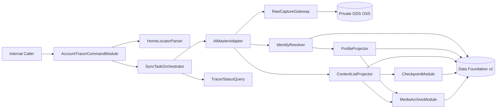
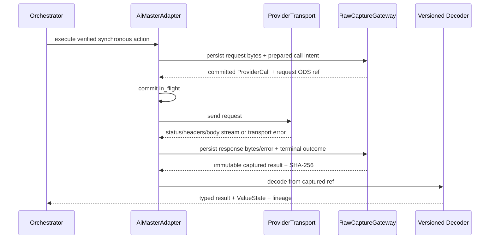
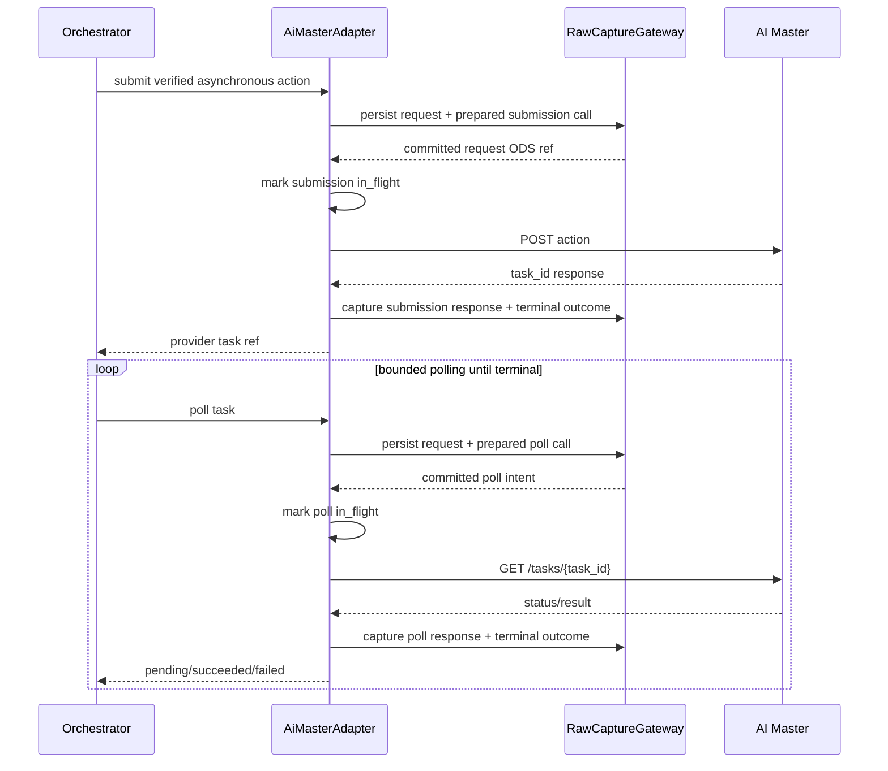

# A Data Foundation Tracer Design

> **状态**：`draft`  
> **模式**：Design-First  
> **需求**：[`requirements.md`](requirements.md)  
> **实施计划**：[`tasks.md`](tasks.md)（仅规划，尚未执行）  
> **验收**：[`acceptance.md`](acceptance.md)  
> **所属域**：A 数据底座 · **目录命名**：`a-data-foundation-tracer`，符合 `<代号>-<切片>`  
> **上游 PRD**：[`prd-domain-a-data-foundation.md`](../../../HBECHO设计方案/prd-domain-a-data-foundation.md) v1.10（2026-11-04，定稿候选）  
> **最近核对**：2026-11-04（按 A v1.10 与 raw4/raw5/raw8 校准；v2 十项修订已落地）  
> **更新日期**：2026-11-04

## 1. Overview

`a-data-foundation-tracer` 的最小纵向结果是：

```text
已授权内部主体 + Platform + MediaStaff + 主页入口
→ 最多 3 次入口解析
→ ExternalAccount + namespaced identifiers
→ account record + current assignment
→ finalized profile snapshot
→ complete returned first page
→ ContentSnapshot + ContentDiscovery
→ type-preserving initial checkpoint
→ asynchronous formal-media progress
→ local status query
```

设计把复杂度收进少量深模块。调用方只提交追踪意图并查询状态，不学习供应商认证、同步/异步模式、ODS 顺序、账号标识命名空间、cursor 类型、租约、媒资下载或 v2 current-pointer 规则。AI Master 是内部 Adapter，不形成独立的大而全平台。

首版只以抖音和小红书已有证据验收。枚举中存在的平台、action 或字段不等于已支持能力。

## 2. Authority and Evidence Levels

### 2.1 Decision order

1. [`CONTEXT.md`](../../../CONTEXT.md)：领域语义和不可违反的不变量；
2. [`prd-domain-a-data-foundation.md`](../../../HBECHO设计方案/prd-domain-a-data-foundation.md) v1.10：A 域产品语义的唯一真相源；它决定做什么、首次录入给什么反馈、明确不做什么；
3. [`database-design-v2.md`](../../../HBECHO设计方案/domains/data-foundation/database-design-v2.md)：数据底座实体、历史事实、任务、ODS、快照、检查点和媒资基线。与第 1、2 项冲突时按前两项修订，不在 design 或局部 SQL 里暗中选择；
4. [AI Master V1.2 文档](<../../../aimaster接口文档/FieldShortcut A Master API 开发文档 V1.2.md>) 与已保存的 [`raw3`](../../../aimaster接口文档/测试结果/raw3/)、[`raw4`](../../../aimaster接口文档/测试结果/raw4-2026-10-28/)、[`raw5`](../../../aimaster接口文档/测试结果/raw5-2026-10-28/)、[`raw8`](../../../aimaster接口文档/测试结果/raw8-2026-10-28/) 证据：供应商声明与实测；二者冲突时必须显式记录，样本行为不能外推为长期合同；
5. 本 Spec：tracer 的需求、Interface、流程和验收边界，不得静默改写前 4 项事实；
6. [`data-supply-mvp.md`](../../../HBECHO设计方案/archive/data-foundation/data-supply-mvp.md)、[`data-supply-and-assets.md`](../../../HBECHO设计方案/archive/data-foundation/data-supply-and-assets.md) 及其他 archive：仅可选择性吸收经验。

历史稿、供应商示例或脚本不能覆盖 `CONTEXT.md`、A 域 PRD 与 v2。供应商声明和实测不一致时必须保留差异，不能靠实现猜测。

### 2.2 Evidence labels

| 等级 | 含义 | 本设计中的例子 |
|---|---|---|
| `invariant` | 当前领域必须遵守 | 外部 ID 按文本；历史归属不回写；临时 URL 不是媒资身份 |
| `baseline` | 当前实施基线 | v2 的 ExternalAccount、账号当前归属、Snapshot、Discovery、ProviderCall、Checkpoint、Media 语义 |
| `observed` | 已在保存证据中看到 | 抖音列表 20 条且有异作者；小红书列表 21 条；两平台 cursor 类型不同；raw4 的 `X-Api-Key` 与 `RESULT_VALIDATION_FAILED` 可重试 |
| `declared` | 供应商文档声称，但仍需能力验证 | Bearer 认证描述、字段及 action 支持范围 |
| `candidate` | 本设计建议，尚可在 requirements/tasks 前调整 | 内部 HTTP 路径、轮询参数和阈值 |
| `unknown` | 没有足够证据 | 生产 QPS、单价、任务 TTL、部分异步 tuple 和媒体 URL 有效期 |

现有 `raw3` 是测试脚本解析后保存的 JSON 包络；`raw4`/`raw5`/`raw8` 是逐次请求与响应的保存样本。它们能证明已观察到的响应形态与 capability 结论，但不能替代本实现层的 raw-before-parse 故障注入验收。异步能力已由 raw4/raw5/raw8 按 tuple 验证，不再使用“所有 probe 都是 async=false”的旧结论。

## 3. Goals and Non-goals

### 3.1 Goals

- 一条命令可幂等、可恢复地生成根任务；
- 入口三次失败不污染业务主档；
- 只接受主页入口；视频、笔记与作品分享文本不建账号、不重试；
- 每次供应商 IO 先保存原始证据，再运行版本化 Adapter；
- 平台 + namespace + 原始文本共同决定账号标识；
- 小红书 profile ID 与列表作者 ID 通过主导作者证据绑定而非字符串猜测；
- 已返回首屏全部处理，本地 limit 只控制是否继续请求；
- 内容按被观察账号保存，不跨账号合并；
- profile/list/content/discovery/assignment/checkpoint 均可追溯到 call、payload 和 Adapter；
- cursor 的值与类型保真；初始锚点按 `time` / `id_window` / `empty` 确定；
- 五态值状态（含 `unsupported`）与 `content_kind` 在投影中保真；
- 少数异作者形成内容事实但不触发账号创建；
- 正式媒资异步归档，结构化成功不依赖所有下载成功；封面取第 2 条候选，原始字节与标准化衍生图分别保留；
- 首次录入结果（正常 / 链接无效 / 疑似空账号）与质量问题可观察，但不自动改账号状态；
- 同步/异步按已验证 capability 选择，所有提交、轮询和重试分别计量；
- 默认验证完全离线，真实 smoke 人工批准且有固定预算；
- 状态查询只读本地事实，不产生隐性供应商成本。

### 3.2 Non-goals

- 不建设通用 AI Master Gateway、供应商管理产品或任意 action 转发；
- 不在本 Spec 交付完整后续分页、周期调度、详情、评论或历史回填；
- 不交付快手、外部监控账号、活动计划、监控判定计划或名单导入；
- 不重建 `MediaStaff`、`ExternalAccount`、组织、归属、内容、任务或媒资平行主档；
- 不创建自然人 `Staff`，不恢复旧 `platform_accounts/staff_accounts/account_dealer_bindings`；
- 不解决规则、指标、看板、导出或完整用户 RBAC；
- 不把 `monitoring_enabled` 解释为用户查看权限；
- 不做账号改绑、停用/删除处置或数据质量问题处置工作台；
- 不复制 v2 的 30 表 DDL 或整份供应商文档；
- 不冻结 Web 框架、ORM、迁移工具、队列、缓存或部署拓扑；
- 不把成功 fixture 外推为所有平台能力；
- 不在本 Spec 修改 v2 表结构；与 v2 的基线冲突只登记在 requirements §1.2，由对应修订关闭。

## 4. Ownership and stable vocabulary

### 4.1 Data-foundation facts reused

本 Feature 使用并遵守 v2 所拥有的事实：

- `MediaStaff`、`ExternalAccount`、namespaced account identifier；
- 账号记录上的当前归属（单一事实，不建独立表、不存时间区间）；
- profile/content immutable snapshot 与 current pointer；
- 按账号保存的 content 事实与 `ContentDiscovery`；
- sync root/task/batch、`ProviderCall`、ODS payload 与 continuity/data-quality issue；
- 五态值状态（含 `unsupported`）与 `content_kind`；
- typed checkpoint 与初始锚点；
- media reference、formal asset、normalized derivative 和下载任务。

本 Feature 只定义这些事实如何在 tracer 纵向链中协作，不创建第二套 owner。§1.2 所列与 v2 的冲突不在本设计里另造平行模型，而是在对应字段上显式标注“待 v2 修订”。

### 4.2 Tracer-owned workflow concepts

| 概念 | 说明 |
|---|---|
| `TracerCommand` | 规范化但保留原始入口的幂等业务意图 |
| `TracerRoot` | 对外稳定的根任务状态和阶段汇总 |
| `LocatorResolution` | 最多三次解析的证据与最终 verified locator |
| `CapabilityProfile` | platform × action × execution mode 的已验证能力，不由枚举自动生成 |
| `StageLease` | Worker 对某一可变阶段的限时占有和 fencing token |
| `TracerStatus` | 从本地事实组装的只读、脱敏进度视图 |
| `EntryOutcome` | 首次录入结果：`normal` / `invalid_link` / `suspected_empty`；不是账号主档状态 |
| `QualitySignal` | 可观察的质量问题（身份冲突、字段异常、疑似空账号、媒资失败），不直接改账号状态 |

`ProviderCall`、快照、账号与当前归属、Checkpoint 和 MediaAsset 仍由数据底座拥有；TracerRoot 不复制其业务字段。

### 4.3 Persistence mapping to v2

Tracer workflow 不新增平行持久化模型，映射如下：

| Tracer concept | v2 persistence |
|---|---|
| `TracerCommand` / `TracerRoot` | 一个 `trigger_type='manual'` 的 SyncBatch + 一个根 `requested_action='resolve_account'` 的 SyncTask；对外 `root_task_id = task_id`；根任务固定 platform、`subject_type='media_staff'`、`subject_id=media_staff_id` |
| canonical command | 原始 locator 在 `subject_key`；effective limit 在两字段 `data-foundation-tracer-task-parameters.v1` persistence projection；完整五字段 aggregate 使用独立 `data-foundation-tracer-command.v1` closed schema，覆盖 platform/staff/locator/effective limit，并严格按 v2 §5.5 的 RFC 8785 JCS bytes 计算 canonical hash；只有 TypeScript 一种实现，用 v2 §5.5 的两个固定向量锁住 |
| caller idempotency | 根 SyncTask 的 `submitted_by_actor`、`caller_idempotency_key_sha256` 与 `canonical_command_sha256`；在一年任务保留窗口内，相同 actor/key 比较 payload hash |
| original HomeLocator | 根任务 `subject_key` + `subject_key_sha256`；不作为账号身份 |
| stage graph | profile/list/media 等子 SyncTask 通过 `parent_task_id` 指向根任务 |
| stage lease/fence/cancel | SyncTask status、lease、fencing token 与终态字段 |
| provider attempts | 每次 prepare/send/poll/page/retry 一个 ODS ProviderCall 及其 request/response/error payload |
| dominant-author decision | 成功绑定长期写入 `external_account_identifiers.binding_policy_version/binding_evidence/binding_evidence_sha256/evidence_batch_id`；拒绝长期写入 `data_quality_issues.detail + batch_id`；两者共用 v2 `dominant-list-author-evidence.v1` |
| root status | 在一年任务保留窗口内，从 batch/root/child tasks 与现有 identity/snapshot/checkpoint/media facts 投影；到期后不从长期业务事实反推旧 operational status |
| entry outcome | 成功路径：归属行 `intake_status='normal'`；`suspected_empty` 写 `intake_status='suspected_empty'` 并写 `data_quality_issues`（`issue_code='suspected_empty_account'`）；失败路径：`invalid_link` 由根任务终态与 `data_quality_issues` 表达，不建账号与归属行。实际监控 = 开关打开且 `intake_status='normal'` |
| quality signals | `data_quality_issues`，`issue_code` 至少覆盖 `suspected_empty_account`、`identity_conflict`、`field_contract_anomaly`、`continuity_gap`、`media_archive_failed` |
| content grain | `contents` 带 `account_id`，唯一键 `(platform_id, account_id, platform_content_id_sha256)`；快照唯一键 `(batch_id, content_id)` 因内容已按账号区分而等价于按 `(batch, account, content)` 唯一（v2 §10.1，2026-11-04） |
| value states | `value/missing/explicit_null/invalid/unsupported`（v2 §5.2） |
| normalized derivative | 独立 `media_assets` 行（独立 SHA-256），由 `media_references` 以 `cover_normalized` / `avatar_normalized` / `background_normalized` 角色指向（v2 §11.3） |
| staff platform slot | 归属行 `platform_id` + `UQ(active_staff_platform, platform_id)`：一专员一平台一账号（D-69）；冲突时根任务阻塞为 `staff_platform_slot_taken` |

`result_summary` 只能保存可重建展示摘要；关键幂等、状态和身份不得藏在无约束 JSON 中。账号 namespace 直接使用代码枚举中的 `douyin.user_id`、`douyin.sec_uid`、`xiaohongshu.profile.user_id`、`xiaohongshu.content.user_id` 等标识（D-25：命名空间是代码枚举，不是独立表）。

内容与发现的持久化 grain 以 CONTEXT 与 A v1.10 §9.2 为准：同一平台作品出现在两个被观察账号时，各账号各一份内容、快照与发现，不跨账号合并；`content_kind` 不输出 `mixed`。

## 5. Deep Module architecture



### 5.1 Module responsibilities and Depth

| Module | Narrow Interface | Hidden implementation depth |
|---|---|---|
| `AccountTracerCommandModule` | `submit(command, actor)` | capability/scope gate、canonical payload、idempotency、审计、root creation |
| `HomeLocatorParser` | `resolve(root, locator)` | 平台策略、最多三次尝试、redirect/share-text 证据、恢复 |
| `SyncTaskOrchestrator` | `start/resume/cancel` | stage graph、租约、fencing、重试、同步/异步恢复、终态汇总 |
| `AiMasterAdapter` | `fetchProfile/fetchFirstPage` | action mapping、capability、认证 seam、提交/轮询、response action、versioned decode |
| `RawCaptureGateway` | `captureRequest/captureResponse/captureTransportFailure` | 私有 OSS、完整 bytes、hash、加密、retention、integrity ordering |
| `IdentityResolver` | `resolveProfile/bindListAuthor/assign` | namespace、原文复核、XHS 主导作者、DY 多标识、冲突、不创建异作者账号 |
| `ProfileProjector` | `project(capturedProfile, identity)` | ValueState、immutable snapshot、current fencing、profile media references |
| `ContentListProjector` | `projectCompletePage(capturedPage, context)` | 全页处理、content identity、snapshot、discovery、returned author、page completeness |
| `CheckpointModule` | `advance(completedPage)` | v2 typed cursor envelope、anchor/continuity/version、原子推进、stale-writer rejection；页/调用细节留在一年期 task/call lineage |
| `MediaArchiveModule` | `ensureArchived(reference)` | 下载任务、fake/real transport、完整 bytes SHA-256、验证、重试、formal asset |
| `TracerStatusQuery` | `get(rootTaskId, actor)` | 本地聚合、scope、redaction、stage/count/media/failure projection |

调用方不能绕过这些 Module 直接解析 payload、写 current pointer、把 URL 当媒资、把角色写进业务条件或自行拼接账号标识。

### 5.2 Internal Interfaces

以下是 TypeScript Interface（ADR-0005）；模块落在 `src/modules/`（ADR-0013）：

```ts
interface AccountTracerCommandModule {
  submit(command: SubmitTracerCommand, actor: ActorContext): Promise<TracerAccepted>;
  cancel(rootTaskId: string, actor: ActorContext): Promise<TracerStatus>;
}

interface SyncTaskOrchestrator {
  start(rootTaskId: string): Promise<void>;
  resume(rootTaskId: string, lease: StageLease): Promise<void>;
}

interface AiMasterAdapter {
  fetchProfile(request: ProfileRequest): Promise<CapturedProviderResult>;
  fetchFirstPage(request: FirstPageRequest): Promise<CapturedProviderResult>;
}

interface TracerStatusQuery {
  get(rootTaskId: string, actor: ActorContext): Promise<TracerStatus>;
}
```

`CapturedProviderResult` 只能引用已可靠落 ODS 的 bytes 和 ProviderCall；未经 capture 的内存 response 不能进入 versioned decoder。这个类型约束是 raw-before-parse 的关键 seam。

## 6. Workflow state and invariants

### 6.1 Root state

候选 root 状态：

```text
accepted
→ resolving_locator
→ fetching_profile
→ resolving_identity
→ assigning
→ fetching_first_page
→ projecting_first_page
→ checkpointed
→ media_archiving
→ succeeded | succeeded_with_warnings

任意非终态 → retry_wait | blocked_assignment_conflict
任意非终态 → failed | cancelled
```

状态名在实现前可调整，但以下语义不可合并：

- structured checkpoint 已完成但 media 仍 pending；
- 可重试技术失败与终态失败；
- assignment conflict 与供应商失败；
- 成功、带 warning 成功和 cancellation；
- root 状态与每个 ProviderCall、page entry、media reference 的细粒度状态；
- entry outcome（`normal` / `invalid_link` / `suspected_empty`）与账号状态（`active` / `unavailable` / `deleted`）是两套语义：tracer 只产生前者，不自动设置后者。

### 6.2 Idempotency, leases and fencing

- command key：`actor + idempotency_key`，并保存版本化 canonical command 与 payload hash；该防重/冲突保证与 root status 共同维持一年，过期后可创建新 root，但业务 effect 仍按长期稳定键幂等；
- locator、profile、list、projector、checkpoint、media 各有稳定 logical-effect key；
- 每次实际供应商尝试都是新 ProviderCall，但其成功业务投影可幂等复用；
- Worker 只持有短租约，提交可变结果时必须带 fencing token；
- 网络期间不持有数据库事务；IO 前保存意图，IO 后在短事务内验证 lease/fence 并提交；
- 迟到 worker 可保留 immutable observation，但不能回退 current pointer 或 checkpoint；
- cancellation 禁止新付费调用，并使旧 fence 失效。

## 7. End-to-end flow

### 7.1 Command to first checkpoint

```mermaid
sequenceDiagram
  participant C as Internal Caller
  participant M as CommandModule
  participant O as Orchestrator
  participant H as HomeLocatorParser
  participant A as AiMasterAdapter
  participant R as RawCaptureGateway
  participant I as IdentityResolver
  participant P as Projectors
  participant K as CheckpointModule
  participant D as Data Foundation v2

  C->>M: submit(platform, mediaStaff, locator, key)
  M->>M: authorize + idempotency
  M->>O: create/start root
  O->>H: resolve locator (≤3 attempts)
  H-->>O: verified locator
  O->>A: fetchProfile
  A->>R: persist request/response bytes
  R-->>A: captured payload ref
  A-->>O: decoded profile + lineage
  O->>I: resolve namespaced identity
  I->>D: create/reuse account + assignment
  O->>P: finalized profile snapshot
  O->>A: fetchFirstPage
  A->>R: persist request/response bytes
  R-->>A: captured payload ref
  A-->>O: decoded complete page + typed cursor
  O->>I: bind dominant author if applicable
  O->>P: process every entry; upsert snapshot + v2-grain discovery
  O->>K: advance after complete projection
  K->>D: initial checkpoint
  O-->>C: status available locally
```

### 7.2 Stage rules

1. **Authorize and deduplicate**：在任何网络/付费行为前校验用途受限 Capability、目标范围、platform/action capability 和 command idempotency；同账号同动作已有活动任务时复用。
2. **Resolve locator**：保留原文并记录入口类型；只接受主页入口。短视频、笔记和作品分享文本直接拒绝，不建账号、不重试。短链跳转由 AI Master 的 `media_user_info` 处理，我方不跟跳转、不解析平台 HTML；发送前只做 PRD §11.2.1 的最小清洗。最多三次；三次失败后只保留运维证据，不创建任何业务身份或快照。
3. **Fetch profile**：每次调用必须先 capture；成功 envelope 不等于业务成功，Adapter 仍需验证 supplier status、response action 和 payload schema。解析成功时，locator 与账号 ID 必须在这一条 captured payload 的同一短事务里成对写入。
4. **Resolve identity and assignment**：先按 namespace 解析/复用账号，再在同一账号记录上写入或复用当前归属；冲突不抢占。
5. **Project profile**：写 immutable snapshot 和媒资引用；fencing 控制 current。抖音产生头像/背景引用；小红书主页响应不返回头像/背景，不产生这两类引用。
6. **Fetch first page**：处理完整返回数组。`initial_content_limit` 只在页边界决定是否继续，本 Spec 的最低验收只要求完整首个返回页。
7. **Bind list identity**：小红书在完整页上计算唯一主导作者；抖音保留同 payload 官方多标识；少数异作者只进内容事实。
8. **Project list**：每个条目都形成/复用按账号粒度的 ContentSnapshot 和 ContentDiscovery，携带 target account、采集当时的归属快照、batch/page、returned author 和 call lineage；推断 `content_kind`；列表播放数记 `unsupported`；封面选择第 2 条候选。
9. **Advance checkpoint**：只有整页 required projection 完成后推进，保留 cursor 原值与类型，并按 `time` / `id_window` / `empty` 建立初始锚点。
10. **Archive media**：structured result 可以先完成；头像、背景和封面按引用异步归档，封面同时生成 JPEG q80、540 宽的独立衍生资产，并在 status 中独立汇总。
11. **Record entry outcome**：首次录入结果为 `normal`、`invalid_link` 或 `suspected_empty`；疑似空账号写质量问题，不自动纳入监控，也不改账号状态。

### 7.3 Assignment conflict

若账号当前已归属其他 `MediaStaff`：

- 不关闭、不覆盖、不创建重叠归属；
- root 进入 `blocked_assignment_conflict` 或等价可处理状态；
- 已发生的 ProviderCall、ODS 和 identifier observation 保留；
- status 不把提交者显示为 owner；
- 是否允许在不变更归属的前提下继续刷新已存在账号，是实施前需确认的 P0 策略；默认安全行为是停止后续付费阶段。

## 8. AI Master Adapter

### 8.1 Intentionally narrow surface

本 Spec 只使用：

- `POST /openapi/v1/media_user_info`；
- `POST /openapi/v1/user_video_list`；
- `GET /openapi/v1/tasks/{task_id}`，仅用于已验证异步模式。

不建设任意 action passthrough。`media_stats_number`、评论等保存证据不属于本纵向切片。

### 8.2 Capability profile

```ts
type CapabilityProfile = {
  platform: 'douyin' | 'xiaohongshu';
  action: 'media_user_info' | 'user_video_list';
  mode: 'synchronous' | 'asynchronous';
  requestSchemaVersion: string;
  responseSchemaVersion: string;
  evidenceLevel: 'unknown' | 'supplier_declared' | 'fixture_observed' | 'smoke_verified';
  environment: 'test' | 'staging' | 'production';
  activation: 'disabled' | 'approved';
  evidenceRef: string;
  verifiedAt?: string;
};
```

生产策略不写死 `async=false` 或 `async=true`。证据按 A v1.10 §6.3 与已保存 raw 结果分层：

| platform × action × mode | 证据 | tracer 策略 |
|---|---|---|
| 抖音 / 小红书 × `media_user_info` × synchronous | `smoke_verified`（raw4） | 可进入 production approval 评审 |
| 抖音 / 小红书 × `user_video_list` × synchronous | `smoke_verified`（raw4） | 可进入 production approval 评审 |
| 抖音 / 小红书 × `media_user_info` × asynchronous | `smoke_verified`（raw4 / raw5） | 可进入 production approval 评审 |
| 抖音 / 小红书 × `user_video_list` × asynchronous | provider-failed（raw4 / raw5 / raw8） | 保持 `disabled` |
| 其他 tuple | `unknown` / `supplier_declared` | 拒绝 |

`fixture_observed` 只证明离线样本形态；`smoke_verified` 只证明被实际 exercise 的 tuple；两者都不能自动激活 production。生产调用同时要求 `smoke_verified + environment='production' + activation='approved'`。

### 8.3 Synchronous sequence



`prepared` 可安全恢复而不发送重复调用；若取消、预算或本地策略在发送前封口，持久化为 `terminal/not_sent`。进入 `in_flight` 后，有证据确认未送达的 transport failure 进入 `terminal/transport_error`；进程失联、timeout/reset 等导致远端结果不明时进入 `ambiguous`，并永久保持。本 spec 的三个 action 都是**只读查询**，重发不产生供应商侧副作用，业务事实按幂等键去重，所以 ambiguous 后允许在有界重试内发起**一次**新的 ProviderCall（计入预算），不实现对账（requirements 2.7，2026-11-04）。有副作用的供应商调用不适用这条例外，仍按 v2 §9.5 的对账规则。

### 8.4 Asynchronous sequence



提交、每次轮询、重试和后续分页分别创建 ProviderCall。轮询 deadline、间隔、jitter、供应商 task TTL 和计费均未冻结。

异步只用于已通过 smoke 的 action × mode。当前 tracer 只允许 `media_user_info` 异步；`user_video_list` 异步在三平台均失败，保持 `disabled`，因此首屏列表默认走同步路径。

### 8.5 Authentication seam

供应商文档描述 Bearer，而 raw4 的所有成功调用只使用 `X-Api-Key`；两者冲突以实测为准，但仍须由一次批准式 smoke 在生产配置上复核。认证方式必须由 secret-backed Adapter 配置；设计不把任一方式写死。日志、ODS metadata、审计和 status 都不能保存认证 header 或 secret。

## 9. RawCaptureGateway and versioned decoding

### 9.1 Capture unit

每个 ProviderCall 至少关联：

- requested action、expected response action、完整响应实际 response action、platform、mode、attempt；expected 与 actual 分列，实际不一致仍保留两值；
- exact request body bytes 与 exact received response body bytes；
- HTTP/transport outcome、content type、received length、SHA-256；
- request prepared/captured、send started、response received、terminal captured 时间与 `prepared/in_flight/terminal/ambiguous` 状态；
- private object references、retention deadline、correlation/root/task IDs；
- decoder/Adapter version（解析后补充）。

Header 仅保存安全 allowlist；认证、Cookie 和 secret 永不进入长期对象。若 transport 在 body 完整前失败，保存已有证据和结构化错误，但绝不把截断 body 当成功响应解析。

### 9.2 Ordering invariant

```text
canonical request bytes
→ request ODS durable write + prepared ProviderCall committed
→ ProviderCall marked in_flight
→ network send/result
→ response/error ODS durable write + terminal metadata committed
→ immutable CapturedProviderResult
→ versioned decoder reads captured ref
→ structured projection
```

任何实现都必须能用故障注入证明：request intent 未提交时网络发送次数为 0；终态 ODS 写失败时 decoder 调用次数为 0；`in_flight` 崩溃后进入 ambiguous 而不是盲目重发。解析异常保留原 bytes，并可由新 Adapter version 重放；重放产生新解释 lineage，不覆盖历史解释。

### 9.3 Retention

ProviderCall、task 与 raw payload 保留一年；正式 profile/content snapshot、账号与当前归属、Discovery、Checkpoint 和 MediaAsset 长期保留。长期业务解释不能只依赖一年后会删除的 raw body。

## 10. Identity and assignment semantics

### 10.1 Identifier key

```text
(platform_id, namespace, exact_identifier_text)
```

可用 SHA-256 加速检索，但 hash 命中后必须比较原文。外部 ID 不做数字运算、去前导零或 JavaScript number 转换。首版使用代码枚举（D-25）中的 `douyin.user_id`、`douyin.sec_uid`、`xiaohongshu.profile.user_id` 和 `xiaohongshu.content.user_id`；新增 namespace 必须先改枚举并评审，不能由 Adapter 临时造名。

### 10.2 Approved binding evidence

- `same_payload`：供应商同一账号实体明确同时返回多个官方标识；
- `dominant_list_author`：小红书完整列表页出现次数唯一最高、且通过版本化 dominant-author policy 的作者 ID；
- `provider_mapping`：未来经验证的供应商映射；
- `manual`：经审计人工裁决。

相同昵称、头像、主页文案、手机号或字符串相似度均不是自动绑定依据。

### 10.3 Xiaohongshu

已观察：profile `user_id="49328995493"`，同主页 21 条列表的主导作者为 `5decba2300000000010007e1`。二者放在不同 namespace，并通过同一 root/page 的 `dominant_list_author` 证据绑定到一个 ExternalAccount。

小红书主页响应不返回头像与背景，因此本平台不产生 `avatar/background` media reference；封面仍按第 2 条候选归档。

算法边界：

1. 先完整解码和验证整个返回页；
2. 对非空 author ID 按 exact text 计数，并保留总 entry 数、非空分母和 exact counts；
3. 只有唯一最高且通过当前 versioned dominant-author policy 的候选才能绑定；
4. tie、空集合、低占比或其他 policy rejection 不猜测；
5. accepted 与 rejected 决策都生成 v2 `dominant-list-author-evidence.v1`，保存 policy version、candidate、exact counts、总 entries、非空 denominator、decision 和 reason，并引用长期 SyncBatch；
6. accepted evidence 按 v2 §5.5 的 RFC 8785 JCS bytes 计算 SHA-256，并与证据长期写入同一个 `external_account_identifiers` 标识行，首次绑定后不可被 replay 覆盖；rejected evidence 长期写入 `data_quality_issues.detail + batch_id`，不创建 identifier；
7. 一年期 task/call/raw 到期后，成功绑定和拒绝决定仍必须分别通过上述长期载体独立解释，不能依赖已删除 ODS；
8. minority author 只保留在对应内容 snapshot/discovery，不创建账号。

首版策略 `dominant-list-author.v1`：唯一最高，且占非空作者条目 ≥ 80%（2026-11-04）；阈值是配置，改阈值必须升策略版本。首个 fixture 的 21 条均为同一作者，是无争议正例；还必须用唯一但低于 80%、tie、空作者和异常分布负例锁定 policy。fake clock 必须覆盖一年期 operational lineage 清理后的成功证据可解释性。

### 10.4 Douyin foreign author

已观察 target account `HITACHI1` 的 20 条主页列表包含作者 `HITACHI2023`。该条仍属于“从 target 主页列表发现”的 ContentDiscovery；returned author 作为独立事实保存。它默认解释为合法共创/异作者内容，不自动创建 `HITACHI2023` ExternalAccount，也不单凭差异生成质量问题。

### 10.5 Current assignment

归属是账号上的**当前单一事实**：v2 的 `staff_account_assignments` 每个账号只有一行（`UQ(account_id)`），不存时间区间（D-16、D-28、ADR-0009）。同一专员在同一平台已占用名额时（D-69），不创建归属，根任务阻塞为 `staff_platform_slot_taken`。没有冲突时，Tracer 在创建或复用账号的同一次短事务里写入 submitted `MediaStaff` 作为当前归属，并记录归属来源与时间；已有其他 owner 时 fail closed，不抢占，也不关闭或改写原归属。账号转移必须走独立、受审计的管理员改绑流程，不由采集结果隐式触发。内容与发现需要保留采集当时的归属时，记录**采集时的归属快照值**（D-67），不引用归属行。

首次录入的 locator 写入当前入口，previous 入口为空。`current_home_locator` 与解析出的账号标识必须在同一短事务中成对写入，且两者都来自同一条已 capture 的 terminal `media_user_info` payload；不得用一次调用的 locator 配另一次调用的账号 ID。

## 11. Snapshot, complete-page and checkpoint semantics

### 11.1 Profile projection

- snapshot 绑定 account、ProviderCall、ODS hash、Adapter version 和 observation time；
- 每个账号每个批次最多一份主页快照，创建成功即不可变终态；
- `0`、missing、explicit null、invalid、unsupported 分开；
- profile media 只形成 MediaReference；
- current pointer 只在候选 finalized、时间/批次排序允许且 fence 有效时前进；
- 旧 observation 可保留历史，但不得覆盖 newer current。

### 11.2 Complete returned page

`initial_content_limit` 表示“达到多少已完整处理条目后可以不再请求下一页”，不是数组切片参数。停止判断只能发生在页边界：

```text
receive page N
→ capture raw
→ decode all returned entries
→ project all entries + discoveries
→ commit page completeness
→ advance checkpoint
→ compare accumulated complete count with local limit
→ decide whether to request page N+1
```

因此小红书第一页返回 21 条时，即使 limit 为 20 或更小，也处理 21 条。列表返回 0 条只有在供应商业务成功且 schema 合法时才是真实空页；技术失败不能伪装为空数组。

### 11.3 Content grain

内容事实按**被观察账号**保存，不跨账号合并（CONTEXT §Content、A v1.10 §9.2、D-23）：

- 内容身份仍由 platform + external content identifier 判定，但快照与发现的业务 grain 是 `(batch, account, content)`；
- 同一作品出现在两个被监控账号列表时，各账号各有一份最终快照与一条 discovery；重复计数是已知且可接受的代价；
- Snapshot 是一次版本化观察；Discovery 保存“哪个 target account、采集当时的归属快照、哪个 batch 看到该 content”；
- 同一 batch + account 的列表若重复返回同一 content ID，每个 entry 都必须经过验证和计数，但只形成一个发现；重复位置/count 留在一年期 page/ProviderCall evidence，并生成可观察质量摘要；
- 同批次后到的有效值（含真实 `0`）覆盖先前值；后到的 `missing`、`explicit_null`、`invalid`、`unsupported` 不擦除先前有效值；
- `content_kind` 由 A 推断：有视频 → `video`；无视频有图片 → `image`；只有文本 → `text`；缺失或矛盾 → `unknown`。`mixed` 不输出；
- 列表接口的播放数按 `unsupported` 记录；抖音返回的 0 与小红书的缺字段都不是有效观测；
- 封面候选保留全部，归档引用固定选第 2 条（540 宽）；第 1 条可能是视频首帧，第 3 条尺寸不稳定；
- returned author 与 target account 分列；
- 少数异作者、共创或跨发不会改变 target list discovery，也不创建账号。

v2 已于 2026-11-04 把 `contents` 改为按账号的内容根，与此一致。

### 11.4 Typed checkpoint

长期 Checkpoint 直接使用 v2：固定 account/provider/action/scope、类型保真的 `cursor_envelope` 与 hash、anchor/high-watermark、长期 batch 引用、continuity state、单调 `version` 和 `updated_at`。抖音 fixture 的 `max_cursor` 是 integer，小红书是 string；持久化与后续请求都不得互转。

初始锚点按 v2 §9.4 确定性建立：

```text
本轮存在有效 published_at
  → anchor_mode='time'
  → high_watermark_published_at = 全部返回内容的最大发布时间
  → high_watermark_content_ids = 同一时刻的内容 ID 集合

无有效发布时间、但有内容 ID
  → anchor_mode='id_window'
  → high_watermark_content_ids = 第一页全部内容 ID

首屏真实返回 0 条且 has_more=false
  → anchor_mode='empty'
  → 时间与 ID 集合都为空，任务成功
```

首次采集没有旧锚点，`initial_content_limit<=20` 只是整页处理后的续页目标。首屏完整处理且累计条目达到目标时停止并建立基线；供应商仍有更多历史页不构成本 spec 的连续性缺口。本 spec **不请求第二页**（2026-11-04）：首屏不足目标且 `has_more=true` 时也只按首屏建立基线，后续翻页属于 `a-full-sync`。`has_more=true` 但游标为空或 null 时记质量问题并停止（与 D-53 一致）。

`has_more`、page/processed count、source task/ProviderCall 和 Adapter version 保存在一年期 SyncTask/ProviderCall lineage，并可用于当前 status 与保留期内重放；它们不复制进第二套 checkpoint，也不要求 ODS 到期后继续存在。Checkpoint 只在整页 required projection 完成后原子推进。任一 entry 失败、lease 失效或 root cancelled 时不推进；旧 worker 的 cursor 可以保留在调用证据，但 stale fence 不能覆盖更高 checkpoint version。

## 12. MediaArchiveModule

### 12.1 Reference before asset

profile avatar、background 与 content cover 先成为绑定 snapshot 的 MediaReference，包含原始候选 URL、role/slot、观察时间和 source lineage。URL 可过期且可变化，不是 asset identity。

平台差异：

- 抖音主页头像与背景：生成 `avatar/background` 引用；
- 小红书主页响应不返回头像与背景：不生成这两类引用，不得用空值或占位图补造；
- 封面：全平台从列表条目的候选数组选第 2 条（540 宽）作为 `cover` 引用，其余候选作为观察证据保留。

### 12.2 Archive flow

```text
MediaReference
→ idempotent archive demand
→ bounded download outside DB transaction
→ private temporary object
→ complete-byte SHA-256 + size/type verification
→ formal MediaAsset dedupe（原始字节）
→ normalized derivative: JPEG q80, 540 wide, own SHA-256 → separate MediaAsset
   （抖音 HEVC HEIC 经 Python 能力服务 ffmpeg 解码，ADR-0012；WebP/JPEG 用 sharp）
→ verified reference binding（原始 + 衍生分别可追溯）
```

原始字节与标准化衍生图互不替代，都长期保留。衍生图有自己的 SHA-256 与资产行，不以“同一 URL 的转换结果”当作原始资产的别名。

结构化 snapshot/checkpoint 不等待全部媒资成功。状态至少区分 pending/running/archived/carried_forward/retryable_failed/terminal_failed/expired_source/cancelled。下载失败时，若上一快照有已验证资产，可以续用并标记 `carried_forward`，同时保留本轮失败错误；不得把“用旧图”表示成“本轮归档成功”。失败不回滚 structured facts。

### 12.3 Safety

- 默认使用 fake media transport 和 fake OSS；
- 对 URL 执行 scheme、host、redirect、size、content type、timeout 和 SSRF 防护；
- 正式对象私有，短期签名 URL 按授权临时生成；
- 日志不写完整临时 URL；
- 完整 bytes SHA-256 相同才判同，不按 URL、文件名或缩略图参数判同；
- 供应商 URL 有效期未确认（可能 7–15 天）；重试必须重新获取有效地址，不能复用已过期地址；
- 单文件与单批次字节上限可配置，只防异常，不限制正常内容；
- tracer 不调用任何 OCR、ASR 或视觉识别能力；标准化衍生图只是格式转换，不是内容识别。平台 1.0 的音频 ASR 由 C 域承担，不属于本 spec。

## 13. Failure, retry and status semantics

### 13.1 Failure taxonomy

| Category | Retry default | Business effect |
|---|---|---|
| invalid input / unauthorized / unsupported capability | no | 网络调用前终止，不创建业务事实 |
| non-homepage locator（视频/笔记/分享文本） | no | 标 `invalid_link`，不建账号、不建归属、不重试 |
| locator unresolved after 3 | no | 保留尝试证据，不创建账号/快照，标 `invalid_link` |
| provider auth / invalid request（HTTP 400 `INVALID_REQUEST`） | no until configuration fixed | 不解释为空数据，告警且审计 |
| provider input / inaccessible（HTTP 500 `RESULT_VALIDATION_FAILED`） | bounded retry first | 重试耗尽后首次录入标 `invalid_link`；已存在账号不改状态 |
| provider intermittent `RESULT_VALIDATION_FAILED` | bounded retry（raw4 结论） | 新 ProviderCall；不重复已完成业务投影 |
| quota/rate limit | bounded delayed retry | 新 ProviderCall，不重复已完成业务投影 |
| transport/timeout with known non-delivery | bounded retry | 先保存错误证据；无 checkpoint 前进 |
| sent call with unknown remote outcome | no blind retry | 标 `ambiguous`；仅凭供应商幂等或 reconcile 证据恢复 |
| ODS persistence/integrity | bounded internal retry | decoder 不执行 |
| schema/parse drift | no automatic blind retry | 保留 raw，标 Adapter drift，可版本化重放 |
| identity ambiguity | manual/config resolution | 不猜绑定，不创建可疑账号 |
| assignment conflict | authorized business resolution | 不抢占 owner；默认停止后续付费阶段 |
| projection/storage | bounded idempotent retry | raw 和已完成 immutable facts 保留 |
| media failure | independent bounded retry | structured result 可成功并带 warning；可 carried forward |
| stale fence / cancellation | no | 拒绝迟到写和新付费调用 |

重试次数、backoff、deadline 是配置，不是表默认。技术失败不能转成“账号不存在”“列表为空”或 `0`，也不能改写账号状态。HTTP 500 `RESULT_VALIDATION_FAILED` 既可能表示无效/私密/已删除主页，也可能是供应商间歇失败；不能在首次响应时只凭状态码或错误码断言业务含义。HTTP 400 `INVALID_REQUEST` 与认证配置错误也不能只按状态码互相替代。

### 13.2 Local status projection

`TracerStatusQuery` 只读取本地事实，候选结构：

```ts
type TracerStatus = {
  rootTaskId: string;
  state: string;
  stages: Array<{ name: string; state: string; attempts: number }>;
  target?: { accountId?: string; ownerMediaStaffId?: string };
  structured: {
    profileFinalized: boolean;
    returnedEntries: number;
    projectedEntries: number;
    discoveries: number;
    checkpointEstablished: boolean;
    cursorType?: 'string' | 'integer' | 'null';
  };
  media: { total: number; pending: number; archived: number; failed: number; carriedForward: number };
  entryOutcome?: 'normal' | 'invalid_link' | 'suspected_empty';
  warnings: Array<{ code: string; stage: string }>;
  qualityIssues: Array<{ code: string; status: string }>;
  failure?: { category: string; code: string; retryable: boolean };
  timestamps: { acceptedAt: string; updatedAt: string; completedAt?: string };
};
```

字段名是候选；语义必须覆盖 structured/media 分离、entry outcome、冲突、retry wait 和 stable reason。status 不返回 raw body、secret、完整 ODS key、临时 URL 或越权业务 ID。

## 14. Internal entry point（CLI）

B 域尚未实现，本 spec 的调用方只有用途受限的服务身份，因此**不提供 HTTP 接口**（2026-11-04）。入口是 Worker 镜像里的 CLI：

```text
pnpm tracer submit --platform douyin --staff 9007199254740993 \
                   --locator "https://…" --key <idempotency-key> [--limit 20]
pnpm tracer status <root_task_id>
pnpm tracer cancel <root_task_id>
```

- CLI 只调用 `AccountTracerCommandModule` / `TracerStatusQuery`，不直接写库；
- 输出为 JSON，内部 BIGINT 输出十进制字符串；
- 退出码区分：0 已接受或查询成功、2 校验或授权拒绝、3 幂等冲突、4 不存在或已过期；
- 真实用户接入时（`b-access-control` 之后）再加 HTTP 接口，Module 语义不变。

## 15. Security, cost and observability

### 15.1 Security and privacy

- ODS 与 formal media 均私有、加密、最小权限；
- AI Master secret 只从 secret provider 注入，不进入 request body fixture、日志、trace、status 或审计；
- 原始载荷读取需要独立高敏权限与审计；
- Caller 对 submitted MediaStaff/ExternalAccount 的 scope 在提交和状态查询时检查；
- network egress 仅允许已批准供应商和媒资目标，并实施 SSRF/redirect 防护；
- User↔MediaStaff 未冻结前，不通过手机号/姓名猜“本人”。

### 15.2 Cost guard

- 每个 submission/poll/page/retry 都单独计数；
- platform/action/mode、最大调用数、最大 polling、最大 pages、media bytes 和 deadline 有硬上限；
- 成本估算使用 A v1.10 §6.2 的 1.0 点数：抖音主页 10/次、列表 10/页；小红书主页 15/次、列表 15/页；失败、超时、429 与异步轮询不计点；
- 单价 0.02 元/点（2026-11-04 确认）；QPS 未知，并发由我方配置；预算按点数、调用数与金额三者控制；
- 默认 fixture 路径网络禁用；
- paid smoke 需要人工批准、显式 switch、allowlist 和固定预算；
- 超预算先停止再记状态，不能先调用后告警；
- status query 永远不触发 provider call。

### 15.3 Observability

至少观测：

- commands accepted/deduplicated/conflicted/denied；
- locator attempts 与三次失败；
- ProviderCall 按 platform/action/mode/attempt/outcome 的计数、延迟、bytes、成本估计；
- raw capture latency/failure、decoder version/schema drift；
- identity created/reused/ambiguous、dominant-author distribution、assignment conflict；
- profile/list projection counts、returned vs projected mismatch；
- checkpoint cursor type、stale fence rejection、resume；
- media pending/archived/failed/bytes/dedupe；
- root age、stage age、retry wait、terminal category。

关联键使用 rootTaskId、task/batch、ProviderCall、ODS ref、account、assignment、snapshot、discovery、checkpoint 和 media reference/asset。日志不输出 secret、raw body 或临时 URL；手机号按明文记录（B 域 PRD v1.21）。

## 16. Verification strategy

### 16.1 Default offline harness

默认测试环境由以下可替换 seam 组成：

- fixture `ProviderTransport`，网络 socket 被禁止；
- fake `RawCaptureGateway`/OSS，可断言 bytes、hash 和调用顺序；
- fake clock、lease store 和 fencing；
- v2 repository Adapter 的事务内存实现；
- fake media transport/OSS；
- deterministic capability profile。

任何真实 HTTP 或媒体下载尝试都使默认验证失败。fixture 不包含真实 secret。

### 16.2 Fixture contract matrix

| Case | Expected invariant |
|---|---|
| Douyin Hitachi profile/list | target `HITACHI1`；20/20 entries processed；integer `max_cursor`；`content_kind` 按条目推断；列表播放数 `unsupported` |
| Douyin foreign author | `HITACHI2023` 保留在 content fact；不创建第二账号；不单凭差异报质量问题 |
| Xiaohongshu Hitachi profile/list | profile `49328995493` + dominant author `5decba2300000000010007e1` 不同 namespace、同一账号 |
| Xiaohongshu complete page | 21/21 entries processed，即使 local limit ≤ 20；string `max_cursor`；无 avatar/background 引用；封面选第 2 条 |
| Locator fail ×3 | no ExternalAccount/identifier/assignment/snapshot/discovery/checkpoint；entry outcome `invalid_link` |
| Non-homepage locator | no account/assignment；不重试；entry outcome `invalid_link` |
| ODS write failure | decoder/projector invocation count = 0 |
| Duplicate command | same root，no duplicate call/effect |
| Active same-account/action task | 复用原任务，不并发 |
| Assignment conflict | old owner unchanged，submitted staff not represented as owner |
| Dominant-author tie | no binding，data-quality issue |
| Suspected empty account | follower=0 且 post=0 → `suspected_empty` + issue；不自动纳入监控；账号 status 不变 |
| Stale worker | immutable history may remain，current/checkpoint unchanged |
| Media failure | structured checkpoint retained，media warning visible；旧资产续用标 `carried_forward` |
| Normalized derivative | 衍生图有独立 SHA-256；原始与衍生都存在；不互相替代 |
| Status query | no ProviderTransport invocation |

具体 fixture：

- [Douyin profile](../../../aimaster接口文档/测试结果/raw3/V1.2_raw3_抖音主页_MPOAlEqWpec_media_user_info.json)
- [Douyin first page](../../../aimaster接口文档/测试结果/raw3/V1.2_raw3_抖音主页_MPOAlEqWpec_user_video_list.json)
- [Xiaohongshu profile](../../../aimaster接口文档/测试结果/raw3/V1.2_raw3_小红书主页_日立中央空调_media_user_info.json)
- [Xiaohongshu first page](../../../aimaster接口文档/测试结果/raw3/V1.2_raw3_小红书主页_日立中央空调_user_video_list.json)

这些文件用于 Adapter fixture。实现 raw-before-parse 验收时还需在测试 harness 中把 fixture 文件作为 exact response bytes 经过 capture seam，而不能直接把已解析对象喂给 Projector。

### 16.3 Paid smoke

smoke 独立于 CI，必须先显示并确认 capability、locator allowlist、call/page/poll 上限、预算、deadline 和证据保留。成功只把实际 exercise 的 tuple 标记为 observed，不批量启用其他平台或模式。

## 17. Acceptance boundaries

实现进入可验收状态必须同时满足：

1. [`requirements.md`](requirements.md) 的每个 SHALL 有自动化离线检查或明确的批准式 smoke 检查；
2. 入口三次失败可证明没有业务主档副作用，且入口结果可观察为 `invalid_link`；
3. 每次 supplier submit/poll/retry 可证明先 capture 后 decode；
4. 抖音与小红书 fixture 的账号、条目数、foreign/dominant author、`content_kind`、列表播放数 `unsupported` 和 cursor 类型全部匹配；
5. `initial_content_limit` 不截断 21 条已返回页；
6. Assignment conflict 不发生所有权抢占；
7. checkpoint 只在完整页后推进，初始锚点为 `time` / `id_window` / `empty` 之一，stale fence 无法回退；
8. structured success 与 media progress 可独立观察；封面衍生图有独立资产与 SHA-256；
9. default suite 无网络、无 secret、无付费；
10. status query 不触发供应商调用；
11. 没有创建 v2 之外的平行 Staff、账号、归属、内容或媒资主档；
12. 实现以 v2 修订稿为准；第 7 项范围区别（requirements §1.2）没有被静默改变；
13. 首次录入结果与质量问题可观察，且没有因技术失败改写账号状态；
14. 内容按账号保存，没有跨账号合并；`mixed` 没有被输出。

## 18. Open decisions

### P0 before implementation（2026-11-04 已按默认值关闭）

| # | 事项 | 决定 |
|---|---|---|
| 1 | 生产认证 | `X-Api-Key`；生产开关由任务 9 的批准式 smoke 复核 |
| 2 | 异步 profile 的 terminal schema、TTL、轮询参数 | 由任务 9 的 smoke 实测后定；未实测前异步保持 disabled，首版走同步 |
| 3 | 单价与 QPS | 单价 0.02 元/点；QPS 未知，并发由我方配置 |
| 4、5 | 入口清洗与解析策略 | 单一策略：最小清洗（截掉路径之后的分享文案）后直接调 `media_user_info`；其返回即主页投影来源；成功路径调用数 = 主页 1 + 列表 1 |
| 6 | 调用入口 | CLI（§14），不做 HTTP |
| 7 | 是否请求第二页 | 不请求 |
| 8 | 小红书主导作者 | 唯一最高且 ≥ 80%，策略版本 `dominant-list-author.v1` |
| 9 | 归属冲突后 | 停止后续付费阶段；人工改绑不在本 spec |
| 10 | 空 / null 游标 | `has_more=false` 正常结束；`has_more=true` 时记质量问题并停止 |
| 11 | 媒资 | 单张图片 20 MB；下载域名白名单取 fixture 中出现的 CDN 域名；URL 过期时重新取主页 / 列表拿新地址 |
| 12 | 用户范围 | 只给服务身份；真实用户在 `b-access-control` 之后接入 |
| 13 | 原始载荷读取 | 沿用 B 域 `data.raw_payload.read`（仅超管）与审计 |
| 14、16 | v2 修订与衍生图资产关系 | 已在 v2 完成：独立 asset + `*_normalized` 角色 |
| 15 | 疑似空账号确认入口 | 归 `a-activity-plan`；tracer 只写 `intake_status` |
| 17 | ambiguous | 只读查询允许有界重发一次，不做对账（§8.3） |

### Can remain configurable

- locator、provider、poll、projection 和 media 各阶段重试次数/backoff；
- lease TTL、heartbeat 和 root overall deadline；
- structured success with media warning 的 UI 文案；
- raw ODS 与 formal media 的对象 key layout；
- metrics/alert thresholds；
- paid smoke 的每次预算和 allowlist。

这些未决项不阻塞 Design-First 文档完成，但不得由实现默认值悄悄变成产品合同。

---

## 附录：已知过时内容（2026-11-04 核对）

> 本节只记录偏差，不修改正文。偏差的根多数在 [`database-design-v2.md`](../../../HBECHO设计方案/domains/data-foundation/database-design-v2.md)：v2 已于 2026-11-04 完成十项修订；本节保留历史偏差，实现以 v2 正文为准。requirements §1.2 的注是权威清单。

| # | 位置 | 原写法 | 现处理 | 来源 |
|---|---|---|---|---|
| 1 | requirements R7、design §10.5 与身份链、tasks 任务 4 | 把 `AccountAssignment` 当独立实体，归属带 `traceable start` 的区间语义 | 已改为「归属是账号记录上的当前单一事实」，不建独立表、不存时间区间；发现保留采集时的归属快照值 | D-16、D-28、D-67 |
| 2 | design §10.1 与 §6 | 写「使用 v2 注册的 namespace 代码」 | 已改为代码枚举（命名空间不是表）；新增 namespace 须改 CONTEXT 与枚举 | D-25 |
| 3 | v2 §6.3 / §8.3 | `identifier_namespaces`、`staff_account_assignments` 两张表仍在 v2 | v2 已修订（2026-11-04）：§6.3 改代码枚举，§8.3 去掉区间并加 `platform_id`；实现以 v2 为准 | D-25、D-28 |
| 4 | design 日志字段 | 原写「日志不输出……完整手机号」 | 已按 2026-10-30 决定改为手机号明文可记录；secret、raw body、临时 URL 仍不写 | D-42、B 域 PRD v1.21 |
| 5 | v2 §10.2 | 内容快照按 `(batch, content)` 共享，跨账号不合并；发现虽按 assignment 区分，但快照本身不区分账号 | v2 已修订（2026-11-04）：`contents` 增加 `account_id`，唯一键含 `account_id`；快照/发现挂在按账号内容上，§10.2 快照键不变；实现以 v2 为准 | CONTEXT §Content、D-23 |
| 6 | v2 §5.2 | 值状态只有 `value/missing/explicit_null/invalid` | v2 已修订（2026-11-04）：§5.2 增加 `unsupported`；实现以 v2 为准 | A v1.10 §9.2 |
| 7 | v2 §10.1 | `content_kind` 包含 `mixed` | v2 已修订（2026-11-04）：§10.1 去掉 `mixed`；tracer 仍按四类输出 | A v1.10 §9.2 |
| 8 | v2 §8.3 | 没有录入状态字段；质量问题只表达异常 | v2 已修订（2026-11-04）：归属行 `intake_status`（`normal` / `suspected_empty`），tracer 直接写入；`invalid_link` 只在根任务结果 | A v1.10 §11.6 |
| 9 | v2 §11.3 | `media_references.role` 只有 avatar/background/cover/gallery_image/video/audio | v2 已修订（2026-11-04）：§11.3 增加 `cover_normalized/avatar_normalized/background_normalized`；衍生图独立 SHA-256 | A v1.10 §10.2 |
| 10 | design §8.2 旧文 | 「raw3 只能标 fixture，异步未实测」 | 已按 raw4/raw5/raw8 更新：同步主页/列表与异步主页 `smoke_verified`；列表异步 provider-failed 保持 disabled | raw4、raw5、raw8 |
| 11 | design §8.5 旧文 | 「文档 Bearer 与示例 `X-Api-Key` 冲突，方式未定」 | raw4 全部成功调用使用 `X-Api-Key`；文档 Bearer 记为矛盾；生产启用仍需批准式 smoke | raw4 |

**核对为一致的部分**（不需改动）：首版验收平台为抖音与小红书（快手在 `a-full-sync`，D-47）；不写死 `async=false/true`，按 tuple 门控；20 / 21 条是实测证据而非业务上限（D-12）；ODS 一年、快照与媒资长期保留（D-10）；封面取第 2 条候选（A v1.10 §9.2）；链接与账号 ID 成对写入（A v1.10 §11.2.1）。