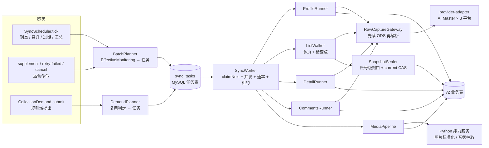
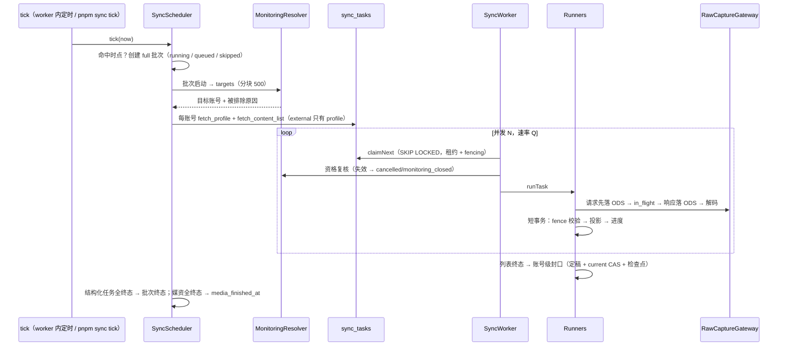
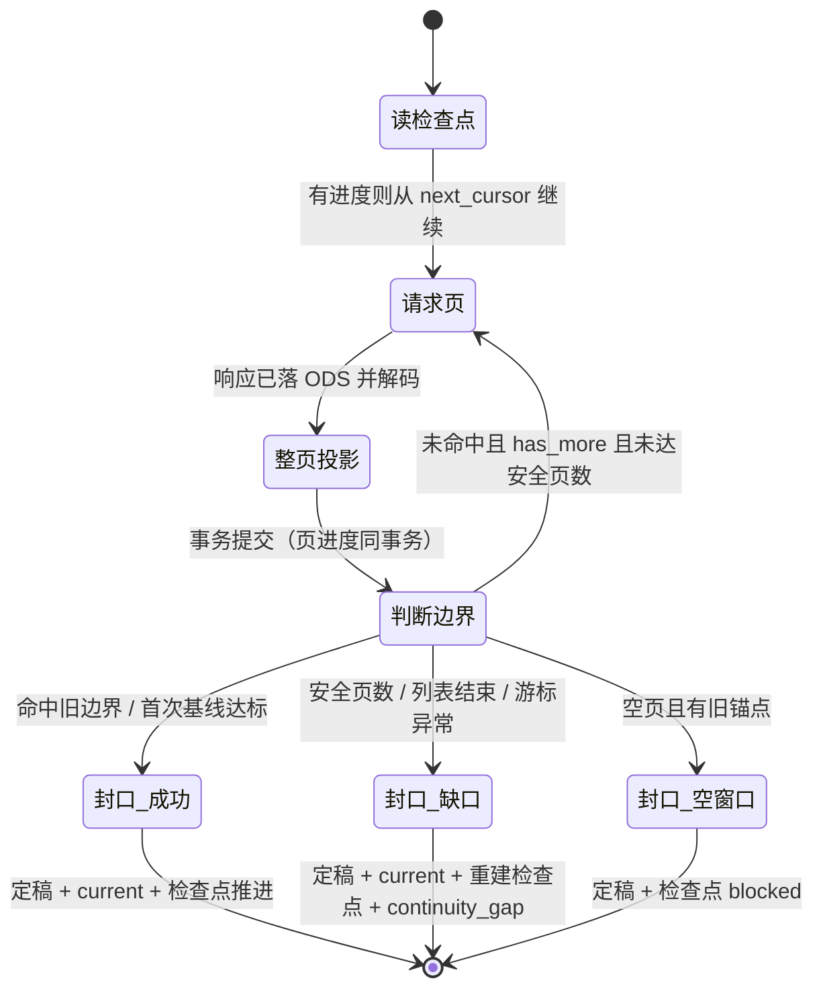
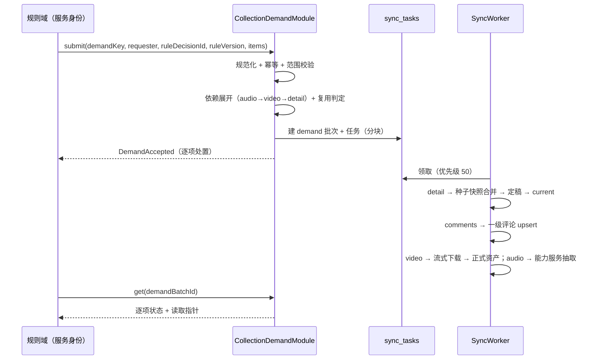

# A 全量周期同步（a-full-sync）· 设计

> **状态**：`draft`
>
> **需求**：[`requirements.md`](requirements.md)
>
> **任务**：[`tasks.md`](tasks.md)
>
> **验收**：[`acceptance.md`](acceptance.md)
>
> **所属域**：A 数据底座 · **目录命名**：`a-full-sync`，符合 `<代号>-<切片>`
>
> **上游 PRD**：[`prd-domain-a-data-foundation.md`](../../../HBECHO设计方案/prd-domain-a-data-foundation.md) v1.11（2026-11-05，定稿候选）
>
> **数据基线**：[`database-design-v2.md`](../../../HBECHO设计方案/domains/data-foundation/database-design-v2.md)（draft）；本设计要求八项修订（requirements §1.3 R1–R8）
>
> **最近核对**：2026-11-05
>
> **更新日期**：2026-11-05（初建；同日 requirements §1.5 闸门通过，吸收旧系统 lxk-BigSpard 经验，见 §2.3；外部审查两轮后修订，见 requirements §1.8、§1.9）
>
> **语言约定**：正文中文；标识符、表名、接口名保留英文。

## 1. Overview

tracer 证明了「一个账号从入口到首个检查点」，a-master-data-import 把组织与门店装进了库。`a-full-sync` 把它们接成**每周自动运行的采集流水线**，并给规则域一个受控的按需采集入口。



三个要点决定了整份设计的形状：

1. **采集只有一份**（PRD §6.11）：周期批次只做主页、列表、头像 / 背景 / 封面；详情、评论、视频、音频只在规则域提出需求时才做，并且本轮已有就复用。
2. **A 只执行不决定**：圈定、阈值、判定都不在这里；A 对外只有「提交需求 / 查询结果」两个口。
3. **技术失败永不变成业务空值**：每个失败有稳定原因码，账号 / 内容状态不被自动改写（D-38、D-54）。

## 2. Authority and Evidence Levels

### 2.1 Decision order

同 [requirements §1.1](requirements.md)。本设计只补一条：**v2 与 PRD 冲突按 PRD 修订 v2**（R1–R7 就是这样产生的），不在代码里选一方。

### 2.2 证据标签

| 证据 | 来源 | 能证明 | 不能证明 |
|---|---|---|---|
| `fixture_observed` | `tests/fixtures/aimaster/manifest.json` 登记的 raw 文件 | 响应形态、字段类型、可空性 | 长期合同、生产行为 |
| `smoke_verified` | raw4 / raw5 / raw6 / raw9 / raw10 / raw12 / raw13 / raw14 的实际调用 | 被调用的 platform × action × mode 在当日通过或失败 | 其他 tuple、其他时间、限流与超时 |
| `supplier_declared` | AI Master V1.2 文档 | 接口存在与参数 | 实际行为（认证头已被实测推翻一次） |
| `unknown` | 无 | — | 一律拒绝 |

本 spec 用到的证据清单（任务 1 把它们登记进 manifest，`knownGaps` 如实写）：

| tuple | 证据 | 备注 |
|---|---|---|
| 抖音 / 小红书 × 详情 × 同步 | raw3 `media_stats` ×9（不含视频号）、raw4 C05 / C06 | `*_count` 全 `null`，`*_number` 有值；`cover` / `download_urls` 是字符串 |
| 抖音 / 小红书 × 详情 × 异步 | raw9 A5（抖音）、raw5（小红书） | 可用 |
| 抖音 / 小红书 × 评论 × 同步 | raw3 评论 ×9、raw4 C07 / C08、raw6 C02、raw10 V4、raw11 | 小红书 `total>0` 但 `has_more=0`；回复扁平含 `parent_id` |
| 小红书 × 评论 × 异步 | raw9 A4 | 可用；抖音评论异步 raw7 / raw8 稳定失败 |
| 快手 × 主页 / 列表 / 详情 × 同步 | raw12 K1–K4 / K6、raw13 L3 / L4 / V1 | 列表游标科学计数法字符串；K3、K6 `max_cursor='no_more'` + `has_more=true`；K5（快手评论）/ L1 / P1 为 500 `RESULT_VALIDATION_FAILED`（无效输入）；raw12 的 W 系列是视频号（2.0），不登记 |
| 快手 × 主页 / 详情 × 异步 | raw14 A1 / A3 | 轮询 2 次 `running → succeeded`；列表异步 A2 失败 |
| 快手 / 小红书 / 抖音 × 评论 / 详情的内容 `url` 构造 | 小红书评论样本用 `https://www.xiaohongshu.com/explore/{post_id}`；快手详情样本用 `v.kuaishou.com` 短链，**构造方式无样本** | design §14 第 2 项 |
| 未证明 | 429、真实 5xx、超时、视频 URL 有效期、异步任务 TTL、QPS | 保持配置化，不写进合同 |

### 2.3 旧系统（lxk-BigSpard）经验对照

来源：`archive/legacy/项目历史文档/` 下的《爬虫四环节问题复盘与解法》《项目全面复盘与重构建议》。旧系统是 Puppeteer 爬虫，与本系统的商用 API 采集不同，下表只列与同步编排有关的教训。

| 旧系统的坑 | 本设计怎么处理 | 状态 |
|---|---|---|
| 失败账号放批次末尾统一重试 | 重试任务回到本批次队尾（§7.5 排序、§7.11） | **新吸收** |
| 全量模式 `OFFSET` 分页基数随采集缩小，漏账号 | 批次启动时一次性规划固定任务集，按 `account_id` 游标分块（§7.4） | 已避免 |
| 「成功」不等于「对」：采到登录号 / 别人的号，状态仍是 success | 主页 `profile_uid_mismatch`、列表 `list_author_mismatch`、三态校验结果（§7.6.1） | **新吸收** |
| profile 不可信时仍写快照，污染趋势 | 不可信则不写快照、不下载媒资、不抹旧值（§7.6.1） | **新吸收**（tracer 只覆盖录入时） |
| `account_snapshots` 用 `INSERT IGNORE`，同日第二次采集被丢弃 | 快照键 `(batch_id, account_id)`，批次内重放幂等，跨批次各留一份 | 已避免 |
| `COALESCE` 保护让旧值永远不被新值覆盖 / 错值自证清白 | 当前值只由 finalized 快照经 `(logical_at, batch_id)` 比较切换；身份校验基准是本次供应商返回值 | 已避免 |
| 链接与账号 ID 不成对写入 | 沿用 tracer 的成对写入 | 已避免 |
| 列表翻页：置顶干扰、重复条目、`has_more` 缺失 | 前三条不作边界证据、跨页去重、`has_more` 缺失按游标异常处理（§7.6） | 已避免 / **补充** |
| 活动最后一天漏计（上界 `<=`） | 不在 A 域（判定在 D）；A 只保存 `published_at` 原值 | 不适用 |
| 厂商返回 200 但字段残缺会静默写入 | 主页四项指标全无效 → `profile_fields_missing`，不写快照（§7.6.1） | **新吸收** |
| 平台声称的作品数从未用来校验 | 主页 `post_value` 增量对比本批次新内容，差异记警告（§7.6.2） | **新吸收** |
| 原始响应不落盘，争议无法追溯 | tracer 已 raw-before-parse | 已避免 |
| 429 / 配额耗尽 / 单账号无权限的区别 | 供应商级 vs 账号级失败区分；provider 熔断；批次点数硬上限（§7.5.1） | **新吸收**（熔断） |
| 批量写库默认 dry-run | 影响面 > 1 的命令默认预览，需 `--apply`（§15） | **新吸收** |
| 商用 API 无法验证对不对 | `sample` 抽样对账命令（§15） | **新吸收** |
| 质量巡检只打 stdout | 质量问题落库（tracer 已有）；批次汇总落 `result_summary` | 已避免 |
| 硬编码昵称黑名单排除登录号 | 商用 API 按标识请求，不存在登录号串号；身份交叉校验兜底 | 不适用 |
| 约束写在注释里、`init.sql` 与实库漂移 | 单一迁移来源 + `verify` 的迁移一致检查 | 已避免 |
| `is_participating` 只置 1 不置 0 | 属活动计划（`a-activity-plan`）；A 已规定移出名单保留记录 | 不适用 |

## 3. Goals and Non-goals

### 3.1 Goals

- 到点自动生成批次，串行、排队、跳过、过期语义与 A §7.1 一致；
- 6,000 账号 / 三平台的一轮同步：每账号主页 + 列表（多页、检查点、缺口），账号失败相互隔离；
- 内容快照账号级封口、current 不倒退、媒资独立推进；
- 按需采集：提交 → 复用判定 → 任务 → 结果指针，幂等、多计划共享；
- 失败可见、可在下一周期前重试；成本有硬上限；
- 默认离线、可故障注入、有规模演练。

### 3.2 Non-goals

见 [requirements §1.6.2](requirements.md)。补充：本设计**不**引入 Redis / 外部队列（tech 基线：队列是 MySQL 任务表）；**不**引入定时库（时点计算是 30 行纯函数）；**不**为多 worker 进程做分布式限流（design §12）。

## 4. Ownership and Deep Modules

### 4.1 复用的既有事实

| 既有模块 | 本 spec 怎么用 | 是否修改 |
|---|---|---|
| `raw-capture`（`RawCaptureGateway`、`recoverInFlightForTasks`、`cleanupExpired`、`sweepOrphans`、`OssObjectStore`、`HttpProviderTransport`） | 全部供应商调用经它；清理由 `maintain` 定时触发 | 加 `signedGetUrl`（见 §7.10）；孤儿清扫前缀扩展 |
| `provider-adapter`（`buildRequest`、`decodeProfile`、`decodeVideoList`、`classifyResponse`、`decideRetry`、`capabilityGate`） | 主页 / 列表解码复用；新增详情、评论解码与快手 | **修改**：平台、action、namespace、capability 表扩展 |
| `identity`（`intakeAccount`、`bindDominantListAuthor`、`loadOwnerSnapshot`） | 外部账号入口、owner 快照 | 增加 `external` 分支 |
| `projection`（`projectProfile`、`projectContentPage`、`checkpointModule`、`selectCurrent*`、`recordIssue`） | 主页 / 列表投影、current CAS、质量问题 | **修改**：封面规则、`building` 写入、多页续写 |
| `media-archive`（`runMediaArchive`、`downloadBounded`、`guard`、`sniff`） | 图片归档、续用旧资产、失败分类 | **修改**：视频流式、音频、快手封面 |
| `orchestrator`（`claimTask`、`heartbeat`、`withFences`、`finishChild`） | 租约、fencing | 增加 `claimNext` |
| `cost-guard` | 调用数 / 点数硬上限 | 扩展点数表与批次作用域 |
| `tracer-command`（`ActorContext`、`AuditSink`） | 授权、审计 | 增加 Capability 常量 |
| `tests/harness` | 禁网、fake clock / OSS / transport / media | 增加 fake 能力服务、规模工厂 |

### 4.2 本 spec 拥有的工作流概念

| 概念 | 含义 |
|---|---|
| 同步轮次（round） | 最近一个已开始的 `full` 批次到下一个 `full` 批次开始之间；按需复用的边界 |
| 目标集（targets） | 批次启动时算出的有效监控账号集合；每个被排除账号有原因码 |
| 账号级封口 | 一个账号的列表任务终态后，定稿其本批次 `building` 快照并更新 current |
| 种子快照 | 按需批次里以当前 finalized 快照为起点的 `building` 快照 |
| 采集需求（demand） | 规则域提交的 `{contentId, wants[]}` 集合 |
| 处置（disposition） | 提交时对每个 `{contentId, want}` 的判定：`queued` / `reused` / `already_pending` / `unsupported_platform` / `capability_disabled` / `content_not_found` / `out_of_scope` |

这些概念不进入 `CONTEXT.md` 的实体表；其中「采集需求」「同步轮次」作为跨域词汇在任务 0 登记到 `CONTEXT.md`（只写语义，不写表名）。

### 4.3 模块与职责

| 模块（`src/modules/…`） | 窄接口 | 隐藏的深度 |
|---|---|---|
| `sync-schedule` | `tick(now)`、`createSupplement`、`cancelBatch`、`retryFailed` | 时点计算（固定 UTC+8）、批次键、排队 / 跳过 / 过期 / 晋升、`planned` 恢复、批次终态汇总、`media_finished_at`；以 `sync_settings` 行锁串行化批次状态迁移 |
| `monitoring` | `resolveTargets(batch)`、`explain(accountId)`、`setSwitch(...)` | 五级 + 账号状态 + 录入状态的单条 SQL；原因码优先级；开关写入规则 |
| `sync-runner` | `runTask(task, ctx)` | 按动作分派；`ProfileRunner`、`ListWalker`、`SnapshotSealer`、领取时资格复核、批次预算检查、统一失败映射 |
| `sync-worker`（`src/worker/` 下的进程部分） | `start/stop` | `claimNext`、并发信号量、provider 令牌桶、心跳、优雅停机、崩溃恢复 |
| `demand` | `submit`、`get` | 规范化与幂等、范围校验、复用判定、分块建任务、依赖展开（audio→video→detail）、结果指针 |
| `detail` | `DetailRunner` | `media_stats_number` 解码、种子快照合并、失败清理 |
| `comments` | `CommentsRunner`、评论投影 | 分页、一级过滤、upsert、完整性口径、疑似删除、质量问题 |
| `media-archive`（扩展） | `ensureArchived` | 封面首次规则、快手 CDN、视频流式、音频抽取、续用、批次媒资汇总 |
| `sync-ops` | `rebind`、`confirmDeleted`、`setIssueStatus`、`externalAdd/enable/disable` | 范围校验、审计、名额释放 |
| `sync-status` | `status`、`batch`、`account`、`freshness` | 本地聚合、点数估算、脱敏 |
| `maintenance` | `runDaily(now)` | ODS 清理与孤儿清扫的调度、有界批量、运维日志 |
| `src/worker/sync-cli.ts` / `sync-main.ts` / `sync-wiring.ts` | CLI | 解析、退出码、依赖装配（沿用 tracer 的 `cli` / `main` / `wiring` 三层） |
| `services/capability/` | HTTP | `POST /v1/image/normalize`、`POST /v1/audio/extract`、`GET /healthz` |

调用方不得绕过这些模块：不得直接写 `sync_tasks`、不得绕过 `RawCaptureGateway` 解析 payload、不得自己改 current 指针、不得用临时 URL 当媒资身份。

### 4.4 Internal Interfaces

TypeScript Interface（ADR-0005）：

```ts
interface SyncScheduler {
  /** 幂等：同一 now 重复调用不产生重复批次 */
  tick(now: Date): Promise<TickReport>;
  createSupplement(cmd: SupplementCommand, actor: ActorContext): Promise<SupplementAccepted>;
  cancelBatch(batchId: string, actor: ActorContext): Promise<BatchView>;
  retryFailed(batchId: string, actor: ActorContext): Promise<RetryReport>;
}

interface MonitoringResolver {
  /** 批次启动时分块调用；每块 ≤ 500 个账号 */
  targets(opts: { afterAccountId: bigint | null; limit: number }): Promise<TargetChunk>;
  explain(accountId: bigint): Promise<{ effective: boolean; reason: ExclusionReason | null }>;
}

interface TaskWorker {
  start(): Promise<void>;
  /** 停止领取；等待在途任务至多 graceMs；返回放弃的任务数 */
  stop(graceMs: number): Promise<{ abandoned: number }>;
}

interface CollectionDemandModule {
  submit(demand: SubmitDemand, actor: ActorContext): Promise<DemandAccepted>;
  get(demandBatchId: string, actor: ActorContext): Promise<DemandView>;
}

interface SyncStatusQuery {
  status(actor: ActorContext): Promise<SyncOverview>;
  batch(batchId: string, actor: ActorContext): Promise<BatchView>;
  account(accountId: string, actor: ActorContext): Promise<AccountSyncView>;
  freshness(actor: ActorContext, opts?: { limit?: number }): Promise<FreshnessView>;
}

interface CapabilityClient {                 // Node → Python（ports，真实实现 HTTP，测试 fake）
  normalizeImage(i: { bytes: Uint8Array; mimeType: string }): Promise<NormalizedImage>;
  extractAudio(i: { sourceUrl: string; maxBytes: number }): Promise<{ bytes: Uint8Array; durationMs: number } | { kind: 'no_audio_track' }>;
}
```

`DemandView`、`BatchView` 的字段在 §5.4 与 §7.12 给出语义；字段名在实现前可调整，语义（处置、状态、失败原因、读取指针、媒资 / 结构化分离）不可合并。

## 5. End-to-end flow

### 5.1 周期批次



### 5.2 一个账号的列表任务



### 5.3 补抓与取消

`supplement`：校验范围与资格 → 建 `supplement` 批次 → 若有运行中 `full`，按 `--on-busy` 处理：`run_now`（**默认**）立即 `running`、与全量批次并行；`queue` 置 `queued`，全量批次结束后开始；`cancel_current` 取消当前全量批次后开始（需 `--apply`）→ 任务与周期任务同类、优先级 100。同账号同动作已有活动任务时复用并把该任务优先级提到 100。`--only profile|full` 与 `--if-older-than <小时>` 供 `a-activity-plan` 实现 A §11.5：对每个账号先检查最近一次成功同步时间，更近则 `not_due`；不在目标集则 `not_eligible`；其余 `queued`。
`cancel`：批次 `cancelled`；未开始任务 `cancelled`；在途任务靠租约失效（`heartbeat` 返回 `cancelled`）停止。

### 5.4 按需采集



`DemandView` 每项：`{ contentId, want, state, failure?, pointers }`。`pointers`：`detail` → `contentSnapshotId`；`comments` → `fetchedAt`、`coverage: complete | partial | unknown`、`fetchedCount`、`reportedTotal`；`video` / `audio` → `mediaAssetId`。

## 6. Data model

### 6.1 表与归属

全部是 v2 既有表；本 spec 不新建表。新增 / 修改的列、约束（对应 requirements §1.3）：

| 表 | 修改 | 对应 |
|---|---|---|
| `content_snapshots` | 加 `seeded_from_snapshot_id BIGINT NULL`，FK → `content_snapshots(content_snapshot_id)` `RESTRICT`；CHECK：非空时 `list_observed=FALSE AND detail_observed=TRUE` | R1 |
| `sync_batches` | 加 `purpose VARCHAR(32) NOT NULL`，CHECK `full/supplement/demand/intake`；加 `media_finished_at DATETIME(6) NULL`；加 `IDX(purpose, status, logical_at)`。**迁移分三步写进同一个手工修改过的迁移文件**：① `ADD COLUMN purpose VARCHAR(32) NULL`；② `UPDATE sync_batches SET purpose='intake' WHERE purpose IS NULL`（此前所有批次都是 tracer 根批次或 smoke，全是 `intake`）；③ `MODIFY purpose VARCHAR(32) NOT NULL`，不留 DEFAULT。schema 快照仍是 `notNull()`，所以 `drizzle-kit generate` 不应产生新文件 | R4、R5 |
| `external_account_identifiers` | `namespace_code` CHECK 增加 `kuaishou.user_id` | R6 |
| 其余 | 无结构修改 | — |

v2 文字修订：§10.2 第 6、7 条与 **§12.3 第 6 条**改账号级、§10.2 增补第 12 条（R1、R2）；**§12.3 第 2 条**补 `queued` / `expired`（R8）；§11.3 封面范围（R3）；§8.3 / §12.3 外部型只采主页（R7）；§9.2 补 `purpose` 与 `media_finished_at`，并把 `skipped` 的语义放宽为「没有执行任何任务的批次」（R8）。A PRD 同步修订 §7.1（补抓 `run_now`）与 §7.3（周期同步不含详情 / 评论，requirements §1.3 P1、P2）。

**迁移归属**：任务 1 一次迁移（`drizzle-kit generate`），测试 `schema.db.test` 同层补用例。

### 6.2 任务参数（版本化 JSON，`sync_tasks.task_parameters`）

| action | schema 版本 | 内容 |
|---|---|---|
| `fetch_profile` | `sync-profile-task.v1` | `{ mode: 'sync' \| 'async' }`（按 capability 与配置在规划时固化） |
| `fetch_content_list` | `sync-list-task.v1` | `{ mode, initial_content_limit, safety_page_limit, anchor_snapshot: { anchor_mode, hw_published_at, hw_content_ids, checkpoint_version } }`（规划时快照旧锚点，保证重试与续跑看到同一旧边界） |
| `fetch_content_detail` | `sync-detail-task.v1` | `{ mode, content_id, url_form: 'share_url' \| 'canonical' }` |
| `fetch_comments` | `sync-comments-task.v1` | `{ mode, content_id, page_limit, item_limit }` |
| `download_media` | `sync-media-task.v1`（周期）/ `sync-media-video-task.v1`（按需） | `{ scope: 'account_batch' }` / `{ content_snapshot_id, role: 'video' \| 'audio' }` |

列表进度写在 `result_summary`（`list-walk-progress.v1`）：`{ next_cursor: envelope \| null, pages_done, boundary_hit: boolean, stop: null \| 'boundary' \| 'baseline' \| 'safety' \| 'end' \| 'cursor_anomaly' \| 'empty', gap_kind: null \| … }`。每页投影事务内更新，续跑只读它。

### 6.3 幂等键

`sha256(JCS({v, batch_id, account_id, action}))`；按需任务再含 `content_id`、`role`；全部经现有 `canonical-json`。跨批次「同账号同动作活动任务复用」在持有 `external_accounts` 行锁的短事务里先查再建（`ponytail:` 应用层判断，若出现重复付费再升级为生成列唯一索引）。

## 7. Algorithms

### 7.1 时点计算（FS-1）

`sync_settings.schedule_slots` 为 1–2 个 `{ weekday: 1..7（ISO，周一=1）, time: 'HH:MM' }`，北京时间。`Asia/Shanghai` 自 1991 年起无夏令时，按固定 UTC+8 计算：

```ts
slotInstant(weekStartUtc, slot) = weekStartUtc(周一 00:00 北京) + (weekday-1)*24h + HH:MM
latestSlotAtOrBefore(now)   // 取本周与上周的候选中 ≤ now 的最大值
nextSlotAfter(t)
```

`timezone !== 'Asia/Shanghai'` 时启动失败（FS-D15）。纯函数，单元测试覆盖跨周、两个时点、周日 23:59 / 周一 00:00 边界。

批次键：`sha256(JCS({v:'sync-batch.v1', purpose:'full', slot_utc}))`。`tick` 只在 `now - slot ≤ tolerance`（默认 10 分钟，tick 间隔 30 秒）内创建；超出视为错过，不补跑（FS-1.3）。

### 7.2 批次状态机（FS-1）

| 状态 | 进入条件 | 说明 |
|---|---|---|
| `planned` | 批次行已建，任务尚未全部规划 | 仅在晋升为 `running` 时短暂存在；崩溃后由 tick 恢复 |
| `queued` | 有运行中 `full`，队列为空 | 不规划任务 |
| `running` | 无运行中 `full`（或晋升） | 规划任务（FS-2） |
| `succeeded` / `partial_succeeded` / `failed` | 结构化任务全终态 | 判定见 §7.12 |
| `cancelled` | 运营取消 | — |
| `skipped` | 队列已满时的新触发 | 只有摘要行，`skip_reason='queue_full'` |
| `expired` | 排队到下一个时点仍未开始 | — |

**串行化**：所有「创建 / 晋升 / 过期 / 终态」迁移都在 `SELECT … FROM sync_settings WHERE settings_id=1 FOR UPDATE` 持有的短事务内完成，这是一个单行互斥锁，保证「同一时刻至多一个运行中 `full`、队列至多一个」。事务里不做任何 IO。

**晋升**：`tick` 发现无运行中 `full` 且存在 `queued` 批次时，按 `logical_at` 升序取一个置 `running` 并规划任务。`supplement` 批次排队使用同一机制（FIFO，按 `created_at`），排在已排队的 `full` 之后。

### 7.3 有效监控目标（FS-2）

一条 SQL（Drizzle 构造，分块 `account_id > :after ORDER BY account_id LIMIT 500`）：

```sql
SELECT aa.assignment_id, aa.account_id, aa.platform_id, aa.watch_type
FROM staff_account_assignments aa
JOIN external_accounts ea ON ea.account_id = aa.account_id
LEFT JOIN media_staff ms ON ms.staff_id = aa.staff_id
LEFT JOIN stores st      ON st.store_id = ms.store_id
LEFT JOIN brands b       ON b.brand_id = st.brand_id
LEFT JOIN dealers d      ON d.dealer_id = st.dealer_id
LEFT JOIN sectors sc     ON sc.sector_id = st.sector_id
LEFT JOIN branches br    ON br.branch_id = sc.branch_id
LEFT JOIN regions rg     ON rg.region_id = br.region_id
WHERE ea.status IN ('active','unavailable')
  AND aa.monitoring_enabled AND aa.intake_status = 'normal'
  AND ( aa.watch_type = 'external'
        OR ( ms.status='active' AND ms.monitoring_enabled
             AND st.status='active' AND st.monitoring_enabled
             AND b.status='active'
             AND d.status='active' AND d.monitoring_enabled
             AND br.status='active' AND br.monitoring_enabled
             AND rg.status='active' ) )
  AND aa.account_id > :after
ORDER BY aa.account_id LIMIT :limit
```

`explain(accountId)` 逐级检查并按固定顺序返回第一个失败原因：`deleted` → `suspected_empty` → `brand_inactive` → `region_inactive` → `branch_*` → `dealer_*` → `store_*` → `staff_*` → `account_off`；品牌与大区只有业务状态，没有监控开关；开关类用 `*_off`，业务状态类用 `*_inactive` / `store_closed`。顺序为「最上级优先」（A §11.6）。

**领取时复核**：`SyncRunner` 在每个任务发出第一个付费调用之前执行同样的单账号条件（`WHERE aa.account_id = :id AND …`），不满足则 `cancelled/monitoring_closed`（FS-2.6）。

### 7.4 规划（FS-1.5、FS-2.7、FS-3.1）

`startBatch(batch)`：

1. 读冻结的 `settings_snapshot`，对每个平台按 capability 与配置选定 `mode`；
2. 分块取目标；每块在一个短事务里 `INSERT … ON DUPLICATE KEY UPDATE task_id = task_id`（幂等键冲突即跳过）插入 `fetch_profile`，非 `external` 再插入 `fetch_content_list`（`task_parameters` 里快照旧检查点）；
3. 全部完成后写 `planned_task_count`、`started_at`，状态置 `running`；崩溃后 `planned` 批次由 `tick` 从头再规划一遍（幂等）。

规划只创建任务，不发任何调用。**周期批次不创建详情 / 评论 / 视频 / 音频任务。**

### 7.5 领取、并发与速率（FS-3）

```sql
-- claimNext（一个短事务）
SELECT t.* FROM sync_tasks t JOIN sync_batches b ON b.batch_id = t.batch_id
WHERE ( (t.status IN ('pending','retry_wait') AND (t.next_attempt_at IS NULL OR t.next_attempt_at <= :now))
        OR (t.status IN ('leased','running') AND t.lease_expires_at <= :now) )
  AND ( b.status = 'running' OR (t.requested_action = 'download_media' AND b.status IN ('succeeded','partial_succeeded','failed')) )
ORDER BY t.priority DESC, t.attempt_count ASC, t.task_id
LIMIT :n FOR UPDATE SKIP LOCKED
```

读取后在同一事务里写租约与 `fencing_token + 1`（沿用 `claimTask` 的写法）。

**重试回队尾**：`attempt_count` 是排序的第二键，所以重试过的任务永远排在同优先级所有未重试任务之后；一个批次先把全部账号采一遍，再依次做第 2、3 轮。这与旧系统「失败账号末尾统一重试」同效，但不需要单独的重试阶段。**"队尾"在同一优先级内成立**：同一个 `full` 批次的任务优先级相同；被运营补抓提升过优先级（100）的周期任务、补抓批次与按需批次（50）的重试任务，仍排在更高优先级一档，这是显式要求的结果，不是缺陷。`idx_sync_tasks_claim (status, next_attempt_at, priority, task_id)` 已存在，新增排序键后用 `EXPLAIN` 复核；若出现全表排序，加 `(status, priority, attempt_count, task_id)` 索引（任务 4 视实测决定）。

`SyncWorker`：

- **并发**：进程内信号量，上限 `HBECHO_SYNC_CONCURRENCY`（无默认值）；
- **速率**：每个 provider 一个令牌桶，`HBECHO_SYNC_PROVIDER_QPS`（无默认值）；媒资下载另有 `HBECHO_SYNC_MEDIA_CONCURRENCY`；
- **心跳**：每次供应商调用 / 每页 / 每个下载分片之前续租；`cancelled` / `stale` 立即放弃；
- **优雅停机**：`SIGTERM` → 停止领取 → 等待在途至多 `graceMs` → 放弃的任务不改状态，租约自然过期后被重新领取；
- **崩溃恢复**：重新领取时先 `recoverInFlightForTasks`（tracer 已有），再继续；列表任务从 `result_summary.next_cursor` 继续。

`ponytail:` 1.0 单 worker 进程，限流与信号量在进程内；多进程需要共享限流（MySQL 令牌行或外部）后才能水平扩展。

#### 7.5.1 provider 熔断（FS-3.7）

进程内、每个 provider 一个状态机：`closed → open → half_open → closed`。

- **计入熔断的失败**：供应商级——429、5xx、传输错误、超时；`ambiguous` 也计入。**不计入**：`RESULT_VALIDATION_FAILED`、HTTP 400、身份不符、字段缺失、解析失败（这些是账号级或我方问题，换账号照样会成功）；
- 连续 `HBECHO_SYNC_BREAKER_FAILURES`（无默认值）次供应商级失败 → `open`：worker 不再为该 provider 领取任务，任务保持 `pending`、**不消耗尝试额度**；
- `open` 持续 `HBECHO_SYNC_BREAKER_COOLDOWN_MS`（无默认值）后 → `half_open`：只放行一个探测任务，成功回 `closed` 并清零计数，失败回 `open` 并重新计时；
- 状态变化写运维日志；`status` 输出当前熔断状态；
- 在途任务不受影响，它们的失败照常消耗额度；
- `ponytail:` 进程重启后状态清零，单 worker 够用；多进程需要共享状态后再升级。

**为什么需要**：旧系统遇到整体故障时逐账号重试，6,000 个账号会把每个账号的额度都烧光并全部变成 `dead`。熔断让整体故障停在「暂停领取」，恢复后任务原样继续。

### 7.6 列表游标走法（FS-5）

**纯函数**：`decideAfterPage(state, page, anchor, cfg) → { action: 'continue' | 'stop', reason, gap }`，`ListWalker` 只负责 IO 与事务。

输入：当前页完整条目（含位置）、旧锚点（`time` / `id_window` / `empty` / 无）、`hasMore`（已归一）、`pageNo`、`isFirstWalkWithoutAnchor`、`initialContentLimit`、`cumulativeCount`。

判定顺序（对应 v2 §9.4 算法 14 条与 FS-5）：

| 序 | 条件 | 结果 |
|---:|---|---|
| 1 | 游标异常（`has_more=true` 且游标空 / `no_more`；或 `has_more` 缺失 / 非法） | 记 `cursor_no_more_with_has_more`（缺失 / 非法记 `has_more_invalid`）；**把 `has_more` 视为 `false`** 再走下面各行，缺口时 `stop_reason` 用 `cursor_anomaly_rebased` 代替 `end_of_list_rebased`。因此「有旧锚点 + 游标异常」落在第 2 行（命中）或第 6 行（缺口）；「无旧锚点 + 游标异常」落在第 3 / 7 行 |
| 2 | 有旧锚点且本页**正常时间序列**条目命中边界 | `stop`，成功（第一页位置 1–3 不参与命中） |
| 3 | 无旧锚点（首次基线）且累计条目 ≥ `initial_content_limit` | `stop`，成功，供应商仍有更多不算缺口 |
| 4 | `has_more=true` 且 `pageNo < safety_page_limit` | `continue`，保存 `next_cursor` |
| 5 | `has_more=true` 且 `pageNo = safety_page_limit` | `stop`，缺口 `safety_limit_rebased`，`window_overflow=TRUE` |
| 6 | `has_more=false` 且旧锚点为 `time` / `id_window` 且未命中 | `stop`，缺口 `end_of_list_rebased`（游标异常时 `cursor_anomaly_rebased`） |
| 7 | `has_more=false` 且（无旧锚点，或旧锚点为 `empty`）且本任务累计 ≥ 1 条 | `stop`，**成功**并重建锚点（首次基线 / 上次为空这次有内容，**不是缺口**） |
| 8 | 本任务全部页累计 0 条且旧锚点为 `time` / `id_window` | `stop`，空窗口：检查点 `blocked`，`empty_window_not_rebased` |
| 9 | 本任务全部页累计 0 条且 `has_more=false` 且（无旧锚点，或旧锚点为 `empty`） | `stop`，建立 / 保持 `empty` 锚点，成功，检查点 `ready` |

边界命中细则：`time` 模式——条目 `published_at` **严格早于**旧高水位时间，或其内容 ID ∈ 旧高水位 ID 集合；等于高水位时间但 ID 不在集合内则继续。`id_window` 模式——条目 ID ∈ 旧窗口。`empty` 模式——没有可命中的边界，只处理首个完整页：有内容走第 7 行（成功 + 重建锚点），无内容走第 9 行；`empty` 模式**无视 `has_more`**，首个完整页处理完即停（`stop_reason='baseline'`），不翻页；它不是第 7 行的特例（第 7 行要求 `has_more=false`），而是单独规则：先判 `empty` 再判其余。

**多页边界**：每页先整页投影，再判定；第 4 行 `continue` 之前保存进度（同一事务）。跨页重复的内容 ID 在同一批次内合并（`INSERT … ON DUPLICATE`），discovery 保留第一次出现的位置。

**重建锚点**（缺口、基线、命中后推进）：在封口事务里从 DB 读本批次本账号全部 `building` 快照的 `(published_at, platform_content_id)`；存在有效发布时间取最大时间及同时间 ID 集合（`time`）；否则取**首页**内容 ID 集合（`id_window`）；全空取 `empty`。可能置顶的条目始终参与计算，旧置顶不会抬高最大时间（它们发布时间本来就早）。

**命中边界成功时**：新锚点 = 本轮重建结果，检查点 `ready`；缺口时 `rebased_after_gap`，`last_gap_at=now`；空窗口 `blocked`，不改锚点。检查点推进用 `version` 乐观比较 + 任务 fencing，二者缺一不可。

#### 7.6.1 身份与残缺校验（FS-4.3、FS-4.8、FS-5.13）

旧系统最大的教训：采到别人的号、状态仍是 success。商用 API 没有登录号串号，但「按链接请求、厂商自行解析」仍可能错位（《项目全面复盘》3.2 坑 1），所以每次采集都带校验：

| 校验 | 基准 | 结果 |
|---|---|---|
| 主页标识 | 本次响应的账号标识 vs `external_account_identifiers` 已登记值（文本精确比较，同 namespace） | 不等 → `profile_uid_mismatch`：不写快照、不下载媒资、任务 `failed`；质量问题含期望值、实际值、ProviderCall 引用；**不改写登记值** |
| 主页残缺 | 粉丝 / 关注 / 获赞 / 作品数四项 | 全部无效 → `profile_fields_missing`（可重试），不写快照 |
| 列表作者 | 已登记的作者标识集合（抖音 `user_id` + `sec_uid`、小红书已绑定内容作者 ID、快手 `user_id`） | 累计条目 ≥ 5 且无一条由这些标识创作 → `list_author_mismatch`：清除本批次该账号 `building` 快照、检查点不推进、任务 `failed`；条目 < 5 或无登记标识 → `unverifiable` |

三态结果（`verified` / `unverifiable` / `mismatch`）写入任务 `result_summary.identity_check`，批次汇总与 `account` 查询都按三态展示，**`unverifiable` 不并入 `verified`**。

异作者共创是常态（抖音 20 条里有 1 条异作者），所以列表校验的是「**是否一条都没有**」而不是「是否全部是」，阈值 5 条是为了避免小账号误报；阈值是纯函数参数，调整要升版本。

#### 7.6.2 自比对（FS-5.14）

列表任务成功后：`k = 本批次主页 post_value − 该账号上一份更早的主页快照 post_value`（"更早"= `batch.logical_at` 更小的最近一份，补抓批次也算）；两份主页的 `post_state` 均为 `value` 且 `k > 0` 时，若**自那份主页快照接收时间以来**首次发现的内容数（`contents.first_seen_at > 上一份主页的 response_received_at`，不限批次）`< k`，记警告级 `suspected_missing_content`（`k`、`discovered`、两份主页快照 ID）。有账号删作品、平台统计延迟等正常原因，所以只告警，不使任务失败、不动检查点，也不进批次终态判定；它用来发现「检查点以为接上了其实漏了」这类静默缺口。

### 7.7 账号级封口与 current（FS-6）

`SnapshotSealer.seal(task, token)`（一个短事务，`withFences` 锁定列表任务）：

1. 把 `batch_id = B AND content 属于账号 A AND snapshot_status='building'` 的快照置 `finalized`（`finalized_at=now`）；
2. 对每个内容：若 `(batch.logical_at, batch_id)` 严格新于 `current_snapshot_selected` 对应批次，则 `contents.current_snapshot_id=…`（复合 FK 保证所属）；
3. 写检查点（或不动）与任务终态、`result_summary`；
4. 失败 / 取消的列表任务也封口**已投影的可靠条目**（它们是供应商已返回的事实），但**不推进检查点**；没有可靠条目则删除残留 `building` 行（只在此事务内、条件 `snapshot_status='building' AND batch_id=B`）。

主页快照创建即终态，current 在 `ProfileRunner` 的投影事务里 CAS。

事务大小：≤ `safety_page_limit × 页大小`（约几十到数百行），短事务可接受。

### 7.8 按需采集（FS-8、FS-9）

**提交**（`demand.submit`）：

1. 规范化与幂等：`items` 按 `contentId` 排序去重，`wants` 排序去重；`command_sha256 = jcsSha256({v:'sync-demand.v1', requester, ruleDecisionId, ruleVersion, items})`。幂等落在批次上：`batch_key = sha256(JCS({v:'sync-demand.v1', actor, demandKey}))`（`uq_sync_batches_key` 已存在），`command_sha256` 存入 `settings_snapshot.demand.command_sha256`；同键同摘要返回原批次，同键不同摘要报幂等冲突。任务本身用普通任务幂等键（§6.3），不使用 tracer 根任务的 command 三元组；
2. 依赖展开：`audio ⇒ video ⇒ detail`；
3. 逐项处置：
   - 内容不存在 → `content_not_found`；所属账号不在 actor 范围 → `out_of_scope`；
   - `want ∈ {comments}` 且平台为快手 → `unsupported_platform`；capability 对该 tuple 未启用 → `capability_disabled`；内容 URL 无法构造（快手详情）→ `capability_disabled`；
   - 复用：见下；
   - 已有活动任务 → `already_pending`；否则 `queued`；
4. 事务外分块建任务（每块 ≤ 500）；崩溃后同键重放按任务幂等键补齐缺失任务，不重复。全部是 `reused` / 被拒、无任务可建时，批次直接 `succeeded`，逐项处置保存在 `settings_snapshot.demand.dispositions`，`get` 据此回答。

**复用判定**（FS-D06）：

| want | 复用条件 | 否则 |
|---|---|---|
| `detail` | 存在该内容的 `fetch_content_detail` 任务 `succeeded` 且 `finished_at ≥ round_start`（**不看批次用途**：周期、补抓、按需批次产生的都算，更早轮次的都不算） | 新建 |
| `comments` | 同上，动作 `fetch_comments`，且 `finished_at ≥ round_start` | 新建 |
| `video` | 该内容的任一快照上存在 `role='video'` 且 `archived` 的引用 | 新建（隐含 detail） |
| `audio` | 同上 `role='audio'` | 新建（隐含 video） |

`round_start` = 最近一个 `purpose='full'` 且状态非 `skipped / expired / cancelled` 的批次的 `started_at`（没有则 `-∞`，即不限轮次）。用 `started_at` 而不是 `logical_at`：批次可能排队几小时才晋升，`logical_at` 是计划时点，早于真正开始，会把上一批次期间完成的结果误算进本轮（requirements §1.4 第 4 项）。

**详情执行**（`DetailRunner`）：

1. 经 `ContentUrlBuilder(platform, content)` 得 `url`：抖音 `share_url`（最近快照观察到的）→ 回退 `https://www.douyin.com/video/{post_id}`；小红书 `https://www.xiaohongshu.com/explore/{post_id}`；快手 → `content_url_unavailable`（直到 smoke 证实）；
2. `media_stats_number`（`mode` 按 capability）→ 落 ODS → `decodeDetail`；
3. 一个短事务（`withFences`）：若本批次该内容没有快照，则以当前 finalized 快照为种子插入 `building` 行：拷贝全部 value / state / 文本 / 返回作者 / 发布时间 / 话题；`list_observed=FALSE`，`detail_observed=TRUE`，`seeded_from_snapshot_id=…`，`last_list_provider_call_id`、`list_response_received_at`、`list_adapter_version` 为空；**必填列取值**：`snapshot_at` = 本次详情响应的接收时间，`merge_policy_version` = 当前 `MERGE_POLICY_VERSION` 常量，`detail_adapter_version` / `last_detail_provider_call_id` / `detail_response_received_at` 取本次详情调用。任务的 `source_content_snapshot_id` 指向被拷贝的种子（这是该既有列的原本用途：任务从哪份快照派生；它不能替代 `seeded_from_snapshot_id`，后者是快照到快照的血缘，要有外键与 CHECK）；把详情有效值按 LaterValidValueWins 合并；`cover` / `download_urls` 展开为候选集，写 `video` 引用（`pending`，`source_locator` 为按平台选出的来源）；随即定稿并做 current CAS；
4. 失败：详情 `RESULT_VALIDATION_FAILED` 有界重试后 → `failed/detail_inaccessible` + 质量问题；**不建种子快照**（或建了就删），不改内容 `status`。

需求只能引用**至少有一个 finalized 快照**的内容（`content_not_found` 的口径就是「没有 finalized 快照」）。所以种子永远存在；内容刚被周期批次发现、该账号还没封口时，需求会被如实拒绝，规则域稍后再提。

**评论执行**（`CommentsRunner`，§7.9）。

**视频 / 音频执行**（§7.10）。

### 7.9 评论（FS-10）

```ts
interface CommentsPolicy { platform: 'douyin'|'xiaohongshu'; completeWhen: 'natural_end'|'never' }
// douyin: natural_end   xiaohongshu: never（D-50 / FS-D08）
```

流程：

1. 请求 `post_comments_list`：`max_cursor` 初值 `0`，之后回发上一页返回的字符串游标，`reply_pages=-1`；
2. 每页：落 ODS → 解码 → 丢弃带 `parent_id` 的条目（计数）→ 一个短事务 upsert（`UQ(content_id, platform_comment_id_sha256)`，命中后复核原文），`last_seen_at=now`，`status='active'`，`suspected_deleted_at=NULL`；
3. 停止：`has_more` 为 0；或 `page_count ≥ page_limit`；或条目数 ≥ `item_limit`；
4. 收尾（一个短事务）：`complete = policy.completeWhen==='natural_end' && has_more==0 && 未触达上限`；仅 `complete` 时把 `status='active' AND last_seen_at < fetch_started_at` 的评论置 `suspected_deleted`（`suspected_deleted_at=now`）；
5. 质量问题：`total>0 && 抓到 0 条` → `comments_total_mismatch`；`total` 大于已抓条数且 `!complete` → `comment_coverage_incomplete`（带 `reported_total`、`fetched`、`reason ∈ page_limit | item_limit | platform_partial`）。问题指纹含 `content_id + 原因`，重复抓取更新 `last_seen_at`，不重复建；
6. `RESULT_VALIDATION_FAILED` 按小红书间歇性处理：用 `decideRetry` 判定为可重试后，任务回队尾（`retry_wait`），之后从已提交页的下一游标继续；不在进程内原地重试。

### 7.10 媒资（FS-11）

**周期媒资任务**：每个账号每个批次一个 `download_media`（`scope='account_batch'`），在 `fetch_profile` 与 `fetch_content_list` 都终态后才可领取（避免引用还在增长）；处理该账号本批次所有 `pending` 引用：头像 / 背景 / 封面。复用 `runMediaArchive` 的单引用逻辑，并做三处扩展：

- **封面来源不变**：抖音取封面数组第 2 条（540 宽），小红书 / 快手取单值（解码器已实现，R3 不改）；下面只改「何时建引用」。
- **封面首次规则（R3）**：`projectContentPage` 在建快照时判断内容是否已有 `archived/carried_forward` 的 `cover` 引用；有则**不建**新引用。（SQL：`EXISTS (SELECT 1 FROM media_references r JOIN content_snapshots s … WHERE s.content_id=:c AND r.role='cover' AND r.archive_status IN ('archived','carried_forward'))`。）
- **快手封面（FS-11.4）**：下载原始字节作为原始资产；另请求 `{source}?x-oss-process=image/format,jpg/resize,w_540` 得 JPEG，作为 `ImageConverter` 的输入生成 JPEG q80 / 540 宽的衍生资产。CDN 转换失败 → 引用 `cover_normalized` 置 `failed(cover_unavailable)`、质量问题 `media_cover_unavailable`，原始引用照常归档。
- **失败分类**：沿用 `media-failure`；`source_expired` 对周期引用的含义是「等下次列表出现再取新地址」（引用保持 `failed`/`needs_fresh_url`，下一周期封面规则会重建引用）。

**视频**（按需，`sync-media-video-task.v1`）：

1. 从种子快照 / 详情快照的 `video` 引用取来源（`pickVideoSource(platform, candidates)` 纯函数）：抖音按主机优先级 `api-play.amemv.com` → `api.amemv.com` → 其余，**排除** `video.url`；小红书 / 快手取详情 `download_urls`；
2. `VideoTransport.stream(url, { timeoutMs, maxBytes })` → 写 `$HBECHO_MEDIA_TMP_DIR/<task_id>.part`，边写边 `createHash('sha256')`；超 `maxBytes` 中止并删除；
3. 完整性：`Content-Length` 与实际字节一致，否则 `truncated`；
4. 分片上传正式媒资桶（`OssObjectStore.putFile`，ali-oss `multipartUpload`），校验后一个短事务写 `oss_objects` / `media_assets`（`UQ(sha256)` 命中则复用已有资产并丢弃新对象）/ 引用 `archived`；
5. 删除临时文件（`finally`）；启动时清理 `$HBECHO_MEDIA_TMP_DIR` 里超过 24 小时的 `.part`。

**音频**：视频入库成功后，同一任务继续：`OssObjectStore.signedGetUrl(videoObject, ttl=10min)` → `CapabilityClient.extractAudio({ sourceUrl, maxBytes })`（Python 侧 `ffmpeg -i <url> -vn -c:a copy -f ipod`，不重编码）→ 返回 m4a 字节（小）→ 计算 SHA-256 → 正式资产 + `role='audio'` 引用；`maxBytes` = 源视频字节数（`-c:a copy` 只拷贝音频流，不会比源更大）与 `HBECHO_MEDIA_MAX_BYTES` 的较小者。无音轨返回 `no_audio_track`：引用置 `failed` 并写该错误码；`media-failure` 的分类表里把 `no_audio_track` 登记为 `terminal` 且带 `informational` 标记，所以不重试，也不计入批次的媒资失败数（引用没有新的 `archive_status` 取值，不改 v2）。**`media-failure` 当前只有 `retryable` / `needs_fresh_url` / `terminal` 三类，没有 `informational`**：任务 7 新增第四类 `informational`（不重试、不计失败），并给 `classifyMediaFailure` 与其测试补用例。

> ADR-0012 把「Node 传签名 URL 还是 Python 读 OSS」留给 `c-signals`。本 spec 先按**签名 URL**实现（Python 不持有 OSS 凭证），任务 0 把这一选择补记进 ADR-0012，`c-signals` 沿用或修订（FS-D10）。

**Python 外壳**（任务 8）：`services/capability/capability/app.py`，FastAPI；`POST /v1/image/normalize`（body：原始字节，`Content-Type` 为图片 MIME；返回 JPEG q80 / 540 宽，附宽高）、`POST /v1/audio/extract`（JSON：`source_url`、`max_bytes`；返回 m4a 字节，`X-Duration-Ms`）、`GET /healthz`。无数据库凭证、无 OSS 凭证、不映射宿主端口。失败返回结构化 `{code}`，Node 映射到 `converter_unavailable` / `convert_failed` / `no_audio_track`。`POST /v1/image/normalize` 的请求 / 响应是二进制 body + `Content-Type`（ADR-0012 写的是 JSON；图片字节用 base64 会膨胀 33%，所以例外，任务 0 在 ADR-0012 补记）。FastAPI 已由 ADR-0012 批准；uvicorn 作为其运行服务器，任务 0 在 ADR-0012 登记（⭐ 约 9k，BSD-3-Clause）。

### 7.11 重试、死信与补跑（FS-12）

- **退避与队尾**：沿用 tracer 的 `decideRetry`、`backoffMs`（`DEFAULT_RETRY`）；失败后 `attempt_count + 1`、置 `retry_wait` 并写 `next_attempt_at`；因 §7.5 的排序键，重试任务排在**同优先级内所有**未重试任务之后，**不立即重试**；
- **不使用进程内重试**：tracer 的 `attemptLoop` 为单账号录入流程在一次运行里原地重试（交互式、单账号）；full-sync 的 Runner 只复用它的分类与退避函数（`decideRetry`、`backoffMs`），每次失败都返回调度层变成 `retry_wait`。tracer 流程本身保持原行为；
- **尝试额度**：每次调用失败消耗一次额度（熔断期间不领取，不消耗）；`attempt_count` 到 `max_attempts`（= `settings_snapshot.task_max_attempts`）→ `dead`；不可重试稳定失败 → `failed`；
- **`retry-failed`**：校验批次为最新 `full`、下一个 `full` 未开始；把 `failed/dead` 任务置 `pending`，`max_attempts += task_max_attempts`，`last_error_*` 保留，`result_summary.retry_rounds += 1`；列表任务保留已提交的进度（不重复已提交页）；批次从终态回到 `running`，`finished_at` 清空，结束后重算终态。记审计。
- **取消**：见 §5.3。

### 7.12 批次终态与汇总（FS-1.7、FS-15）

每次 `tick`（以及完成最后一个结构化任务的 worker）执行一次汇总：

```sql
SELECT requested_action, status, COUNT(*) FROM sync_tasks WHERE batch_id=:b GROUP BY requested_action, status;
```

- 结构化任务（`fetch_profile`/`fetch_content_list`）全部终态 → 批次终态：
  - `failed`：成功数为 0 且 (失败 + 死信) > 0；
  - `partial_succeeded`：(失败 + 死信 > 0 或缺口 > 0) 且成功数 > 0；
  - `skipped`：规划任务数为 0（`skip_reason='no_targets'`），或规划了任务但全部在领取前因监控资格失效被取消（成功 0、失败 0，`skip_reason='all_targets_closed'`；此时存在已取消的任务行）。`skipped` 的 v2 定义因此由「队列满、不创建任务」放宽为「没有执行任何任务」（requirements §1.3 R8）；
  - `succeeded`：其余；
  - `cancelled` 任务中 `last_error_code='monitoring_closed'` 计入 `skipped_task_count`；
- 计数列（`planned/succeeded/failed/skipped/gap`）只在汇总时写，**不在每个任务完成时对批次行做 `+1`**（避免 6,000 个任务争同一行锁，FS-D21）；
- 媒资任务全部终态 → 写 `media_finished_at`。

### 7.13 ODS 清理的定时执行（FS-17）

`maintenance.runDaily(now)`：北京时间 04:00 之后每个自然日运行一次，**不建新表**：进程内记住「今天是否已跑」，执行结果写应用日志（`ponytail:` 进程重启当天可能再跑一次，清理本来幂等，无害）。调用 tracer 已有的 `cleanupExpired` 与 `sweepOrphans`，给有界批量（每次最多 2,000 个 payload，剩余留给下一次）；失败不抛到调度循环，下一次 tick 再试。孤儿清扫的前缀集合加入 `smoke/ods/`（tracer acceptance 登记过的缺口）；视频临时文件在本地磁盘，不在 OSS，不属于孤儿清扫。

## 8. Failure semantics

| 类别 | 默认重试 | 业务影响 |
|---|---|---|
| 授权 / 范围 / capability 禁用 / 平台不支持 | 否 | 调用前终止；需求返回对应处置 |
| 监控资格失效（领取时） | 否 | 任务 `cancelled/monitoring_closed`，不发调用 |
| 供应商认证 / 输入错误（HTTP 400 `INVALID_REQUEST`） | 配置修好前否 | 告警；不当作空数据 |
| `RESULT_VALIDATION_FAILED`（500） | 有界重试 | 耗尽后：主页 `provider_input_inaccessible` + `account_inaccessible_suspected`；详情 `detail_inaccessible`；评论小红书继续重试到额度；**不改状态** |
| 限流 / 5xx | 有界退避 | `retry_wait`；耗尽 `dead` |
| 传输 / 超时（已知未送达） | 有界 | 先落错误证据 |
| 已发送结果不明 | 只读重发一次 | `ambiguous` 保留，新调用独立 |
| 解析 / schema 漂移 | 否 | 保留 raw；质量问题；可版本化重放 |
| 游标异常（快手 `no_more`） | 否 | 质量问题；按自然结束处理 |
| 页投影失败 | 有界幂等 | 检查点不推进；已提交页不重复 |
| 预算耗尽 | 否 | 任务 `failed/budget_exhausted`；批次如实 `partial_succeeded` 或 `failed` |
| 媒资失败 | 独立有界 | 快照不受影响；续用旧资产并标记；`source_expired` 触发取新地址 |
| 陈旧 fence / 取消 | 否 | 拒绝迟到写入 |
| 能力服务不可用 | 有界 | `converter_unavailable`（可重试） |

技术失败不能转成「账号不存在」「列表为空」「评论 0 条」或 `0`；不能改账号 / 内容状态。

## 9. Authorization seam

沿用 `ActorContext`（tracer）；新增 Capability 常量与对应范围：

| 入口 | Capability | 范围 |
|---|---|---|
| `supplement`、`batch cancel`、`batch retry-failed` | `data.sync.trigger` | 目标账号 / 平台集合 |
| `demand submit/get` | 服务身份 `service:demand-<requester>`，Capability `data.sync.trigger` | 平台 + 品牌集合 |
| `account rebind`、`confirm-deleted`、`issue set-status` | `data.account.manage` | 品牌集合 |
| `monitoring set` | `data.monitoring.manage` | 品牌集合；经销商级需 `platform_admin` 标记 |
| `external *` | `monitor.external.manage` | 仅 `platform_admin` |
| 预算 / 并发 / 调度配置 | `config.manage` | 仅 `platform_admin`（1.0 通过环境变量与 `sync_settings`，由运维改） |
| 周期任务 | 固定服务身份 `service:sync-worker` | 全平台被监控账号；无数据交付出口 |

B 域接入后只替换 `ActorContext` 的来源，不改调用方。审计沿用 `AuditSink`（pre-B 写结构化应用日志），事件含 actor、对象、批次 / 任务、前后状态。

## 10. 对既有代码与依赖的改动

| 位置 | 改动 | 说明 |
|---|---|---|
| `src/db/schema/content.ts`、`sync.ts`、`accounts.ts`、`drizzle/*` | R1、R4、R5、R6 | 任务 1 |
| `provider-adapter/contract.ts`、`capability.ts`、`strategy.ts`、`request.ts` | `Platform` 加 `kuaishou`；`AiMasterAction` 加 `media_stats_number`、`post_comments_list`；`IdentifierNamespace` 加 `kuaishou.user_id`；capability 表扩展；请求构造 | 任务 2 |
| `provider-adapter/decode-detail.ts`、`decode-comments.ts`（新）、`decode-profile.ts`、`decode-video-list.ts` | 快手解码、详情、评论 | 任务 2 |
| `projection/content-list.ts` | `building` 写入、多页续写、封面首次规则（R3）、跨页重复合并 | 任务 5、7；tracer 单页测试需保持通过 |
| `orchestrator/tracer-flow.ts`、`identity/repository.ts` | `external` 分支（跳过列表与名额检查，owner 快照为空） | 任务 9 |
| `media-archive/*` | 视频流式、音频、快手封面、批次媒资汇总 | 任务 7 |
| `raw-capture/oss-store.ts`、`ports.ts` | `putFile`（分片）、`signedGetUrl` | 任务 7 |
| `cost-guard/index.ts` | 点数表扩展到详情 / 评论 / 快手；批次作用域 | 任务 4 |
| `tests/harness/` | fake 能力服务、规模工厂、快手 / 详情 / 评论 fixture | 任务 2、10 |
| `package.json` | 脚本 `sync`；**无新 Node 依赖** | — |
| `services/capability/pyproject.toml` | 加 `fastapi`、`uvicorn`（ADR-0012 补记） | 任务 8 |
| `HBECHO设计方案/…/adr/0012-python-capability-service.md` | 补记签名 URL 决定与 uvicorn | 任务 0 |
| `scripts/verify.sh` | 若 Python 外壳需要，扩展第 9 步 | 任务 8 |

**配置（环境变量，zod 校验，缺失即启动失败；写入批次 `settings_snapshot.runtime` 供审计）**：`HBECHO_DATABASE_URL`、`HBECHO_SYNC_CONCURRENCY`、`HBECHO_SYNC_PROVIDER_QPS`、`HBECHO_SYNC_MEDIA_CONCURRENCY`、`HBECHO_SYNC_BREAKER_FAILURES`、`HBECHO_SYNC_BREAKER_COOLDOWN_MS`、`HBECHO_SYNC_BATCH_MAX_CALLS`、`HBECHO_SYNC_BATCH_MAX_POINTS`、`HBECHO_MEDIA_TMP_DIR`、`HBECHO_MEDIA_MAX_BYTES`、`HBECHO_MEDIA_BATCH_MAX_BYTES`、`HBECHO_CAPABILITY_URL`。重试退避沿用 tracer 的 `DEFAULT_RETRY`（5 秒起、300 秒封顶），不作为必填配置（只影响恢复速度，不影响花费；§7.11）；`HBECHO_ENV` 只允许 `test` / `production`（`staging` 没有 capability 行）。`sync_settings` 里 `list_safety_page_limit`、`task_max_attempts`、`comment_page_limit` / `comment_item_limit` 同样**没有默认值**，迁移不种入（`drizzle/0001` 已声明）。

## 11. Testing strategy

| 层 | 对象 | 方式 |
|---|---|---|
| 纯函数 | 时点计算、`decideAfterPage`、边界命中、锚点重建、`pickVideoSource`、`ContentUrlBuilder`、复用判定、评论完整性、批次终态、原因码优先级 | `unit` project，表驱动 |
| Adapter | 三平台 × 主页 / 列表 / 详情 / 评论 的解码 | 固定字节 fixture（raw3 / raw4 / raw6 / raw10 / raw12–14 摘取），断言值状态、游标类型、候选集 |
| 真实 MySQL | 规划、领取（并发两个连接顺序触发）、封口、current CAS、检查点版本、幂等、需求提交、评论 upsert、媒资引用 | `*.db.test.ts`，`scripts/with-test-mysql.sh` 一次性 MySQL 8.4 |
| 流程 | 周期批次端到端（fixture transport + fake clock + fake OSS + fake 媒资 + fake 能力服务） | `*.db.test.ts` |
| 故障注入 | ODS 写失败、`in_flight` 后丢进程、租约过期被抢、陈旧 token、页投影中途失败、媒资失败 / 过期、预算耗尽、取消 | 钩子（沿用 tracer 的 `hooks`） |
| 规模 | 6,000 账号 / 三平台 | 测试代码生成，fake transport；记录规划耗时、峰值内存、行数 |
| Python | 外壳契约、音频抽取（真实 ffmpeg 小样本）、图片标准化 | `pytest`；ffmpeg ≥ 7.1 才跑 |
| 手工 | 批次 / 账号 / 需求状态输出可读性；smoke 摘要 | 见 acceptance |

- 默认禁网：沿用 `tests/harness/setup.ts`；
- 时间全部注入 fake clock；
- 并发测试用两个独立连接顺序触发，不用 `Promise.all` 抢同一行锁；
- 6,000 账号数据用代码生成，不提交大文件。

## 12. Explicit non-goals and known limits

- 单 worker 进程：并发信号量与令牌桶在进程内。多进程水平扩展前需要共享限流（`ponytail:`）；
- QPS 未知：令牌桶数值由配置给定，smoke 后回填建议值；**没有默认值**；
- 周期调用量（按 PRD 的点数表，三平台各 2,000 账号）：主页 + 首页列表每周约 140,000 点（约 2,800 元），翻页另计；首次上线那一周封面一次性下载约 6,000 × 20 = 12 万张，之后只有新内容；这个突发由 `media` 并发配置与批次点数 / 字节上限约束；
- 任务表规模：每周约 12,000 个结构化任务 + 6,000 个媒资任务；一年内的任务随一年期清理消失；
- 视频 URL 有效期未知（可能 7–15 天）：失败重试一律重新取详情；
- 周期同步不拉详情：规则域看到的播放数等详情指标只有被圈定内容才有，且只反映需求提出时的值；
- 小红书评论永远视为覆盖不完整（保守口径）：下游不得把小红书评论总数当完整；
- 快手详情的内容 URL 构造未验证：在 smoke 之前快手详情 disabled；
- `unavailable` 在 1.0 无自动设置路径：供应商无法区分私密 / 删除 / 无效；账号长期失败只产生质量问题，由运营处置；
- 规模演练的数字（待任务 10 回填）：规划耗时、峰值内存、DB 行数——**未测量前不写**；
- 单账号补抓默认 `run_now` 与全量批次并行（A PRD §7.1 已在任务 0 放宽）；
- 没有页面；运营只能用 CLI（§15）。

## 13. Decision records

| # | 决策 | 理由 | 决策人 / 日期 |
|---|---|---|---|
| FS-D01 | worker 是单进程常驻 + MySQL 任务表，无新依赖 | tech 基线：队列是 MySQL 任务表，不引入 Redis；与租约 / fencing 设计一致 | 沿用 ADR-0005 |
| FS-D02 | 全量批次串行；单账号补抓默认 `run_now` 并行，另可 `queue` / `cancel_current` | 补抓只有两次调用；A §7.1 因此在任务 0 放宽（只约束全量批次） | 刘学奎，2026-11-05 采纳建议 |
| FS-D03 | 任务在批次**启动**时规划，不在触发时 | 排队期间开关会变，旧目标集会过期 | 刘学奎，2026-11-05 采纳建议|
| FS-D04 | 账号级封口：账号的列表任务终态后定稿其快照 | D-23 之后内容按账号保存，不存在跨账号合并，v2 的批次级 fan-in 失去意义；6,000 个账号不应等最慢的一个 | 刘学奎，2026-11-05 采纳建议|
| FS-D05 | 按需详情落到按需批次的种子快照 | 周期快照 finalized 不可改；D 不自动跑，需求总是晚于周期批次；新增表更重 | 刘学奎，2026-11-05 采纳建议|
| FS-D06 | 「本轮」= 最近已开始 `full` 批次起；详情 / 评论本轮复用，视频 / 音频有资产即复用 | PRD 说「本轮是否已有」但未定义轮次；视频字节不随时间变 | 刘学奎，2026-11-05 采纳建议|
| FS-D07 | 从不自动设置账号 / 内容 `unavailable` / `deleted` | 供应商对无效 / 私密 / 删除返回同一 500；D-38、D-54 | 沿用 D-38、D-54 |
| FS-D08 | 评论完整性：抖音自然翻完为完整；小红书永不完整；触达上限不完整 | D-50 与 C11；实测小红书 `has_more=0` 但 `total` 远大 | 刘学奎，2026-11-05 采纳建议|
| FS-D09 | 封面首次入库；已有成功封面不再建引用 | A §10.1；避免每周 12 万次冗余下载（v2 R3） | 沿用 A §10.1 |
| FS-D10 | 视频流式临时文件 + 分片上传；音频经签名 URL 调能力服务 | 视频几十 MB～2GB，不能整文件进内存；Python 不持有 OSS 凭证（ADR-0012） | 刘学奎，2026-11-05 采纳建议|
| FS-D11 | 本 spec 建 Python 能力服务的 HTTP 外壳 | 仓库里只有 `image.py`；A 的 HEIC 与音频抽取在生产没有它跑不了 | AI 提议 |
| FS-D12 | 外部监控账号只采主页 | A §5.6（v2 R7） | 沿用 A §5.6 |
| FS-D13 | 批次终态由结构化任务决定，媒资独立（`media_finished_at`） | 视频下载以小时计，不能让下一个全量批次排在它后面 | 刘学奎，2026-11-05 采纳建议|
| FS-D14 | 安全页数、并发、QPS、评论上限、批次点数 / 调用 / 字节上限：无默认值，缺失启动失败 | C18：未决项不得被默认值静默冻结；这些数值直接决定花费 | 沿用 C18 |
| FS-D15 | 调度按固定 UTC+8；时区配置不是 `Asia/Shanghai` 拒绝启动 | 无夏令时；不引入时区库 | AI 提议 |
| FS-D16 | `retry-failed` 为运营手工命令，不做自动二轮 | gate 只要求「下一周期前可重试完成」；自动重试会掩盖系统性故障 | 刘学奎，2026-11-05 采纳建议|
| FS-D17 | 优先级：补抓 100 > 按需 50 > 周期 0；按需批次不受全量串行约束 | 业务触发的采集不应排在小时级的周期批次之后；PRD 只约束「全量批次」 | 刘学奎，2026-11-05 采纳建议|
| FS-D18 | 领取时复核监控资格 | A §11.5「上级关闭立即停采」；批次内资格会变 | 沿用 A §11.5 |
| FS-D19 | 运营处置命令（改绑、确认已删除、质量问题状态、监控开关、外部账号）纳入本 spec | A §7.6 / §5.3 / §5.5 / §9.4 / §4.3；路线图里没有别的 spec 拥有；不做页面 | 刘学奎，2026-11-05 采纳建议|
| FS-D20 | ODS 清理每日 04:00（北京）运行，幂等 | 关闭 I 域 §13.8「清理频率」；避开 03:00 快照 | AI 提议 |
| FS-D21 | 批次计数只在汇总时写，不做逐任务 `+1` | 避免 6,000 任务争同一行锁 | AI 提议 |
| FS-D22 | 快手 `no_more`+`has_more=true` 归一为自然结束并记质量问题 | D-53；回发 `no_more` 无证据 | 沿用 D-53 |
| FS-D23 | 快手封面经 CDN 转换为标准化来源；原始 KVIF 仍作为原始资产保存 | A §10.2、D-62 | 沿用 A §10.2 |
| FS-D24 | 失败任务回到本批次队尾（排序键 `attempt_count`），不立即重试 | 旧系统：失败账号末尾统一重试；整体故障时立即重试会烧光额度 | 刘学奎，2026-11-05（指出旧系统做法）；AI 设计 |
| FS-D25 | provider 级熔断：连续 K 次供应商级失败暂停领取，冷却后单探测恢复；账号级失败不计入 | 旧系统无熔断；商用 API 有配额，整体故障时逐账号重试 6,000 次是浪费 | AI 提议，沿用刘学奎对旧系统经验的吸收要求 |
| FS-D26 | 每次采集做身份与残缺校验，三态结果，`unverifiable` 不并入 `verified` | 旧系统最大的坑是「成功但抓错号」 | 同上 |
| FS-D27 | 自比对（作品数增量 vs 新发现内容）只告警，不改任务结果 | 平台统计延迟 / 删作品是正常原因，不能因此判失败 | 同上 |
| FS-D28 | 影响面 > 1 的命令默认预览，`--apply` 才写；`sample` 抽样对账 | 旧系统 dry-run 挡下过三次数据损坏；商用 API 无法自证正确 | 同上 |
| FS-D29 | 批次全部任务被跳过 / 没有目标时终态为 `skipped`，不是 `succeeded` | 运营看到「成功」会以为采了；零采样必须可见 | 刘学奎，2026-11-05 采纳（外部审查） |
| FS-D30 | `supplement` 增加 `--only` 与 `--if-older-than`，作为活动计划联动的唯一采集入口 | A §11.2 第 ⑥ 步（名单导入后只采主页）与 §11.5（新账号立即、老账号满一周立即）需要一个与 `tick` 不同的入口；老账号立即采什么 PRD 未写，默认 `full` | 同上 |

## 14. Open items

1. ~~requirements §1.5 的待确认项~~：已于 2026-11-05 全部采纳建议（见 requirements §1.5）；
2. **详情 / 评论请求的内容 URL 构造**：抖音、小红书有样本；快手没有。smoke 要验证 `https://www.kuaishou.com/short-video/{post_id}` 之类的形式是否被接受；在此之前快手详情 disabled，快手视频无法按需归档；
3. 小红书详情 `share_number` 语义仍有疑点（返回动作 `media_stats`，自有笔记合理、他人笔记 740 > 点赞 71）：按「分享数」保存，不在 A 里下结论；
4. 列表异步全部失败：三平台周期列表只走同步；若同步在高峰期超时过多，需要另议，而不是启用异步；
5. 视频 URL 有效期：smoke 记录；影响 `source_expired` 的重试节奏；
6. 起步值（刘学奎 2026-11-05 采纳，**写在运维配置里，不写成代码默认值**）：安全页数 5、任务最大尝试次数 3、评论页数上限 10、并发 4、QPS 2、批次点数上限 210,000、批次调用数上限 25,000；熔断阈值与冷却期 smoke 前由运维给出（建议起步：连续 10 次、冷却 5 分钟）。这些都是 smoke 前的保守值，smoke 后回填；
7. 供应商 QPS 仍需向供应商确认；
8. 孤儿清扫对 `smoke/ods/` 前缀的覆盖：tracer acceptance 登记过缺口，本 spec 一并补上；
9. 评论作者标识与 `external_accounts` 是否同命名空间：C 的待对齐项，A 只保存文本，不做比较假设。

## 15. 界面

本 spec **没有页面**。运营入口是 CLI（`pnpm sync …`），退出码与 JSON 输出沿用 tracer 约定：0 成功 / 2 校验、授权、不支持 / 3 幂等冲突 / 4 不存在或过期 / 1 其他。

```text
pnpm sync worker                                   常驻：tick + 执行器
pnpm sync tick                                     单步（测试 / 外部 cron）
pnpm sync status | batches | batch <id> | account <id> | freshness
pnpm sync supplement --account <id>... --key <k> [--on-busy run_now|queue|cancel_current] [--only profile|full] [--if-older-than <小时>]
pnpm sync batch cancel <id> [--apply] | retry-failed <id> [--apply]   默认只预览
pnpm sync demand submit --file <json> | demand get <demand_batch_id>
pnpm sync account rebind --account <id> --staff <id> | confirm-deleted --account <id>
pnpm sync issue list | set-status --issue <id> --status acknowledged|ignored|resolved
pnpm sync monitoring set --level branch|dealer|store|staff|account --id <id> --enabled true|false [--apply]   默认只预览
pnpm sync sample --n <N>                           随机抽样对账（只读）
pnpm sync external add --platform <p> --locator <text> --key <k> | list | enable|disable --account <id>
pnpm sync maintain
```

台账 / 处置工作台属于 F3 / 2.0；页面开工前需满足：B 可登录、`ui-foundation.md` 定稿、原型走查通过，并由承接页面的 spec 写出界面一节、取得刘学奎的**界面设计确认**（`structure` steering；本 spec 不产生页面，也不需要该确认记录）。
