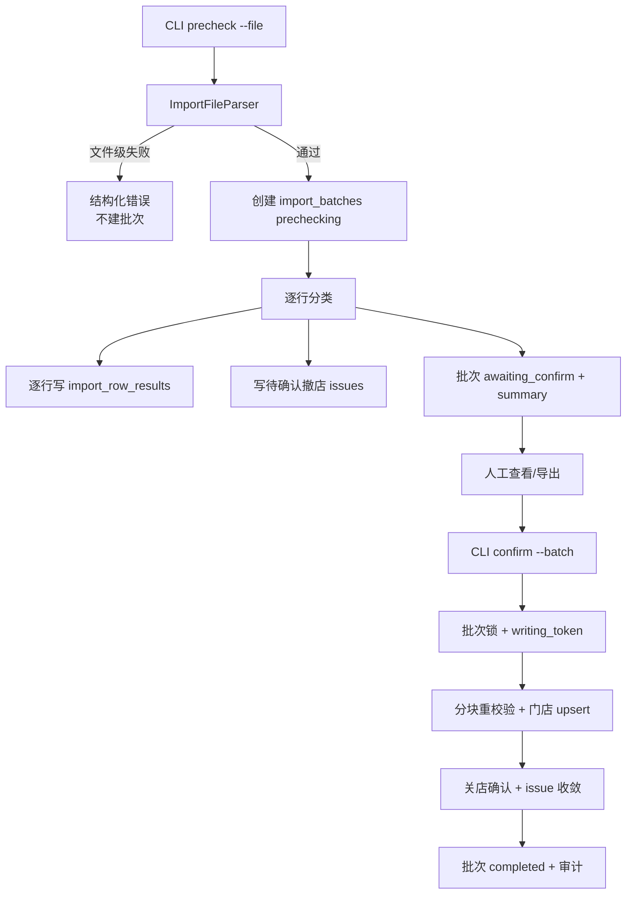

# A 主数据导入（a-master-data-import）· 设计

> **状态**：`draft`
>
> **模式**：Design-First
>
> **需求**：[`requirements.md`](requirements.md)
>
> **实施计划**：[`tasks.md`](tasks.md)（仅规划，尚未执行）
>
> **验收**：[`acceptance.md`](acceptance.md)
>
> **所属域**：A 数据底座 · **目录命名**：`a-master-data-import`，符合 `<代号>-<切片>`
>
> **上游 PRD**：[`prd-domain-a-data-foundation.md`](../../../HBECHO设计方案/prd-domain-a-data-foundation.md) v1.10（2026-11-04，定稿候选）
>
> **数据基线**：[`database-design-v2.md`](../../../HBECHO设计方案/domains/data-foundation/database-design-v2.md)（draft，2026-11-04 十项修订后；本 spec 另提六项修订，见 §6.2）
>
> **最近核对**：2026-11-05
>
> **更新日期**：2026-11-05（审查修订：上游列名；删除「标为撤销」；去掉 `store_code_match`；确认续跑与 fencing；待确认撤店范围与 issue 收敛；结构命令收窄；贴合已落地的 tracer 代码）

## 1. Overview

本 spec 的最小纵向结果是：

```text
权威主档导出 CSV（11 列，上游 xlsx 原列名）
→ 文件级校验（大小 / 行数 / 编码 / 表头 / CSV 结构）
→ 批次 + 逐行预检（只写批次与行结果）
→ 六类差异报告 + 待确认撤店清单
→ 确认写入（门店 upsert；结构变更仅超管）
→ 批次终态 + 行结果可查 + 回流 CSV
```

两条互斥的确认路径：

| 模式 | 持有 Capability | 能做什么 |
|---|---|---|
| `import` | `data.master_data.import` | 只在授权品牌内写门店非结构字段；在已有结构下新增门店；Q 行只记录 |
| `structure` | `data.master_data.structure` | 在 `import` 能力之上，把 Q 行中的**新经销商、经销商改名与启用、门店换经销商或板块**应用到主档；品牌 / 大区 / 分公司 / 板块只来自 bootstrap 种子 |

> `structure` 模式只解决「初次上线时文件里带出的大量经销商」这一类批量结构输入；它不是 `import` 的例外，也不允许总部使用。B-D34 仍然成立：普通批量导入不写结构。

## 2. Authority and Evidence Levels

### 2.1 Decision order

1. [`CONTEXT.md`](../../../CONTEXT.md)：领域语义与不变量；
2. A 域 PRD v1.10.1：导入语义、组织规则、验收标准；
3. v2：组织主档、导入批次、行结果、质量问题的物理基线；
4. F 域 PRD v1.0.2：F5 的文件级校验、六类报告、回流与用户旅程；与 A 冲突时按 A；
5. B 域 PRD v1.21：Capability 名称与品牌范围；不复制其实现；
6. ADR-0005 / 0008 / 0010 / 0013：应用栈、门店身份、品牌交集、目录；
7. 本 spec。

### 2.2 Evidence labels

| 等级 | 含义 | 本设计中的例子 |
|---|---|---|
| `invariant` | 必须遵守 | 门店身份是 `store_id`；停用不删除；预检不写业务表；导入不自动撤店 |
| `baseline` | 当前实施基线 | v2 的 7 张组织表（已在 `src/db/schema/org.ts` 落地）、`import_batches`、`import_row_results`、`data_quality_issues` |
| `observed` | 有保存样本 | 种子 CSV 的 42 行分公司 → 大区；本地真实导出 `最终的权威信息.xlsx`（8,327 行，已被 `.gitignore` 排除，不入库）：撤店情况全是「无撤销」、数字门店全是「否」、主营业务编码只有 13/15/23/25/33、42 个分公司编码全部命中种子、无重复门店编码、无首尾空白；12 行商家渠道编码为 `--` / `#N/A`；去掉哨兵后有 5,275 个不同的商家渠道编码，其中 180 个同时出现在日立与海信/约克的行里（经销商是跨品牌的全局实体） |
| `candidate` | 本设计建议，可在评审前调整 | 品牌 / 板块编码、reason code 命名、20% 疑似不完整阈值 |
| `unknown` | 没有证据 | 下一期导出的新经销商比例、10,000 行在测试机的实际耗时 |

本 spec 没有供应商样本，也不需要：全部输入是文件与数据库。

## 3. Goals and Non-goals

### 3.1 Goals

- 用一份权威导出完成组织主档的门店层刷新，且预检与写入严格分离；
- 任何一行失败都能在库里追溯、导出、重试；
- 门店身份与编码分离（ADR-0008），撤店只能人工确认；
- 结构变更只能由超管执行，批量导入不成为绕过；
- 默认验证离线、可重复、可在空库上一次迁移成功。

### 3.2 Non-goals

- 本轮不做 F5 路径 1 页面（归属见 §15）；
- 不做真实用户登录、DataScope、Capability 持久化；
- 不建专员、账号、归属、快照、内容、媒资；
- 不做批次回滚、在线编辑、自动重试、定时/API/多文件导入、xlsx；
- 不做品牌 / 大区 / 分公司 / 板块 / 经销商的单条结构命令族（只做 bootstrap、`structure` 模式、门店改码）；
- 不建第二套组织模型、第二套导入账、第二套审计表。

## 4. Ownership and Deep Modules

### 4.1 复用的数据底座事实

| 事实 | 所有者 | 本 spec 的用法 |
|---|---|---|
| `brands/regions/branches/sectors/dealers/stores` | v2 组织主档；`src/db/schema/org.ts` 已建 | 读、写门店非结构字段；bootstrap 与 `structure` 模式写结构 |
| `media_staff` | v2；tracer 已建 | 只读；本 spec 不创建、不修改专员 |
| `import_batches` / `import_row_results` | v2 导入审计；**尚未建表** | 本 spec 建表；主数据导入的唯一写入者 |
| `data_quality_issues` | v2 质量事实；tracer 已建 | 写待确认撤店 issue；不另建待办表 |
| 审计 | B 域契约 | 经 `AuditSink`；pre-B 写结构化日志 |

### 4.2 本 spec 拥有的工作流概念

| 概念 | 说明 |
|---|---|
| `PrecheckBatch` | 一次文件预检的批次状态与分类汇总 |
| `RowClassification` | 一行原文对应的预检类与原因 |
| `PendingClosure` | 本期未出现、等待确认撤店的门店项 |
| `BootstrapSeed` | 3 品牌、4 大区、42 分公司、84 板块的固定种子 |
| `ReturnFile` | 回流 CSV |

### 4.3 模块与职责

| Module | Narrow Interface | 隐藏的深度 |
|---|---|---|
| `ImportFileParser` | `parse(bytes, limits)` | 编码判定、CSV 严格解析、表头、行列数校验、原文保留 |
| `MasterDataImport` | `precheck(input, actor)` / `confirm(batchId, cmd, actor)` | 映射、范围、分类优先级、待确认撤店、批次租约、分块事务、续跑、`structure` 模式的保存点动作 |
| `MasterDataStructure` | `bootstrap(seed, actor)` / `changeStoreCode(storeId, newCode, actor)` | 种子加载、自然键幂等、引用完整性、审计 |
| `ImportBatchQuery` | `list/get/rows/returnFile` | 范围过滤、汇总、BIGINT 字符串化、脱敏、回流 CSV 与公式注入前缀 |

横切入口只有两个函数，不做成可替换的 Port 对象：`assertAllowed(actor, capability, scope)` 与 `audit(event)`（§9、§7.8）。映射 `MappingResolver` 是 `MasterDataImport` 内部的纯函数，不对外暴露。

调用方不能绕过 Module 直接写 `stores`、`import_batches` 或 `import_row_results`。

### 4.4 Internal Interfaces

```ts
type PrecheckMode = 'import' | 'structure'

interface MasterDataImport {
  precheck(input: PrecheckInput, actor: ActorContext): Promise<PrecheckAccepted>
  confirm(batchId: string, command: ConfirmCommand, actor: ActorContext): Promise<ImportBatchSummary>
}

interface MasterDataStructure {
  bootstrap(seed: BootstrapSeed, actor: ActorContext): Promise<BootstrapResult>
  changeStoreCode(storeId: string, newCode: string, actor: ActorContext): Promise<StructureResult>
}

interface ImportBatchQuery {
  list(filter: BatchFilter, actor: ActorContext): Promise<BatchPage>
  get(batchId: string, actor: ActorContext): Promise<BatchDetail>
  rows(batchId: string, page: Page, actor: ActorContext): Promise<RowPage>
  returnFile(batchId: string, actor: ActorContext): Promise<ReturnFileRef>
}

type AssertAllowed = (actor: ActorContext, capability: Capability, scope: BrandScope | 'platform') => void
type AuditSink = (event: AuditEvent) => void

interface PrecheckInput {
  fileName: string
  bytes: Uint8Array
  mode: PrecheckMode
}

interface ConfirmCommand {
  closureStoreIds?: string[]   // 十进制字符串
}
```

`ConfirmCommand` 不接收文件内容：确认只能针对已落库的批次，防止「预检看的文件」与「确认写的文件」不是同一份。

## 5. End-to-end flow



状态：

```text
prechecking → awaiting_confirm → writing → completed
     ↓                ↓             ↓  ↑
precheck_failed   (人工不确认)    failed │（超时/中断后续跑仍回到 writing）
```

- `precheck_failed` 只在批次已建立、但预检过程被内部错误中断时使用；文件级失败不建批次；
- 没有 `cancelled`：不确认就是不动，批次保留；
- `completed` 同时表达「有部分行失败」，用 `summary` 区分，不引入 `partially_completed`；
- `failed` 只用于无法续跑的内部不一致；超时和进程中断停在 `writing`，可续跑。

## 6. Data model

### 6.1 表与归属

| 表 | 本 spec 的动作 | 说明 |
|---|---|---|
| `brands` | bootstrap 写；预检查 | v2 §7.1；种子 3 行 |
| `regions` | bootstrap 写 | v2 §7.2；种子 4 行 |
| `branches` | bootstrap 写 | v2 §7.3；种子 42 行 |
| `sectors` | bootstrap 写 | v2 §7.4；每分公司 2 行 |
| `dealers` | `structure` 模式写 | v2 §7.5；编码来自导出，全局唯一 `UQ(dealer_code)` |
| `stores` | 确认写入 / 改码 | v2 §7.6；补 `source_batch_id` 外键（R6） |
| `media_staff` | **不写** | 本 spec 只读 |
| `import_batches` | 建表；唯一写入者 | 增列按 §6.2 |
| `import_row_results` | 建表；唯一写入者 | `precheck_class` 可空，`outcome` 可空 |
| `data_quality_issues` | 写待确认撤店 issue | 不新增表；`issue_code='store_missing_from_export'` |

### 6.2 v2 修订（实施前必须落回正文）

`import_batches` 与 `import_row_results` 是主数据导入与名单导入共用的表（v2 §9.8）。以下修订**只增列、放宽约束，不删除**名单导入已在用的列。

**R1 · `import_row_results` 增加预检类**

```text
precheck_class VARCHAR(32) NULL
  CHECK (precheck_class IS NULL OR precheck_class IN ('new','update','unchanged','error','needs_superadmin'))
outcome VARCHAR(32) NULL
  CHECK (outcome IS NULL OR outcome IN ('imported','unchanged','conflict','invalid'))
```

- 主数据行的 `precheck_class` 必须非空，由应用保证；名单导入的预检类由 `a-activity-plan` 扩展 CHECK；
- 预检阶段写 `precheck_class`，`outcome` 为 null；确认后写 `outcome`；
- `error` / `needs_superadmin` 行确认后 `outcome` 仍为 null（没有写入）；
- `unchanged` 行确认后 `outcome='unchanged'`；`new/update` 成功为 `imported`，失败为 `conflict`/`invalid`；
- 续跑只处理 `precheck_class IN ('new','update','unchanged') AND outcome IS NULL` 的行。

**R2 · `import_batches` 汇总与租约**

```text
summary JSON NULL
writing_token VARCHAR(36) NULL
heartbeat_at DATETIME(6) NULL
```

- `summary`（主数据批次）：预检时 `{new, update, unchanged, error, needs_superadmin, pending_closure_stores, suspect_incomplete_export}`；确认完成时追加 `{imported, unchanged_written, conflict}`；
- v2 现有的 `new_rows/skipped_rows/error_rows/conflict_rows` 保持原样，供名单导入使用；主数据批次不写这四列（保持 0）；
- `total_rows` 定义为表头之后的数据行数；
- `writing_token` 是确认租约；每个块的事务开头核对它（fencing）；`heartbeat_at` 每块更新，用来判断租约陈旧；
- `status` 保持 v2 六态；`precheck_failed` 的语义按 §5。

**R3 · actor 字段**

```text
import_batches.uploaded_by_actor  VARCHAR(128) NOT NULL
import_batches.confirmed_by_actor VARCHAR(128) NULL
import_row_results.resolved_by_actor VARCHAR(128) NULL
```

- `uploaded_by_user_id/confirmed_by_user_id/resolved_by_user_id` 改为可空，B 域接入后回填；不得造假用户 ID；
- 与 `sync_tasks.submitted_by_actor` 同形。

**R4 · `data_quality_issues` 增加导入批次引用与 actor**

```text
import_batch_id BIGINT NULL  FK → import_batches
resolved_by_actor VARCHAR(128) NULL
CHECK (batch_id IS NULL OR import_batch_id IS NULL)
```

- 现有 `batch_id` 是同步批次引用（tracer 写），导入类 issue 不复用它，只填 `import_batch_id`；
- 关店确认时写 `resolved_by_actor`；B 接入后可另加 user 列，不改语义。

**R5 · v2 §12.1 同步**

- 第 5、6 列名按上游写作「门店所属商家 / 门店所属商家渠道编码」（经销商）；
- 第 3 步补「撤店情况在上游导出里只会是『无撤销』，出现其他值按行级错误处理」；
- 第 8 步补「已 `closed` 的门店再次出现 → 恢复 `active`」；
- 第 9 步补「需超管处理 Q」与「待确认撤店 P」；
- 明确结构变更不进批量导入，由 `structure` 模式、bootstrap 或改码命令完成。

**R6 · `stores.source_batch_id` 外键**

`FK → import_batches(import_batch_id)`，RESTRICT；与 `import_batches` 同一次迁移补上（`org.ts` 的注释已预告）。

> **不新增 `store_code_match`**：门店匹配键保持 v2 现状 `UQ(brand_id, store_code)`，`store_code` 是 `utf8mb4_bin`，按字节精确比较。理由见 MD-D12。
>
> 这六项在 v2 正文改完前，不得写迁移。迁移只能实现已落回基线的列；否则代码与 v2 各说一套。

### 6.3 关键约束

- `stores`：沿用 `UQ(brand_id, store_code)`、`IDX(dealer_id, status)`、`IDX(brand_id, status)`、`IDX(sector_id, status)`、`IDX(source_batch_id)`；
- `import_batches`：`IDX(import_kind, uploaded_at)`、`IDX(plan_id, uploaded_at)`、status CHECK；
- `import_row_results`：`UQ(import_batch_id, row_no)`、`IDX(precheck_class, created_at)`、`IDX(outcome, created_at)`、`IDX(store_id)`；
- `data_quality_issues`：`UQ(issue_fingerprint)`、`IDX(import_batch_id)`；
- 不使用 `ON DELETE CASCADE` 指向组织主档或导入批次；
- 批次、行结果、issue 均不物理删除。

### 6.4 迁移归属

- 组织七表与 `media_staff` 已由 tracer 建立（`drizzle/0000_init_schema.sql`）；本 spec 的迁移只做：`import_batches` / `import_row_results` 建表（含 R1–R3）、`data_quality_issues` 的 R4 列与 CHECK、`stores.source_batch_id` 的 R6 外键；
- 迁移由 `drizzle-kit` 生成；CHECK、外键等 drizzle-kit 不支持的写法用手写 SQL，并在 ADR-0005「已知坑」登记；`verify.sh` 第 4 步会校验 schema 与迁移一致。

## 7. Algorithms

### 7.1 文件级校验

按固定顺序，任一步失败即返回，不创建批次：

1. 字节长度 ≤ `10 * 1024 * 1024`；
2. 编码判定：
   - `EF BB BF` → UTF-8，去掉 BOM；
   - `FF FE` / `FE FF` → UTF-16LE / UTF-16BE，按对应解码；
   - 无 BOM → `TextDecoder('utf-8', {fatal:true})`；失败 → `TextDecoder('gb18030', {fatal:true})`（ADR-0005：依赖 full-icu）；再失败 → 拒绝；
   - `fatal:true` 必须开；任一步解码失败即整批拒绝，不用替换字符继续；
3. 严格 CSV 解析：列数与表头一致、引号闭合、无裸换行在引号外；
4. 首行逐列等于 11 列表头（去 BOM 后比较，大小写与空格敏感）；
5. 数据行数 ≤ 10,000 且 ≥ 1；路径 1 没有示例行（输入是上游导出，不是我方模板）；
6. 表头之后每一行都是候选行，`row_no` 从 1 开始（不含表头）；所有单元格去首尾空白后参与判断，`raw_row` 仍保存原文。

11 列固定顺序（上游 xlsx 原名）：

```text
门店名称, 撤店情况, 是否数字门店, 门店编码,
门店所属商家, 门店所属商家渠道编码, 所属分公司, 分公司编码,
主营业务, 主营业务编码, 店面标准
```

「门店所属商家」在系统里就是经销商，「门店所属商家渠道编码」就是经销商编码（`dealers.dealer_code`）。面向业务的报告与回流文件用文件列名，代码与 reason code 用 `dealer`。

### 7.2 映射

`master-data-mapping.v1` 是代码常量（`src/modules/master-data-import/mappings.v1.ts`），不是数据库表：

| 主营业务编码 | 品牌编码 | 品牌名 | 板块名 |
|---|---|---|---|
| `13` | `hitachi` | 日立 | 家装 |
| `15` | `hitachi` | 日立 | 水机 |
| `23` | `hisense` | 海信 | 家装 |
| `25` | `hisense` | 海信 | 水机 |
| `33` | `york_vrf` | 约克VRF | 家装 |

- 编码按原文去首尾空白后比较；不做数字转换、不补零、不转全角；
- 板块按 `sector_name` 在分公司下查找：`(branch_id, sector_name)`；
- bootstrap 生成的板块编码为 `{branch_code}-water` / `{branch_code}-home`；
- 大区由种子 CSV 的 `分公司编码 → 大区编码/大区名` 建立；种子加载在 `bootstrap` 中完成；
- 品牌、板块、大区的显示名更新不从导入文件进行；本轮也没有改名命令（改名延后，§3.2）。

### 7.3 行分类

固定优先级，命中即停：

| # | 条件 | `precheck_class` | `reason_code` |
|---:|---|---|---|
| 1 | 必填列（除「店面标准」外的 10 列）去空白后为空 | `error` | `missing_required_field` |
| 2 | `撤店情况 ≠ 无撤销` | `error` | `row_withdrawn`（`reason_detail` 写原值） |
| 3 | `是否数字门店 ≠ 否` | `error` | `row_digital_store` |
| 4 | 商家渠道编码 ∈ {`--`, `#N/A`}（空值已被第 1 条拦下） | `error` | `dealer_code_missing` |
| 5 | 主营业务编码未命中映射 | `error` | `main_business_code_unmapped` |
| 6 | 映射出的品牌不在 actor 品牌范围（`structure` 模式除外） | `error` | `brand_not_authorized` |
| 7 | 文件内 `(品牌编码, 门店编码)` 重复 | `error` | `duplicate_store_code_in_file` |
| 8 | 文件内同一商家渠道编码对应不同商家名称 | `error` | `dealer_name_conflict_in_file` |
| 9 | 品牌在 `brands` 中不存在 | `needs_superadmin` | `brand_not_found` |
| 10 | 品牌 `status ≠ active` | `needs_superadmin` | `brand_inactive` |
| 11 | 分公司编码在 `branches` 中不存在 | `needs_superadmin` | `branch_not_found` |
| 12 | 分公司 `status ≠ active` | `needs_superadmin` | `branch_inactive` |
| 13 | 板块 `(branch_id, sector_name)` 不存在 | `needs_superadmin` | `sector_not_found` |
| 14 | 板块 `status ≠ active` | `needs_superadmin` | `sector_inactive` |
| 15 | 经销商编码不存在 | `needs_superadmin` | `dealer_not_found` |
| 16 | 经销商 `status ≠ active` | `needs_superadmin` | `dealer_inactive` |
| 17 | 经销商名称与库中不一致 | `needs_superadmin` | `dealer_name_mismatch` |
| 18 | 门店不存在 | `new` | null |
| 19 | 门店存在，但 `dealer_id` 或 `sector_id` 与解析结果不同 | `needs_superadmin` | `store_relation_change` |
| 20 | 门店存在且 `status='closed'`，其余合法 | `update` | `reactivate_store` |
| 21 | 门店存在，名称或等级不同 | `update` | `store_fields_changed` |
| 22 | 门店存在，名称与等级相同 | `unchanged` | null |

补充规则：

- 第 6 步只用映射出的品牌编码判断，先于任何库内查询：范围外操作者不会看到其他品牌的 `brand_inactive` 等状态；
- 第 7、8 步的重复组只在通过第 1–6 步的行之间形成；组内**所有行**都记 `error`，不选一行保留；这样结构类原因（第 9 步以后）不会让重复组只有一半行被标出；
- 分公司名称与库中不一致不分类：继续往下，并在 `reason_detail` 记 `branch_name_differs`；分公司只按编码解析，改名只在种子里改；
- 第 9–14 步在 1.0 里实际由 bootstrap 保证：只有种子之外的新分公司才会命中 `branch_not_found`，处理方式是在种子 CSV 补行后重跑 bootstrap；
- `店面标准` 允许为空；空值写 `store_tier=NULL`，不把空串写进库；
- `store_name` 去首尾空白后保存；门店名称不是唯一键；
- 商家渠道编码、分公司编码、主营业务编码、门店编码都保存原文（去首尾空白），不做大小写转换；
- 门店编码按字节精确比较（`utf8mb4_bin`），不折叠大小写；
- `撤店情况` 不是「无撤销」只表示该行不导入，**不关闭门店**；撤店只经待确认清单。

### 7.4 `structure` 模式的分类覆盖

`structure` 模式只改变经销商与门店关系类结果，不放松字段级错误：

| 原分类 | `structure` 模式 | 确认时的动作 |
|---|---|---|
| `brand_not_found` / `brand_inactive` | 仍 `needs_superadmin` | 品牌来自 bootstrap 常量 |
| `branch_not_found` / `branch_inactive` | 仍 `needs_superadmin` | 在种子 CSV 补行后重跑 bootstrap |
| `sector_not_found` / `sector_inactive` | 仍 `needs_superadmin` | 板块来自 bootstrap；1.0 没有停用板块的命令，此两条是防御分支 |
| `dealer_not_found` | `new`（`create_dealer`） | 新建经销商，编码与名称原文保存 |
| `dealer_inactive` | `update`（`activate_dealer`） | 启用经销商 |
| `dealer_name_mismatch` | `update`（`update_dealer_name`） | 更新经销商名称当前值 |
| `store_relation_change` | `update`（`change_store_relation`） | 更新门店经销商 / 板块当前值 |

- `structure` 模式不创建品牌、大区、分公司、板块；
- `structure` 模式要求 `data.master_data.structure` 且 `brandScope='all'`；
- 普通 `import` 模式看到上述 Q 行只记录，不动作。

### 7.5 待确认撤店

在预检事务**之外**、行结果写完后计算：

```text
brands_in_file = 文件中能映射出品牌的行所对应的品牌 ∩ actor 品牌范围
                 （structure 模式不受范围限制）
active_stores  = SELECT store_id FROM stores
                 WHERE brand_id IN brands_in_file AND status='active'
present        = 文件中所有能解析出 (brand_id, store_code) 的行
                 （包括 error / needs_superadmin 行；只要行里能解析出品牌与编码）
unresolved     = 品牌无法解析的行里的 store_code 集合
pending        = active_stores - present - {store | store.store_code ∈ unresolved}
```

- 范围只取**文件中出现的品牌**：文件里没有某品牌的任何行，该品牌的门店不进入待确认；
- `present` 包含被过滤的行：如果门店在文件里以「数字门店」或非「无撤销」出现，不算消失；
- 品牌无法解析的行（例如主营业务编码不认识）不能证明门店存在，也不能证明它消失：按 `store_code` 把它们从待确认列表中排除，避免误报；这些行本身仍是 `error`，由人处理（`ponytail:` 跨品牌同编码会被一并排除，只会少报，不会多报）；
- 每项写一条 `data_quality_issues`：`issue_code='store_missing_from_export'`，`entity_type='store'`，`entity_id=store_id`，`import_batch_id`（R4），`severity='warning'`，`status='open'`；
- `issue_fingerprint = SHA-256(issue_code || ':' || import_batch_id || ':' || store_id)`；
- `detail` 存 `store_code/store_name/brand_code/dealer_code/sector_code/last_seen_batch_id`；
- 同一批次重复预检（不应发生）用 upsert 防重；
- `pending_closure_stores` 是 issue 数，不是行数；
- `ponytail:` 待确认数占 `active_stores` 超过 20% 时置 `summary.suspect_incomplete_export=true`，CLI 提示「疑似导出不完整」。20% 是拍脑袋的阈值，没有历史数据支撑；有了几期真实导出再校准。

确认关店（在确认的最后一个事务内，逐店顺序）：

```text
for store_id in closureStoreIds:
  SELECT ... FOR UPDATE store
  require store.status='active'
  UPDATE stores SET status='closed', updated_at=now()
  UPDATE data_quality_issues SET status='resolved', resolved_at=now(),
         resolved_by_actor=actor, resolution_note='confirmed_by_import'
         WHERE import_batch_id=? AND entity_id=? AND issue_code='store_missing_from_export'
  audit(store_closed)
```

任一 `store_id` 不在本批次待确认列表中 → 整个确认命令拒绝，不部分执行（在进入 `writing` 之前校验）。

**issue 收敛**（确认完成时，同一事务内，只处理其他批次遗留的 `open` 的 `store_missing_from_export`，限定在本批文件出现的品牌内）：

| 遗留 issue 的门店 | 处理 | `resolution_note` |
|---|---|---|
| 已 `closed`（包括刚被本批关闭的） | `resolved` | `closed_by_other_batch` |
| 在本批文件中重新出现（`present`） | `resolved` | `store_reappeared` |
| 其余 | `ignored` | `superseded_by_batch:<本批 ID>`，由本批自己的待确认项接续 |

目的：预检了但从未确认的批次、已确认但没勾选的批次，不会在共享的 `data_quality_issues` 里永远停在 `open`。

### 7.6 确认写入

```text
confirm(batchId, {closureStoreIds}, actor):
  1. assertAllowed(actor, import|structure, scope)；校验 closureStoreIds 都在本批待确认列表内
  2. BEGIN; SELECT batch FOR UPDATE
     - completed → 直接返回汇总（不重复审计）
     - awaiting_confirm → status=writing
     - writing 且 heartbeat_at 为空或早于 now-2min → 接手（租约陈旧）
     - writing 且心跳新鲜 → 返回 batch_in_progress，不并发写入
     换发 writing_token = 新 UUID；heartbeat_at = now; COMMIT
  3. 读取该批次 precheck_class in (new,update,unchanged) 且 outcome IS NULL 的行，按 row_no 升序
  4. 每 500 行一块：
       BEGIN
       SELECT batch FOR UPDATE；writing_token 不是自己的 → ROLLBACK，退出 lease_lost（fencing）
       for row:
         SAVEPOINT
         重新做门店层分类（§7.3 第 18–22 步，结构层按当前模式判断）
         与预检类比较：
           相同，或预检为 update 而现在已是 unchanged（已收敛）→ 继续
           其余不一致 → outcome=conflict, reason=precheck_stale；RELEASE
         apply：
           new       → （structure 模式先应用结构动作）INSERT store；
                       唯一键冲突(1062) → ROLLBACK TO SAVEPOINT；outcome=conflict, reason=store_unique_conflict
           update    → （structure 模式先应用结构动作）UPDATE name/tier/status/source_batch_id；值未变 → unchanged，不写 updated_at
           unchanged → outcome=unchanged
         同一事务内写 outcome（与门店写入同成败）
       UPDATE batch heartbeat_at = now
       COMMIT
       若总耗时 > 10 分钟：heartbeat_at=NULL；退出 time_limit_exceeded（稳定错误码，可立即续跑）
  5. 关店确认与 issue 收敛（§7.5），短事务
  6. 汇总：summary 追加 {imported, unchanged_written, conflict}；status=completed；audit(import_confirmed)
```

要点：

- 每块一个事务，块之间释放锁；不在事务里解析文件或做网络 IO；
- 行级失败只回滚该行的保存点，不因一行失败回滚整块已成功的其他行；
- 新建门店**先 INSERT**，不先 `SELECT … FOR UPDATE` 一个不存在的键（REPEATABLE READ 下会取间隙锁，并发时容易死锁）；
- 续跑只处理 `outcome IS NULL` 的行；行的 `outcome` 和它的门店写入同一事务提交，所以崩溃后不会出现「门店写了、行结果没写」，也不会把已 `imported` 的行改写成 `unchanged`；
- 租约：`writing_token` 是 fencing token。被接手的旧进程在下一个块开头发现 token 变了，直接退出，不再写任何东西；心跳阈值 2 分钟远小于 10 分钟总时限，所以接手不会发生在一次正常运行的中途；
- 同一批次另一个 `confirm` 在 `SELECT FOR UPDATE` 上等待；前者完成后后者看到 `completed` 直接返回；
- `structure` 模式的结构动作与该行门店写入在同一个保存点内：新建经销商可以被后续行复用（允许）；但该行自身的门店写入必须同成败。同一经销商被多行引用时，后一行看到前一行已建的经销商，名称一致即复用，不一致记 `conflict`（文件内名称冲突已在第 8 步被拦下，这里只防并发）。

### 7.7 结构操作

自然键：

| 对象 | 自然键 |
|---|---|
| 品牌 | `brand_code` |
| 大区 | `region_code` |
| 分公司 | `branch_code` |
| 板块 | `sector_code`（`{branch_code}-water` / `{branch_code}-home`） |
| 经销商 | `dealer_code` |
| 门店 | `store_id` |

**bootstrap**：

1. 3 个品牌：`hitachi/日立`、`hisense/海信`、`york_vrf/约克VRF`；
2. 4 个大区：来自种子 CSV 的去重 `大区编码 → 大区名`；读 CSV 时去掉 UTF-8 BOM；
3. 42 个分公司：来自种子 CSV 的 `分公司编码 → 分公司名 → 大区`；
4. 每个分公司 2 个板块：先按 `(branch_id, sector_name)` 查，存在则复用；不存在才用编码 `{branch_code}-water` / `{branch_code}-home` 新建；
5. 全部在一个事务内 upsert；重复执行全部 `unchanged`；自然键存在但字段不同 → 记 `conflict`，不覆盖（bootstrap 只新增，不改名）；
6. 种子里同一分公司对应多个大区 → 整批失败；
7. 写一条 `bootstrap_completed` 审计事件，包含各对象计数，不含全量行。

新增一个分公司 = 在种子 CSV 补一行后重跑 bootstrap。

**`store change-code`**：对指定 `store_id` 写新的 `store_code`。`store_id` 不变；新码与同品牌其他门店冲突 → 返回冲突；记审计。上游编码以最终 11 列为准，不预期出现新旧编码成对出现，所以不做「疑似换码」提示，也不提供批量改码。

不创建经销商与门店之外的任何对象：经销商与门店来自权威导出，由 `structure` 模式或普通导入创建。

### 7.8 审计事件

| `event_type` | 触发 | 关键字段 |
|---|---|---|
| `import_precheck_completed` | 预检批次完成 | batch_id、分类汇总、文件哈希 |
| `import_confirmed` | 批次 `completed` | batch_id、汇总、关店数 |
| `store_closed` | 确认撤店 | store_id、batch_id、before status |
| `store_reactivated` | 已撤店门店恢复 | store_id、batch_id |
| `structure_changed` | `structure` 模式动作、门店改码 | target_type、target_id、reason_code、before/after |
| `bootstrap_completed` | bootstrap | 品牌/大区/分公司/板块计数 |
| `import_confirmation_rejected` | 授权或批次状态拒绝 | batch_id、actor、reason_code |

`audit(event)` 的 1.0 实现写应用日志（pino）：一行一条 JSON，含 `event_type`、`reason_code`、`actor`、`occurred_at`、目标 ID、批次 ID；不写文件内容、不写 secret、不写整行原文。B 域接入后替换为持久化审计，调用方不变。批次与行结果本身（含 `confirmed_by_actor`、`resolved_by_actor`）已是持久记录；门店改码与 bootstrap 没有批次，pre-B 只有日志（§12）。

## 8. Failure semantics

| 情形 | 行为 | 用户可见 |
|---|---|---|
| 文件级失败 | 不建批次、不写库 | 结构化错误 + 样本 |
| 批次预检内部错误 | 批次 `precheck_failed`，已写行结果保留 | 可重试同一文件（新批次） |
| 单行字段/映射错误 | `error`，不阻塞其他行 | 回流文件含原因 |
| 单行结构缺失 | `needs_superadmin`，不阻塞其他行 | 回流给超管 |
| 预检后结构变化 | `conflict` / `precheck_stale`，不写 | 批次详情可见 |
| 唯一键竞争 | `conflict` / `store_unique_conflict`，不写该行 | 可重试 |
| 数据库连接中断 / 进程被杀 | 批次停留 `writing`，租约陈旧后下次确认续跑 | 批次状态 + 心跳 |
| 确认超过 10 分钟 | 在块边界停下，`time_limit_exceeded`，可立即续跑 | 稳定错误码 |
| 被接手的旧进程继续写 | 下一个块开头 `lease_lost` 退出，不写 | 稳定错误码 |
| 授权拒绝 | 命令开始前拒绝 | 稳定错误码，无部分写入 |
| 批次不存在 | 未找到 | 不返回空列表 |
| 关闭一个本批次未列为待确认的门店 | 整条确认拒绝（进入 `writing` 之前） | 错误列表 |

## 9. Authorization seam

1.0（B 未实现）：

```ts
interface ActorContext {
  actor: string                 // 例：service:master-data-import
  capabilities: Set<Capability>
  brandScope: string[] | 'all'  // 服务身份必须显式声明
}
```

- CLI 从受控配置（环境变量或本地配置文件）构造 actor；不提供命令行参数直接声明超管；
- 配置文件缺失或 `brandScope` 未声明 → 启动失败；
- `assertAllowed` 是唯一入口；Module 内部不读角色名；
- B 接入后，`ActorContext` 改由会话与授权链构造，Module 不变；
- `structure` 模式、bootstrap 与改码要求 `data.master_data.structure`，且 `brandScope='all'`；普通导入要求 `data.master_data.import` 且 `brandScope` 为品牌数组。

## 10. 对既有代码与依赖的改动

tracer 任务 1–9 已合并，本 spec 在其上增量：

| 位置 | 改动 |
|---|---|
| `src/db/schema/` | 新增 `import.ts`（`import_batches`、`import_row_results`）；`org.ts` 补 `stores.source_batch_id` 外键（R6）；`sync.ts` 的 `data_quality_issues` 补 R4 列与 CHECK；在 schema 汇总导出处登记新表 |
| `drizzle/` | 新增一份迁移（手写部分登记 ADR-0005 已知坑） |
| `src/modules/master-data-import/` | 本 spec 的模块、映射、解析、分类、结构操作；测试与源码同目录：纯函数 `*.test.ts`（`unit` project），需要 MySQL 的 `*.db.test.ts`（`db` project） |
| `src/worker/master-data-cli.ts` | 新 CLI 入口，沿用 `src/worker/cli.ts` 的 `runCli(argv, deps)` + JSON 输出 + 退出码约定（0 成功 / 2 校验、授权 / 3 冲突 / 4 不存在 / 1 其他）；`package.json` 增加 `master-data` script |
| `tests/fixtures/master-data/` | CSV fixture（UTF-8 / GB18030 / 错误样本，脱敏造数，不放真实商家名） |
| `tests/harness/` | 复用 `network-deny.ts`、`db.ts`、`fake-clock.ts`、`audit.ts`；不新增禁网设施 |
| `scripts/verify.sh` | 已覆盖 typecheck + 单元 + 迁移一致 + 数据库测试；本 spec 不改入口 |
| ADR | ADR-0014（accepted，2026-11-05）：CSV 解析依赖（编码判定沿用 ADR-0005） |

依赖选择（no-reinventing-wheels 第 6 级）：

```
采用：csv-parse 7.x（MIT；所属仓库 adaltas/node-csv ⭐ 4,288，2026-11-03 仍有提交；ADR-0014 accepted）
用途：严格 CSV 解析（引号、换行、列数、BOM）
不用它做什么：不做编码判定、不做业务分类、不写库

不采用：iconv-lite
原因：ADR-0005 已决定 GB18030 用 Node 内置 TextDecoder('gb18030', {fatal:true})，
      依赖 full-icu；再引入转码库会形成第二套解码路径
```

- 2026-11-05 刘学奎把 steering 第 6 级的星标线由 5,000 下调为 3,000，csv-parse（⭐ 4,288）满足新阈值，不再是例外；选它而不是 PapaParse 的原因是严格模式（列数、未闭合引号直接报错）。`package.json` 目前还没有 CSV 库，任务 3 加入精确版本；
- 不引入 xlsx、不引入编码探测库（判定顺序已固定，探测库反而引入不确定性）；
- Node 24 自带 full-icu；任务 3 用一条独立测试锁住 `TextDecoder('gb18030')` 可用；
- 编码判定与 CSV 解析必须封装在 `ImportFileParser`，其他模块不得直接依赖 `csv-parse`。

## 11. Testing strategy

| 层 | 对象 | 方式 |
|---|---|---|
| 纯函数 | 编码判定、表头、映射、分类、回流转义 | Vitest `unit` project，固定字节 fixture |
| 运行时能力 | `TextDecoder('gb18030', {fatal:true})` 可用 | 一条独立测试；full-icu 缺失时该测试失败并提示运行时问题 |
| 真实 MySQL | 批次租约、分块事务、门店 upsert、唯一键、续跑、并发确认 | `*.db.test.ts`（`db` project，`scripts/with-test-mysql.sh` 一次性 MySQL 8.4 / `_test` 库） |
| 模块集成 | precheck → confirm → query → returnFile | 真实 DB + 内存 audit sink |
| 手工 | 预检报告可读性、回流文件在 Excel 中打开、审计日志内容、本地真实文件预检演练 | 见 acceptance |

- 默认禁网：沿用 `tests/harness/setup.ts`；
- 时间：确定性时钟注入，便于断言心跳与租约陈旧；
- 不在测试里用 `Promise.all` 抢同一门店行锁；并发测试用两个独立连接顺序触发；
- 10,000 行用测试代码生成，不提交大文件。

## 12. Explicit non-goals and known limits

- 本轮没有 F5 页面；业务人员暂时只能用 CLI；
- 没有真实用户认证；1.0 只有受限服务身份，品牌范围来自配置；
- 没有 DataScope 组织范围；ADR-0010 的另一半在 B 接入后补齐；
- 没有批次回滚；错误只能通过新文件重试或超管单条处理；
- `structure` 模式不创建品牌、大区、分公司、板块；
- 10,000 行的 10 分钟上限：本机（Mac + docker MySQL 8.4）实测预检约 0.5 秒、确认约 18–20 秒、RSS 约 180–250 MB（2026-11-05）；测试 ECS 上（2026-11-05）预检 564 ms、确认 6.9 s、RSS 277 MB；生产硬件不跑测试；
- 文件级失败不建批次，因此文件级错误的审计只存在应用日志，不在数据库；
- bootstrap、门店改码没有批次，pre-B 的审计只有应用日志，日志轮转后无法追溯；B 域持久化审计上线前，操作者自己保留命令记录；
- 门店编码按字节精确比较，不折叠大小写、不去除内部空格；ADR-0008 后果一节「另存去空格与大小写的匹配值」本 spec 未落实（真实样本无此需求）。如果日后出现大小写重码，先改 ADR 再加生成列；
- 上游「撤店情况」只会是「无撤销」：非该值的行按行级错误处理，本 spec 不提供「标为撤销」的关店通道；
- 回流文件里的 `'` 前缀是展示保护，业务重新上传前需去掉（MD-8）。

## 13. Decision records

| # | 决策 | 理由 | 决策人 / 日期 |
|---|---|---|---|
| MD-D01 | 本 spec 包含超管结构操作与 `structure` 模式 | 初次上线必须能把文件中的经销商与关系写入；没有别的 spec 拥有结构变更 | 刘学奎，2026-11-04 |
| MD-D02 | 本轮入口为 CLI + Module seam | B 未实现；保持与 tracer 一致 | 刘学奎，2026-11-04 |
| MD-D03 | 确认写入同步、有界（10,000 行 / 10 分钟） | 不新增任务表；避免 Worker 与导入状态的第二套队列 | 刘学奎，2026-11-04 |
| MD-D04 | 已 `closed` 门店再次出现 → 自动 `active` + 审计 | 重新开业是正常业务；编码未变，身份不变 | 刘学奎，2026-11-04 |
| MD-D05 | 分类用 `precheck_class` 持久化，`outcome` 确认后才写 | 预检与写入是两个阶段，不能用「imported」冒充「预检为新增」 | AI 提议，待刘学奎确认 |
| MD-D06 | 待确认撤店用 `data_quality_issues`，不建待办表 | 复用既有质量问题事实；v2 不新增表 | AI 提议，待刘学奎确认 |
| MD-D07 | 品牌/板块编码采用 `hitachi/hisense/york_vrf`、`water/home` | 编码是稳定属性；中文名只作显示 | AI 提议，待刘学奎确认 |
| MD-D08 | 表头逐列完全一致（上游原列名），不做别名兼容 | 11 列文件没有版本列；别名兼容会让「多出的列」悄悄混进来 | 刘学奎，2026-11-05（见 MD-D13） |
| MD-D09 | 同一文件重复提交建新批次、全 `unchanged` | 满足 A §14「不产生额外数据」，同时保留每次提交的审计边界 | AI 提议，待刘学奎确认 |
| MD-D10 | 预检不设过期；确认时逐行重校验 | 避免预检过期带来的可用性问题；用 `precheck_stale` 防止旧结果覆盖新事实 | AI 提议，待刘学奎确认 |
| MD-D11 | pre-B 审计写结构化日志，B 接入后替换 sink | 不新建平行审计表；不冒充 B 域的持久化审计 | AI 提议，待刘学奎确认 |
| MD-D12 | **不新增** `store_code_match`；匹配键保持 `UQ(brand_id, store_code)` | 真实导出 8,327 行无大小写差异、空白、重复；加列意味着一次迁移和第二套匹配语义；ADR-0008 的「另存匹配值」是后果描述，不是硬约束（取代 2026-11-04 初稿） | 刘学奎同意审查意见，2026-11-05 |
| MD-D13 | 文件列名以上游 xlsx 为准（「门店所属商家」「门店所属商家渠道编码」），业务转 CSV 前删去「负责人」列 | 避免每期手工改列名；与真实导出一致 | 刘学奎，2026-11-05 |
| MD-D14 | 导出里「撤店情况」只会是「无撤销」；删除 `store_marked_withdrawn` | 「提交初审 / 审核失败 / 撤销成功 / 已升级…」都是未正常营业，不会进最终导出；这些值的含义也未经业务确认 | 刘学奎，2026-11-05 |
| MD-D15 | 不预期新旧编码成对出现；不做「疑似换码」提示 | 上游编码以最终 11 列为准 | 刘学奎，2026-11-05 |
| MD-D16 | 确认写入用 `writing_token` 做 fencing，续跑只处理 `outcome IS NULL` 的行，超时在块边界停下 | tech 基线要求租约与 fencing；旧设计从第一行重跑会把 `imported` 改写成 `unchanged` | 刘学奎同意审查意见，2026-11-05 |
| MD-D17 | 待确认撤店范围 = 文件中出现的品牌；确认完成时收敛旧批次遗留 issue；疑似不完整给提示 | 防止部分导出把整个品牌列为消失；防止 issue 永远 `open` | 刘学奎同意审查意见，2026-11-05 |
| MD-D18 | 页面任务不在本轮；等 B 可登录、UI 基线定稿、原型走查后再写 | 页面需要登录和授权；规则复杂的页面先做原型（structure 规则） | 刘学奎，2026-11-05 |
| MD-D19 | 结构操作收窄为 bootstrap、`structure` 模式、门店改码；单条命令族延后 | 当前真实需求只有这三类；`structure` 模式不创建板块（bootstrap 已为 42 个分公司各建两个） | 刘学奎同意审查意见，2026-11-05 |
| MD-D20 | 共享表 `import_batches` / `import_row_results` 只增列、放宽约束，不删除名单导入在用的列；主数据汇总放 `summary JSON` | 名单导入（`a-activity-plan`）共用这两张表 | 刘学奎同意审查意见，2026-11-05 |

## 14. Open items

以下为需要在评审时确认的候选决定，未确认前不写代码：

1. ~~品牌 / 板块编码的具体字符串（MD-D07）是否是业务接受值~~ —— 已确认（刘学奎，2026-11-05），`hitachi` / `hisense` / `york_vrf` 与 `{分公司}-water` / `{分公司}-home` 不变；
2. 10,000 行 / 10 分钟上限在测试机的实测结果（任务 8 回填）；
3. B 域接入时 `ActorContext` 的字段映射（B spec 开工时对齐）；
4. ~~两条待确认的业务规则~~：路径 1 无模板版本号与示例行（第 6 项）、分公司只按编码匹配（第 14 项）已确认（刘学奎，2026-11-05）；
5. ~~F5 路径 1 页面范围~~（第 15 项）：已确认——本 spec 只拥有「导入页 + 批次列表 / 详情」，「组织与门店浏览」「结构变更」另立 spec；见 §15；
6. **行数上限（已确认保持 10,000，刘学奎 2026-11-05）**：真实导出 8,327 行，余量约 17%。将来门店数逼近上限时，再按「已编号决策修订」流程修订 F-D12。同目录的《门店信息报表》含全部状态共 12,564 行，不是本文件，不能直接上传；
7. ~~`csv-parse` 例外~~：已由 ADR-0014 关闭（星标线下调为 3,000）；
8. **业务操作说明**：从 xlsx「门店信息数据」sheet 删去「负责人」列并另存为 CSV 的步骤，写进模板说明（F 域文档），并在说明里提醒不要用 Excel 重新排列列。

已关闭（2026-11-05，刘学奎）：列名用上游原名（第 5 项）；删除「标为撤销」机制（第 13 项）；不做「疑似换码」（第 17 项）。

## 15. 界面（占位，2026-11-05）

> 本节按 [`ui-foundation.md`](../../../HBECHO设计方案/ui/ui-foundation.md) §8 的模板预留。**本轮任务不包含页面。**

### 15.1 为什么页面不排在本轮

- 页面需要真实登录和 Capability，而 `b-access-control` 在路线图第 4 位，页面现在没有可用的身份；
- 本轮 CLI 已经覆盖业务操作的全流程（预检、确认、查询、回流），首次上线是一次性动作，CLI 足够；
- `ui-foundation.md` 仍是 draft；规则复杂的页面按 structure 规则「先做可点击原型，请业务按真实任务走一遍，再写 tasks.md」；
- 业务可读性的风险（六类名称、原因文案）先用 CLI 输出与回流 CSV 验证（acceptance M1），再把确认过的措辞带进页面。

### 15.2 进入条件（页面开工前都要满足）

1. B 域可登录且 Capability 生效；
2. `ui-foundation.md` 定稿；
3. 原型走查通过（业务按真实文件走一遍：上传 → 看六类 → 勾选待确认撤店 → 确认 → 看回流），原型放 `ui-lab/a-master-data-import/`；
4. 本节 15.3–15.7 补全，并在末尾增加「15.8 界面设计确认」（确认人、日期、范围、原型链接）——**经刘学奎明确确认前，不得写页面任务与页面代码**（`structure` steering）。

### 15.3 页面清单（待补）

| 页面 | 角色 | 入口 | 主要操作 | 对应 Capability | 归属 |
|---|---|---|---|---|---|
| 主数据导入（F5 路径 1） | `platform_admin`、`hq_manager` | 主数据 → 导入 | 上传 → 预检报告 → 勾选待确认撤店 → 确认写入 | `data.master_data.import` / `structure` | 本 spec（建议） |
| 导入批次列表与详情 | 同上 | 主数据 → 导入记录 | 查看汇总、行明细、下载回流文件 | 随导入权限 | 本 spec（建议） |
| 组织与门店浏览 | 同上 | 主数据 | 浏览、单条纠错 | `data.master_data.correct` | 另立 spec（建议，待确认） |
| 结构变更（超管） | `platform_admin` | 主数据 → 结构 | 经销商 / 板块 / 门店关系 / 停用启用 / 改码 | `data.master_data.structure` | 另立 spec（建议，待确认） |

### 15.4 用户流程（待补）
### 15.5 线框（待补，放 `wireframes/`）
### 15.6 状态矩阵（待补）
### 15.7 字段可见性（待补）
