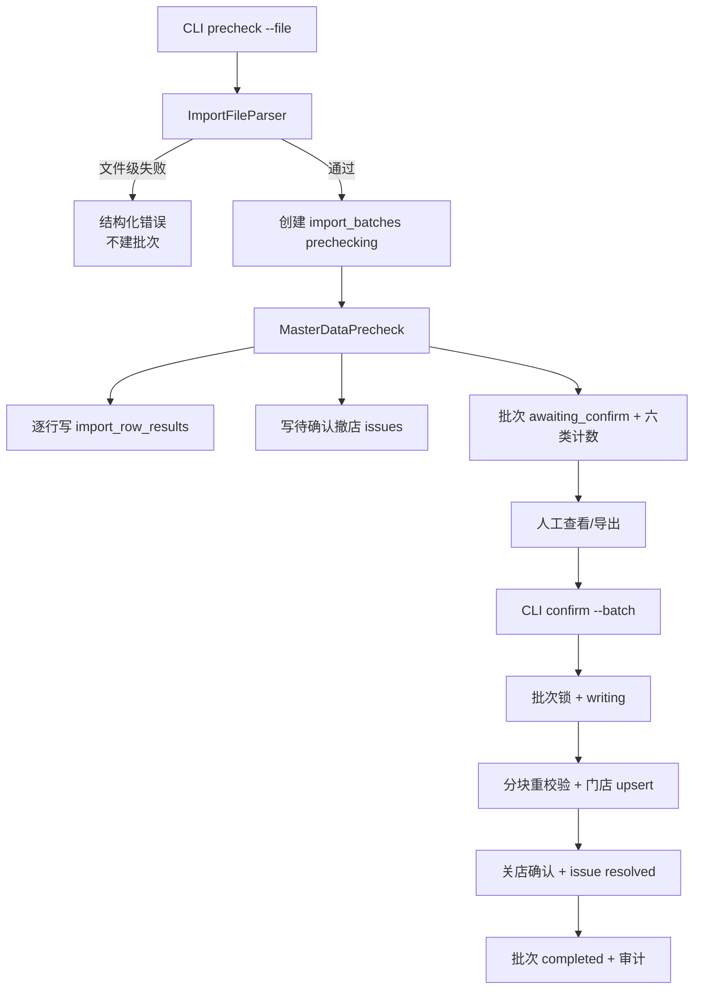

# A 主数据导入（a-master-data-import）· 设计

> **状态**：`draft`
>
> **模式**：Design-First
>
> **需求**：[`requirements.md`](requirements.md)
>
> **实施计划**：[`tasks.md`](tasks.md)（仅规划，尚未执行）
>
> **验收**：[`acceptance.md`](acceptance.md)
>
> **所属域**：A 数据底座 · **目录命名**：`a-master-data-import`，符合 `<代号>-<切片>`
>
> **上游 PRD**：[`prd-domain-a-data-foundation.md`](../../../HBECHO设计方案/prd-domain-a-data-foundation.md) v1.10（2026-11-04，定稿候选）
>
> **数据基线**：[`database-design-v2.md`](../../../HBECHO设计方案/domains/data-foundation/database-design-v2.md)（draft，2026-11-04 十项修订后；本 spec 另提三处修订，见 §6.2）
>
> **最近核对**：2026-11-04
>
> **更新日期**：2026-11-04（初建）

## 1. Overview

本 spec 的最小纵向结果是：

```text
权威主档导出 CSV（11 列）
→ 文件级校验（大小 / 行数 / 编码 / 表头 / CSV 结构）
→ 批次 + 逐行预检（只写批次与行结果）
→ 六类差异报告 + 待确认撤店清单
→ 确认写入（门店 upsert；结构变更仅超管）
→ 批次终态 + 行结果可查 + 回流 CSV
```

两条互斥的确认路径：

| 模式 | 持有 Capability | 能做什么 |
|---|---|---|
| `import` | `data.master_data.import` / `correct` | 只在授权品牌内写门店非结构字段；在已有结构下新增门店；Q 行只记录 |
| `structure` | `data.master_data.structure` | 在 `import` 能力之上，把 Q 行中的**新经销商、经销商改名、分公司下新板块、门店换关系**应用到结构主档；品牌 / 大区 / 分公司本身仍只经单条结构命令 |

> `structure` 模式只解决「初次上线时文件里带出的大量经销商」这一类批量结构输入；它不是 `import` 的例外，也不允许总部使用。B-D34 仍然成立：普通批量导入不写结构。

## 2. Authority and Evidence Levels

### 2.1 Decision order

1. [`CONTEXT.md`](../../../CONTEXT.md)：领域语义与不变量；
2. A 域 PRD v1.10：导入语义、组织规则、验收标准；
3. v2：组织主档、导入批次、行结果、质量问题的物理基线；
4. F 域 PRD v1.0.1：F5 的文件级校验、六类报告、回流与用户旅程；与 A 冲突时按 A；
5. B 域 PRD v1.21：Capability 名称与品牌范围；不复制其实现；
6. ADR-0005 / 0008 / 0010 / 0013：应用栈、门店身份、品牌交集、目录；
7. 本 spec。

### 2.2 Evidence labels

| 等级 | 含义 | 本设计中的例子 |
|---|---|---|
| `invariant` | 必须遵守 | 门店身份是 `store_id`；停用不删除；预检不写业务表；导入不自动撤店 |
| `baseline` | 当前实施基线 | v2 的 7 张组织表、`import_batches`、`import_row_results`、`data_quality_issues` |
| `observed` | 有保存样本 | 种子 CSV 的 42 行分公司 → 大区；A §14 的六类验收 |
| `candidate` | 本设计建议，可在评审前调整 | 品牌 / 板块编码、`store_code_match` 生成列、reason code 命名 |
| `unknown` | 没有证据 | 真实导出的编码分布、门店数量、10,000 行在本机的实际耗时 |

本 spec 没有供应商样本，也不需要：全部输入是文件与数据库。

## 3. Goals and Non-goals

### 3.1 Goals

- 用一份权威导出完成组织主档的门店层刷新，且预检与写入严格分离；
- 任何一行失败都能在库里追溯、导出、重试；
- 门店身份与编码分离（ADR-0008），撤店只能人工确认；
- 结构变更只能由超管执行，批量导入不成为绕过；
- 默认验证离线、可重复、可在空库上一次迁移成功。

### 3.2 Non-goals

- 本轮不做 F5 路径 1 页面（归本 spec，UI 基线定稿后补，见 §15）；
- 不做真实用户登录、DataScope、Capability 持久化；
- 不建专员、账号、归属、快照、内容、媒资；
- 不做批次回滚、在线编辑、自动重试、定时/API/多文件导入、xlsx；
- 不建第二套组织模型、第二套导入账、第二套审计表。

## 4. Ownership and Deep Modules

### 4.1 复用的数据底座事实

| 事实 | 所有者 | 本 spec 的用法 |
|---|---|---|
| `brands/regions/branches/sectors/dealers/stores` | v2 组织主档 | 读、写门店非结构字段；结构命令写结构 |
| `media_staff` | v2；DDL 由 tracer 任务 2 首次建立 | 只读；本 spec 不创建、不修改专员 |
| `import_batches` / `import_row_results` | v2 导入审计 | 本 spec 是唯一写入者 |
| `data_quality_issues` | v2 质量事实 | 写待确认撤店 issue；不另建待办表 |
| 审计 | B 域契约 | 经 `AuditPort`；pre-B 写结构化日志 |

### 4.2 本 spec 拥有的工作流概念

| 概念 | 说明 |
|---|---|
| `PrecheckBatch` | 一次文件预检的批次状态与六类计数 |
| `RowClassification` | 一行原文对应的预检类与原因 |
| `PendingClosure` | 本期未出现、等待确认撤店的门店项 |
| `StructureCommand` | 仅超管可用的单条组织变更 |
| `BootstrapSeed` | 3 品牌、4 大区、42 分公司、84 板块的固定种子 |
| `ReturnFile` | 回流 CSV |

### 4.3 模块与职责

| Module | Narrow Interface | 隐藏的深度 |
|---|---|---|
| `ImportFileParser` | `parse(bytes, limits)` | 编码判定、CSV 严格解析、表头、行列数校验、原文保留 |
| `MasterDataPrecheck` | `precheck(parsed, actor, mode)` | 映射、范围、结构解析、六类优先级、待确认撤店、行结果写入 |
| `MasterDataImportCommandModule` | `precheck(input, actor)` / `confirm(batchId, cmd, actor)` | 批次锁、分块事务、幂等、恢复、Q 行边界 |
| `MasterDataStructureModule` | `execute(command, actor)` / `bootstrap(seed, actor)` | 自然键幂等、引用完整性、审计、bootstrap |
| `ImportBatchQuery` | `list/get/rows/returnFile` | 范围过滤、计数聚合、BIGINT 字符串化、脱敏 |
| `MappingResolver` | `brandSector(code)` / `branch(code)` | 版本化映射、精确文本比较、种子加载 |
| `AuthorizationPort` | `assert(actor, capability, scope)` | Capability、品牌集合、超管判定；1.0 服务身份策略 |
| `AuditPort` | `record(event)` | pre-B 结构化日志；B 接入后换持久化 |

调用方不能绕过 Module 直接写 `stores`、`import_batches` 或 `import_row_results`。

### 4.4 Internal Interfaces

```ts
type PrecheckMode = 'import' | 'structure'

interface MasterDataImportCommandModule {
  precheck(input: PrecheckInput, actor: ActorContext): Promise<PrecheckAccepted>
  confirm(batchId: string, command: ConfirmCommand, actor: ActorContext): Promise<ImportBatchSummary>
}

interface MasterDataStructureModule {
  execute(command: StructureCommand, actor: ActorContext): Promise<StructureResult>
  bootstrap(seed: BootstrapSeed, actor: ActorContext): Promise<BootstrapResult>
}

interface ImportBatchQuery {
  list(filter: BatchFilter, actor: ActorContext): Promise<BatchPage>
  get(batchId: string, actor: ActorContext): Promise<BatchDetail>
  rows(batchId: string, page: Page, actor: ActorContext): Promise<RowPage>
  returnFile(batchId: string, actor: ActorContext): Promise<ReturnFileRef>
}

interface AuthorizationPort {
  assert(actor: ActorContext, capability: Capability, scope: BrandScope | 'platform'): void
}

interface AuditPort {
  record(event: AuditEvent): Promise<void>
}

interface PrecheckInput {
  fileName: string
  bytes: Uint8Array
  mode: PrecheckMode
}

interface ConfirmCommand {
  closureStoreIds?: string[]   // 十进制字符串
}
```

`ConfirmCommand` 不接收文件内容：确认只能针对已落库的批次，防止「预检看的文件」与「确认写的文件」不是同一份。

## 5. End-to-end flow



状态：

```text
prechecking → awaiting_confirm → writing → completed
     ↓                ↓             ↓
precheck_failed   (人工不确认)    failed（仅基础设施中止）
```

- `precheck_failed` 只在批次已建立、但预检过程被内部错误中断时使用；文件级失败不建批次；
- 没有 `cancelled`：不确认就是不动，批次保留；
- `completed` 同时表达「有部分行失败」，用六类计数区分，不引入 `partially_completed`。

## 6. Data model

### 6.1 表与归属

| 表 | 本 spec 的动作 | 说明 |
|---|---|---|
| `brands` | 结构命令写；预检查 | v2 §7.1；种子 3 行 |
| `regions` | 结构命令 / bootstrap 写 | v2 §7.2；种子 4 行 |
| `branches` | 结构命令 / bootstrap 写 | v2 §7.3；种子 42 行 |
| `sectors` | 结构命令 / bootstrap / `structure` 模式写 | v2 §7.4；每分公司 2 行 |
| `dealers` | 结构命令 / `structure` 模式写 | v2 §7.5；编码来自导出 |
| `stores` | 确认写入 / 结构命令 | v2 §7.6；新增 `store_code_match`（§6.2） |
| `media_staff` | **不写** | DDL 由 tracer 任务 2 建立；本 spec 只读 |
| `import_batches` | 唯一写入者 | 计数与 actor 字段按 §6.2 修订 |
| `import_row_results` | 唯一写入者 | 增加 `precheck_class`；`outcome` 可空 |
| `data_quality_issues` | 写待确认撤店 issue | 不新增表；`issue_code='store_missing_from_export'` |

### 6.2 v2 修订（实施前必须落回正文）

**R1 · `import_row_results` 增加预检类**

```text
precheck_class VARCHAR(32) NOT NULL
  CHECK (precheck_class IN ('new','update','unchanged','error','needs_superadmin'))
outcome VARCHAR(32) NULL
  CHECK (outcome IS NULL OR outcome IN ('imported','unchanged','conflict','invalid'))
```

- 预检阶段写 `precheck_class`，`outcome` 为 null；确认后写 `outcome`；
- `error` / `needs_superadmin` 行确认后 `outcome` 仍为 null（没有写入）；
- `unchanged` 行确认后 `outcome='unchanged'`；`new/update` 成功为 `imported`，失败为 `conflict`/`invalid`。

**R2 · `import_batches` 计数与 actor**

```text
new_rows/update_rows/unchanged_rows/error_rows
needs_superadmin_rows/pending_closure_stores INT NOT NULL DEFAULT 0
uploaded_by_actor VARCHAR(128) NOT NULL
confirmed_by_actor VARCHAR(128) NULL
```

- `total_rows` 定义为表头之后的数据行数；
- 删除 `skipped_rows/conflict_rows`（语义含混，且与六类不对应）；
- 前五列是**行级**计数，之和等于数据行数；`pending_closure_stores` 是**门店级** issue 数，单独计数，不计入行数；
- `uploaded_by_user_id/confirmed_by_user_id` 改为可空，B 域接入后回填；不得造假用户 ID；
- `status` 保持 v2 六态；`precheck_failed` 的语义按 §5。

**R3 · `stores.store_code_match`**

```text
store_code_match VARCHAR(64)
  GENERATED ALWAYS AS (LOWER(TRIM(store_code))) STORED
UQ(brand_id, store_code_match)
```

- 原文仍保存在 `store_code`，展示、回流、审计都用原文；
- 匹配与唯一性使用 `store_code_match`（ADR-0008：「另存只做去空格与大小写的匹配值」）；
- 唯一键只保留 `UQ(brand_id, store_code_match)`：它严格强于 `UQ(brand_id, store_code)`，两个都留只会多一种报错路径（2026-11-04 审查简化）。

**R4 · `import_row_results` actor**

```text
resolved_by_actor VARCHAR(128) NULL
```

`resolved_by_user_id` 改为可空。1.0 的待确认撤店确认写 actor；B 接入后回填用户。

**R6 · `data_quality_issues` 增加导入批次引用与 actor**

```text
import_batch_id BIGINT NULL  FK → import_batches
resolved_by_actor VARCHAR(128) NULL
```

- 现有 `batch_id` 是同步批次引用（tracer 写），导入类 issue 不复用它，只填 `import_batch_id`；
- 关店确认时写 `resolved_by_actor`；B 接入后可另加 user 列，不改语义。

**R5 · v2 §12.1 同步**

- 第 8 步补「已 `closed` 的门店再次出现 → 恢复 `active`」；
- 第 9 步补「需超管处理 Q」与「待确认撤店 P」；
- 明确结构变更不进批量导入，由 `structure` 模式或结构命令完成。

> 这六项在 v2 正文改完前，不得写迁移。迁移只能实现已落回基线的列；否则代码与 v2 各说一套。

### 6.3 关键约束

- `stores`：`UQ(brand_id, store_code_match)`、`IDX(dealer_id, status)`、`IDX(brand_id, status)`、`IDX(sector_id, status)`、`IDX(source_batch_id)`；
- `import_batches`：`IDX(import_kind, uploaded_at)`、`IDX(plan_id, uploaded_at)`、status CHECK；
- `import_row_results`：`UQ(import_batch_id, row_no)`、`IDX(precheck_class, created_at)`、`IDX(outcome, created_at)`、`IDX(store_id)`；
- `data_quality_issues`：`UQ(issue_fingerprint)`；
- 不使用 `ON DELETE CASCADE` 指向组织主档或导入批次；
- 批次、行结果、issue 均不物理删除。

### 6.4 迁移归属

- tracer 任务 2 建立 v2 中 tracer 用到的表，包含组织主档与 `media_staff`；
- 本 spec 的迁移只做：`import_batches` / `import_row_results` 的修订列、`stores.store_code_match`、必要索引；
- 如果 tracer 任务 2 尚未建立某张组织表，本 spec 的迁移补齐该表，但列定义必须逐列引用 v2，不另立字段；
- 迁移由 `drizzle-kit` 生成；CHECK、生成列唯一键等 drizzle-kit 不支持的写法用手写 SQL，并在 ADR-0005「已知坑」登记。

## 7. Algorithms

### 7.1 文件级校验

按固定顺序，任一步失败即返回，不创建批次：

1. 字节长度 ≤ `10 * 1024 * 1024`；
2. 编码判定：
   - `EF BB BF` → UTF-8，去掉 BOM；
   - `FF FE` / `FE FF` → UTF-16LE / UTF-16BE，按对应解码；
   - 无 BOM → `TextDecoder('utf-8', {fatal:true})`；失败 → `TextDecoder('gb18030', {fatal:true})`（ADR-0005：依赖 full-icu）；再失败 → 拒绝；
   - `fatal:true` 必须开；任一步解码失败即整批拒绝，不用替换字符继续；
3. 严格 CSV 解析：列数与表头一致、引号闭合、无裸换行在引号外；
4. 首行逐列等于 11 列表头（去 BOM 后比较，大小写与空格敏感）；
5. 数据行数 ≤ 10,000 且 ≥ 1；路径 1 没有示例行（输入是上游导出，不是我方模板）；
6. 表头之后每一行都是候选行，`row_no` 从 1 开始（不含表头）。

11 列固定顺序：

```text
门店名称, 撤店情况, 是否数字门店, 门店编码,
经销商名称, 经销商编码, 所属分公司, 分公司编码,
主营业务, 主营业务编码, 店面标准
```

### 7.2 映射

`master-data-mapping.v1` 是代码常量（`src/modules/master-data-import/mappings.v1.ts`），不是数据库表：

| 主营业务编码 | 品牌编码 | 品牌名 | 板块名 |
|---|---|---|---|
| `13` | `hitachi` | 日立 | 家装 |
| `15` | `hitachi` | 日立 | 水机 |
| `23` | `hisense` | 海信 | 家装 |
| `25` | `hisense` | 海信 | 水机 |
| `33` | `york_vrf` | 约克VRF | 家装 |

- 编码按原文去首尾空白后比较；不做数字转换、不补零、不转全角；
- 板块按 `sector_name` 在分公司下查找：`(branch_id, sector_name)`；
- bootstrap 生成的板块编码为 `{branch_code}-water` / `{branch_code}-home`；
- 大区由种子 CSV 的 `分公司编码 → 大区编码/大区名` 建立；种子加载在 `bootstrap` 中完成；
- 品牌、板块、大区的显示名更新只经结构命令，不从导入文件更新。

### 7.3 行分类

固定优先级，命中即停：

| # | 条件 | `precheck_class` | `reason_code` |
|---:|---|---|---|
| 1 | 必填列（门店名称、门店编码、经销商名称、经销商编码、所属分公司、分公司编码、主营业务、主营业务编码）为空 | `error` | `missing_required_field` |
| 2 | `撤店情况 ≠ 无撤销` | `error` | `row_withdrawn` |
| 3 | `是否数字门店 ≠ 否` | `error` | `row_digital_store` |
| 4 | 经销商编码 ∈ {`--`, `#N/A`}（空值已被第 1 条拦下） | `error` | `dealer_code_missing` |
| 5 | 主营业务编码未命中映射 | `error` | `main_business_code_unmapped` |
| 6 | 映射出的品牌编码在 `brands` 中不存在 | `needs_superadmin` | `brand_not_found` |
| 7 | 品牌 `status ≠ active` | `needs_superadmin` | `brand_inactive` |
| 8 | 品牌不在 actor 品牌范围（`structure` 模式除外） | `error` | `brand_not_authorized` |
| 9 | 分公司编码在 `branches` 中不存在 | `needs_superadmin` | `branch_not_found` |
| 10 | 分公司 `status ≠ active` | `needs_superadmin` | `branch_inactive` |
| 11 | （不分类）分公司名称与库中不一致 | 继续往下分类 | 在 `reason_detail` 记 `branch_name_differs`；分公司只按编码解析，名称以种子为准，改名只走结构命令 |
| 12 | 板块 `(branch_id, sector_name)` 不存在 | `needs_superadmin` | `sector_not_found` |
| 13 | 板块 `status ≠ active` | `needs_superadmin` | `sector_inactive` |
| 14 | 经销商编码不存在 | `needs_superadmin` | `dealer_not_found` |
| 15 | 经销商 `status ≠ active` | `needs_superadmin` | `dealer_inactive` |
| 16 | 经销商名称与库中不一致 | `needs_superadmin` | `dealer_name_mismatch` |
| 17 | 文件内 `(brand_id, store_code_match)` 重复 | `error` | `duplicate_store_code_in_file` |
| 18 | 门店不存在 | `new` | null |
| 19 | 门店存在，但 `dealer_id` 或 `sector_id` 与解析结果不同 | `needs_superadmin` | `store_relation_change` |
| 20 | 门店存在且 `status='closed'`，其余合法 | `update` | `reactivate_store` |
| 21 | 门店存在，名称或等级不同 | `update` | `store_fields_changed` |
| 22 | 门店存在，名称与等级相同 | `unchanged` | null |

补充规则：

- 第 17 条的重复组内**所有行**都记 `error`，不选一行保留；
- `店面标准` 允许为空；空值写 `store_tier=NULL`，不把空串写进库；
- `store_name` 去首尾空白后保存；门店名称不是唯一键；
- 经销商编码、分公司编码、主营业务编码都保存原文（去首尾空白），不做大小写转换；
- 门店编码比较用 `LOWER(TRIM())` 生成列，原文保存；
- `撤店情况` 不是「无撤销」只表示该行不导入，**不关闭门店**；撤店必须经待确认清单确认或结构命令。

### 7.4 `structure` 模式的分类覆盖

`structure` 模式只改变结构类结果，不放松字段级错误：

| 原分类 | `structure` 模式 | 确认时的动作 |
|---|---|---|
| `brand_not_found` | 仍 `needs_superadmin` | 品牌由结构命令创建 |
| `brand_inactive` | 仍 `needs_superadmin` | 品牌由结构命令启用 |
| `branch_not_found` | 仍 `needs_superadmin` | 大区无法从文件确定；先由结构命令建分公司 |
| `branch_inactive` | 仍 `needs_superadmin` | 分公司由结构命令启用 |
| `sector_not_found` | `new`（`create_sector`） | 在分公司下新建板块，编码 `{branch_code}-{slug}` |
| `sector_inactive` | `update`（`activate_sector`） | 启用板块 |
| `dealer_not_found` | `new`（`create_dealer`） | 新建经销商，编码原文保存 |
| `dealer_inactive` | `update`（`activate_dealer`） | 启用经销商 |
| `dealer_name_mismatch` | `update`（`update_dealer_name`） | 更新经销商名称当前值 |
| `store_relation_change` | `update`（`change_store_relation`） | 更新门店经销商 / 板块当前值 |

- `structure` 模式不创建品牌、大区、分公司：它们的上级归属无法从文件唯一确定，必须单条命令；
- `structure` 模式要求 `data.master_data.structure`，不要求品牌范围；
- 普通 `import` 模式看到上述 Q 行只记录，不动作。

### 7.5 待确认撤店

在预检事务**之外**、行结果写完后计算：

```text
scope = 授权品牌（structure 模式为全部品牌）
active_stores = SELECT store_id FROM stores
                WHERE brand_id IN scope AND status='active'
present = 文件中所有行解析出的 (brand_id, store_code_match) 集合
             （包括 error / needs_superadmin 行；只要行里能解析出品牌与编码）
unresolved_codes = 品牌无法解析的行里的 store_code_match 集合
pending = active_stores - present - {store | store.store_code_match ∈ unresolved_codes}
```

- `present` 包含被过滤的行：如果门店在文件里以「数字门店」出现，不算消失；
- **例外：`撤店情况 ≠ 无撤销` 的行不计入 `present`**。导出明确标为撤销、库中仍 `active` 的门店进入待确认，`issue_code='store_marked_withdrawn'`；与「消失」一样需人工勾选才关闭；
- 品牌无法解析的行（例如主营业务编码不认识）不能证明门店存在，但也不能证明它消失：按 `store_code_match` 把它们从待确认列表中排除，避免误报；这些行本身仍是 `error`，由人处理；
- 每项写一条 `data_quality_issues`：`issue_code='store_missing_from_export'`，`entity_type='store'`，`entity_id=store_id`，`import_batch_id`（R6），`severity='warning'`，`status='open'`；
- `issue_fingerprint = SHA-256(issue_code || ':' || import_batch_id || ':' || store_id)`；
- `detail` 存 `store_code/store_name/brand_code/dealer_code/sector_code/last_seen_batch_id`；
- 同一批次重复预检（不应发生）用 upsert 防重；
- `pending_closure_stores` 是 issue 数，不是行数。

确认关店：

```text
for store_id in closureStoreIds:
  SELECT ... FOR UPDATE store
  require store.status='active'
  UPDATE stores SET status='closed', updated_at=now()
  UPDATE data_quality_issues SET status='resolved', resolved_at=now(),
         resolved_by_actor=actor, resolution_note='confirmed_by_import'
         WHERE import_batch_id=? AND entity_id=? AND issue_code IN ('store_missing_from_export','store_marked_withdrawn')
  audit(store_closed)
```

任一 `store_id` 不在本批次待确认列表中 → 整个确认命令拒绝，不部分执行。

### 7.6 确认写入

```text
confirm(batchId, {closureStoreIds}, actor):
  1. AuthorizationPort.assert(actor, import|structure, scope)
  2. BEGIN; SELECT batch FOR UPDATE
     - status must be awaiting_confirm 或 writing（writing 且心跳陈旧 → 恢复）
     - writing 且心跳新鲜 → 返回 batch_in_progress，不并发写入
     - 若 completed → 直接返回汇总（不重复审计）
     - status=writing; updated_at=now(); COMMIT
  3. 读取该批次 precheck_class in (new,update,unchanged) 的行，按 row_no 升序
  4. 每 500 行：
       BEGIN
       for row:
         re-resolve mapping and entities
         if 结构前提已变化 → outcome=conflict, reason=precheck_stale
         else apply：
           new → INSERT store ... ON DUPLICATE KEY? 不用；先 SELECT FOR UPDATE by match key
                 不存在 → INSERT；已存在且字段一致 → outcome=unchanged
                 已存在且关系不同 → outcome=conflict, reason=store_relation_change_after_precheck
           update → UPDATE name/tier/status/source_batch_id
                    值未变 → outcome=unchanged，不写 updated_at/source_batch_id
           unchanged → outcome=unchanged
       UPDATE batch progress counters, updated_at=now()
       COMMIT
  5. 关店确认（§7.5）在同一批次的最后一个事务中或独立短事务，逐店顺序执行
  6. batch status=completed; finished counts; audit(import_confirmed)
```

要点：

- 每块一个事务，块之间释放锁；不在事务里解析文件或做网络 IO；
- 行级失败只回滚该行所在的保存点（`SAVEPOINT`）或该行不进入写入列表；不因一行失败回滚整块已成功的其他行。实现上每行一个保存点，失败后 `ROLLBACK TO SAVEPOINT`；
- 批次 `updated_at` 每块更新，作为恢复心跳；
- 恢复：`status='writing'` 且 `updated_at < now()-10min` → 允许重新进入，从第一行重跑；所有写入按自然键幂等；
- 同一批次另一个 `confirm` 在 `SELECT FOR UPDATE` 上等待；前者完成后后者看到 `completed` 直接返回，不重复写入；
- `structure` 模式在同一流程中额外执行 §7.4 的结构动作；结构动作与门店写入在同一行保存点内，保证「经销商建了但门店没写」不会成为半截状态（新建经销商可以被后续行复用，允许；但该行自身的门店写入必须同成败）。

### 7.7 结构命令与 bootstrap

自然键：

| 对象 | 自然键 |
|---|---|
| 品牌 | `brand_code` |
| 大区 | `region_code` |
| 分公司 | `branch_code` |
| 板块 | `sector_code`（`{branch_code}-water` / `{branch_code}-home`） |
| 经销商 | `dealer_code` |
| 门店 | `store_id`（命令必须显式给 ID；新建除外） |

命令语义：

- `create*`：自然键不存在则建；存在且字段一致 → `unchanged`；存在但不同 → `conflict`；
- `update*`：自然键必须存在；只改允许的当前值字段；`unchanged` 不写；
- `deactivate/activate`：改 `status`，不删除；
- `changeStoreCode`：只改 `store_code`（及生成列），`store_id` 不变；
- 所有命令记审计（`before/after` 只含变动字段）。

`bootstrap`：

1. 3 个品牌：`hitachi/日立`、`hisense/海信`、`york_vrf/约克VRF`；
2. 4 个大区：来自种子 CSV 的去重 `大区编码 → 大区名`；读 CSV 时去掉 UTF-8 BOM；
3. 42 个分公司：来自种子 CSV 的 `分公司编码 → 分公司名 → 大区`；
4. 每个分公司 2 个板块：先按 `(branch_id, sector_name)` 查，存在则复用；不存在才用编码 `{branch_code}-water` / `{branch_code}-home` 新建；
5. 全部在一个事务内 upsert；重复执行全部 `unchanged`；
6. 写一条 `bootstrap_completed` 审计事件，包含各对象计数，不含全量行。

不创建经销商与门店：它们来自权威导出，由 `structure` 模式或普通导入创建。

### 7.8 审计事件

| `event_type` | 触发 | 关键字段 |
|---|---|---|
| `import_precheck_completed` | 预检批次完成 | batch_id、六类计数、文件哈希 |
| `import_confirmed` | 批次 `completed` | batch_id、六类计数、关店数 |
| `store_closed` | 确认撤店 | store_id、batch_id、before status |
| `store_reactivated` | 已撤店门店恢复 | store_id、batch_id |
| `structure_changed` | 单条结构命令 | target_type、target_id、reason_code、before/after |
| `bootstrap_completed` | bootstrap | 品牌/大区/分公司/板块计数 |
| `import_confirmation_rejected` | 授权或批次状态拒绝 | batch_id、actor、reason_code |

`AuditPort` 的 1.0 实现写应用日志：一行一条 JSON，含 `event_type`、`reason_code`、`actor`、`occurred_at`、目标 ID、批次 ID；不写文件内容、不写 secret、不写整行原文。B 域接入后替换为持久化审计，调用方不变。

## 8. Failure semantics

| 情形 | 行为 | 用户可见 |
|---|---|---|
| 文件级失败 | 不建批次、不写库 | 结构化错误 + 样本 |
| 批次预检内部错误 | 批次 `precheck_failed`，已写行结果保留 | 可重试同一文件（新批次） |
| 单行字段/映射错误 | `error`，不阻塞其他行 | 回流文件含原因 |
| 单行结构缺失 | `needs_superadmin`，不阻塞其他行 | 回流给超管 |
| 预检后结构变化 | `conflict` / `precheck_stale`，不写 | 批次详情可见 |
| 唯一键竞争 | `conflict` / `store_unique_conflict`，不写该行 | 可重试 |
| 数据库连接中断 | 批次停留 `writing`，下次确认恢复 | 批次状态 + 心跳 |
| 授权拒绝 | 命令开始前拒绝 | 稳定错误码，无部分写入 |
| 批次不存在 | 未找到 | 不返回空列表 |
| 关闭一个本批次未列为待确认的门店 | 整条确认拒绝 | 错误列表 |

## 9. Authorization seam

1.0（B 未实现）：

```ts
interface ActorContext {
  actor: string                 // 例：service:master-data-import
  capabilities: Set<Capability>
  brandScope: string[] | 'all'  // 服务身份必须显式声明
}
```

- CLI 从受控配置（环境变量或本地配置文件）构造 actor；不提供命令行参数直接声明超管；
- 配置文件缺失或 `brandScope` 未声明 → 启动失败；
- `AuthorizationPort` 是唯一入口；Module 内部不读角色名；
- B 接入后，`ActorContext` 改由会话与授权链构造，Module 不变；
- `structure` 模式要求 `data.master_data.structure`，且 `brandScope='all'`；普通导入要求 `data.master_data.import` 且 `brandScope` 为品牌数组。

## 10. 对既有代码与依赖的改动

当前仓库没有应用代码。本 spec 落地时：

| 位置 | 改动 |
|---|---|
| `src/db/schema/` | 新增导入表 schema 与 `stores.store_code_match`；如 tracer 尚未建组织表，补齐 v2 定义 |
| `drizzle/` | 新增迁移 SQL |
| `src/modules/master-data-import/` | 本 spec 的模块、映射、解析、分类、结构命令 |
| `src/worker/cli/` | 新增 `master-data` CLI 入口 |
| `tests/fixtures/master-data/` | CSV fixture（UTF-8 / GB18030 / 错误样本） |
| `scripts/verify.sh` | 应用代码落地后扩展 typecheck + tests；本 spec 不改入口 |
| ADR | **新增 ADR-0014**：CSV 解析依赖（编码判定沿用 ADR-0005） |

依赖选择（no-reinventing-wheels 第 6 级）：

```
采用：csv-parse（MIT；所属仓库 adaltas/node-csv ⭐ 4,289，2026-11-03 仍有提交）
用途：严格 CSV 解析（引号、换行、列数、BOM）
不用它做什么：不做编码判定、不做业务分类、不写库

不采用：iconv-lite
原因：ADR-0005 已决定 GB18030 用 Node 内置 TextDecoder('gb18030', {fatal:true})，
      依赖 full-icu；再引入转码库会形成第二套解码路径
```

- **星标低于 steering 第 6 级的 5,000 线**（2026-11-04 实测 4,289）：ADR-0014 必须写明例外理由（Node 原生流式、严格模式、持续维护），或改用 PapaParse（⭐ 13,591，偏浏览器端）。ADR 未 accepted 前不安装依赖；
- 不引入 xlsx、不引入编码探测库（判定顺序已固定，探测库反而引入不确定性）；
- Node 运行时必须带 full-icu；任务 3 用一条独立测试锁住 `TextDecoder('gb18030')` 可用；
- 编码判定与 CSV 解析必须封装在 `ImportFileParser`，其他模块不得直接依赖 `csv-parse`。

## 11. Testing strategy

| 层 | 对象 | 方式 |
|---|---|---|
| 纯函数 | 编码判定、表头、映射、分类、回流转义 | Vitest，固定字节 fixture |
| 运行时能力 | `TextDecoder('gb18030', {fatal:true})` 可用 | 一条独立测试；full-icu 缺失时该测试失败并提示运行时问题 |
| 真实 MySQL | 批次锁、分块事务、门店 upsert、唯一键、生成列、恢复、并发确认 | 本地一次性 MySQL 8.4 / `_test` 库，迁移后跑 |
| 模块集成 | precheck → confirm → query → returnFile | 真实 DB + 假审计 sink |
| 手工 | 预检报告可读性、回流文件在 Excel 中打开、审计日志内容 | 见 acceptance |

- 默认禁网：测试启动时替换 `net.connect` / `fetch`，任何外联失败；
- 时间：确定性时钟注入，便于断言心跳与恢复；
- 不在测试里用 `Promise.all` 抢同一门店行锁；并发测试用两个独立连接顺序触发。

## 12. Explicit non-goals and known limits

- 本轮没有 F5 页面；业务人员暂时只能用 CLI，页面在本 spec 后续补（§15）；
- 没有真实用户认证；1.0 只有受限服务身份，品牌范围来自配置；
- 没有 DataScope 组织范围；ADR-0010 的另一半在 B 接入后补齐；
- 没有批次回滚；错误只能通过新文件重试或单条纠错；
- `structure` 模式不创建品牌、大区、分公司；
- 10,000 行的 10 分钟上限未在目标硬件实测；任务 8 在测试机测量并记录；
- 文件级失败不建批次，因此文件级错误的审计只存在应用日志，不在数据库；
- 门店编码匹配值使用 `LOWER(TRIM())`；如果现实编码存在大小写语义（例如 `A1` 与 `a1` 是两家），需要先改 ADR-0008，不在本 spec 里绕开。

## 13. Decision records

| # | 决策 | 理由 | 决策人 / 日期 |
|---|---|---|---|
| MD-D01 | 本 spec 包含超管结构命令与 `structure` 模式 | 初次上线必须能把文件中的经销商与关系写入；没有别的 spec 拥有结构变更 | 刘学奎，2026-11-04 |
| MD-D02 | 本轮入口为 CLI + Module seam；F5 路径 1 页面仍归本 spec，UI 基线定稿后补 | B 未实现；保持与 tracer 一致 | 刘学奎，2026-11-04（页面归属 2026-11-04 订正） |
| MD-D03 | 确认写入同步、有界（10,000 行 / 10 分钟） | 不新增任务表；避免 Worker 与导入状态的第二套队列 | 刘学奎，2026-11-04 |
| MD-D04 | 已 `closed` 门店再次出现 → 自动 `active` + 审计 | 重新开业是正常业务；编码未变，身份不变 | 刘学奎，2026-11-04 |
| MD-D05 | 六类分类用 `precheck_class` 持久化，`outcome` 确认后才写 | 预检与写入是两个阶段，不能用「imported」冒充「预检为新增」 | 本 spec，2026-11-04 |
| MD-D06 | 待确认撤店用 `data_quality_issues`，不建待办表 | 复用既有质量问题事实；v2 不新增表 | 本 spec，2026-11-04 |
| MD-D07 | 品牌/板块编码采用 `hitachi/hisense/york_vrf`、`water/home` | 编码是稳定属性；中文名只作显示 | 本 spec，2026-11-04 |
| MD-D08 | 模板版本由表头逐列完全一致识别 | 11 列文件没有版本列；不做别名兼容 | 本 spec，2026-11-04 |
| MD-D09 | 同一文件重复提交建新批次、全 `unchanged` | 满足 A §14「不产生额外数据」，同时保留每次提交的审计边界 | 本 spec，2026-11-04 |
| MD-D10 | 预检不设过期；确认时逐行重校验 | 避免预检过期带来的可用性问题；用 `precheck_stale` 防止旧结果覆盖新事实 | 本 spec，2026-11-04 |
| MD-D11 | pre-B 审计写结构化日志，B 接入后替换 sink | 不新建平行审计表；不冒充 B 域的持久化审计 | 本 spec，2026-11-04 |
| MD-D12 | `store_code_match` 生成列 + 唯一键 | 落实 ADR-0008 的「去空格与大小写匹配值」，同时保留原文 | 本 spec，2026-11-04 |

## 14. Open items

**无实现级未决项。** 以下为需要在评审时确认的候选决定，未确认前不写代码：

1. 品牌 / 板块编码的具体字符串（MD-D07）是否是业务接受值；
2. ~~示例行哨兵~~（已删除：路径 1 没有示例行）；
3. 10,000 行 / 10 分钟上限在测试机的实测结果（任务 7 回填）；
4. B 域接入时 `ActorContext` 的字段映射（B spec 开工时对齐）。

## 15. 界面（占位，2026-11-04）

> 本节按 [`ui-foundation.md`](../../../HBECHO设计方案/ui/ui-foundation.md) §8 的模板预留。UI 全局基线定稿后补齐，届时在 tasks.md 增加页面任务；**本轮任务不包含页面**。

### 15.1 页面清单（待补）

| 页面 | 角色 | 入口 | 主要操作 | 对应 Capability |
|---|---|---|---|---|
| 主数据导入（F5 路径 1） | `platform_admin`、`hq_manager` | 主数据 → 导入 | 上传 → 预检报告 → 勾选待确认撤店 → 确认写入 | `data.master_data.import` / `structure` |
| 导入批次列表与详情 | 同上 | 主数据 → 导入记录 | 查看六类计数、行明细、下载回流文件 | 随导入权限 |
| 组织与门店浏览 | 同上 | 主数据 | 浏览、单条纠错 | `data.master_data.correct` |
| 结构变更（超管） | `platform_admin` | 主数据 → 结构 | 经销商 / 板块 / 门店关系 / 停用启用 / 改码 | `data.master_data.structure` |

### 15.2 用户流程（待补）
### 15.3 线框（待补，放 `wireframes/`）
### 15.4 状态矩阵（待补）
### 15.5 字段可见性（待补）

