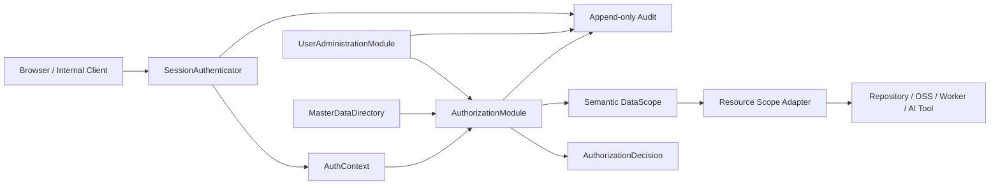

# Access Control Design

> **状态**：`draft`  
> **模式**：Design-First；当前只有设计草案，不代表实现已冻结  
> **适用范围**：平台用户、会话认证、Capability、DataScope、用户与授权管理、异步任务及最终出口授权  
> **所属域**：B 访问控制 · **目录命名**：旧名 `access-control`，按域代号应为 `b-access-control`（重命名在 B 域 spec 开工前执行）  
> **最近核对**：2026-10-29（与 B 域 PRD v1.2 存在偏差，见文末附录）  
> **更新日期**：2026-09-02

## 1. Overview

访问控制模块负责回答两个正交问题：

1. 当前请求是谁发起的，Session 是否仍然可信；
2. 该主体能否执行某个动作，以及能访问哪些业务对象。

本设计把复杂度收进三个深模块：`SessionAuthenticator`、`AuthorizationModule` 和 `UserAdministrationModule`。调用方只学习少量语义接口，不接触角色判断、组织 JOIN、SQL 片段、Token 轮换或授权层级算法。



## 2. Design Authority

冲突时按以下顺序裁决：

1. [`CONTEXT.md`](../../../CONTEXT.md)：`MediaStaff`、`ExternalAccount`、组织、历史归属与监控语义；
2. [`database-design-v2.md`](../../../HBECHO设计方案/domains/data-foundation/database-design-v2.md)：数据底座当前主档和引用路径；
3. 本设计：访问控制域的 User、Session、Capability、Grant 与 DataScope；
4. 历史输入：
   - [`HBECHO设计方案/archive/legacy/域E-用户与权限详细设计.md`](../../../HBECHO设计方案/archive/legacy/域E-用户与权限详细设计.md)
   - [`HBECHO设计方案/archive/legacy/域E-用户与权限详细设计-评审意见.md`](../../../HBECHO设计方案/archive/legacy/域E-用户与权限详细设计-评审意见.md)
   - [`hbecho-模块设计-权限中心.md`](../../../HBECHO设计方案/prd-drafts-子PRD草案/hbecho-模块设计-权限中心.md)
   - [`平台底座首版产品设计`](../../../HBECHO设计方案/prd-drafts-子PRD草案/hbecho-平台底座首版产品设计.md)

历史文档只提供候选经验；与前两项冲突的角色、组织或账号模型不被继承。

## 3. Goals and Non-goals

### 3.1 Goals

- 无公开注册；平台运营可受控创建、导入、激活、停用和恢复用户；
- 每名真实使用者使用独立身份，不使用共享账号；
- 短期访问凭证、可撤销 Session、Refresh 轮换和重用检测形成闭环；
- 固定角色只负责聚合 Capability，业务代码只检查 `resource.action`；
- Capability 与 DataScope 正交；相同动作在不同数据范围内复用；
- 每个资源类型显式注册 `ScopeStrategy`，未注册或无法解释时默认拒绝；
- 当前查看权限与历史业务归属分开，账号转移或组织调整不重写历史；
- 用户管理不能把权限授予到操作者自身边界之外；
- 导出、下载、Worker、AI 和签名 URL 都执行与在线查询一致的授权语义；
- 安全相关状态变更和敏感出口追加写审计。

### 3.2 Non-goals

首版不包含：

- 动态角色设计器、任意 ABAC、脚本化策略或个人 ALLOW/DENY 覆盖；
- 公开注册、经销商自助入驻、通用审批流、SSO、MFA 和设备管理中心；
- 在授权模块中生成 SQL、拼表别名或直接查询所有业务表；
- 重建品牌、区域、分公司、板块、经销商、门店、专员、平台账号或账号归属主档；
- 把 `monitoring_enabled` 当作登录或查看权限；
- 把审计日志建设成全量页面点击分析平台；
- 本文直接决定物理表、ORM、缓存或消息队列。

## 4. Domain Ownership and Vocabulary

### 4.1 Access-control-owned concepts

| 概念 | 含义 |
|---|---|
| `User` | 可登录平台的主体；拥有独立生命周期，但不等于 `MediaStaff` |
| `RoleProfile` | 首版固定的 Capability 聚合模板；角色代码仍待最终确认 |
| `Capability` | 稳定的 `resource.action` 动作许可，不携带数据范围 |
| `Grant` | 将 RoleProfile、Capability 或语义范围授予 User 的受审计事实 |
| `Session` | 可撤销的登录会话；Refresh 轮换链和设备/风险摘要属于会话实现 |
| `AuthContext` | 已认证主体、Session、授权版本和请求相关安全信息的最小上下文 |
| `DataScope` | 与存储无关的语义范围；由资源专属 Adapter 解释 |
| `GrantBoundary` | 某个管理者允许授予的角色、Capability 和范围上限 |
| `AuthorizationAuditEvent` | 认证、授权、敏感读取和管理变更的追加写事实 |

### 4.2 Data-foundation-owned concepts

`Brand`、`Region`、`Branch`、`Sector`、`Dealer`、`Store`、`MediaStaff`、`ExternalAccount`、`AccountAssignment` 及其状态由数据底座拥有。访问控制通过 `MasterDataDirectory` 只读引用稳定 ID 和有效性，不复制下列表：

- `staffs` 或自然人 Staff 主档；
- `platform_accounts` / `staff_accounts`；
- `account_dealer_bindings`；
- 与 v2 平行的 `org_unit` 组织树。

`MediaStaff` 是门店/品牌业务身份；`User` 是登录主体。两者的映射方式尚未冻结，缺少可靠映射时“本人范围”必须 fail closed。

### 4.3 Organization path

当前业务组织路径为：

```text
Region → Branch → Sector → Store → MediaStaff → AccountAssignment → ExternalAccount
                           ↑
                         Dealer
                           ↑
                          Brand（通过 Store）
```

Dealer 是 Store 的所有者维度，不是 Branch 的子节点。Branch 范围必须沿 `branch → sector → store → media_staff → assignment` 解析，不能通过 Dealer 猜组织范围。

## 5. Deep Module Interfaces

### 5.1 SessionAuthenticator

```ts
interface SessionAuthenticator {
  authenticate(request: AuthenticationRequest): Promise<AuthContext>;
  startSession(command: LoginCommand): Promise<SessionDelivery>;
  refresh(command: RefreshSessionCommand): Promise<SessionDelivery>;
  revoke(command: RevokeSessionCommand): Promise<void>;
}
```

接口隐藏密码验证、速率限制、Session 存储、Refresh family、轮换、重用检测、Cookie、CSRF 和所有会话撤销细节。调用方不得自行解析 Token 后跳过 Session 状态检查。

### 5.2 AuthorizationModule

```ts
interface AuthorizationModule {
  authorize(request: AuthorizationRequest): Promise<AuthorizationDecision>;
  buildDataScope(request: DataScopeRequest): Promise<DataScope>;
}
```

`authorize` 只回答动作许可；`buildDataScope` 返回语义范围。两者都 fail closed，但不能返回 SQL。接口保证：

- 使用当前有效 User、Session、RoleProfile、Grant 和主数据状态；
- 决策携带 policy/grant version，便于审计和缓存隔离；
- 未知 Capability、未知资源、缺少 ScopeStrategy、无效主数据映射均拒绝；
- 普通用户的空范围表示拒绝，不表示“查询全部”。

### 5.3 UserAdministrationModule

```ts
interface UserAdministrationModule {
  invite(command: InviteUserCommand, actor: AuthContext): Promise<UserInvitation>;
  changeAccess(command: ChangeUserAccessCommand, actor: AuthContext): Promise<AccessChangeResult>;
  changeStatus(command: ChangeUserStatusCommand, actor: AuthContext): Promise<UserStatusResult>;
  previewChange(command: PreviewAccessChangeCommand, actor: AuthContext): Promise<AccessChangePreview>;
}
```

该模块内部执行 `GrantBoundary`、current/proposed 双校验、冲突检测、Session 撤销和审计。调用方不能分别写 User、Grant 和 Session 后假装一次管理操作已经原子完成。

### 5.4 MasterDataDirectory seam

```ts
interface MasterDataDirectory {
  resolveScope(reference: BusinessScopeReference): Promise<ResolvedBusinessScope>;
  resolveMembership(resource: BusinessResourceRef): Promise<ResourceMembership>;
  resolveSelfBinding(userId: string): Promise<SelfBinding | UnresolvedBinding>;
}
```

这是访问控制与 v2 的只读 seam。其 Adapter 可批量查询和缓存，但必须保留稳定 ID、有效性与版本；不得把 SQL 结构泄漏给授权模块。若未来存在第二个主数据来源，这个 seam 才允许新增相应 Adapter。

## 6. Authentication and Session Lifecycle

### 6.1 User lifecycle

推荐的最小状态：

```text
pending_activation → active ↔ disabled
```

- `pending_activation`：已创建但未完成一次性激活；
- `active`：可建立 Session，仍需每次授权检查有效 Grant 与主数据状态；
- `disabled`：禁止建立或刷新 Session，现有 Session 全部撤销，历史审计保留。

不以物理删除表达离职或退出试点。恢复 User 时必须重新校验当前角色、范围、关联业务身份和到期时间，不能只清除停用标记后恢复旧授权。

### 6.2 Invitation and activation

1. 有权限的管理者提交邀请或批量导入；
2. UserAdministrationModule 校验登录标识唯一性、角色、范围和 GrantBoundary；
3. 系统生成短期、一次性、仅保存摘要的激活凭证；
4. 用户设置自己的正式凭证；运营人员不能设置或查看正式密码；
5. 激活成功后使凭证永久失效，并记录审计；
6. 重发激活凭证使旧凭证失效。

### 6.3 Login and refresh

- Access credential 必须短期有效，具体时长配置化；
- Refresh credential 绑定可撤销 Session，并在每次使用后轮换；
- 浏览器凭证使用 `HttpOnly`、`Secure` 和合适的 `SameSite` Cookie，不写入 `localStorage`；
- Cookie 参与状态变更请求时必须使用 CSRF token、Origin/Referer 校验或等价防线；
- Refresh 重用意味着凭证可能泄漏，应撤销整个 token family，并要求重新登录；
- 登录标识、IP/设备风险和密码失败需要限速，但风控失败不修改业务 User 状态；
- User 禁用、密码重置、敏感授权收缩可按策略撤销全部 Session。

### 6.4 Authentication vs authorization

认证成功只证明“当前是谁”，不证明“能访问任何业务数据”。若 User 没有有效 Grant、组织范围不可解析、关联业务对象已停用或访问已过期，AuthorizationModule 返回拒绝。超级管理员的全局权限也必须通过显式 Capability 和全局 ScopeStrategy 表达，不使用隐藏旁路。

## 7. Capability Model

### 7.1 Naming

Capability 采用稳定的 `resource.action` 形式，例如：

- `data.account.read`
- `data.sync.trigger`
- `data.raw_payload.read`
- `rule.definition.manage`
- `rule.run.execute`
- `metric.catalog.manage`
- `report.read`
- `report.export`
- `user.manage`
- `audit.read`

以上是命名示例，不是已冻结清单。最终 Capability 注册表由对应 Spec 与访问控制评审共同确认。

### 7.2 Fixed role profiles

首版采用少量固定 RoleProfile，把 Capability 集合集中播种和评审。业务模块不得写：

```text
if role == hq_staff ...
```

而应请求具体 Capability。这样角色代码可调整、Capability 可拆分，调用方接口不变。角色不自动携带 SQL 范围；同一 RoleProfile 的不同 User 可通过正式 Grant 拥有不同品牌或组织范围。

### 7.3 Decision semantics

`AuthorizationDecision` 至少区分：

- `allowed`；
- `denied_unknown_capability`；
- `denied_user_or_session_inactive`；
- `denied_missing_grant`；
- `denied_expired_access`；
- `denied_master_data_inactive`；
- `denied_policy_unavailable`。

对外错误可以统一为 401/403 和安全摘要，内部审计保留稳定 reason code。拒绝不能通过“返回空列表”伪装成功；但列表查询在有效授权下计算出的真实空范围可以返回空结果。

## 8. DataScope and Resource Strategies

### 8.1 Semantic DataScope

候选逻辑结构：

```ts
type DataScope = {
  scopeVersion: string;
  brands: IdConstraint;
  regions: IdConstraint;
  branches: IdConstraint;
  sectors: IdConstraint;
  stores: IdConstraint;
  dealers: IdConstraint;
  mediaStaff: IdConstraint;
  externalAccounts: IdConstraint;
  self: 'not_applicable' | 'required' | 'resolved';
  expiresAt?: string;
};
```

它表达语义集合与交集，不表达 JOIN 或 WHERE。资源 Adapter 只能收窄，不能扩大。缓存键必须包含资源类型、动作、scopeVersion 与规范化 scope fingerprint。

### 8.2 Explicit ScopeStrategy registry

每个资源类型注册一个策略，例如：

| 资源 | 范围语义 |
|---|---|
| 当前账号与内容 | 通过 v2 的 Store/MediaStaff/Assignment/Discovery 路径解析当前可见对象 |
| 历史内容与考核结果 | 用当前 DataScope 检查被冻结的 `AttributionSnapshot`，不重新 JOIN 当前归属生成历史 |
| 规则与活动配置 | Capability + 配置适用品牌/组织；配置适用范围不是授权本身 |
| 指标、报表和看板 | 当前 DataScope 与投影中的历史稳定 ID 求交；同一配置对不同用户返回不同数据 |
| User 管理 | `GrantBoundary`、目标用户当前范围和 proposed 范围三者共同约束 |
| ODS 原始载荷 | 独立高敏 Capability + 业务范围 + 审计；普通报表读取权不自动包含 |
| 手机号等敏感字段 | 对字段执行额外 Capability；行可见不等于敏感字段可见 |
| 媒资与导出件 | 继承源业务对象范围；签名 URL 每次短期签发，不成为永久授权 |
| 审计日志 | 按审计级别、操作者边界和敏感字段策略过滤 |

新增资源未注册策略时必须拒绝启动或拒绝请求，不能自动套用“品牌过滤”。

### 8.3 Current authorization vs historical attribution

- `AccountAssignment` 和 `ContentDiscovery` 保存历史业务事实；
- `AttributionSnapshot` 保存规则/指标运行时冻结的组织稳定 ID；
- 当前 User 的 Grant 决定现在是否有权查看这些历史事实；
- 当前主档变化不能改写历史归属；
- 授权收缩必须立即缩小历史查询结果，但不能删除或重算历史事实。

Store 的 brand/dealer/sector 是否可变以及完整历史快照 owner 尚未冻结。在决定前，历史结果必须携带已有稳定引用并避免查询时动态重建。

## 9. User and Grant Management

### 9.1 GrantBoundary

管理者可以授予的范围不得超过其自身有效边界和管理 Capability。边界至少包含：

- 可管理的 RoleProfile 等级；
- 可授予的 Capability 集；
- 可授予的品牌、组织和本人绑定范围；
- 是否能查看/导出敏感字段；
- 有效期上限。

超级管理员也通过显式 global boundary 表达，而不是绕过校验。

### 9.2 Current/proposed dual validation

每次修改执行两轮校验：

1. **current 校验**：操作者当前是否有权管理目标 User 及其现有授权；
2. **proposed 校验**：修改后的 RoleProfile、Capability 和 DataScope 是否完全位于操作者 GrantBoundary 内。

批量导入逐行返回成功、失败或冲突；不得静默覆盖已有 User 的角色或范围。一次变更的 User、Grant、Session 撤销和审计要么共同成功，要么保持旧状态。

### 9.3 External access expiry

外部或试点 User 至少支持 User 级或 Grant 级有效期。在线认证/授权必须直接检查有效期，不依赖定时任务及时执行。延期需要显式权限和审计；过期后的 Session 不可刷新。

## 10. Async Jobs and Final Egress

### 10.1 Effective task scope

异步任务在提交时保存：

```text
requestedBy + capability + submittedScopeSnapshot/version
+ resource query + payloadHash + requestedAt
```

执行时：

```text
EffectiveTaskScope = SubmittedScope ∩ CurrentSubjectScopeAtExecution
```

后续扩权不能扩大旧任务；撤权会收窄或取消任务。Worker 使用用途受限 service actor，通过同一业务查询模块读取数据，不伪造 User 或超级管理员。

### 10.2 Delivery-time recheck

导出、打包、媒资、AI 结果和签名 URL 在交付前再次：

1. 检查 User、Session/下载凭证和 Capability；
2. 重算当前 DataScope；
3. 验证 artifact/resource scope 是当前范围子集；
4. 不满足时拒绝、删除或按新范围重建；
5. 记录结果与 reason code。

仅在提交时或仅在交付时检查都不够：前者会在撤权后继续处理，后者可能让 Worker 内部接触超范围数据。

## 11. Audit, Privacy and Security

### 11.1 Append-only audit events

首版至少记录：

- 邀请、激活、登录成功/失败、Refresh 重用、Session 撤销；
- User 创建、导入、停用、恢复、RoleProfile/Grant/范围/有效期变更；
- 敏感字段查看、ODS 访问、手工同步、规则发布/重算；
- 导出提交、执行、取消、交付与下载 URL 签发；
- 高成本操作的授权与拒绝。

事件包含 actor、subject、action、resource、decision、policy/grant version、范围 fingerprint、before/after 安全摘要、reason、trace/request/job ID 和 UTC 时间。日志不保存密码、Token、API key、Cookie、完整手机号或大范围明细。

### 11.2 Sensitive data

- `media_staff.phone` 当前按 v2 明文保存，但展示、完整读取和批量导出必须独立授权并脱敏；
- User 登录手机号的存储方案仍未决定，不能从 v2 的业务手机号基线外推；
- Session/activation/refresh secret 仅保存不可逆摘要；
- 签名 URL 短期有效且不写入长期业务记录；
- 授权拒绝响应不暴露目标资源是否存在。

### 11.3 Observability

至少观测：登录/刷新成功率、密码失败与限速、Refresh 重用、活跃/撤销 Session、授权拒绝原因、未知资源/策略、scope 构建耗时与失败、主数据映射失败、管理越界尝试、异步撤权取消、交付复查拒绝和审计写入失败。

审计写入失败对高风险管理操作和外发操作应 fail closed；低风险只读是否允许带告警降级需运行策略单独确认。

## 12. Failure Semantics

| 情形 | 行为 |
|---|---|
| 凭证缺失、过期或 Session 已撤销 | 401；不进入业务模块 |
| User disabled、访问到期或 Refresh 重用 | 拒绝并撤销相应 Session/family |
| Capability 未注册或无 Grant | 403，稳定 reason code |
| 资源 ScopeStrategy 未注册 | fail closed；配置/启动检查应提前暴露 |
| 主数据状态失效或 ID 无法映射 | 空 DataScope 或拒绝，不回退“同品牌全量” |
| “本人”绑定不存在或冲突 | 拒绝 self-scoped 访问并产生可处理问题 |
| proposed Grant 超出操作者边界 | 整个管理变更拒绝，不部分写入 |
| 异步执行时范围交集为空 | 取消任务，保留安全审计，不生成可下载 artifact |
| artifact 超出当前范围 | 拒绝下载并删除或重建 |
| 审计冲突/重复事件 | 以幂等键去重；不可覆盖历史事件 |

## 13. Acceptance Boundaries

设计进入 requirements/tasks 前至少应有以下可自动验证的契约：

1. SessionAuthenticator 与 AuthorizationModule 可分别替换为内存 Adapter 测试；调用方不解析 Token、不写角色条件；
2. Refresh 每次轮换，旧 Refresh 重用会撤销 family；User disabled 后现有 Session 无法继续刷新或授权；
3. 所有业务动作以 Capability 判定，不在 Controller/Repository 分散判断 RoleCode；
4. 每个资源都有显式 ScopeStrategy；删除注册后请求必定失败，而不是返回全量；
5. Branch、Dealer 和 Brand 使用 v2 正确关系，Dealer 不被当作组织树父节点；
6. monitoring switch 变化只影响采集，不改变登录授权；
7. 账号转移后历史归属不变，当前用户范围收缩后历史查询立即收缩；
8. User 管理同时验证 current 与 proposed GrantBoundary，不能创建比管理者更高或更广的授权；
9. 手机号、ODS、导出和媒资下载分别验证敏感 Capability；
10. 异步任务不因后续扩权扩大范围，撤权后执行和交付均不能越界；
11. 签名 URL 短期生成，不能在权限撤销后继续通过平台刷新；
12. 高风险操作审计可按 actor/resource/job/decision 追溯，且不记录 secret。

## 14. Open Decisions

### P0 before implementation

1. 最终 RoleProfile/RoleCode，尤其 `dealer_staff` 是否重命名；
2. User 与 MediaStaff 首版是否严格一对一，以及跨品牌/门店现实人员如何映射；
3. Branch 范围是否还必须与显式品牌 Grant 求交；
4. Store 的 dealer/brand/sector 是否不可变；若可变，历史 AttributionSnapshot 由哪个域拥有；
5. User 登录手机号采用明文还是 `ciphertext + lookup HMAC`；
6. 登录标识、密码策略、Access/Refresh 有效期和 Session 并发上限；
7. 首版 Capability 注册表及固定 RoleProfile 的精确映射；
8. 平台运营是否继续由超级管理员职责承担，何时拆独立角色。

### May remain configurable

- 外部 User/Grant 默认有效期；
- 哪些授权变化立即撤销全部 Session；
- 高风险审计写入失败时各动作的 fail-closed 等级；
- 只读范围缓存 TTL 与授权版本失效机制；
- 经销商/门店用户默认“仅本人”还是“本门店”，最终以 User↔MediaStaff 决策为前提。

---

## 附录：已知过时内容（2026-10-29 核对）

> 本节只记录偏差，不修改正文。正文仍是本 spec 的技术草案；凡与 B 域 PRD v1.2 冲突处，以 PRD 为准。

| # | 位置 | 本设计的写法 | 当前事实 | 来源 |
|---|---|---|---|---|
| 1 | §7.1 Naming | 10 个 Capability 只是“命名示例，不是已冻结清单” | B 域 §7 已冻结角色 × Capability 矩阵 | B 域 PRD v1.2 |
| 2 | §7.1 Naming | 无 `activity_plan.create`、`activity_plan.join`、`learning.report.read`、`learning.tag.manage` | 四项已登记（前两项 v1.1，后两项 v1.2） | B 域 PRD v1.1、v1.2 |
| 3 | §14 Open Decisions 1 | 最终 RoleProfile / RoleCode 待定，尤其 `dealer_staff` 是否重命名 | 已关闭：`platform_admin` / `hq_manager` / `branch_manager` / `store_staff`，不保留 `dealer_staff` | D-22 |
| 4 | §14 Open Decisions 2 | User ↔ MediaStaff 是否严格一对一带开 | 已关闭：`store_staff` 与一个 `MediaStaff` 一对一，绑不上拒绝本人范围 | B 域 PRD §8.3 |
| 5 | §14 Open Decisions 4 | Store 的 dealer / brand / sector 是否可变带开 | 已关闭：视为不可变，不做组织历史归属快照 | D-18 |
| 6 | §14 Open Decisions 5 | 手机号明文还是 `ciphertext + lookup HMAC` 带开 | 已关闭：明文保存 | D-42 |
| 7 | §14 Open Decisions 6 | 登录标识、密码策略、会话有效期带开 | 已关闭：15 天滑动会话；密码只保留最短 8 位 | D-40、D-45 |
| 8 | §14 Open Decisions 3 | Branch 范围是否与品牌 Grant 求交 | 仍未决，保持不变 | ADR 未决选型 #7 |

**未同步但不算冲突**：B 域 v1.2 的 10 个数据出口与审计可见性（仅 `platform_admin` 可读审计，D-41）在本文中没有展开；本设计只给出口授权语义，不列出口清单。
