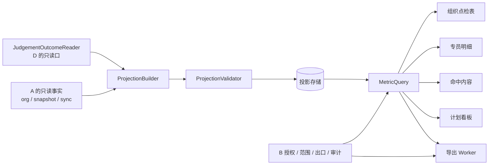

# E 指标与看板（e-metrics）· 设计

> **状态**：`draft`
>
> **模式**：Design-First；实现前的技术设计与取舍，不包含实施结果
>
> **上游需求**：[`requirements.md`](requirements.md)
>
> **所属域**：E 指标、报表与看板 · **目录命名**：`e-metrics`（旧 `metrics-and-dashboard` 已删除）
>
> **权威顺序**：见 requirements §1.1。本设计不得改写 Upstream 事实；与 PRD 冲突时按 requirements §5 的记录裁决，不在这里另立一套。
>
> **最近核对**：2026-11-16
>
> **更新日期**：2026-11-16

## 1. Overview

E 把 D 已冻结的判定结果与 A 已冻结的观察，翻译成一份**可审计、可授权、同口径**的指标投影；三张视图、一张看板和五类导出都只读这一份投影。



三条不可妥协的性质：

1. **同投影**：三视图、看板、导出共用 `projectionId`，下钻不换版本；
2. **同口径**：一个指标只有一个 revision，每个节点用该节点的分量求值，不平均下级百分比，自定义指标等于同一行上显示的操作数的运算结果，不在查询层各算各的；
3. **四态不互转**：真实 0、缺失、显式 null、非法值在投影里保持区别，缺数据不显示 0。

## 2. 形状

| 需要的东西 | 结论 | 说明 |
|---|---|---|
| 指标目录与版本 | **新建** `metric_catalog`（`src/modules/metrics/catalog.ts`） | 依赖图的校验、影响面、revision 治理收在模块内 |
| 投影构建 | **新建** `projection/` | 冻结、校验、原子激活、stale、保留 |
| 三视图与看板查询 | **新建** `query/` | 只读投影；范围过滤在查询层 |
| 导出 | **新建** `export/` | exceljs 写文件、任务表、下载中心 |
| 授权 / 范围 / 出口 / 审计 | **复用** `access-control` | 不复制任何角色或范围逻辑 |
| 活动计划下游端口 | **复用** `activity-plan` 的 `PlanDownstream` | E 提供一个片段，与 D 组合 |
| 判定结果读取 | **复用 D 的 `JudgementOutcomeReader`** | E 不 JOIN D 的表 |
| 组织 / 快照 / 同步质量 | **复用 A 的表，只读** | 集中在 `facts.ts` 一个文件 |
| 指标计算 / 上卷 / 四态 | **自建**纯函数 | 语义是本项目独有的（四态、参与分母、组件上卷） |
| Excel 生成 | **采用** exceljs 4.4.0 | ADR-0011，仅写入 |
| 对象存储 | **复用** `ali-oss` 与 `raw-capture` 的 `ObjectStore` | 导出件另建桶（待确认） |
| 规范 JSON / 哈希 | **复用** `canonical-json`（JCS） | 幂等键与 descriptor 哈希 |
| 时间换算 | **复用** 现有的北京时间日界写法（`bjtDate` 同款） | 纯函数，带测试 |
| 板块种类 | **复用** `sectorKeyOf`（`master-data-import/mappings.v1.ts`） | 不重写 `{分公司编码}-{water\|home}` 的解析规则 |
| 签名链接上限 | **复用** `MAX_SIGNED_LINK_TTL_SECONDS`（`access-control/egress.ts`） | 不另设一个 900 |
| 缓存 | **不建**独立缓存服务 | 进程内短 TTL，键含投影与范围指纹 |
| 队列 | **复用** MySQL 任务表模式（租约 + fencing） | 不引入 Redis / 消息队列 |

## 3. 边界阶梯

按 [`no-reinventing-wheels.md`](../../../.kiro/steering/no-reinventing-wheels.md)：

| 能力 | 停在那一级 | 采用 / 自建 | 不用它做什么 |
|---|---|---|---|
| 十进制与比率 | 3（标准库） | `BigInt` 定点运算（scale 10） | 不引 `decimal.js`：只需要整数加减乘与一次带舍入的除法，标准库足够；也避免浮点进入指标链路 |
| Excel 写入 | 6（成熟开源，已选型） | **exceljs 4.4.0**（MIT，ADR-0011） | 不读取任何外部 xlsx；不在 Web 进程生成大文件；不做范围过滤与交付 |
| 对象存储 | 6（官方 SDK） | `ali-oss`（已有） | 不自己拼签名、不自己实现分片 |
| 规范化 JSON | 2（代码库已有） | `src/modules/canonical-json` | 不另写一套 key 排序 |
| 时间与时区 | 3（标准库） | `Date` + 显式的北京时间日界函数 | 不引入 dayjs / luxon；只做「北京自然日 → UTC 半开区间」 |
| 指标公式 | 8（自建最小方案） | 两个操作数 + 一个运算符的 AST | 不引表达式引擎；DSL 是 2.0 的事 |
| 授权 / 范围 / 出口 | 2（代码库已有） | `access-control` 的 `authorize`、`createEgress`、注册表 | 不复制角色矩阵、不拼 SQL 范围 |
| 任务领取 | 2/8（项目自己的合同） | MySQL 任务表 + 租约 + fencing（与 A / C 同一写法） | 不引 Redis / BullMQ：与 v2 的设计冲突 |

## 4. 模块、文件与端口

目录按 [ADR-0013](../../../HBECHO设计方案/architecture/adr/0013-repository-layout.md)：

| 位置 | 职责 | 对外 seam |
|---|---|---|
| `src/modules/metrics/catalog.ts` | 指标定义、revision、适用范围、归档、影响面 | `createCatalog(deps)` |
| `src/modules/metrics/catalog-pure.ts` | 依赖图、成环、分子 ⊆ 分母、四态兼容（纯函数） | 无 IO |
| `src/modules/metrics/values.ts` | 定点十进制、比率、上卷组件（纯函数） | 无 IO |
| `src/modules/metrics/facts.ts` | **E 与 A 的唯一表耦合点**：组织、主页 / 内容快照、同步任务 | `createFacts(deps)` |
| `src/modules/metrics/projection/poll.ts` | 轮询 D 的 `listCompleted`，维护游标与每计划最新执行 | — |
| `src/modules/metrics/projection/build.ts` | 构建阶段机与冻结 | `createBuilder(deps)` |
| `src/modules/metrics/projection/validate.ts` | 激活前校验（纯函数 + 描述符） | 无 IO |
| `src/modules/metrics/projection/activate.ts` | 原子激活与 stale | — |
| `src/modules/metrics/projection/reader.ts` | `JudgementOutcomeReader` 适配器 + fake | 端口 |
| `src/modules/metrics/query/*.ts` | 点检表、专员明细、命中内容、看板、页脚 | `createQuery(deps)` |
| `src/modules/metrics/export/*.ts` | 任务提交、执行、工作簿、交付、上限 | `createExport(deps)` |
| `src/modules/metrics/downstream.ts` | `PlanDownstream` 片段 + 组合器 | 对 A |
| `src/modules/metrics/lifecycle.ts` / `maintenance.ts` | 回收站、清除、保留、导出过期 | — |
| `src/modules/metrics/assemble.ts` | 装配入口 | `createMetrics(deps)` |
| `src/modules/metrics/config.ts` | 环境变量 + zod | — |
| `src/modules/metrics/errors.ts` | 稳定错误码 `MetricError` | — |
| `src/modules/metrics/authz.ts` / `audit.ts` | B 的委托与审计适配 | — |
| `src/modules/metrics/web.ts` | 页面取数（**界面确认后才建**） | — |
| `src/db/schema/metrics.ts` | 本 spec 全部新表 | — |
| `src/worker/metrics-cli.ts` / `metrics-main.ts` | CLI 与常驻进程 | `runMetricsCli` |

**深模块**：页面 / CLI 只知道 `catalog`、`projection`（构建 / 重算 / 状态）、`query`（四类查询）、`export`（提交 / 状态 / 下载 / 取消）；不知道取整规则、上卷组件、任务表与范围指纹。

### 4.1 端口

```ts
// D 的只读口（JP-16）+ E 需要的一处补充（对齐请求见 §15）
interface JudgementOutcomeReader {
  listCompleted(after: { completedAt: Date; executionId: bigint } | null, limit: number): Promise<ExecutionDescriptor[]>;
  listPlans(activityPlanId: bigint): Promise<PlanDescriptor[]>;
  describe(executionId: bigint): Promise<ExecutionDescriptor>;
  streamParticipants(executionId: bigint, constraint: ResourceConstraint): AsyncIterable<ParticipantFact>;
  streamContents(executionId: bigint, constraint: ResourceConstraint): AsyncIterable<ContentFact>;
  streamCircleRows(runId: bigint, constraint: ResourceConstraint): AsyncIterable<CircleRow>;
  // 以下两项与 JP-16 现有签名不同，是向 D 的对齐请求（§15.1 第 5、6 项）
  explain(caller: AuthContext, executionId: bigint, ref: { contentId: bigint } | { staffId: bigint }): Promise<EvidenceExplanation>;
  describeRun(runId: bigint): Promise<{ activityPlanId: bigint; runKind: "execution" | "circle" | "compare"; status: string }>;
}

// E 需要的 A 事实（只在本模块 facts.ts 里实现；模块外不 import A 的 schema）
interface FactsReader {
  activityPlan(planId: bigint): Promise<ActivityPlanFacts | null>;
  joinedBranches(planId: bigint): Promise<Array<{ branchId: bigint; regionId: bigint; branchName: string; regionName: string }>>;
  orgNames(ids: OrgIds): Promise<OrgNames>;
  profileObservations(accountIds: bigint[], opts: { atOrBefore: Date }): Promise<Map<string, ProfileObservation>>;
  profileBoundaries(accountIds: bigint[], opts: { start: Date; cutoff: Date }): Promise<Map<string, ProfileBoundary>>;
  publishedContentCounts(accountIds: bigint[], window: { from: Date; toExclusive: Date }): Promise<Map<string, number>>;
  contentDisplay(contentIds: bigint[]): Promise<Map<string, ContentDisplay>>;
  syncQuality(accountIds: bigint[], cutoff: Date): Promise<SyncQuality>;
}

// 导出件的对象存储：在 ObjectStore 上加签名下载
interface ExportObjectStore extends ObjectStore {
  signedGetUrl(key: string, ttlSeconds: number): Promise<string>;
}

// 封面读取：正式媒资（media 桶），只读
interface MediaReader {
  getBySha(sha256: string): Promise<Uint8Array | null>;
}
```

`ResourceConstraint`、`AuthContext`、`Authorizer`、`Egress`、`AuditWriter` 全部从 `access-control` 的 `index.ts` 导入。

## 5. 数据模型

全部新表放 `src/db/schema/metrics.ts`，遵守 v2 §5 惯例：内部 ID 为 signed `BIGINT`（输出十进制字符串）；时间 UTC `DATETIME(6)`；状态 `VARCHAR + CHECK`；哈希 `BINARY(32)`；业务表**没有** `ON DELETE CASCADE`。**15 张表**，不入 v2，以本文件为准。

### 5.1 指标字典

#### `metric_definitions`

| 列 | 类型 | 说明 |
|---|---|---|
| `metric_id` | id PK | |
| `code` | varchar(128) | UQ；内置 `snake_case`、派生 `judgement.<planId>.<metric>`、自定义 `custom.<slug>` |
| `kind` | varchar(16) | `builtin` / `derived` / `custom`；CHECK |
| `judgement_plan_id` | id NULL | `derived` 必填；`custom` 为绑定的判定计划（NULL = 绑定 `base`，§6.5），创建后不可改；`builtin` 为 NULL。**不建外键**（D 的表不归 E 引用），由构建时校验计划存在 |
| `status` | varchar(16) | `active` / `archived`；CHECK |
| `current_revision` | int | 最新 revision 号 |
| `owner_actor` | varchar(128) | 创建者；内置为 `service:metrics` |
| `created_at` / `updated_at` | utc | |

约束：`CHECK (kind <> 'derived' OR judgement_plan_id IS NOT NULL)`；`CHECK (kind <> 'builtin' OR judgement_plan_id IS NULL)`；`UQ(code)`。

#### `metric_revisions`

| 列 | 类型 | 说明 |
|---|---|---|
| `metric_id` / `revision` | id / int | 复合 PK |
| `name` / `description` | varchar(200) / varchar(1000) | 显示名与说明；改它们不产生新 revision |
| `unit` / `display_format` | varchar(32) | 如 `count` / `percent` |
| `aggregation` | varchar(32) | 内置 / 派生指标的分量如何求和（§6.6）：`additive` / `distinct_per_staff` / `ratio_components` / `semi_additive_last_observed`；自定义指标固定 `custom_expression`；CHECK |
| `grain` | varchar(16) | 1.0 固定 `staff`：内置 / 派生指标的**分量**在专员粒度产出，再按节点求和；自定义指标**不**在专员粒度先算，而是在每个节点用操作数的节点值求值（§6.5） |
| `observation_policy_code` | varchar(64) NULL | 互动类必填（E-CAT-6） |
| `observation_tolerance_seconds` | int NULL | 1.0 只记录，不用于选择 |
| `formula` | json NULL | 自定义指标的 AST；内置 / 派生为 NULL |
| `dependencies` | json NULL | `[{code, revision}]`；用于依赖图与 lineage |
| `brand_scope_hash` | sha256 | 适用品牌集合的规范化哈希（改适用品牌 = 新 revision） |
| `definition_sha256` | sha256 | 规范化 JSON 的哈希 |
| `published_at` / `published_by_actor` | utc / varchar | |
| `created_at` | utc | |

约束：`CHECK ((aggregation='custom_expression') = (formula IS NOT NULL))`。互动类指标必须声明观测策略（E-CAT-6）由应用层校验，不写 CHECK。

#### `metric_brand_scopes`

`PK(metric_id, brand_id)`；`brand_id` FK → `brands`（RESTRICT）。内置与派生指标不写行（= 全部品牌）；自定义指标至少一行。

#### `observation_policy_revisions`

| 列 | 说明 |
|---|---|
| `code` / `revision` | 复合 PK；1.0 只有 `last_observed` v1 |
| `type` | `last_observed`；CHECK |
| `params` | json；1.0 `{}` |
| `status` | `active` / `archived` |
| `published_at` / `published_by_actor` / `definition_sha256` | |

### 5.2 投影

#### `latest_executions`

轮询的轻量产物：每个判定计划最近一次已完成执行。`PK(judgement_plan_id)`；`activity_plan_id`、`execution_id`、`completed_at`、`version`、`updated_at`。轮询按 `(completedAt, executionId)` 取大值 upsert；计划归档后行保留；活动计划清除时按 `activity_plan_id` 一并删除。

#### `projections`

| 列 | 类型 | 说明 |
|---|---|---|
| `projection_id` | id PK | |
| `activity_plan_id` | id | FK → `activity_plans`（RESTRICT）；清除前 E 必须先 purge |
| `status` | varchar(16) | `planned` / `building` / `validating` / `active` / `superseded` / `rejected` / `failed` / `cancelled`；CHECK |
| `active_key` | id，生成列 | `CASE WHEN status='active' THEN activity_plan_id END`；**UQ** 保证每活动至多一个 active。生成列**不可显式赋值**，随 `status` 自动重算 |
| `frozen_inputs` | json NOT NULL | **入队时冻结**的 `{executionMap, metricSet, observationPolicy}`（§7.2）；幂等键由它算出，构建**只读这一列** |
| `idempotency_key` | sha256 | UQ |
| `cutoff_at` | utc | 所选执行中 D 数据冻结时刻（`ExecutionDescriptor.cutoffAt`）的最大值；基础指标的观测以它为截止（E-SD-10） |
| `descriptor` | json | 冻结描述符（§7.3） |
| `validation` | json NULL | 校验报告 |
| `stale_since` | utc NULL | 更新失败后旧投影标 stale 的时间 |
| `lease_owner` / `lease_expires_at` / `fencing_token` | varchar / utc / id | 构建租约 |
| `next_attempt_at` / `attempt_count` / `last_error_code` / `last_error_detail` | utc / int / varchar / json | 重试 |
| `trigger_kind` / `trigger_ref` | varchar(16) / varchar(128) | `execution` / `metric` / `manual` 与触发引用（执行 ID、revision 集合哈希、请求 ID） |
| `built_at` / `activated_at` / `superseded_at` | utc NULL | 生命周期时间 |
| `created_at` / `updated_at` | utc | |

索引：`(activity_plan_id, created_at)`、`(status, next_attempt_at, projection_id)`、`(status, created_at)`。
CHECK：`status <> 'building' OR (lease_owner IS NOT NULL AND lease_expires_at IS NOT NULL)`；`status <> 'superseded' OR superseded_at IS NOT NULL`。
「每活动至多一个 active」由 `active_key` 生成列的 UQ 表达，不另写 CHECK。

#### `projection_executions`

`PK(projection_id, judgement_plan_id)`；FK → `projections`（RESTRICT）。

| 列 | 说明 |
|---|---|
| `execution_id` / `version` / `plan_alias` | D 的执行 ID、判定计划版本、构建时别名（查询时优先用 D 的当前别名，取不到回退它） |
| `completed_at` / `frozen_at` / `cutoff_at` | 时间 |
| `window` | json（UTC 半开区间 + 北京日期） |
| `participant_count` / `c1_count` / `c2_count` / `c3_count` / `content_total` | 描述符计数 |
| `participant_set_sha256` | 参与专员 ID 升序拼接的哈希；相同 = 同一人群（E-D01） |
| `stale_used` | bool |

#### `projection_metrics`

稀疏行：`PK` 用自增 `projection_metric_id`，唯一键 `(projection_id, sector_key, org_level, org_id, scope_key, metric_code)`。

| 列 | 说明 |
|---|---|
| `projection_id` | FK → `projections` |
| `sector_key` | `water` / `home`；CHECK |
| `org_level` | `region` / `branch` / `store` / `staff`；CHECK |
| `org_id` | 对应层级的稳定 ID |
| `scope_key` | `base` 或 `jp:<planId>`：同一表内多个判定计划各自一组 |
| `metric_code` / `metric_revision` | 指标编码与 revision |
| `value_state` | `value` / `no_data` / `partial`；CHECK（`invalid` 在构建期拒绝，不落库） |
| `value` | DECIMAL(38,10) NULL：舍入到 10 位小数的展示值 |
| `numerator` / `denominator` | DECIMAL(38,0) NULL：节点值的精确有理数（内置 / 派生指标即分量；计数类 `denominator = 1`；`rate` 即 `Σachieved / Σparticipant`）。受限范围的「本范围合计」由可见子节点的这两列重新求和（§8.1）。溢出 → 构建失败 `value_overflow` |
| `coverage` | json NULL：`{observed, expected}` |
| `observed_at` | utc NULL |
| `basis` | json NULL：选中的快照 ID / 观测策略 / 边界差值 |

索引：`(projection_id, sector_key, org_level, org_id)`、`(projection_id, scope_key, metric_code)`。
CHECK：`value_state <> 'value' OR value IS NOT NULL`；`denominator IS NULL OR denominator >= 0`。

#### `projection_orgs`

`PK(projection_id, sector_key, org_level, org_id)`；FK → `projections`。

| 列 | 说明 |
|---|---|
| `parent_id` | 上级节点 ID（region 为 NULL） |
| `name` | 构建时冻结的名称 |
| `participated` | bool：本板块内是否有参与账号（false = 显示「未参与」） |
| `membership` | varchar(8)：`joined` / `exited`（仅分公司层有意义）；CHECK。构建时已不在活动计划中、但 D 执行时的冻结名单里仍有其参与者的分公司标 `exited` |
| `sort_key` | varchar(64)：稳定排序（一般取组织编码） |

行集 = 构建时活动计划已加入的每个分公司 ∪ 参与者冻结组织链里出现的分公司，加上它们的大区；在活动计划的**每个板块**（`activity_plan_sectors`，1–2 个）各一行。不取并集，执行之后才退出的分公司的参与者会找不到组织行，汇总与明细对不上。门店与专员只在有参与者时出现（专员行在 `projection_staff`，这里不重复存）。

#### `projection_staff`

`PK(projection_id, judgement_plan_id, staff_id)`；FK → `projections`。

| 列 | 说明 |
|---|---|
| `account_id` / `account_count` | 冻结账号；1.0 D 保证一名专员一个名单账号，`account_count = 1`（见 §17） |
| `store_id` / `dealer_id` / `brand_id` / `sector_id` / `sector_key` / `branch_id` / `region_id` | 冻结组织链（来自 D 的 `run_participants`） |
| `plan_result` / `content_result` / `comment_result` / `account_result` | `success` / `not_met` / `unobtained` / NULL |
| `content_total` / `comment_total` / `c1_count` / `c2_count` / `c3_count` | 计数 |
| `primary_reason` / `reason_detail` | 未获取成功的主要原因与分布 |
| `sync_complete` / `stale_used` | bool |
| `last_observed_at` | utc NULL |

索引：`(projection_id, branch_id, judgement_plan_id, plan_result)`、`(projection_id, staff_id)`。

#### `projection_staff_observations`

`PK(projection_id, judgement_plan_id, account_id)`；每账号一行，支撑基础指标与粉丝边界。

| 列 | 说明 |
|---|---|
| `start_profile_snapshot_id` / `end_profile_snapshot_id` | 活动开始前 / 截止时点前最新 finalized 主页快照 |
| `start_observed_at` / `end_observed_at` | |
| `follower_start` / `follower_end` / `follower_state` | 值 + 四态（`value` / `missing` / `explicit_null` / `invalid`） |
| `boundary_deviation` | `follower_end - follower_start`；任一缺失为 NULL |
| `published_content_count` | 活动窗口内按账号各存一条的内容数 |

#### `projection_hits`

`PK(projection_id, judgement_plan_id, content_id)`；FK → `projections`。

| 列 | 说明 |
|---|---|
| `content_snapshot_id` | D 冻结的快照 |
| `staff_id` / `account_id` / `account_nickname` | 显示字段，构建时冻结 |
| `branch_id` / `store_id` / `sector_key` | 过滤用 |
| `title` / `published_at` / `share_url` | 冻结的显示字段 |
| `l1` / `l2` / `l3` / `final` / `stop_layer` / `reason_code` / `stale` | 各层结果 |
| `interactions` | json：`{like, comment, collect, share, forward}` 各自 `{state, value}` |
| `cover_media_asset_id` / `cover_sha256` / `cover_mime_type` | 封面；导出嵌图用 |
| `evidence` | json：D 的 `evidence` 摘要（不含正文 / 评论原文 / 作者） |
| `observed_at` | 内容快照的观测时间 |

索引：`(projection_id, sector_key, branch_id, judgement_plan_id)`、`(projection_id, staff_id)`。

#### `projection_quality`

`PK(projection_id, category)`；`count` int、`detail` json。类别：`missing_snapshot`、`partial_coverage`、`attribution_issue`、`value_conflict`、`sync_quality`、`excluded_content`。

### 5.3 导出

#### `export_jobs`

| 列 | 说明 |
|---|---|
| `export_job_id` | id PK |
| `object_kind` | `org_checklist` / `staff_detail` / `hit_contents` / `judgement_result` / `circle_rows`；CHECK |
| `status` | `planned` / `running` / `succeeded` / `failed` / `cancelled` / `expired`；CHECK |
| `projection_id` / `execution_id` / `circle_run_id` | 三者**恰好一个**非空（CHECK），决定数据源 |
| `activity_plan_id` | 范围复查与交付前的资源引用；三者任一来源都能反查 |
| `submitted_by_actor` / `submitted_by_user_id` / `capability` | 提交者与 Capability |
| `submitted_scope` / `submitted_scope_fingerprint` | B 的 `serializeScope` 形状与指纹 |
| `filters` | json：组织、板块、判定计划、结果、排序 |
| `template_version` | int；1.0 固定 1 |
| `timezone` | varchar(32)；固定 `Asia/Shanghai` |
| `include_images` | bool |
| `idempotency_key` | sha256 UQ |
| `row_limit` / `image_limit` / `image_max_bytes` / `file_max_bytes` / `timeout_ms` | 提交时冻结的上限 |
| `rows_written` / `images_embedded` / `images_downgraded` / `bytes` / `warnings` | 结果 |
| `error_code` / `error_detail` | 失败 |
| `lease_owner` / `lease_expires_at` / `fencing_token` / `attempt_count` / `next_attempt_at` | 执行租约 |
| `created_at` / `started_at` / `finished_at` / `expires_at` / `cancelled_at` / `deleted_at` | 时间 |

索引：`(submitted_by_user_id, created_at)`、`(status, next_attempt_at)`、`(expires_at)`。
`expires_at` 在任务**成功时**写入（完成时间 + 保留天数），此前为 NULL；排队时间不消耗保留期（E-EXP-11）。`cancel_requested` 不单独成列：取消通过 `status='cancelled'` + 递增 `fencing_token` 表达。

#### `export_artifacts`

`PK(export_artifact_id)`；`UQ(export_job_id)`；FK → `export_jobs`（RESTRICT）。

| 列 | 说明 |
|---|---|
| `bucket` / `object_key` | 私有桶与对象键 |
| `sha256` / `bytes` / `rows` / `images` | 产物事实 |
| `scope` / `scope_fingerprint` | 产物实际覆盖的范围 |
| `published_at` / `expires_at` / `deleted_at` / `delete_attempts` / `last_delete_error` | 生命周期 |

### 5.4 表间关系

```text
activity_plans 1 ── n projections 1 ── n projection_executions
                                    1 ── n projection_metrics
                                    1 ── n projection_orgs
                                    1 ── n projection_staff 1 ── n projection_staff_observations
                                    1 ── n projection_hits
                                    1 ── n projection_quality

metric_definitions 1 ── n metric_revisions
                 1 ── n metric_brand_scopes

export_jobs 1 ── 0..1 export_artifacts
```

E 对 A 只读（`activity_plans`、`branches`、`regions`、`stores`、`media_assets` 等），唯一写的是自己的表。E 对 D **没有任何表耦合**。

## 6. 指标语义与算法

### 6.1 数值表示

- 所有计数用 `BigInt`。**求值全程用精确有理数 `{n: bigint, d: bigint}`（`d > 0`）**，加减乘除都不丢精度（§6.5）；只有**最后一步落展示值**时才舍入；
- 展示值 / 落库值用「定点数」`{n: bigint, scale: 10}`，即实际值 = `n / 10^10`；由有理数换算时 `(n * 10^10) / d` **四舍五入**（`roundHalfUp`），负值先取符号；
- 精确值落 `numerator / denominator`（`DECIMAL(38,0)`），展示值落 `value`（`DECIMAL(38,10)`）；API 输出字符串；**禁止** `Number()` 中转；
- 展示：计数原样；比率显示百分比，保留 2 位小数（`66.67%`），由显示格式决定，不改存储值。

### 6.2 指标 revision

一条 revision 是不可变的；`definition_sha256 = sha256(jcs(definition))`。revision 变化触发新投影，旧投影固定使用旧 revision。改名 / 改说明 / 改单位 / 改显示格式只改 `metric_revisions` 的元数据列，不产生新 revision；但为了让历史投影显示当时的名称，投影在 `descriptor.metricSet` 里冻结 `{code, revision, name}`。

### 6.3 内置指标算法

内置指标的**分量**在专员粒度产出，节点值按 §6.6 对分量求和：

```text
account_count(staff)           = COUNT(DISTINCT account_id)                  // 1.0 = 1
follower_total(staff)          = Σ end.follower_value  where state = value
                                 state = value   若全部账号有值
                                       = partial 若部分账号缺失（coverage = 有值数 / 账号数）
                                       = no_data 若全部缺失
published_content_count(staff) = Σ per-account count
interactions_total             = disabled，不计算、不落行
```

- `published_content_count` 的窗口 = 活动计划 `starts_on` 00:00 至 `ends_on + 1 天` 00:00（北京时间）；`ends_on` 为 NULL 时用截止时点所在北京日；
- **按截止时点取快照，不读 `current`**：每个 `content_id` 取 `snapshot_status='finalized'` 且 `finalized_at ≤ cutoff` 的**最后一个**快照，其 `published_at` 落在窗口内则计 1。不读 `contents.current_snapshot_id`：它随后续批次漂移，违背 E-OBS-1 与 E-PRJ-9「不回退 current」。A 没有保存内容的历史 `status`，cutoff 之后才被置为非 active 的内容仍会计入，见已知上限 11；
- 按账号各存一条（D-23），同一作品在不同账号下各计一条；
- 真实 0 粉丝是 `value`，不是缺失（CONTEXT 不变量 14）。

### 6.4 派生指标算法

```text
participant_count(jp) = COUNT(staff ∈ run_participants)
achieved(jp)          = COUNT(plan_result = 'success')
unobtained(jp)        = COUNT(plan_result = 'unobtained')
rate(jp)              = achieved ÷ participant_count        // 分母为 0 → no_data
```

「不达标人数」= `participant_count − achieved − unobtained`，不落指标行，只在查询时计算展示。

### 6.5 自定义指标

AST：

```ts
type Formula =
  | { op: "add" | "sub" | "mul" | "div"; left: Operand; right: Operand };
type Operand =
  | { kind: "metric"; code: string; revision: number }
  | { kind: "const"; value: string };        // 十进制字符串
```

#### 节点值与求值

- 每个指标在**每个节点**（专员 / 门店 / 分公司 / 大区）都有一个**节点值**：精确有理数 `n/d`（`d > 0`），或 `no_data` / `partial`；
- 内置与派生指标的节点值由分量求和得到（§6.6）；
- **自定义指标的节点值 = 在该节点取两个操作数的节点值，做一次精确有理数运算**（左 `n1/d1`、右 `n2/d2`）：

```text
add: (n1·d2 + n2·d1) / (d1·d2)        sub: (n1·d2 − n2·d1) / (d1·d2)
mul: (n1·n2) / (d1·d2)                div: (n1·d2) / (d1·n2)        // n2 = 0 → no_data
```

- 不在专员粒度先算再求和。因此自定义指标在任一节点都等于「同一行上显示的两个操作数的运算结果」；
- 与 PRD 的验收一致：`A ÷ B` 在分公司层与大区层都等于组件相除。对两个可加指标相除，节点级求值与「分子分母分别上卷」逐值相同；
- **旧写法已废止**（专员级有理数 + `ΣN/ΣD`，E-DD-02 修订）：对乘法、加减法或比率操作数，它的结果不等于显示值的运算。例：`(achieved ÷ participant) × 发布内容数`，两名专员 (1,1,2)、(0,1,6)，旧写法得 1，显示值运算得 `(1/2)×8 = 4`；
- 四态：任一操作数 `no_data` → `no_data`；除数为 0 → `no_data`；任一操作数 `partial` → `partial`，覆盖数取较小者；真实 0 是有效值；
- 节点值的精确有理数写入 `projection_metrics.numerator / denominator`；`value` 是舍入到 10 位小数的展示值。

#### 绑定范围（E-SD-11）

一个自定义指标的操作数可能来自不同人群（基础指标按「板块内参与任一计划的账号并集」，派生指标按「某计划的参与专员」）。为使分子分母是同一人群，每个自定义指标在创建时确定**绑定**，写入 `metric_definitions.judgement_plan_id`，创建后不可改（改绑 = 新指标）：

| 操作数 | 绑定 | 取值人群 |
|---|---|---|
| 全部是内置基础指标 / 绑定 base 的自定义指标 / 常数 | `base` | 板块内参与任一计划的账号并集（E-SD-08） |
| 含某判定计划 P 的派生指标 | 绑定 P | 基础指标操作数改按 **P 的参与专员**重算，与 P 的派生指标同一人群 |
| 含两个不同判定计划的派生指标 | **保存拒绝** `cross_plan_operands` | 人群不同（E-D01），1.0 不提供跨人群运算 |

- 绑定 P 的自定义指标，其基础指标操作数在构建时额外产出 `scope_key = 'jp:P'` 的基础指标行（仅当存在引用基础指标的、绑定 P 的已发布自定义指标）；
- 绑定 P 的自定义指标列出现在 P 的计划组末尾，绑定 `base` 的出现在基础指标组末尾，均为**可选列，默认关闭**（E-VIEW-9）。

#### 保存校验

- 操作数必须是已发布 revision，并把 revision 固定进 `dependencies`；
- 依赖图 DFS 检测环；任一依赖已归档时新保存被拒绝，历史 revision 仍可解释；
- `div` 的右操作数是常数 0 → 保存拒绝；运行期为 0 → `no_data`；
- 影响面 = 被哪些自定义指标引用 + 覆盖哪些活动计划（该指标 revision 出现在哪些投影），保存前返回并要求确认。

### 6.6 上卷（内置与派生指标的分量）

内置 / 派生指标在专员粒度产出**分量**，节点值是分量按节点求和。**计数类不求和分母**：3 名专员各发 2 条内容，节点值是 6，不是 2。

| 聚合 | 专员级分量 | 节点值 |
|---|---|---|
| `additive`（`published_content_count`、`account_count`、`achieved`、`unobtained`、`participant_count`） | `n_i` | `Σn_i`，`d = 1` |
| `semi_additive_last_observed`（`follower_total`） | 有值账号的值 + 覆盖 `{observed, expected}` | `Σn_i`；覆盖数分别求和；覆盖不足 → `partial` |
| `ratio_components`（`rate`） | `(achieved_i, participant_i)` | `Σachieved / Σparticipant`；分母为 0 → `no_data` |

- **不平均下级百分比**；`ΣD = 0` → `no_data`，显示 `—`；计数类 `ΣN = 0` 是有效值 `0`；
- 「未参与」的节点没有分量，节点值 `no_data`，界面显示「未参与」；
- 基础指标按「本板块内参与任一判定计划的账号并集」计算（E-SD-08），同一账号只计一次；
- 每个被引用的指标行都保存其节点分量（`numerator / denominator`）。受限范围的「本范围合计」就是用可见子节点的分量重新求和、再重新求值，不读预存的大区 / 总计行（§8.1）。

### 6.7 观测基准

`last_observed` 在构建时一次性解析，截止时点 = `projection.cutoff_at`（所选执行中 D 数据冻结时刻 `cutoffAt` 的最大值，E-SD-10）：

```text
可用主页快照(account) = 其所属批次满足  finished_at IS NOT NULL ∧ finished_at ≤ cutoff ∧ logical_at ≤ cutoff
end(account)          = 可用快照中批次 logical_at 最大者（同值取 batch_id 大者）
start(account)        = 同上，但 logical_at ≤ 活动开始（北京日 00:00 → UTC）
```

- `account_profile_snapshots` **没有自己的 `snapshot_status`**（只有 `content_snapshots` 有）。主页快照的「已终态」由所属批次的结构化阶段终态表达：`sync_batches.finished_at` 非空（A 的 R5 约定）。任务 3 对照 A 现有的 current 指针选择规则核对，不一致以 A 为准并回写本节；
- 用 `finished_at ≤ cutoff`（而不是只看 `logical_at`），使重建在没有补数据的情况下可复现，也不会读到 D 冻结之后才完成的批次；
- 选择结果（快照 ID、`response_received_at`、批次 ID）写进 `basis` 与 `projection_staff_observations`；
- 投影发布后不重新选择；后续批次到达不改变该投影；
- 边界差 = `end.follower_value − start.follower_value`，可为负；任一缺失为 NULL，页面显示「观测不足」而不是 0；
- 1.0 不存在 `n_day`。

## 7. 投影构建与切换

### 7.1 触发与轮询

- 常驻 Worker 每 `scanIntervalMs` 调一次 `listCompleted(cursor, limit)`；
- 游标不单独建表：取 `MAX(completed_at)`（`latest_executions`），回退 ≥ 60 秒（`HBECHO_METRICS_OVERLAP_MS`，最小值 60000）后以 `(t − overlap, 0)` 作为 `after`，首次为 `null`；重叠窗口大于 D `finalize` 事务的最长时长（D design §10.4 第 3 条），重叠部分靠幂等键去重。游标取自「每计划最新一行」的最大值，计划被清除后可能回退，只会多读，不会漏读；
- 每收到一条完成执行，更新 `latest_executions`（§5.2）；
- 同一轮顺带做指标目录同步：读 A 的 `activity_plans`（`status ∈ {collecting, paused}`），对每个计划调 `listPlans`，upsert 派生指标定义与 revision v1。新建的判定计划**在下一个扫描周期内**出现在指标字典（E-CAT-1），不依赖先产生执行；D 未提供 `listPlans` 时见 §15.1；
- **对账**：每轮扫描对「有已完成执行、但既无 `active` 投影也无未终态投影」的活动补入队（幂等键命中则不重复）。它同时覆盖活动计划恢复后、被取消的构建需要重做的情形（§11）；
- 一次轮询里同一活动计划收到多条新执行 → 只入队一次（§7.2 合并）；
- 指标 revision 发布、手工重算 → 直接入队（`trigger_kind = metric | manual`）。

### 7.2 入队、合并、租约与幂等

入队（单事务）：

```text
frozen_inputs = {
  executionMap:  { judgementPlanId → executionId },        // 取自 latest_executions，仅含 listPlans 中状态为 active / archived 的计划
  metricSet:     [{ code, revision }],                      // 入队时的已发布指标集合
  observationPolicy: { code, revision }
}
idempotency_key = sha256(jcs({ activityPlanId, frozen_inputs, triggerRef }))     // triggerRef 仅手工重算时非空
INSERT projections(status='planned', frozen_inputs, idempotency_key, next_attempt_at=now)
  UQ 冲突 → 返回既有行；既有行为 cancelled → 重置为 planned（attempt_count=0）；failed / rejected → 原样返回（需手工重算）
```

- **构建只读 `frozen_inputs`**，不再读 `latest_executions` 和「当前已发布指标」。planned 行里冻结的输入、幂等键、descriptor 三者一致（E-PRJ-2、E-PRJ-4）；
- **合并**：入队时若该活动已有**尚未被领取**（`lease_owner IS NULL`）的 `planned` 行，在同一事务里原地更新它的 `frozen_inputs` 与 `idempotency_key`，不新增行；新键若与别的行冲突则丢弃本次入队。连续完成的多个执行因此只构建一次，不会出现「刚激活就被下一份顶掉」；
- 领取：`SELECT ... FOR UPDATE SKIP LOCKED` 取 `planned` 且 `next_attempt_at ≤ now`，写 `lease_owner/lease_expires_at/fencing_token`，置 `building`；
- 每个写操作带 `fencing_token` 条件；旧租约迟到写不进去；
- 失败：指数退避写 `next_attempt_at`；达到上限置 `failed`。

### 7.3 冻结描述符

`descriptor` 至少包含：

```ts
{
  schemaVersion: 1,
  activityPlanId, brandId, activityWindow: { from: 'YYYY-MM-DD', to: 'YYYY-MM-DD' | null },
  sectors: Array<'water' | 'home'>,
  cutoffAt: string,                                   // = projection.cutoff_at：各执行 D 数据冻结时刻的最大值
  executions: Array<{
    judgementPlanId, executionId, version, alias, completedAt, frozenAt,
    cutoffAt,                                         // D 的数据冻结时刻
    window: { fromUtc, toUtc, fromBjt, toBjt },
    participantCount, c1, c2, c3, contentTotal, staleUsed, participantSetSha256
  }>,
  pendingPlans: Array<{ judgementPlanId, alias }>,    // 构建时 listPlans 中尚无已完成执行的计划；点检表上方「N 个判定计划尚未执行」读它（E-VIEW-3）
  metricSet: Array<{ code, revision, name }>,
  metricSetSha256,
  observationPolicy: { code, revision },
  buildVersion: string,
  sync: { state: 'value' | 'no_data', numerator, denominator, batchId, lastSyncAt },
  counts: { orgNodes, staffRows, hits, contents, attributionIssues }
}
```

### 7.4 构建步骤

```text
build(projection):
  claim → ap = facts.activityPlan(planId)
  ap 不存在或 status='deleted' → cancelled(plan_deleted)
  execs = projection.frozen_inputs.executionMap          // 入队时冻结；不读 latest_executions
  execs 为空 → rejected(no_execution)，不激活、不落视图行
  plans = reader.listPlans(planId)                        // 别名与状态
  pendingPlans = plans 中不在 execs 里的计划               // 写入 descriptor
  cutoff = MAX(describe(e).cutoffAt)  over execs           // D 的数据冻结时刻
  for each exec (按 planId 升序):
    desc = reader.describe(exec.executionId)
    校验 desc.completedAt 与入队时一致；不一致 → failed(descriptor_mismatch)
    participants = reader.streamParticipants(executionId, ALL)   // 分块
    contents     = reader.streamContents(executionId, ALL)       // 分块
    逐块写 projection_staff / projection_staff_observations / projection_hits
    逐块累计分量
  行集 = facts.joinedBranches(planId)  ∪  参与者冻结链中出现的分公司
         （不在 joined 中的标 membership='exited'；它们仍有行，使汇总与明细对得上）
  写 projection_orgs（行集 + 大区；participated 由参与者是否落在该板块决定）
  计算 base 指标（facts 的快照与同步质量，截止 cutoff，§6.7）
  对每个绑定了计划 P 的自定义指标，额外产出 jp:P 下的基础指标行（§6.5）
  写 projection_metrics（region / branch / store / staff 四层；先写分量与内置 / 派生指标，再按依赖顺序求自定义指标）
  写 projection_quality
  validate → 通过则 activate；不通过则 rejected
```

- 读取通过 D 的函数端口，**不 JOIN D 的表**；写入自己的表；
- **板块种类**用 A 已有的 `sectorKeyOf(sectorCode)`（`master-data-import/mappings.v1.ts`，板块编码形如 `{分公司编码}-{water|home}`），不重写这条规则；取不到种类的组织链记为 `attribution_issue`，**该专员不进任何节点的上卷**，计数后在页脚列出「未归属 N」（PRD §5.6，requirements U11），**不拒绝整个投影**；
- 每个分块一个短事务，不在事务里做网络 IO；D 的 stream 是本地读取，仍按块处理；
- 同一执行被两个计划引用不可能（执行属于一个计划）；
- `projection_staff` 与 `projection_hits` 先写，再算汇总，保证「分子来自明细」；
- 构建期间旧 active 投影继续服务。

### 7.5 激活

单事务：

```text
UPDATE projections SET status='superseded', superseded_at=now
 WHERE activity_plan_id=? AND status='active'
UPDATE projections SET status='active', activated_at=now, stale_since=NULL
 WHERE projection_id=? AND fencing_token=?
```

- `active_key` 是生成列，随 `status` 自动重算；**SQL 里不得对它赋值**（MySQL 对生成列只允许 `DEFAULT`）；
- `active_key` 唯一键兜底：并发激活只有一个成功；
- 审计写 `report.projection_activated`（新投影 ID、执行映射、版本、时间）；
- 激活后，该活动所有查询的下一次请求返回新投影（旧 `projectionId` 仍可显式查询）。

### 7.6 校验

`validate.ts` 纯函数，输入描述符 + 汇总行，逐项返回 `{ok, violations[]}`。

**拒绝激活**（破坏不变量）：

| 校验 | 失败码 |
|---|---|
| 每个计划 `participant_count = Σ(success + not_met + unobtained)` | `participant_mismatch` |
| 每个节点 `achieved ≤ participant`；比率分子 ≤ 分母 | `numerator_gt_denominator` |
| `achieved` 集合 ⊆ 参与集合（按 staff ID） | `achieved_not_subset` |
| 指标依赖完整、无环、revision 存在 | `metric_dependency_invalid` |
| 同一投影只有一个 `cutoffAt` | `mixed_cutoff` |
| 值违反不变量（如负数粉丝，`invalid` 态，PRD §3.8） | `invalid_value` |

**降级，不拒绝**（记质量问题并计数，单元格或对象降级）：

| 情形 | 处理 |
|---|---|
| 冻结组织链不完整（缺 region / branch / store / brand / 板块种类） | 该专员不进上卷；`attribution_issue` +1；页脚「未归属 N」 |
| 账号缺主页 / 内容快照 | 所在单元格 `partial` / `no_data`；`missing_snapshot` +1 |
| 自定义指标的操作数是 `partial` / `no_data` | 该单元格 `partial` / `no_data`（§6.5），不影响其他单元格 |

失败 → `rejected` + `validation.violations`；旧投影 `stale_since = now`。

### 7.7 失败与 `stale`

| 情形 | 行为 |
|---|---|
| 新投影构建 / 校验失败 | 旧 active 继续服务，`stale_since` 写入；页面显示「当前显示上一版」 |
| 无旧投影 | 查询返回 `not_ready`，页面显示「尚未生成」，不返回 0 |
| D 在执行中途报错 | 该投影 `failed`，记 `error_code`；下次重试重新构建 |
| 活动计划在构建中被删除 | `cancelled(plan_deleted)`，不激活 |
| 重复事件 / Worker 重试 | 幂等键命中，返回既有投影 |

### 7.8 重算

- 手工重算：`trigger_kind='manual'`，`trigger_ref = 客户端提交的 requestId`（幂等键因此唯一，双击不会产生两份）；
- **Capability = `metric.catalog.manage`**（仅超管 / 总部，E-SD-13），记审计。不用 `report.export`：它授予 `branch_manager`，而整活动全量重建既不是导出，也不属于分公司范围；
- 同一活动已有未终态的手工重算时返回既有任务，不再新增；
- 指标 revision 发布：对使用该指标的活动入队一次；
- 重算期间旧投影继续服务，状态接口返回 `pending`，页面显示「正在重算」。

### 7.9 同步质量

`facts.syncQuality(accountIds, cutoff)`：

```text
batch = 最近一个 purpose='full' 且 logical_at ≤ cutoff 的批次
tasks = sync_tasks where batch_id=batch 且 account_id ∈ 参与账号
        且 requested_action ∈ {fetch_profile, fetch_content_list}
success = status ∈ {succeeded, succeeded_with_gap}
terminal = success ∪ {failed, dead}
rate = COUNT(success) / COUNT(terminal)        // terminal=0 → no_data
lastSyncAt = batch.finished_at
```

结果写入 `descriptor.sync` 与 `projection_quality(sync_quality)`；页脚与看板卡片 5 读它。

### 7.10 保留

- 每日维护：对每个活动计划，保留 `active`，再按 `created_at` 倒序保留最近 `HBECHO_METRICS_KEEP_PROJECTIONS` 份其他投影；更旧的 `superseded / rejected / failed / cancelled` 分块删除；
- 不删除：`active`、被未终态导出任务引用的投影；
- 活动计划物理清除时全量删除（§11）。

## 8. 查询

### 8.1 范围

- 入口先 `authorize(ctx, {capability:'report.read', resource:{key:'report', ref:{activityPlanId, brandId, branchIds}}})`；`ref` 由 `facts.activityPlan` 与 `joinedBranches` 给出（品牌取活动计划的品牌，分公司取已加入者）；
- 授权通过后读**实时**活动计划状态：`deleted` → 410「计划已删除」。不依赖 `onDeleted` 通知（§11），也不依赖投影表上的任何标记；
- `ResourceConstraint = {empty, brands, branches, self}` 是**合取**，一行数据必须同时满足所有适用的项：
  - `empty` → 空结果（不是 403，空范围是合法的）；
  - `brands ≠ 'all'` → 行的 `brand_id ∈ brands`；
  - `branches ≠ 'all'` → 行的 `branch_id ∈ branches`；
  - `self ≠ null` → 行的 `staff_id = self.mediaStaffId`；
- 无法映射（组织不存在、注册表缺策略）→ 403，不返回空列表（B-D26）。

#### 汇总不得越出范围（E-AUTH-6）

投影里预存的大区行、总计、页脚人数、看板卡片 1 / 2 / 6 的计数，都是**整活动**的汇总。它们只对「全局范围」（`brands` 与 `branches` 均为 `all`，`self` 为空）直接读取。其他范围：

| 范围 | 大区行 / 合计 / 页脚人数 / 看板计数 | 同步成功率、最后同步时间 | 祖先行 |
|---|---|---|---|
| `branches` 受限（`branch_manager`） | 不读预存值；用**可见分公司**的分量重新求和，自定义指标用重算后的操作数节点值重新求值（§6.6），标「本范围合计」 | 属于整个活动，**不显示**（`—`） | 大区行显示名称与「本范围合计」 |
| `self`（`store_staff`） | 点检表只返回本人一行（专员层，带本人单元格）；页脚不显示人数 | 不显示 | 大区、分公司、门店**只作为路径文字，不带任何单元格** |

- 「本范围合计」的分量取自可见子节点已存的 `numerator / denominator`，不需要新增存储；
- 受限范围下，范围外的任何求和结果都不得出现在页面、导出或错误信息里。

### 8.2 组织点检表

输入：`activityPlanId`、`projectionId?`（缺省 active）、`sectorKey`、`page/pageSize`、`sort`、`filters{regionId?, branchId?, planId?}`。

```text
p = projectionOf(activityPlanId, projectionId)     // active 或显式旧版；实时计划状态为 deleted 时已在 §8.1 拒绝
if p 不存在 → not_ready
rows = projection_orgs(p, sectorKey, level=region) + children(level=branch)
for each node: metrics = projection_metrics(p, sectorKey, orgLevel, orgId, *)
列组 = projection_executions(p) 中在 sectorKey 有参与者的计划
  分组键 = participant_set_sha256；相同 → 共用分母并在表头标「同一人群」
```

- 行来自 `projection_orgs`，不从当前主数据补；`membership='exited'` 的分公司仍显示，行上标「已退出活动」；
- 大区行与合计：全局范围读预存值；受限范围按 §8.1 用可见分公司重算，标「本范围合计」；`self` 只返回本人一行；
- 分公司 `participated=false` → 该行所有计划组显示「未参与」，基础指标也显示「未参与」（不显示 0）；
- 表上方提示「N 个判定计划尚未执行」读 `descriptor.pendingPlans`（构建时冻结），查询时不调 D；
- 自定义指标是**可选列，默认关闭**（E-VIEW-9）：绑定判定计划 P 的出现在 P 的计划组末尾，绑定 `base` 的出现在基础指标组末尾；开启后读同一投影里已算好的行；
- 展开门店：`projection_staff` 按 `store_id` 聚合 + 基础指标；
- 展开专员：读 `projection_metrics(level='staff')` 与 `projection_staff`；
- 排序：`sort = org | metricCode`，同值按 `sort_key, org_id` 稳定排序；
- 分页在组织行上做（默认 20，最大 100），展开的门店 / 专员不分页（单分支最多数百行）。

返回结构（页面与导出共用）：

```ts
{
  projection: { projectionId, activityPlanId, status, cutoffAt, activatedAt, stale, descriptor },
  sectorKey,
  columns: {
    base: MetricColumn[],                       // account_count / follower_total / published_content_count
    planGroups: Array<{ judgementPlanId, alias, participantSetSha256, samePeopleAs?: number[], columns: MetricColumn[] }>
  },
  rows: Array<{ orgLevel, orgId, name, parentId, participated, cells: Record<string, Cell> }>,
  footer: Footer,
  page: { page, pageSize, total }
}
```

### 8.3 专员明细

输入：同点检表 + `planId?`、`result?`（`success` / `not_met` / `unobtained`）、`platform?`。

```text
staffRows = projection_staff(p) where 组织范围 ∧ 板块 ∧ 可选 planId/result
按 staff_id 聚成一行（1.0 每专员每计划一行；多计划时 plans[] 有多项）
列 = 组织链、姓名（facts.orgNames）、平台、账号数
     + 每个计划：总结果、未获取原因、内容/评论/账号三项结果、C1/C2/C3
     + 基础指标（projection_metrics level=staff scope='base'）
     + last_observed_at
```

- 筛选「未达标」= `plan_result='not_met'`；「未获取成功」= `unobtained`；
- 下钻：`staff_id` → 命中内容（带同一 `projectionId`）；
- 分页：`(sort_key, staff_id)` keyset，单页 ≤ 100；
- 多账号：同一专员多行时合并，账号数 = 行数；分母仍只 +1（1.0 D 保证一行，见 §17）。

### 8.4 命中内容

输入：同点检表 + `planId?`、`staffId?`、`contentId?`。

```text
rows = projection_hits(p) where 范围 ∧ 板块 ∧ 筛选
列 = 组织链、专员、平台、账号昵称、标题、发布时间、l1/l2/l3、证据入口、互动数、观测时点
证据入口 = reader.explain(ctx, executionId, {contentId})     // 以查看者自己的 AuthContext 调用，见 §15.1 第 5 项
  D 返回 content_rows_pruned → 显示「证据已过期」，行仍保留
  查看者没有 D 要求的权限（`rule.definition.read` + 对该内容的 `data.content.read` 范围，如 `store_staff`）→ 不展示入口，不报错
```

- 行集 = 内容级 `final='pass'`；不含未命中（E-D02 / E-D09）；
- 同一作品在不同账号下各一行（A 按账号保存，D-23），页面固定说明；
- 分页 keyset `(published_at desc, content_id)`，单页 ≤ 100。

### 8.5 页脚与看板

页脚读 `descriptor` + `projection_quality` + 当前 `stale_since`；受限范围按 §8.1 处理：

```text
数据截止 = cutoffAt（D 的数据冻结时刻，北京时间展示）
判定执行时间 = 每个执行 completedAt
判定计划版本 = executions[].version
指标版本 = metricSet
观测策略 = observationPolicy.code + revision
各计划考核人数 / 未获取成功数 = 执行描述符；受限范围 = 可见分公司求和
未归属 = counts.attributionIssues（全局范围）
同步成功率 = descriptor.sync（no_data → 「—」；受限范围一律「—」）
stale = stale_since != null
```

看板（E-BOARD）：

| 卡片 | 数据 | 受限范围 |
|---|---|---|
| 1 当前判定计划完成率 | 选中单个计划 → `rate`；未选 → 各计划 `participant_count / achieved / unobtained` 计数，不显示合并比率 | 用可见分公司的分量重算 |
| 2 各判定计划完成率 | 每个计划的 `rate` 条形图（按板块分开） | 同上 |
| 3 分公司完成率对比 | 选中计划 → `projection_metrics(branch, jp:<id>, rate)` 排序 | 只含可见分公司；`self` 不展示 |
| 4 未获取成功分布 | `projection_staff.reason_detail` 按原因汇总（查询时按范围过滤） | 按范围过滤；`self` 为本人一行 |
| 5 数据质量 | `descriptor.sync` + `lastSyncAt` + `stale` | 只显示 `stale`；同步成功率与最后同步时间不显示 |
| 6 最近一次判定执行 | `projection_executions` 中 `completedAt` 最大者 + 状态 | 只显示时间与状态，不显示条数 |

- 所有卡片读同一 `projectionId`；
- 缓存：进程内 Map，键 = `projectionId + scopeFingerprint + queryHash + boardVersion`，TTL ≤ 60 秒；不同指纹不复用。**顺序**：授权与实时计划状态检查先于读缓存，命中缓存不得绕过 410；
- 不可见范围的组织不出现（查询前过滤）。

## 9. 授权、出口与审计

### 9.1 范围策略

装配时向 `access-control` 的 `defaultRegistry` 注册：

```ts
// report：数据资源，按冻结组织链过滤
registry.registerScopeStrategy("report", {
  contains: async (scope, ref) => /* 冻结 branch/brand/self 是否覆盖 ref */,
  constraint: constraintOf,                       // 复用 B 的语义约束
});

// metric_config：配置资源，按「适用品牌 ∩ 授权品牌」判断，不是数据范围
registry.registerScopeStrategy("metric_config", {
  contains: async (scope, ref: { brandIds: bigint[] }) => brandIds.some(b => scope.brands === "all" || scope.brands.has(b)),
  constraint: constraintOf,
});
```

- `registerScopeStrategy` 对同一资源键重复注册会抛错（`scope.ts`）。装配处**先查再注册**（`defaultRegistry.scopeStrategy(key)` 为空才注册），沿用 `learning/runtime.ts` 与 D 的写法，否则同一进程二次装配（测试）会失败；
- `report` 的 `ref` = `{ activityPlanId, brandId, branchIds }`，品牌取活动计划的品牌，分公司取已加入者（`facts` 提供）；
- `report` 的 `self`：仅当 `scope.self.kind='resolved'` 且 `staff_id` 相等时覆盖；
- `metric_config` 的最终可见性 = 配置适用 ∩ `scope.brands`；最终数据 = 配置适用 ∩ `scope` ∩ 用户筛选（E-AUTH-4）。

### 9.2 出口

| 动作 | 出口 | Capability | 说明 |
|---|---|---|---|
| 三视图 / 看板查询 | 3 `report` | `report.read` | 动作权限 + 数据范围 |
| 导出提交 / 交付 | 4 `export_file` | `report.export` | `userOnly`，审计；提交时 `snapshotForJob` |
| 导出执行 | 7 `worker` | — | 服务身份，无角色；执行时 `checkJobAtExecution` |
| 指标字典读 / 写 | 不走出出口 | `metric.catalog.read` / `manage` | 配置资源，经 `authorize` + `metric_config` 策略 |

- 导出交付：`guardExit(4)` → `recheckDelivery` → `issueSignedLink` 的同类实现（E 用自己的 `ExportObjectStore.signedGetUrl`，TTL ≤ 900 秒；每次签发重新过出口）；
- 任何出口的允许与拒绝都写审计（出口 3 不强制审计，E 只为失败写 `report.query_denied`）。

### 9.3 审计事件

| 事件 | 时机 | 风险 |
|---|---|---|
| `metric.published` / `metric.archived` | 指标发布 / 归档 | high |
| `metric.observation_policy_published` | 观测策略发布 | high |
| `report.projection_activated` | 自动激活 | low |
| `report.projection_rejected` / `report.projection_failed` | 校验拒绝 / 构建失败 | low |
| `report.projection_recompute_requested` | 手工重算（Capability = `metric.catalog.manage`） | high |
| `report.export_submitted` / `report.export_delivered` / `report.export_cancelled` | 导出生命周期 | 由 B 出口 4 写；E 补 `report.export_execution_failed` |
| `report.query_denied` | 出口 3 拒绝 | low |

审计详情只含 ID、计数、版本、范围指纹；不含行数据、手机号、正文、签名 URL。

## 10. 导出

### 10.1 提交

```text
submit(ctx, input):
  d = egress.guardExit(4, ctx, { capability: 'report.export', resource: { key: 'report', ref: { activityPlanId } }, audit: {...} })
  d.ok 否则返回 DenyReason
  snapshot = egress.snapshotForJob(ctx, 'report.export')
  job = INSERT export_jobs(status='planned', submitted_scope=serializeScope(ctx.scope), fingerprint, caps, expires_at = now + retentionDays)
  幂等键冲突 → 返回既有任务
```

- `caps` 从配置取，冻结进任务（改配置不影响已提交任务）；`export_jobs.expires_at` 此时为 NULL，成功时才写（§5.3）；
- 数据源三选一：`projection_id`（前三类）或 `execution_id`（判定结果）或 `circle_run_id`（圈定结果）；CHECK 保证恰好一个；
- 判定结果的 `execution_id` 用 `describe` 取 `activityPlanId` 并校验属于该活动计划且 `completed`；圈定结果的 `circle_run_id` 用 D 的 `describeRun`（§15.1 第 6 项）取 `activityPlanId`、运行种类与状态，种类必须是 `circle` 且已完成；校验不过一律 404（不区分「不存在」与「无权」）；
- D 的 `streamCircleRows` 只对 E6 的服务调用开放（D design §14 第 24 项），读取侧不再复核。因此 **E 是圈定导出的唯一闸门**：提交者须有 `report.export`，且活动计划在 `report` 范围内（出口 4）；
- 圈定运行属于草稿期的试验数据，有保留期（D JP-19）：运行被 D 清理后任务以 `circle_run_expired` 失败，不造数。

### 10.2 执行

```text
run(job):
  claim（租约 + fencing）
  ctxNow = authenticator.contextForUser(job.submitted_by_user_id)   // 可能为 null
  decision = egress.checkJobAtExecution(snapshotFrom(job), ctxNow)
  cancel → status='cancelled', 审计
  run     → EffectiveScope = decision.scope
  分页读 query（传 EffectiveScope），逐块写 Worksheet
  图片：按 cover_sha256 取 MediaReader；超过单图 / 张数上限 → 降级为链接并计 warning
        封面只取自已按 EffectiveScope 过滤后的行（E-SD-12）
  写临时对象（export/ 前缀）→ 校验 SHA-256 与字节数 → INSERT export_artifacts（published_at=now）
  status='succeeded'
```

- 执行者不 import A / D 的 schema；只经 `query` 与 `MediaReader`；
- 失败：`failed` + `error_code`；对象不留半成品。OSS 没有原子 rename：先写临时键，校验通过后 copy 到正式键并删除临时键；只有正式键存在后才把任务置 `succeeded`，查询只认 Artifact 行；
- 取消：分块边界重读任务行，`status='cancelled'` 或 `fencing_token` 变化时停止，删除临时对象；
- 封面嵌入的授权边界（E-SD-12）：封面随报表产物授权，由提交者的 `report.export` 与行级范围过滤覆盖，Worker 用服务身份读 `media` 桶，**不另过出口 5**（出口 5 管的是把媒资签名链接交给用户）；封面只取自查询层已过滤的行，因此不会嵌入范围外的封面。

### 10.3 交付

```text
download(ctx, artifactId):
  job = jobOf(artifact)
  guardExit(4, ctx, { capability:'report.export', resource:{key:'report', ref:{activityPlanId}} })
  recheckDelivery({ scope: artifact.scope, rebuildable: true }, ctx)
    deliver → signedGetUrl(object_key, ≤900s)
    rebuild → 重新提交同一任务（新 Artifact），返回「已按当前范围重建」
    deny    → 403
  先读实时活动计划状态（deleted → 410）；再检查 artifact.expires_at / artifact.deleted_at；过期 → 410
  签名有效期 ≤ MAX_SIGNED_LINK_TTL_SECONDS（`egress.ts`，900）
```

### 10.4 上限（初值，任务 12 实测后调整）

配置项与环境变量：

| 项 | 初值 | 变量 |
|---|---|---|
| 单任务行数 | 100,000 | `HBECHO_METRICS_EXPORT_MAX_ROWS` |
| 嵌入图片数 | 200 | `HBECHO_METRICS_EXPORT_MAX_IMAGES` |
| 单图字节 | 5 MiB | `HBECHO_METRICS_EXPORT_MAX_IMAGE_BYTES` |
| 文件字节 | 100 MiB | `HBECHO_METRICS_EXPORT_MAX_FILE_BYTES` |
| 运行时长 | 600,000 ms | `HBECHO_METRICS_EXPORT_TIMEOUT_MS` |
| 全局并发 | 2 | `HBECHO_METRICS_EXPORT_CONCURRENCY` |
| 保留天数 | 7 | `HBECHO_METRICS_EXPORT_RETENTION_DAYS` |

行数初值按真实量级取：点检表约 1,400 个组织节点，命中内容万级，判定结果明细按旧草案约 4–7 万行 / 活动，100,000 已留余量。ADR-0011 说明现有写法是非流式（整本在内存里建），行数 × 列数 × 嵌图决定 Worker 内存；任务 12 要实测并决定**无图的大表是否改用 `WorkbookWriter` 流式写入**（嵌图时是否可用未核实），并写明 Worker 内存上限。

超行数上限 → 提交时拒绝（`row_limit_exceeded`）；超图片 / 单图 / 文件 → 降级或中止（`file_too_large`），写 `warnings`。所有值必须显式配置，无代码默认值（未决项不得被默认值静默冻结）。

### 10.5 工作簿

- 三层表头 + `mergeCells`；冻结首列与表头（`views: [{ state: 'frozen', xSplit, ySplit }]`）；
- 隔行底色；条件着色：命中绿、未获取黄、异常红；
- 页脚行：数据截止、执行时间、版本、观测策略、分母说明、生成时间、生成人；
- 文件名：`{活动名}_{对象}_{yyyymmdd_HHmm}_{projectionId前8}.xlsx`，去掉 `/\:*?"<>|` 与控制字符，长度 ≤ 120；
- 文本单元格以 `= + - @ \t \r` 开头时加 `'` 前缀（ADR-0011 / F-D11）；
- 只用写 API，代码中不得出现 `xlsx.read` / `xlsx.load`（静态护栏）。

### 10.6 判定结果与圈定结果

- 判定结果：`汇总`（plan 总结果 + C1/C2/C3 条数）、`明细`（每条内容各层结果）、`未获取成功`（原因分布）；
- 数据经 `streamContents` / `streamCircleRows` 流式读取；E 不把全量内容行落库；
- D 已清理内容级行 → `streamContents` 返回空或标记；E 在完成状态写 `content_rows_pruned` warning；
- 圈定结果：`streamCircleRows(runId, constraint)`，按提交人范围过滤。

## 11. 生命周期

E **不在自己的表里保存「已删除」标记**。A 的 `downstream.ts` 明确 `onDeleted / onRestored` 只是加速通知，失败不回滚，D / E 以 `activity_plans.status` 为准对账；D 的读路径也是这样做的。

```text
活动计划 deleted（回收站）
  → 所有读路径（查询、看板、导出提交与交付、手工重算）先读实时计划状态：
      status = 'deleted' → 410「计划已删除」；带旧 projectionId 直接查询也拒绝
  → downstream.onDeleted(planId)：仅加速。取消该活动未完成的构建与 export_jobs（幂等；失败不影响正确性）

活动计划 restored
  → 实时状态恢复后，查询自然恢复，无需任何写入；downstream.onRestored(planId) 为空操作（幂等）
  → 回收期内被 onDeleted 取消的构建 / 导出不自动恢复；§7.1 的对账会为「无 active 也无未终态投影」的活动补入队

活动计划期满清除（A 的 maintenance 调 downstream.purge，事务之外）
  → ① 把该活动所有未终态投影置 cancelled、未终态 export_jobs 置 cancelled，并递增 fencing（迟到的 Worker 写入被拒）
  → ② export：删除 Artifact 对象 → DELETE export_artifacts → DELETE export_jobs
  → ③ 分块 DELETE projection_quality → projection_hits → projection_staff_observations
                 → projection_staff → projection_orgs → projection_metrics
                 → projection_executions → projections
  → ④ latest_executions：按 `activity_plan_id` 删除
```

- **指标定义与 revision 不随活动清除删除**：派生指标的 revision 可能被自定义指标引用，删除会让历史的自定义指标解释断裂；活动清除后这些定义标 `archived`，历史可读，新配置不能选（E-CAT-2）；
- `summarize(planId)` 固定返回 `{ judgementPlans: 0, results: 0, running: 0 }`。A 用 `running > 0` 拒绝删除计划（`plans.ts`），而 E 的构建与导出都是**可取消的派生工作**，不该挡住删除；删除后由 `onDeleted` 与 `purge` 取消。`judgementPlans` 与 `results` 由 D 报，避免重复计数；与 D 的 `summarize` 用组合器相加（§15.2）；
- 所有步骤幂等、可重跑，失败让 A 的清除重试；
- 清除顺序在 A 删 `activity_plans` 行之前（`projections.activity_plan_id` 是 RESTRICT 外键，必须先删）。

## 12. 失败语义总表

| 情形 | 行为 |
|---|---|
| 活动计划进回收站 | 以实时计划状态拒绝查询（410），不依赖 `onDeleted` 通知；不返回空表 |
| 活动计划被清除 | E 先取消在途工作、再删自己的行；失败则清除重试 |
| 无 active 投影 | `not_ready`，页面「尚未生成」，不返回 0 |
| 构建失败 | 旧投影继续服务 + `stale`；无旧版 → `not_ready` |
| 校验拒绝 | `rejected` + violations；不激活 |
| 参与名单为空 | `no_data`（`—`），不是 0% |
| 快照缺失 / 非终态 | `no_data` / `partial` + 质量问题；不回退 `current` |
| 归属异常 | 不静默丢，也不拒绝整个投影：该专员不进上卷，记 `attribution_issue` 并计数，页脚列出未归属数 |
| 受限范围的汇总 | 用可见子节点重算（「本范围合计」）；同步成功率等整活动指标不显示（§8.1） |
| 重复事件 / 重试 | 幂等，一份投影 |
| 引用归档指标 / 计划 | 历史可读；新配置拒绝或提示 |
| DataScope 未注册 / 映射失败 | 403，fail closed |
| 导出提交后撤权 | 任务取消，不交付 |
| 导出执行中范围收缩 | 按新范围重读 / 重建；范围为空取消 |
| 导出件过期 | 410；对象被清理 |
| 图片下载失败 | 降级为链接，完成状态带 warning |
| 缓存指纹不同 | 不复用 |

## 13. 审计、lineage 与可观测

- `lineage`：`MetricValue → metric revision + observation policy → projection → executionId + 快照 ID + 冻结组织链`；`projection.descriptor` 与 `basis` 列承载可追溯信息；
- 日志字段：`activityPlanId`、`projectionId`、`executionId`、`metricCode`、`metricRevision`、`orgId`、`scopeFingerprint`、`exportJobId`；
- 指标：构建滞后（执行完成到激活的秒数）、构建时长、失败 / 重试次数、校验拒绝原因、查询 P50/P95、导出行 / 字节 / 图片数、过期清理条数；
- 日志脱敏：不含正文、评论原文、昵称之外的可识别信息、签名 URL、DataScope 明细；`redact` 复用 `signals/redact` 的同款写法。

## 14. 对既有代码与依赖的改动

| 文件 / 目录 | 改动 | 为什么不是放宽 |
|---|---|---|
| `package.json` | 增加 `exceljs: "4.4.0"`（精确版本，不加 `^`） | ADR-0011 已 accepted；锁版本是它的要求 |
| `src/db/schema/metrics.ts` | 新增 15 张表 | 本 spec 的物理模型；不入 v2 |
| `src/db/schema/index.ts` | `export * from "./metrics"` | 惯例 |
| `drizzle/` | 新增一张迁移（序号在实施时按现状生成） | — |
| `src/modules/metrics/**` | 新增模块 | — |
| `src/worker/metrics-cli.ts` / `metrics-main.ts` | 新增 CLI 与常驻进程 | — |
| `package.json` scripts | `"metrics": "tsx src/worker/metrics-main.ts"` | 与 `signals` / `plan` 一致 |
| `src/modules/access-control/service-principals.ts` | 增加 `"service:metrics-worker": []` | Worker 只做内部读写；**不**持有 `report.*`（`SERVICE_NEVER` 不允许） |
| `src/modules/access-control/roles.ts` | **不改** | Capability 已存在 |
| `src/worker/plan-main.ts` | 注入 `composeDownstream([metrics.downstream])`；D 合并后追加 D 的片段 | 让删除 / 恢复 / 清除的联动现在就生效；组合器的归属见 §15.2 |
| `scripts/check-doc-registry.py` | `DESIGN_ONLY_SPECS` 去掉 `metrics-and-dashboard` | 旧目录已删除，新目录是四件套 |
| `scripts/*` 静态护栏 | 增加三条：模块外不 import `metrics/` 内部文件；除 `facts.ts` 外不 import A 的 schema；导出处理器不 import schema | 与 B-AX-14、D 的 JP-21 同一做法 |
| `.env.example` | 增加 `HBECHO_METRICS_*` 与 `OSS_BUCKET_EXPORT` | 运维可见；**不填真实值** |
| `HBECHO设计方案/INDEX.md` | 登记 `e-metrics`、归档旧 design、更新 §7.1 与 §5 | 文档登记门禁要求 |
| `HBECHO设计方案/prd-domain-e-metrics.md` | 文首与 §13 的旧 design 链接改到归档 / 新 spec；追加版本记录「订正引用，非新规则」；§13 第 9 项恢复为「建议已提出，待 D 的 §14 第 17 项确认」（2026-11-12 已做） | 不改产品语义 |

**不改**：A、B、C、D 的任何表与模块行为；`roles.ts` 的 Capability 矩阵；v2 的 35 表。

## 15. 跨域对齐

### 15.1 向 D 的请求

| # | 请求 | 原因 |
|---|---|---|
| 1 | `JudgementOutcomeReader.listPlans(activityPlanId): PlanDescriptor[]`（`planId / alias / status / latestPublishedVersion / platform`） | 点检表需要「未执行过的判定计划」与列头别名；`listCompleted` 只能看到已执行者。D 现在没有计划列表口 |
| 2 | `streamParticipants` 的 `ParticipantFact` 带 `accountId`（JP-16 已列「staff / account」） | E 的 `account_count` 与观察选择需要账号 ID |
| 3 | `describe` 的 `ExecutionDescriptor` 带 `activityPlanId` 与 `planAlias`（JP-16 已列） | 轮询去重与列头回退 |
| 4 | `explain` 对已清理内容返回稳定错误码 `content_rows_pruned` | 命中内容的证据入口需要显示「证据已过期」而不是 500 |
| 5 | `explain` 增加调用方 `AuthContext` 参数（JP-16 现在是 `explain(executionId, ref)`，没有调用方身份） | D 要求调用方有 `rule.definition.read` + 对该内容的 `data.content.read` 范围；`store_staff` 没有前者（`roles.ts`）。E 以查看者本人的身份调用，D 据此鉴权；无权时 E 不展示入口 |
| 6 | `describeRun(runId): { activityPlanId, runKind, status }` | 圈定导出要把 `circle_run_id` 对到活动计划才能做范围校验；JP-16 的 `describe` 只接受执行 ID |

新增的合同项共三个：`listPlans`、`explain` 的调用方参数、`describeRun`。在 D 实现前，E 的 fake 提供它们；真实装配时若 `listPlans` 缺失，则列头退化为「判定计划 #ID」并记一条告警（不阻断构建），`pendingPlans` 为空；`describeRun` 缺失时圈定导出不可用（其余四类不受影响）。

### 15.2 与 D 共用活动计划下游端口

`activity-plan` 的 `PlanDownstream` 是单实例端口，E 与 D 各提供片段，由装配处组合。**组合器应只有一份**：D 的 design §10.2 也说装配处用组合下游，两份 spec 都要改 `plan-main.ts`。建议放进 A 的 `activity-plan/downstream.ts`（端口的所有者；对已合并的 A 是一处加法，见 §18 第 14 项）。在确认之前 E 先在 `metrics/downstream.ts` 提供同样的函数，D 落地时二选一，只保留一份：

```ts
export function composeDownstream(parts: PlanDownstream[]): PlanDownstream {
  return {
    summarize: async (planId) => { const rs = await Promise.all(parts.map(p => p.summarize(planId)));
      return { judgementPlans: rs.reduce((a, r) => a + r.judgementPlans, 0),
               results: rs.reduce((a, r) => a + r.results, 0),
               running: rs.reduce((a, r) => a + r.running, 0) }; },
    onDeleted: async (planId) => { for (const p of parts) await p.onDeleted(planId); },
    onRestored: async (planId) => { for (const p of parts) await p.onRestored(planId); },
    purge: async (planId) => { for (const p of parts) await p.purge(planId); },   // 顺序执行，任一失败抛出
  };
}
```

- E 片段的 `summarize`：`{ judgementPlans: 0, results: 0, running: 0 }`（理由见 §11：E 的在途工作都可取消，不应阻止删除）；
- `purge` 顺序：先 E 后 D 或反之都可（互不引用），但**都必须在 A 删计划行之前**。

### 15.3 与 B 的约定

- 使用已有 Capability；不新增；
- 出口 3 / 4 / 7 的守卫与三次复查全部复用 `createEgress`；
- 注册 `report` 与 `metric_config` 策略；未注册即 fail closed；
- 服务身份 `service:metrics-worker` 不持有任何 `report.*`（B 的 `SERVICE_NEVER`）。

## 16. 测试策略

| 层 | 内容 |
|---|---|
| `unit`（纯函数） | 定点加 / 减 / 乘 / 除与舍入；分量求和（`rate` 不平均百分比）；**自定义指标节点级求值**（§6.5 两个反例必须是用例：乘法 `(a÷p)×c` 得 4、两计划部分重叠的 `rate₁+rate₂` 得 3/2，且每个用例断言「等于同一节点上操作数值的运算」）；跨计划操作数拒绝；四态合并与传播；指标依赖图与成环；分子 ⊆ 分母；revision 哈希；BJT 日界；文件名清洗；公式注入前缀；列组「同一人群」分组；上限判断 |
| `db`（真实 MySQL 8.4） | 全部 CHECK / UQ（`active_key`、`idempotency_key`）；构建（fake D）逐块写入、续跑、租约与 fencing；校验拒绝的每个失败码，以及「组织链不完整 / 缺快照 / 操作数 partial」只降级不拒绝；激活原子性（并发两个构建只有一个 active；激活 SQL 不写生成列）；入队后新执行到达，构建仍只用 `frozen_inputs`；入队合并；`stale` / `not_ready`；as-of：构建之后到达的新批次 / 新快照不改变重建结果；查询正确性（上卷、未参与、同人群、`self`、受限范围的「本范围合计」与页脚、分页与排序）；导出任务生命周期（提交 / 取消 / 重试 / 过期 / 撤权 / 范围收缩）；计划删除（不调用 `onDeleted`）后仍 410，恢复后自然恢复；清除 / 保留；15 张表的外键 RESTRICT |
| 契约 | `JudgementOutcomeReader` 的 fake 与 E 共用一份 shape 测试；D 合并后补真实适配器测试；`PlanDownstream` 组合器的调用顺序（fake 记录） |
| 静态 | 三条护栏（§14）；`xlsx.read` 零命中；Capability 字符串在注册表内；`drizzle-kit generate` 无新文件 |
| 离线 | `network-deny`、`FakeClock`、fake D / fake OSS / fake media；导出用内存工作簿 + fake store |
| 手工 / 环境 | 真实桶 smoke（待 E-SD-04 确认与桶创建）；真实浏览器页面（界面确认后）；P95 容量实测（任务 12） |

- 测试数据工厂放 `tests/harness`：造活动计划 + 名单 + 账号 + 组织 + 内容 / 主页快照 + 同步任务 + fake D 的执行描述符；
- 同一用例的争抢行锁操作顺序 `await`；并发用例用显式闸门；
- 默认测试**不**调用真实 OSS、不发网络请求。

## 17. 明确不做与已知上限

- 不做增量重算、多投影并行对比、投影分叉；
- 不做 `n_day`、全量内容明细、自由看板、排行榜、地图、看板导出图片；
- 不做业务自建模板、个人视图、拖拽列序；
- 不做 CSV / PDF / 图片导出、定时推送；
- 不做跨对象聚合与指标 DSL；
- **已知上限 1**：D 的当前模型保证「一名专员在一个判定计划里只有一个名单账号」（`run_participants` 唯一键 `(run_id, staff_id)`，且两个账号解析到同一专员会让执行失败），所以 `account_count` 在 1.0 恒为 1；E 的存储按「一专员一行 + 账号数」设计，D 若放开多账号，E 不需要改表；
- **已知上限 2**：D 会清理较早执行的 `run_contents`；命中内容的证据入口届时返回 `content_rows_pruned`，显示「证据已过期」，投影中的结果行仍保留；
- **已知上限 3**：投影冻结名称；组织改名后旧投影显示旧名，新投影显示新名；
- **已知上限 4**：投影按活动级重建，一次执行完成会重建整个活动；活动下判定计划多、参与人多时构建时间长，用批量与分块控制，不做增量；
- **已知上限 5**：exceljs 默认非流式写入，整本在内存里建；靠上限（§10.4）与 Worker 内存限制兜底，任务 12 决定无图大表是否改用 `WorkbookWriter`；流式写入器是否支持嵌图未核实（ADR-0011）；
- **已知上限 6**：P95 < 2 秒是候选目标，尚未在真实投影上实测；
- **已知上限 7**：D 尚未实施，端到端验收延后；E 的离线验收用 fake D；
- **已知上限 8**：1.0 不展示 `interactions_total`；命中内容的互动数按字段原样显示，不做跨平台合并；
- **已知上限 9**：活动计划清除后，派生指标的定义与 revision 仍保留（标 `archived`），只为历史解释与自定义指标的引用不悬空；它们不再出现在新配置的可选列表里；
- **已知上限 10（活动级投影的故障半径）**：同一活动下任一判定计划的新执行校验失败，整个活动的投影停在旧版并标 `stale`，其他计划的新结果也暂时看不到。1.0 接受这个代价（E-SD-01）；若要缩小，可选方案是「失败计划沿用上一份 active 投影里的执行」，会让一份投影里出现不同计划的不同新旧程度，须另行确认；
- **已知上限 11**：A 不保存内容的历史 `status`。`published_content_count` 按快照回溯到 cutoff，cutoff 之后才被置为非 active 的内容仍会计入（§6.3）；
- **已知上限 12**：1.0 不提供跨判定计划的自定义指标（`cross_plan_operands`，E-SD-11）；需要时放 2.0，并先定义跨人群运算的语义。

## 18. 待确认项

> 状态说明：「已采纳」= 刘学奎在会话中明确采纳（2026-11-12）；其余在答复前按「当前处理」实现，不当作已确认。

| # | 待确认 | 当前处理 | 谁定 |
|---|---|---|---|
| 1 | E-SD-01 投影是活动级（代价见已知上限 10） | 按活动级实现；若改按判定计划，三视图 token 与看板需重设计 | 刘学奎 |
| 2 | E-SD-02 投影保留 20 份 | 配置化；默认 20 | 刘学奎 |
| 3 | E-SD-03 基础指标窗口 = 活动起止日 | 按活动窗口实现 | 刘学奎 |
| 4 | E-SD-04 新增 `hbecho-export` 桶（评估过 ADR-0001 的 `hbecho-temp`：3 天过期 < 7 天保留，改它会影响别的用途） | 离线用 fake；真实桶 smoke 等确认与创建；新桶建议加「保留期 + 1 天」的生命周期规则做兜底，应用层只删被取消的件 | 刘学奎 + 运维 |
| 5 | E-SD-05 导出行 / 图 / 大小上限初值 | §10.4 的初值进配置；任务 12 实测后调整 | 刘学奎 |
| 6 | E-SD-06 同步成功率口径 | §7.9 的口径 | 刘学奎 |
| 7 | E-SD-07 命中内容冻结显示字段、证据回 D | 按本设计 | 刘学奎 |
| 8 | E-SD-08 基础指标按账号并集 | 按本设计 | 刘学奎 |
| 9 | 向 D 的三项对齐请求：`listPlans`、`explain` 的调用方参数、`describeRun`（§15.1） | 缺失时分别：列头退化并告警；证据入口不展示；圈定导出不可用 | D 的 spec / 刘学奎 |
| 10 | 界面设计（§20） | 未确认，页面任务不开工 | 刘学奎 |
| 11 | E-SD-09 尚未执行的判定计划**不在点检表出列**，只在表上方提示（偏离 PRD §12 E1「点检表可选列里立刻出现该计划」；指标字典里仍立刻可见） | 按本设计 | 刘学奎 |
| 12 | E-SD-10 截止时点 = 所选执行中 D 数据冻结时刻 `cutoffAt` 的最大值（不是完成时间）；基础指标与 D 判定看到的是同一时点的数据 | 按本设计 | 刘学奎 |
| 13 | E-SD-11 自定义指标：① **节点级求值**（已采纳）；② **每个自定义指标绑定 base 或一个判定计划，含两个计划的派生指标时保存拒绝**（待确认） | ① 按本设计；② 按本设计，需要跨人群运算时放 2.0 | 刘学奎 |
| 14 | `composeDownstream` 放进 A 的 `activity-plan/downstream.ts`（对已合并的 A 的一处加法） | 确认前 E 先在 `metrics/downstream.ts` 提供，D 落地时只保留一份 | 刘学奎 + D 的 spec |
| 15 | E-SD-12 封面嵌入随报表产物授权，不另过出口 5 | 按本设计 | 刘学奎 + B |
| 16 | E-SD-13 手工重算的 Capability = `metric.catalog.manage`（不用 `report.export`） | 按本设计 | 刘学奎 |

## 19. 决策记录

> 以下为设计层的实现取舍，起草人：AI（2026-11-12），随本 spec 评审由刘学奎确认。产品可见的取舍已列 §18，不在本表重复冻结。

| # | 决策 | 理由 | 日期 |
|---|---|---|---|
| E-DD-01 | 投影按活动级、每个判定计划固定一次执行 | 三视图必须共用 token（§3.4），点检表要并排列组（E-D01），投影行数按「组织节点 × 计划级指标」估算（§2.3）；按判定计划一份投影无法满足这三条 | 2026-11-12（本 spec 起草） |
| E-DD-02 | ~~用有理数 `N/D` 做全部指标与上卷~~ —— 2026-11-12 修订：内置 / 派生指标按分量求和；**自定义指标在每个节点用操作数的节点值求值**，精确有理数只用来表示节点值 | 原写法在专员粒度先算再 `ΣN/ΣD`，对乘法、加减法或比率操作数得到的数不等于同一行上操作数值的运算（§6.5 两个反例）；节点级求值对「两个可加指标相除」与 PRD 的组件规则逐值一致，还删掉了「比率类 / 计数类」分类 | 2026-11-12（刘学奎采纳） |
| E-DD-03 | 投影行来自 `projection_orgs` / `projection_staff`，不查当前主数据补行 | 空行必须来自冻结名单（E §6.1），否则历史投影会随主数据变化 | 2026-11-12 |
| E-DD-04 | 命中内容冻结显示字段，证据回 D | 投影不可变；正文与评论原文不复制（数据纪律），证据仍以 D 为唯一解释源 | 2026-11-12 |
| E-DD-05 | 轮询完成通知、重叠 ≥ 60 秒 | D 明确事件机制 2.0；60 秒 > D `finalize` 事务最长时长 | 2026-11-12（对齐 D design §10.4 #3） |
| E-DD-06 | 导出件独立桶 | 需要删除语义与 7 天过期；`media` 无删除权，`course` / `signals` 用途不同，`temp`（3 天过期）保留期不够；新桶加「保留期 + 1 天」生命周期兜底 | 2026-11-12（待确认） |
| E-DD-07 | 不建独立缓存服务 / 队列 | 1.0 规模与一致性要求不需要；引入 Redis 与 v2 的 MySQL 租约设计冲突 | 2026-11-12 |
| E-DD-08 | `latest_executions` 独立表 | 点检表需要在没有投影时也知道「哪些计划已执行」；不能读 D 的表 | 2026-11-12 |
| E-DD-09 | E 不保存「已删除」标记，读路径用实时计划状态 | A 的 `onDeleted / onRestored` 只是加速通知，失败不回滚；依赖通知会让回收站里的投影仍可查，或恢复后永远被隐藏。D 的读路径同做法 | 2026-11-12 |
| E-DD-10 | 入队时冻结 `frozen_inputs`，构建只读它 | 幂等键、descriptor、实际输入三者必须一致；构建时再读 `latest_executions` 会让它们错位 | 2026-11-12 |
| E-DD-11 | 受限范围的汇总用可见子节点的分量重算，整活动指标不显示 | 预存的大区行、总计、页脚与看板计数是整活动汇总，直接给 `branch_manager` / `store_staff` 看会泄露范围外的数 | 2026-11-12 |
| E-DD-12 | 观测按 cutoff 回溯快照（批次 `finished_at ≤ cutoff`），不读 `current` | 构建晚几小时数就变会违背 E-OBS-1；这样重建可复现，也与 D 判定看到的数据同一时点 | 2026-11-12 |
| E-DD-13 | 激活前校验只拒绝破坏不变量的情形，其余降级并计数 | 一个坏账号不该让整个活动停在旧版（PRD §5.6 的「记质量问题并计数」） | 2026-11-12 |

## 20. 界面

> **已确认（2026-11-16，刘学奎）。** 本节按 [`ui-foundation.md`](../../../HBECHO设计方案/ui/ui-foundation.md) §8 模板写成；可点击原型见 §20.3，确认记录见 §20.6。**页面任务现在可以写；页面代码仍要等对应查询与导出接口（任务 6–9、10a）落地。** 界面改动超出 §20.6 的确认范围要重新确认。
>
> **确认过程**：① 已在 `ui-lab/e-metrics/` 做出「组织点检表 → 专员明细 → 命中内容 → 计划看板 → 指标字典 → 下载中心」的可点击原型（含门店端「我的考核」）；② 按真实任务走查（总部查看 618 点检表 → 按分公司排序 → 下钻未达标专员 → 看命中内容 → 导出 → 下载中心取回；分公司、门店两种受限范围）；③ 刘学奎于 2026-11-16 明确确认；④ 超出确认范围仍要重新确认。

### 20.1 页面清单

| 页面 | 角色 | 入口 | 主要操作 | 对应 Capability |
|---|---|---|---|---|
| 组织点检表 | 四类角色（按范围过滤） | 一级导航「报表与看板」→ 选活动计划 | 切板块、切判定计划、排序、展开门店 / 专员、下钻 | `report.read` |
| 专员明细 | 同上 | 点检表下钻；或直接从导航选活动 | 筛选计划 / 结果 / 组织 / 平台；下钻命中内容 | `report.read` |
| 命中内容 | 同上 | 专员明细下钻；或直接筛选 | 看各层结果与证据；打开内容链接 | `report.read` |
| 计划看板 | 同上 | 导航「看板」 | 选活动 / 判定计划 / 品牌；看六张卡片 | `report.read` |
| 指标字典与自定义指标 | `platform_admin`、`hq_manager` | 导航「指标」 | 查看、发布、归档、创建自定义指标 | `metric.catalog.read` / `manage` |
| 下载中心 | 有 `report.export` 的角色 | 导航「下载中心」 | 查看、重新下载、取消、重试 | `report.export` |

导航按角色裁剪：`store_staff` 只看到自己的点检行、明细与命中内容，**没有**导出与指标入口；`branch_manager` 按本分公司；总部与超管按授权品牌。

### 20.2 用户流程

```text
总部月底通报：
  报表与看板 → 选活动 → 点检表（家装 / 水机两张）
  → 按分公司完成率排序 → 点最低分公司的完成率 → 专员明细（筛「未达标」「未获取成功」）
  → 点某专员 → 命中内容（看证据入口）→ 返回 → 导出（提交）→ 下载中心取回
分公司催办：
  登录 → 点检表（只有本分公司）→ 展开门店 → 下钻专员明细 → 线下催办
业务质疑：
  命中内容找不到 → 专员明细看到「未获取成功」与原因 → 页脚看同步成功率 → 交运营处理账号
```

### 20.3 线框

**原型 v1 已建并经刘学奎确认（2026-11-16）：** [`ui-lab/e-metrics/`](../../../ui-lab/e-metrics/README.md)，覆盖组织点检表、专员明细、命中内容、计划看板、指标字典、下载中心与门店端「我的考核」。点检表的多级表头、按板块分表、同一人群共用分母、受限范围「本范围合计」是原型重点验证的部分。确认记录见 §20.6；页面任务见 `tasks.md` 的「页面任务」一节。

### 20.4 状态矩阵

| 页面 | 加载 | 空 | 无权限 | 错误 | 部分成功 | 处理中 | 过期 |
|---|---|---|---|---|---|---|---|
| 组织点检表 | 骨架屏保留表头 | 「这个活动还没有判定结果」+ 去判定计划 | 「无权访问」页，不显示计数 | 人话 + 稳定错误码 + 重试 | `partial` 行标黄，页脚覆盖数 | 「正在重算，当前显示上一版」 | `stale` 徽标 + 数据截止 |
| 专员明细 | 同上 | 「没有符合条件的专员」 | 同上 | 同上 | 部分账号无数据 | 同上 | 同上 |
| 命中内容 | 同上 | 「没有通过全部内容层的内容」 | 同上 | 证据过期显示「证据已过期」 | — | — | 同上 |
| 计划看板 | 卡片骨架 | 各卡片独立空态 | 同上 | 单卡片失败不影响其他卡 | — | 正在重算 | `stale` |
| 指标字典 | 骨架屏 | 「还没有自定义指标」 | 只读角色隐藏「新建」 | 同上 | — | — | — |
| 下载中心 | 骨架屏 | 「还没有导出任务」 | 无 `report.export` 无入口 | 失败原因 + 重试 | 生成中含 warning | 排队 / 执行中，可离开 | 过期不可下载 |

### 20.5 字段可见性

| 字段 | platform_admin | hq_manager | branch_manager | store_staff |
|---|---|---|---|---|
| 点检表（全部授权品牌 / 本分公司 / 本人） | ✅ 全部品牌 | ✅ 授权品牌 | ✅ 本分公司 | ✅ 仅本人一行 |
| 专员姓名 | ✅ | ✅ | ✅ | 本人 |
| 命中内容标题 / 账号昵称 | ✅ | ✅ | ✅ | 本人 |
| 内容正文 / 评论原文 / 作者账号 | ❌ 任何页面都不出现 | ❌ | ❌ | ❌ |
| 导出 | ✅ | ✅ | ✅ | ❌ |
| 指标字典 | ✅ 全部 | ✅ 授权品牌 | 只读（有 `metric.catalog.read`） | ❌ |
| 自定义指标维护 | ✅ | ✅ 授权品牌 | ❌ | ❌ |
| 内部字段名、表名、`reason_code` | ❌ 人话 + 稳定错误码 | ❌ | ❌ | ❌ |

**随界面一并评审的新增界面元素**（2026-11-12 评审后加入，2026-11-16 随界面一并确认）：受限范围的「本范围合计」标签与「同步成功率 —」；分公司行的「已退出活动」标记；页脚「未归属 N」；点检表上方「N 个判定计划尚未执行」；自定义指标作为默认关闭的可选列；`store_staff` 的点检表只有本人一行、祖先只显示路径文字；无权限的证据入口不展示。

### 20.6 界面设计确认

| 确认人 | 日期 | 确认的页面范围 | 原型 / 线框链接 | 备注 |
|---|---|---|---|---|
| 刘学奎 | 2026-11-16 | §20.1 的 6 个页面（组织点检表、专员明细、命中内容、计划看板、指标字典与自定义指标、下载中心）+ `store_staff` 的「我的考核」角色视图；含 §20.4 状态矩阵、§20.5 字段可见性与新增界面元素 | [`ui-lab/e-metrics/`](../../../ui-lab/e-metrics/README.md)（本地 4175：`/e-metrics/`） | 会话中明确回复「确认设计」；原型 v1 为静态演示，不连真实接口。界面改动超出本范围需重新确认；页面代码仍依赖任务 6–9、10a 的查询与导出接口 |