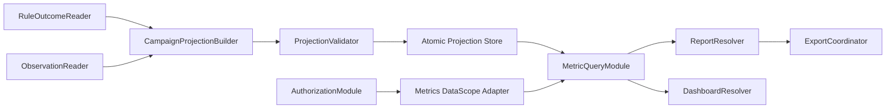
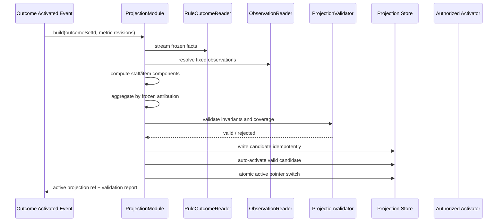

# Metrics and Dashboard Design

> **状态**：`draft`  
> **模式**：Design-First；本轮重构历史技术设计，不包含 requirements/tasks  
> **适用范围**：指标目录、观察策略、活动投影、三张表、看板、DataScope 与异步导出  
> **所属域**：E 指标与看板 · **目录命名**：旧名 `metrics-and-dashboard`，按域代号应为 `e-metrics`  
> **最近核对**：2026-10-29（与 E 域 PRD v0.1.6 存在偏差，见文末附录）  
> **2026-11-04 已知过时**（以 E 域 PRD v1.1 为准，正文未改）：不设分项完成率与「考核项」sheet；专员明细展示内容 / 评论 / 账号三项结果与 C1 / C2 / C3 各层通过条数；命中内容 = 通过全部内容层的内容；报表导出用 exceljs 仅写入，在 Worker 进程生成（ADR-0011）。
> **更新日期**：2026-09-02

## 1. Overview

指标与看板模块把规则引擎的冻结业务结论和数据底座的版本化观察转换为唯一、可追溯、可授权的指标投影。点检表、看板、导出和未来取数工具必须引用同一个 `projectionId`、`outcomeSetId` 和 observation policy revision；“SQL 看起来一样”不构成口径一致。

本设计是逻辑架构与稳定契约，不是旧 DDL 的翻版。v2 明确不拥有指标、报表、看板或导出表；本模块可拥有自己的持久化模型，但物理 schema 需在后续实现 Spec 中单独评审。



## 2. Design Authority

优先级：

1. [`CONTEXT.md`](../../../CONTEXT.md)：稳定身份、历史归属、ContentDiscovery、快照、ValueState 和时间语义；
2. [`database-design-v2.md`](../../../HBECHO设计方案/domains/data-foundation/database-design-v2.md)：数据底座当前事实与约束；
3. [`d-rule-engine/design.md`](../d-rule-engine/design.md)（旧 `rule-engine` 已被取代；`OutcomeSet` 等已由 `JudgementOutcomeReader` 取代，见其 §10.4）：OutcomeSet、ParticipantFact、ItemOutcomeFact 和 AttributionSnapshot 契约；
4. [`b-access-control/design.md`](../b-access-control/design.md)：Capability、DataScope 和异步撤权语义；
5. 本设计：指标、投影、报表、看板和导出；
6. 历史输入：[`hbecho-模块设计-指标与看板.md`](../../../HBECHO设计方案/archive/prd-drafts/hbecho-模块设计-指标与看板.md)。

## 3. Goals and Non-goals

### 3.1 Goals

- 指标定义与 revision 是唯一语义来源；
- 内置、考核项派生和受限自定义三类指标使用同一查询接口；
- 参与资格集合是所有考核完成率的统一分母，分子必须是其子集；
- 比率上卷分子、分母和质量组件后再计算，不能平均下级比率；
- 互动指标显式冻结观察基准、实际快照和截止时间；
- ValueState 和数据覆盖传播为指标质量，不把未知转换为 0；
- CampaignProjection 固定规则 outcome、参与者、观察快照、指标版本与历史归属，并原子发布；
- 全量数据表、命中业务明细表、点检表共享同一版本 token 并可下钻；
- 看板配置与数据范围分离，同一配置对不同 User 应用当前 DataScope；
- 导出异步、流式、范围可证明，提交/执行/交付均不越权；
- 每个 MetricValue 可通过 lineage 回溯来源、规则、观察和口径。

### 3.2 Non-goals

- 不重新实现规则求值、composite 或参与资格；
- 不修改 v2 的采集、快照或媒资表；
- 不定义角色矩阵或返回授权 SQL；
- 不允许任意 SQL、自定义脚本或无限嵌套指标表达式；
- 首版不建设自助分析平台、排行榜、热力图或财务报表；
- 不在本文冻结物理表、ORM、缓存、分析库或原生分区；
- 不把报表字段显示配置误当成指标口径；
- 不使用旧角色键、旧表、MySQL ENUM 或旧组织 JOIN。

## 4. Domain Ownership and Vocabulary

| 概念 | Owner | 说明 |
|---|---|---|
| `MetricDefinition` / `MetricRevision` | 本模块 | 稳定指标身份和不可变语义 revision |
| `ObservationPolicyRevision` | 本模块 | 如何选择内容/主页观察快照及容差 |
| `CampaignProjection` | 本模块 | 一组冻结输入到可查询指标事实的原子版本 |
| `MetricValue` | 本模块 | 数值、组件、质量、观察和 lineage 的统一返回 |
| `ReportView` | 本模块 | 明细列、筛选和排序的显示配置，不含授权 |
| `ReportTemplateRevision` | 本模块 | 汇总维度、指标列、样式和空行策略的版本配置 |
| `DashboardRevision` | 本模块 | 卡片、布局、指标、维度和下钻配置，不含角色可见数组 |
| `ExportJob` / `ExportArtifact` | 本模块 | 异步导出的执行与受控交付事实 |
| `OutcomeSet` / `ParticipantFact` | 规则域 | 判定、参与者、item outcome 和历史归属输入 |
| `Content/Profile Snapshot` | 数据底座 | 基础互动与主页观察，不由指标域复制 |
| `DataScope` | 访问控制域 | 当前 User 的语义可见范围，由本模块 Adapter 解释 |

## 5. Deep Module Interfaces

### 5.1 MetricCatalogModule

```ts
interface MetricCatalogModule {
  validate(draft: MetricDraft): Promise<MetricValidation>;
  publish(command: PublishMetricCommand): Promise<MetricRevisionRef>;
  describe(ref: MetricRef, locale: string): Promise<MetricDescriptor>;
}
```

接口隐藏类型检查、依赖图、循环检测、grain/observation compatibility、影响面和 revision 治理。调用方不能保存 SQL fragment。

### 5.2 CampaignProjectionModule

```ts
interface CampaignProjectionModule {
  build(command: BuildProjectionCommand): Promise<ProjectionBuildRef>;
  getStatus(ref: ProjectionBuildRef): Promise<ProjectionBuildStatus>;
  activate(command: ActivateProjectionCommand): Promise<CampaignProjectionRef>;
}
```

它隐藏读取、观察选择、组件聚合、质量验证、幂等重试和原子激活。调用方不按 item 逐个 upsert “当前指标”。

### 5.3 MetricQueryModule

```ts
interface MetricQueryModule {
  query(request: MetricQuery, scope: DataScope): Promise<MetricResultSet>;
  explain(request: MetricExplanationQuery, scope: DataScope): Promise<MetricLineage>;
}
```

点检表、看板和导出共用该接口。接口保证使用单一 projection、scope fingerprint 隔离缓存，并返回质量与 lineage；调用方不重复计算比率。

### 5.4 Report and export modules

```ts
interface ReportModule {
  resolveSchema(request: ReportSchemaRequest, scope: DataScope): Promise<ReportSchema>;
  query(request: ReportQuery, scope: DataScope): Promise<ReportPage>;
}

interface ExportModule {
  submit(command: SubmitExportCommand, actor: AuthContext): Promise<ExportJobRef>;
  getStatus(ref: ExportJobRef, actor: AuthContext): Promise<ExportJobStatus>;
  issueDownload(ref: ExportArtifactRef, actor: AuthContext): Promise<ShortLivedDownload>;
}
```

这些是调用方与测试的外部 seam。流式写文件、图片限流、OSS、重试和撤权恢复属于内部实现。

## 6. Metric Semantics

### 6.1 Three metric sources

1. **内置基础指标**：账号、粉丝、内容、互动、覆盖与数据质量；
2. **考核项派生指标**：每个 item 至少提供 `achievedCount`、`achievementRate`、`hitContentCount`、`pendingParticipantCount`；
3. **受限自定义指标**：只允许 `add/subtract/multiply/divide`，两个操作数为已有指标或常数，不嵌套、不接收 SQL。

考核项指标以稳定 `assessmentItemId` 绑定。改别名只改变显示元数据；归档不破坏历史 projection。推荐结构化 MetricKey，而不是把中文别名或 ID 拼成不可治理字符串。

### 6.2 MetricRevision contract

每个不可变 revision 至少定义：

- 业务名称、说明、owner 和状态；
- 来源、数值类型、单位和显示格式；
- 支持 grain；
- 聚合类型：additive、distinct-recompute、ratio-components、semi-additive snapshot 或 selector；
- observation policy；
- null/quality policy；
- rollup plan；
- 公式依赖及其 revision；
- 发布时间、审计和影响面。

修改口径产生新 revision，不静默重写历史正式投影。历史报表固定使用原 revision，除非发起显式重建并产生新 projection。

### 6.3 Unified MetricValue

```ts
interface MetricValue {
  state: 'value' | 'no_data' | 'partial' | 'invalid';
  value: string | null;
  numerator?: string;
  denominator?: string;
  coverage?: { observed: string; expected: string };
  basis: ObservationBasis;
  observedAt?: string;
  computedAt: string;
  lineageId: string;
}
```

BIGINT/Decimal 对外使用 string，避免精度丢失。`0` 是 value；`missing/explicit_null/invalid` 按指标 policy 形成 no_data/partial/invalid，禁止 `COALESCE(..., 0)`。

### 6.4 Unified participant denominator

规则域输出冻结 `ParticipantFact`，指标域不得从“发过内容的人”反推参与者：

```text
achievementRate = achieved participants / eligible participants
```

- 每名 `MediaStaff` 稳定 ID 去重；多个账号不重复进入分母；
- achieved 集合必须是 eligible 集合子集；违反即阻断 projection；
- waiting/pending 单列，不从分母中静默扣除；
- 是否排除同步异常必须在 participant revision 中统一决定，并同时暴露排除质量计数；
- composite 的 achievement 由规则域输出，指标域不再实现 AND/OR。

### 6.5 Ratio rollup

任何粒度上卷都聚合组件：

```text
branch numerator + branch numerator → region numerator
branch denominator + branch denominator → region denominator
region rate = region numerator / region denominator
```

不得平均 branch rate。分母为 0 返回 `no_data`，不是 `0%`。distinct、selector 和 semi-additive 指标必须使用各自 rollup plan，不能伪装为 SUM。

## 7. Observation Policies

### 7.1 Last observed

`last_observed(asOf)` 选择 asOf 之前逻辑上最新的 finalized 快照，把实际 snapshot ID、观察时间和选择 policy revision 固定进 projection。发布后不再沿 `current_snapshot_id` 漂移。

### 7.2 N-day matured（2.0，1.0 不启用）

1.0 只用 `last_observed`；`n_day_matured` 及其 N、选择方向、容差与缺失显示都放 2.0（D-66、E 域 PRD §11）。2.0 启用时需另行定义：首次不早于目标时点 / 目标时点前最近 / 容差内最近；没有合格快照时返回 `no_data`，不插值、不取 0。

### 7.3 Profile boundary observations

粉丝增量等边界指标保存开始/结束两个 `profileSnapshotId`、实际观察时间和边界偏差。差值可为负。不能声称“活动精确新增”而隐藏周度观察误差。

### 7.4 Interaction semantics

- `comment_value` 使用平台报告总评论数，不等于 `comments` 行数；
- `interactions_total` 是否含 share/forward/collect 及跨平台字段映射必须有 revision；
- 排序、最佳内容和比较必须使用与展示值相同的 observation basis；
- 数据鲜度、连续性缺口、同步成功率和媒资完整度与同一 projection cutoff 对齐。

## 8. Upstream Contracts

### 8.1 RuleOutcomeReader

```ts
interface RuleOutcomeReader {
  getOutcomeSet(campaignId: string): Promise<OutcomeSetDescriptor>;
  streamParticipants(outcomeSetId: string): AsyncIterable<ParticipantFact>;
  streamScopedContents(outcomeSetId: string): AsyncIterable<ScopedContentFact>;
  streamItemOutcomes(outcomeSetId: string): AsyncIterable<ItemOutcomeFact>;
}
```

一个 projection 只使用一个 `outcomeSetId`。它冻结 campaign scope、item→run mapping、participant revision、source batches、cutoff 和 attribution schema。指标域不 JOIN 规则内部表。

### 8.2 ObservationReader

```ts
interface ObservationReader {
  resolveContentObservation(request: ContentObservationRequest): Promise<ContentObservationResult>;
  resolveProfileObservation(request: ProfileObservationRequest): Promise<ProfileObservationResult>;
}
```

该 Adapter 只返回 finalized/终态快照及 ValueState。它隐藏 v2 查询、时间选择和批量优化；指标域不得查询 current 后再宣称历史可复现。

### 8.3 AttributionSnapshot

`AttributionSnapshot` 当前是 owner 未决的跨域合同，不归指标域拥有。以下是指标投影所需的最小输入形状，不代表规则域已经取得 owner；owner、schema 和冻结时点未裁决前，实施 Spec 不得单方面建表或发布正式 projection。

规则 outcome 必须携带 typed、不可变归属：assignment、staff、store、dealer、brand、sector、branch、region 稳定 ID、capturedAt、source discovery 和 schema version。Dealer 是 Store 所有者维度，不参与错误的组织父子上卷。

v2 保存 discovery 时 assignment，但 Store/组织当前主档没有完整变化历史。AttributionSnapshot owner 和冻结时点是本设计实施前的 P0 决策。

## 9. Campaign Projection

### 9.1 Frozen projection descriptor

一次 build 冻结：

- campaign scope revision；
- outcomeSetId 与每个 item/run revision；
- participant set revision；
- source batch/snapshot IDs；
- metric revision set；
- observation policy revisions；
- cutoff 和 timezone；
- attribution schema version；
- build implementation version。

### 9.2 Build and explicit activation flow



幂等键至少包含 outcomeSetId、metric revision set 和 observation policy revisions。重复 build event 返回同一 candidate，不创建不同事实。通过验证的 candidate 由系统**自动激活**，业务刷新即见新数（E-D11）；激活记录触发事件、版本与时间，供审计追溯，不需要人工动作。build/validate/activate 任一步失败时旧 active projection 继续服务并标注 stale，无旧版时返回 not_ready。

候选生命周期为：

```text
planned → building → validating → active → superseded
                         ↘ rejected | failed | cancelled
```

### 9.3 Validation

激活前至少验证：

- expected/produced fact 数与 item/run mapping；
- achieved ⊆ participant；
- 分子不得大于分母；
- metric dependency revisions 完整且无循环；
- ValueState、observation basis 和 grain 兼容；
- AttributionSnapshot 完整；
- waiting/partial/invalid 和 snapshot age 在允许范围；
- 同一 projection 不混用不同 cutoff 或 current 数据。

## 10. Reports and Drilldown

### 10.1 Shared version token

三张表所有请求携带 `projectionId + outcomeSetId`。下钻沿用该 token，避免用户从点检表点击后恰逢重算而看到另一版明细。

### 10.2 Table 1: full-scope data

定义：活动范围内的全部内容参与事实，包括未命中、待定、不可判定、排除原因和质量状态。

v2 允许同一内容有多个 discovery。推荐在线展示 grain：

```text
一条 content snapshot 行 + attributions[]
```

若业务需要“一名专员一行”，应定义独立 content-participation grain。不能一边按 content 去重、一边在分母和命中数按 assignment 计数而不披露。

### 10.3 Table 2: matched business details

定义：命中至少一个 assessment item 的内容事实，包含 item revision、结果、证据摘要和解释入口。一个 content 可携带多个 matched item，避免为每个 item 无界复制行。composite 可展开子项，但不由报表层重新计算。

### 10.4 Table 3: checklist

读取 CampaignProjection：

- 固定维度默认 Region → Branch，可下钻 Sector/Store/MediaStaff；
- Dealer 是交叉维度；
- 固定 participant denominator；
- assessment item 自动展开 achieved/rate，hits/pending 可选；
- 空行来自冻结参与者/组织快照，不从当前目录临时补；
- 页脚展示 cutoff、outcome/metric versions、observation basis、pending 与数据质量。

### 10.5 Views and templates

- 明细 `ReportView` 只保存列显示、顺序、宽度、筛选和排序；所有角色可保存个人视图；
- `ReportTemplateRevision` 保存汇总维度、指标、动态 item group、阈值着色、空行策略和导出样式；
- 默认自动包含全部有效 assessment items；改别名更新显示，不改变绑定；
- 分享只分享配置，不分享或扩大数据范围；
- 配置 applicability 与授权是两件事，最终数据永远是 applicability ∩ current DataScope ∩ user filters。

## 11. Dashboards and DataScope

Dashboard/Card 只引用 MetricKey、dimension/grain、filter、visualization、layout 和 drilldown。不得保存 `visible_roles` 或 `default_for_roles` 作为授权规则。

`MetricsDataScopeAdapter` 将语义 DataScope 应用于 Projection 的历史稳定 ID：

- 当前权限决定现在可查看哪些历史事实；
- 历史 AttributionSnapshot 决定事实归属，不被当前组织 JOIN 改写；
- 未注册策略、普通用户空范围、组织映射失败一律 fail closed；
- 缓存键包含 projectionId、scope fingerprint、query 和 dashboard/template revision；
- 不同 User 打开同一 DashboardRevision 可看到不同范围，但同一可见单元的值和口径一致。

默认首页可按 Capability 和产品策略解析，不能依赖角色数组授予数据。

## 12. Async Export

### 12.1 Submission snapshot

提交时冻结：

- report/template/view revision；
- projection/outcome token；
- filter、sort、locale、timezone、observation policy；
- requestedBy、Capability、DataScope snapshot/version；
- payload hash、idempotency key；
- 是否嵌图及行/图片/文件上限。

### 12.2 Execution and delivery

执行时重算 current scope：

```text
EffectiveExportScope = SubmittedScope ∩ CurrentScopeAtExecution
```

Worker 使用用途受限 service actor，并通过 ReportModule/MetricQueryModule 流式读取，不能直连全库。文件分批生成到私有临时对象，成功校验后原子发布 Artifact；失败不暴露半文件。

交付前再次授权。若当前范围已收缩且 Artifact 包含超范围数据，则拒绝、删除或按新范围重建；不能签发旧文件。短期签名 URL 不进入长期业务字段。

### 12.3 Resource limits

行数、图片数、单图大小、文件大小、运行时长和并发都必须有硬上限。图片下载失败按明确策略降级为链接或占位，并在完成状态中返回 warning。保留期（历史稿建议 7 天）应配置化，不写死为表默认。

## 13. Failure and Consistency Semantics

| 情形 | 行为 |
|---|---|
| 新 outcome/projection 构建失败 | 旧 projection 继续服务并标 stale；无旧版时返回 not_ready，不返回全 0 |
| candidate 未授权、未通过验证或激活失败 | candidate 保持非 active 并记录审计；旧 active 指针不变 |
| active outcome 含 waiting | 可否发布由策略决定；若发布必须暴露 pending/coverage，不能当 false |
| source snapshot 缺失或非 finalized | no_data/partial 并产生质量问题，不回退 current |
| ValueState 非 value | 按 policy 传播 no_data/partial/invalid，不按 0 聚合 |
| denominator = 0 | no_data，显示 `—` |
| numerator > denominator | invariant violation，阻断发布并告警 |
| 重复事件/Worker 重试 | 幂等；一个 revision set 只产生一个候选结果 |
| 引用 archived item/metric | 历史 revision 可读；新配置保存时提示或拒绝，不按同名替换 |
| DataScope 未注册/映射失败 | fail closed |
| 缓存 scope fingerprint 不同 | 禁止复用 |
| 用户撤权或禁用 | 排队任务取消；过宽 Artifact 不可交付 |
| 图片/单行渲染失败 | 按策略降级并记录 warning，不产生静默缺失 |

## 14. Audit, Lineage and Observability

### 14.1 Audit

记录指标发布/归档、观察策略、模板/看板变更、projection 强制激活、导出提交/取消/交付和敏感字段导出。配置审计保留 actor、reason、before/after、revision 和影响面，不保存完整 DataScope 明细或手机号。

### 14.2 Lineage

每个 `lineageId` 可回溯：

```text
MetricValue
→ MetricRevision + ObservationPolicyRevision
→ CampaignProjection
→ OutcomeSet / ParticipantFact / ItemOutcome
→ snapshot IDs + AttributionSnapshot
```

ODS 一年到期不破坏正式报表解释；如果某指标必须依赖 ODS 原文才能解释，则不能宣称长期可复现。

### 14.3 Metrics and alerts

至少观测：

- outcome→projection lag、build duration/throughput/retry；
- expected vs produced facts、item/run version mix；
- numerator/denominator invariant、zero denominator；
- pending/partial/invalid 比例、snapshot age 和成熟期覆盖；
- DataScope denial/mapping failure、cache hit 与 scope 隔离；
- query P50/P95/P99；
- export queue/run/failure、rows/bytes/images、撤权取消与 Artifact 清理；
- projection stale、同步质量下降和 lineage lookup failure。

Trace 关联 `campaignId`、`outcomeSetId`、`projectionId`、`metricRevision`、`metricKey`、`grain`、`scopeFingerprint`、`exportJobId`。

## 15. Security and Privacy

- 每个在线和导出查询先授权动作，再应用 Metrics ScopeStrategy；
- ReportView/DashboardRevision 不携带授权，不能通过分享扩大范围；
- 手机号、原始载荷、私有媒资和其他敏感列需要额外 Capability；
- Export Worker 不记录完整行、手机号、签名 URL 或 DataScope 明细到日志；
- 临时文件与失败 Artifact 按生命周期清理；
- “本人”范围无法绑定 User↔MediaStaff 时拒绝，不按姓名或手机号模糊匹配；
- AI/Agent 若未来调用指标，必须通过 MetricQueryModule 并继承同一 DataScope、行数上限和审计。

## 16. Verification and Acceptance Boundaries

1. 同一 projection token 下，点检表、看板、导出和 MetricQuery 返回相同值、质量状态和 observation basis；
2. 新增 item 自动出现派生指标；改别名不断绑定；归档不破坏历史；
3. achieved 始终是 participant 子集，多账号不重复计算同一 MediaStaff；
4. 跨层级比率由组件重算，不平均下级百分比；
5. `0/missing/explicit_null/invalid/denominator=0/waiting/not_applicable` 有不同结果；
6. last_observed 固定实际 snapshot，并在 UI/导出显示；
7. 账号转移、组织调整和旧批次迟到后，旧 projection 数值与归属不变；
8. 多 discovery/共创按已确认 grain 计数，不丢归属或重复分母；
9. 当前 DataScope 收缩后在线结果立即收缩，异步导出不会交付旧超范围文件；
10. projection build/rebuild 通过验证后自动激活；原子切换，并发事件、重复消费和失败均不产生空窗或混合版本；
11. 三张表使用同一 token 完成点检 → 命中内容 → 专员全量内容下钻；
12. 大导出不阻塞 HTTP，内存、图片并发和文件可见性有界；
13. 正式报表显示数据截止、规则/指标版本、观察策略、pending 与数据质量；
14. 新设计和实现不依赖旧角色键、旧数据底座表、MySQL ENUM 或旧 SQL。

历史性能目标“43 个分公司 × 20 指标 P95 < 2s”可作为候选验收值，但须在真实查询和容量设计中确认。在线明细必须分页，大范围导出必须异步。

## 17. Migration from Legacy Design

明确淘汰：

- `metric_definitions`、`ads_campaign_org_metrics`、`report_views`、`report_templates`、`dashboards`、`export_jobs` 等旧 CREATE TABLE 作为当前 schema；
- `visible_roles/default_for_roles` 与 `hq_user/branch_user/dealer_staff` 授权判断；
- `videos`、`account_snapshots`、`staff_accounts`、`staff_store_relations` 等旧数据源；
- MySQL `ENUM`、裸 `INT` ID、旧分区 SQL、`org_key` 多态字符串和弱 `source_run_ids JSON`；
- `staff → dealer → branch → region → brand` 错误上卷；
- 导出只保存提交范围而不在执行/交付复查；
- `source=legacy` 和当前旧库迁移假设；
- “粉丝边界最多 6 天”或“供应商固定返回 20 条”等硬编码；
- `dealer_count` 显示为门店数。

保留并重构：唯一指标字典、三类指标、动态考核项、统一分母、观测基准、三张表、动态表头、比率组件上卷、配置与范围分离、异步流式导出和数据质量页脚。

## 18. Open Decisions

### P0 before requirements/tasks

1. participant_count 是否排除同步异常，异常定义与质量旁路指标；
2. 内容归属按 discovery 时还是 published_at，及多 discovery/共创计数；
3. campaign OutcomeSet 的一致性和规则域是否直接输出 staff achievement；
4. AttributionSnapshot owner、schema、冻结时点和保留期；
5. User/DataScope 组织 ID 与 v2 稳定 ID 的映射，“本人”如何绑定 MediaStaff；
6. 指标、模板、看板、分享和导出的最终 Capability；
7. interactions_total 对 share/forward/collect 的跨平台口径。

### Product/configuration decisions

- 粉丝首尾快照最大边界偏差；
- 模板发布是否需要审批；
- 多平台按 sheet、标签页还是一张宽表；
- 在线/导出行数、图片数、文件大小和时间上限；
- 考核项归档、活动复制和历史别名展示；
- 自定义指标是否只在品牌内可用及是否审批；
- partial 数据能否用于正式通报；
- 最佳内容并列、缺值和 URL 失效策略；
- Artifact 默认保留期和撤权后的删除/重建策略。

---

## 附录：已知过时内容（2026-10-29 核对）

> 本节只记录偏差，不修改正文。凡与 E 域 PRD v0.1.6 冲突处，以 PRD 为准。

| # | 位置 | 原设计 | 当前事实或处理 | 来源 |
|---|---|---|---|---|
| 1 | 观察策略 · `n_day_matured` | 原把 `n_day_matured` 作为 1.0 可选策略，N / 方向 / 容差列为待定 | 已改为 2.0；1.0 只做 `last_observed` | D-66、E 域 PRD §11 |
| 2 | 投影激活语义 | 原要求具备 Capability 的 actor 显式激活 | 已改为通过验证后自动激活；生命周期去掉 `ready_to_activate` | E-D11 |
| 3 | 授权判断示例 | 对照 `hq_user` / `branch_user` / `dealer_staff` 角色 | 角色码已定四类，`dealer_staff` 不保留 | D-22 |
| 4 | 指标目录 · `interactions_total` | 跨平台字段映射作为开放口径 | 1.0 不展示 `interactions_total`，口径未定前不上线 | E 域 PRD §11.1 |
| 5 | `ReportTemplateRevision` | 保存汇总维度、指标、动态 item group、阈值着色与导出样式 | 1.0 只用系统内置模板，不做业务自建模板 | E-D10 |
| 6 | 文末开放项 | Artifact 默认保留期待定 | 已关闭：导出件保留 7 天，可配置 | E-D13 |

**核对为一致的部分**（不需改动）：唯一 `projectionId` / `outcomeSetId` 口径、三张表共用冻结投影、比率按组件上卷、异步导出与交付前范围复查、点检表固定「大区 → 分公司」两级（E-D12）。
