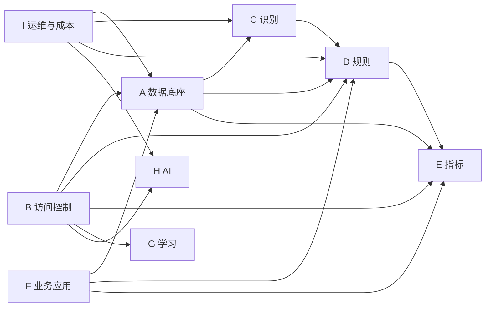

# hbecho 文档索引

> 状态：Current  
> 作用：项目文档的唯一导航页；定义权威顺序、状态和新旧边界。  
> 更新日期：2026-11-05

## 1. 从这里开始

按任务选择入口：

1. 理解领域词汇与不可违反的事实：[`CONTEXT.md`](../CONTEXT.md)
2. 查看不可协商的跨模块条款：[`constitution.md`](governance/constitution.md)（索引，不要求逐条确认）
3. 理解产品目标、模块地图和阶段：[`prd-platform.md`](prd-platform.md)；已开写的子 PRD：[A 数据底座](prd-domain-a-data-foundation.md)、[B 访问控制](prd-domain-b-access-control.md)、[C 识别能力](prd-domain-c-signals.md)、[D 规则与考核](prd-domain-d-rule-engine.md)、[E 指标与看板](prd-domain-e-metrics.md)、[F 业务应用](prd-domain-f-business-apps.md)、[G 学习平台](prd-domain-g-learning.md)、[H AI 能力](prd-domain-h-ai.md)、[I 运维与成本](prd-domain-i-ops.md)
4. 实现数据获取与资产域：[`database-design-v2.md`](domains/data-foundation/database-design-v2.md)
5. 实现当前纵向切片：[`a-data-foundation-tracer`](../.kiro/specs/a-data-foundation-tracer/)
6. 评审后续模块设计：[`access-control`](../.kiro/specs/access-control/design.md)、[`rule-engine`](../.kiro/specs/rule-engine/design.md)、[`metrics-and-dashboard`](../.kiro/specs/metrics-and-dashboard/design.md)
7. 配置 hbecho 的服务器、OSS、密钥、Git 与部署：[`server-operations-runbook.md`](runbooks/server-operations-runbook.md)
8. 开发、验证、CI、测试 ECS 与生产发布：[`dev-test-deploy-workflow.md`](runbooks/dev-test-deploy-workflow.md)
9. 从 0 配置一台新服务器（hbdam 或其他项目）：[`new-server-bootstrap-checklist.md`](runbooks/new-server-bootstrap-checklist.md)
10. 设计带页面的 spec 前先读 UI 全局基线：[`ui-foundation.md`](ui/ui-foundation.md)
11. 查看难逆的技术决定与未决选型：[`adr/README.md`](architecture/adr/README.md)
12. 查看自动注入但不独立裁决事实的精简规则：[`product.md`](../.kiro/steering/product.md)、[`tech.md`](../.kiro/steering/tech.md)、[`structure.md`](../.kiro/steering/structure.md)、[`data-discipline.md`](../.kiro/steering/data-discipline.md)、[`server-access.md`](../.kiro/steering/server-access.md)、[`no-reinventing-wheels.md`](../.kiro/steering/no-reinventing-wheels.md)、[`dev-ci-cadence.md`](../.kiro/steering/dev-ci-cadence.md)
13. 复核待确认的子 PRD 素材：[`prd-drafts-子PRD草案/`](prd-drafts-子PRD草案/README.md)（`draft`，不是实现依据）

## 2. 文档状态

| 状态 | 含义 | 是否可作为当前实现依据 |
|---|---|---|
| `current` | 已确认的当前基线 | 是，按其适用范围使用 |
| `draft` | 正在评审的提案；允许保留明确未决项 | 否；评审通过前不可当成已冻结合同 |
| `superseded` | 已被新文档替代，仅保留背景、反例和迁移线索 | 否 |
| `archived` | 历史记录、复盘或证据，不再维护 | 否；实测证据除外，见权威顺序 |

“文件较新”不自动代表“更权威”；必须以本索引标注的状态和适用范围为准。

## 3. 冲突时的权威顺序

1. [`CONTEXT.md`](../CONTEXT.md)：已确认领域词汇、语义边界和不变量。
2. [`database-design-v2.md`](domains/data-foundation/database-design-v2.md)：数据获取与资产域的当前实施基线。它与子 PRD `prd-domain-<代号>-<slug>.md` 的产品语义冲突时，以子 PRD 为准并回来修订本项；子 PRD 不得覆盖第 1 项。
3. [AI Master API V1.2](../aimaster接口文档/FieldShortcut%20A%20Master%20API%20开发文档%20V1.2.md) 与 [`raw3`](../aimaster接口文档/测试结果/raw3/) 等实测证据：外部合同与证据。文档与实测冲突时，raw 证据只证明“样本中观察到的行为”，不能外推为供应商长期合同。
4. `.kiro/specs/*`：各模块的当前需求、设计和任务；不得静默改写前 3 项事实。
5. [`prd-platform.md`](prd-platform.md)：产品方向、模块边界和路线图，不承载表级实现。
6. `superseded` 与 `archived` 文档：只用于追溯，不参与当前实现裁决。

`.kiro/steering/` 是上述权威内容的精简、always-included 派生规则，不新增独立事实层级，也不能覆盖本节。修改 steering 时必须同步核对其来源文档；发生漂移时，以本索引及前述权威来源为准并修正 steering。

若当前 Spec 与领域不变量或 v2 基线冲突，先停止实现并显式修订文档；不得通过代码或局部 SQL 暗中选择一方。

**宪法与 ADR 的位置**：`HBECHO设计方案/governance/constitution.md` 是前四项的**跨模块索引**，不新增事实，也不裁决冲突；冲突时以 INDEX §3 的权威顺序与原文为准。`HBECHO设计方案/architecture/adr/` 记录难以逆转且存在真实取舍的决定；ADR 不得改写 `CONTEXT.md` 或 v2 的领域语义。

### 3.1 跨域约定去哪找（2026-11-04）

`conventions-platform.md` 不单独编写（D-73）。跨域约定按主题回原文：

| 主题 | 权威位置 |
|---|---|
| 编号 | `prd-platform.md` §0.5（P-R / 域 R / spec R）、§5.1（D-xx） |
| 权限谓词 | B 域 PRD §7.1、B-D17–B-D19 |
| 日志与审计 | B 域 PRD §11、I 域 §5.1 |
| 成本与配额 | I 域 §3.3、§10 |
| 配置 | I 域 §3.2、§9 |
| 容量 | `prd-platform.md` §2.3、I 域 §10.2 |
| 文档规则 | `.kiro/steering/structure.md` |
| 难逆取舍 | `architecture/adr/` |

## 4. 五类项目文档

| 类别 | 目录 | 承载内容 | 不应承载 |
|---|---|---|---|
| 产品需求 | `HBECHO设计方案/`（总 PRD `prd-platform.md`；子 PRD `prd-domain-<代号>-<slug>.md`） | 目标、非目标、模块地图、阶段、域边界、跨域决策 | DDL、接口逐字段说明 |
| 架构与领域 | `CONTEXT.md`、`HBECHO设计方案/domains/`、`HBECHO设计方案/architecture/`、`HBECHO设计方案/governance/` | 领域语义、模块边界、实施基线、必要 ADR、不可协商条款索引 | 单次任务清单 |
| Kiro Specs | `.kiro/specs/<code>-<slice>/` | 可验收需求、实现设计、执行任务 | 全项目巨型总设计 |
| Runbook 与证据 | `HBECHO设计方案/runbooks/`、`aimaster接口文档/` | 运维步骤、供应商合同、fixture 与实测记录 | 未标状态的产品决策 |
| 应用代码与测试 | `src/`（领域模块在 `src/modules/<模块>/`，schema 在 `src/db/`）、`drizzle/`（drizzle-kit 迁移与手写 SQL 迁移）、`tests/`（`tests/fixtures/` 登记证据而不复制，`tests/harness/` 为离线测试挂具）、`services/capability/`（Python 能力服务，ADR-0012；目前只有标准化衍生图的转换函数与 pytest 单测）；目录约定见 [ADR-0013](architecture/adr/0013-repository-layout.md) | 实现与其自动化验收 | 设计结论；与 CONTEXT / v2 冲突时以文档为准 |
| 历史归档 | `HBECHO设计方案/archive/` | superseded 方案、旧稿、复盘、评审证据、legacy 输入 | 当前实现依据 |

### 4.1 命名规范（对齐 hbdam 的做法）

- 总 PRD：`HBECHO设计方案/prd-platform.md`
- 子 PRD：`HBECHO设计方案/prd-domain-<代号>-<slug>.md`
- 技术设计草案（尚未走产品评审时）：`HBECHO设计方案/sdd-domain-<代号>-<slug>.md`
- Spec：`.kiro/specs/<代号>-<切片>/`，四件套 `requirements.md` / `design.md` / `tasks.md` / `acceptance.md`
- 归档：一律进入 `HBECHO设计方案/archive/`；跨项目或早期沉淀的历史资料进入 `archive/legacy/`

**域代号（2026-10-27 已确认，决策人刘学奎，即 `prd-platform.md` D-01）**：

| 代号 | 域 | 对应现状 |
|---|---|---|
| A | 数据底座（组织、账号、同步、ODS、内容、媒资） | `prd-domain-a-data-foundation.md` + `database-design-v2` + `a-data-foundation-tracer` |
| B | 访问控制（User、Session、Capability、DataScope） | `prd-domain-b-access-control.md` + `access-control` design |
| C | 识别能力（文本信号、视觉模板匹配、特征存储） | `prd-domain-c-signals.md`（草稿） |
| D | 规则与考核 | `prd-domain-d-rule-engine.md` + `rule-engine` design |
| E | 指标、报表与看板 | `prd-domain-e-metrics.md`（定稿候选） + `metrics-and-dashboard` design |
| F | 业务应用（点检、账号档案、内容库、任务闭环） | `prd-domain-f-business-apps.md`（草稿） |
| G | 学习平台 | `prd-domain-g-learning.md`（草稿） |
| H | AI 能力 | PRD 初稿（v0.2，1.0 收窄） |
| I | 运维与成本 | PRD 初稿（v0.1，待盘问确认） |

**旧编号已作废**：此前本表把 C 记为规则、D 记为指标、G 记为成本与治理、H 记为学习与 AI，且缺 I。该写法与 `prd-platform.md` §4.1 冲突，已于 2026-10-28 按 D-01 修正。现有 `.kiro/specs/*` 目录名在对应域 PRD 开工前保持不变，之后按 `<代号>-<切片>` 一次性重命名并修复链接。

`HBECHO设计方案/architecture/` 与 `HBECHO设计方案/runbooks/` 在出现首份有效内容时创建；不以空目录或占位文档制造虚假完备度。

## 5. 当前权威矩阵

| 范围 | 文档 | 状态 | 说明 |
|---|---|---|---|
| 数据底座领域语言 | [`CONTEXT.md`](../CONTEXT.md) | current | 只含词汇、语义和不变量，不加入表名、框架或接口决策 |
| 产品总纲 | [`prd-platform.md`](prd-platform.md) | draft（逐章复核中） | v1.0 重构：定位、基线、域划分 A–I、跨域决策、1.0 范围、需求编号与追踪矩阵 |
| 域 A 产品需求 | [`prd-domain-a-data-foundation.md`](prd-domain-a-data-foundation.md) | draft（v1.11 定稿候选，盘问完成） | 数据底座：组织主数据、账号与归属、AI Master 客户端、同步编排、原始证据、明细层、媒资；批量导入与 `structure` 精确分层 |
| 域 B 产品需求 | [`prd-domain-b-access-control.md`](prd-domain-b-access-control.md) | current（v1.20 定稿） | 访问控制：开户与激活、登录会话、生命周期、Capability、DataScope、管理范围、10 个出口、审计 |
| 域 A → C 供数说明 | [`domain-a-handoff-to-c.md`](domain-a-handoff-to-c.md) | draft | A 能给 C 的事实、粒度、质量限制与待对齐项 |
| 域 C 产品需求 | [`prd-domain-c-signals.md`](prd-domain-c-signals.md) | draft（v1.2 定稿候选，第三轮 ASR 前移） | 识别能力：文本信号、素材比对（图片一致 / 元素 / 文字）、音频 ASR + 大模型判定（1.0）、图片/视频理解（2.0）、特征存储、信号五态；拥有监控判定计划的监控段 |
| 域 D 产品需求 | [`prd-domain-d-rule-engine.md`](prd-domain-d-rule-engine.md) | draft（v1.0 定稿候选，第二轮盘问完成） | 规则与考核：计划/考核项模型、专员级达标、三层漏斗、三值逻辑、版本与执行、监控判定计划的判定段与生命周期 |
| 域 E 产品需求 | [`prd-domain-e-metrics.md`](prd-domain-e-metrics.md) | draft（v1.0 定稿候选，第二轮盘问完成） | 指标、报表与看板：唯一口径、投影与原子切换、三张视图、一张计划看板、唯一导出出口；计划级四列 + 分项率（分母=到达人数）；1.0 不做全量内容明细、自助分析、个人视图与 n_day |
| 域 F 产品需求 | [`prd-domain-f-business-apps.md`](prd-domain-f-business-apps.md) | draft（v1.0 定稿候选，第二轮盘问完成） | 业务应用：F 域边界（只编排不复制）、1.0 只做 F5 导入中心（平台级主数据 + 分公司活动名单），F1–F4／F6–F9 仅简版场景；路径 1 upsert、路径 2 只新增；批量导入与 structure 精确分层 |
| 域 G 产品需求 | [`prd-domain-g-learning.md`](prd-domain-g-learning.md) | draft（v1.0 定稿候选，第二轮盘问完成） | 学习平台：1.0 只做 G1 内容管理 + G2 学习中心 + 进度记录 + 总部总量；视频走 VOD、资料走 hbecho-course、可见性=品牌×人员级别；换店删旧建新不迁移进度 |
| 域 H 产品需求 | [`prd-domain-h-ai.md`](prd-domain-h-ai.md) | draft（v0.2 初稿，1.0 收窄） | AI 能力：H1 网关、H2 Prompt、H5 单条脚本分析（仅超管/总部）；H8 规则辅助移 2.0；业务 AI 只保留 D 第三层 ASR + 大模型 |
| 域 I 产品需求 | [`prd-domain-i-ops.md`](prd-domain-i-ops.md) | draft（v0.1 初稿，待盘问确认） | 运维与成本：部署、可观测、备份、安全、生命周期、环境变量配置、配额与硬上限；配置中心/OSS 分级/完整成本看板 2.0 |
| UI 全局基线 | [`ui-foundation.md`](ui/ui-foundation.md) | draft（2026-11-05 复用 hbdam 视觉约定重写；侧栏、状态色、按钮渐变等待办已于同日采纳；含「界面设计须经刘学奎确认」闸门） | 角色导航、1.0 页面地图、页面骨架、筛选与表格交互、通用状态与判定三态、色板与组件、文案与格式、适配与可访问性、验收清单；各 spec 的 design.md「界面」一节按它写 |
| PRD 修订清单 | [`prd-修订清单-2026-11-03.md`](prd-修订清单-2026-11-03.md) | draft（工作清单） | 2026-11-03 对总 PRD、A–G、CONTEXT、steering 与相关 ADR 的评审结论与逐条修订建议；修完后移入 `archive/`；不是实现依据 |
| Kiro steering | [`product`](../.kiro/steering/product.md) · [`tech`](../.kiro/steering/tech.md) · [`structure`](../.kiro/steering/structure.md) | current（derived） | 从本索引、总纲、CONTEXT 与 v2 提炼的自动注入规则；无独立裁决权 |
| 数据底座编码纪律 | [`data-discipline.md`](../.kiro/steering/data-discipline.md) | current（derived） | 从 CONTEXT 不变量与 tracer R2/R5/R9/R10/R13/R18 提炼的六条预防性纪律；当前无机器守护 |
| 服务器访问 | [`server-access.md`](../.kiro/steering/server-access.md) | current | 2026-10-14 用户决定：只走 Workbench；同时适用于 hbecho 与 hbdam |
| 选型纪律 | [`no-reinventing-wheels.md`](../.kiro/steering/no-reinventing-wheels.md) | current | 成熟方案优先的判断阶梯与记录格式 |
| 开发节奏 | [`dev-ci-cadence.md`](../.kiro/steering/dev-ci-cadence.md) | current | 分支、推送、等待 CI 与合并规则；应用代码落地后补实测条目 |
| 不可协商条款 | [`constitution.md`](governance/constitution.md) | current（索引） | 18 条跨模块条款；索引，不新增事实、不裁决冲突 |
| 架构决策 | [`adr/README.md`](architecture/adr/README.md) | current | 13 项已定决定（ADR-0001～0013）+ 10 项选型登记（全部关闭）；新决定必须单独写 ADR |
| 开发测试部署流程 | [`dev-test-deploy-workflow.md`](runbooks/dev-test-deploy-workflow.md) | current | 当前唯一实例是**测试 ECS**，生产 ECS 未购买；只有本机 verify 与 CI 可用 |
| 本机验证与 CI | [`verify.sh`](../scripts/verify.sh) · [`ci.yml`](../.github/workflows/ci.yml) · [`pre-commit`](../.githooks/pre-commit) | current | verify 覆盖 Node 版本、类型检查、离线测试（禁网）、迁移一致、MySQL 8.4 数据库测试、密钥、文档链接、文档登记与 spec 结构，以及 Python 能力服务单测（环境满足 pytest 与 ffmpeg ≥ 7.1 时；CI 不验 Python 侧）；尚无静态门禁与真实数据库集成测试；pre-commit 只扫暂存区 |
| 数据底座数据库 | [`database-design-v2.md`](domains/data-foundation/database-design-v2.md) | draft（待 A 域 PRD 逐表复核） | 30 表草案；v1 不参与新实现 |
| 数据底座字段字典 | [`field-dictionary.md`](domains/data-foundation/field-dictionary.md) | draft | 主页/列表/详情/评论的规范字段、含义、值状态与 10 个未确认语义 |
| 数据底座 tracer | [requirements](../.kiro/specs/a-data-foundation-tracer/requirements.md) · [design](../.kiro/specs/a-data-foundation-tracer/design.md) · [tasks](../.kiro/specs/a-data-foundation-tracer/tasks.md) · [acceptance](../.kiro/specs/a-data-foundation-tracer/acceptance.md) | draft（任务 1–9 已实现并合并 main；离线验收见 acceptance，待确认后升 current） | 首个 Design-First 纵向切片；已按 A v1.9 与 raw4/raw5/raw8 校准；AI Master 是内部适配器 |
| 主数据导入 | [requirements](../.kiro/specs/a-master-data-import/requirements.md) · [design](../.kiro/specs/a-master-data-import/design.md) · [tasks](../.kiro/specs/a-master-data-import/tasks.md) · [acceptance](../.kiro/specs/a-master-data-import/acceptance.md) | draft（任务 0–8 已实现，2026-11-05 已合并 `main`） | 路线图第 2 位；权威主档导出预检与确认写入，含 bootstrap、`structure` 模式与门店改码（单条结构命令族延后）；文件列名以上游 xlsx 为准（11 列）；六项 v2 修订已落回、ADR-0014 已接受（2026-11-05）；路径 1 页面本轮不交付 |
| 全量周期同步 | [requirements](../.kiro/specs/a-full-sync/requirements.md) · [design](../.kiro/specs/a-full-sync/design.md) · [任务 5 实施设计](../.kiro/specs/a-full-sync/design-task5-account-sync.md) · [tasks](../.kiro/specs/a-full-sync/tasks.md) · [acceptance](../.kiro/specs/a-full-sync/acceptance.md) | draft（2026-11-05 初建并经外部审查修订；2026-11-06 任务 0–11 已实现、验收并合并 `main`，真实 smoke 已执行；**不是可上线状态**：真实 worker 因 production capability 全部 disabled 在任何环境都不会启动，没有部署形态；快手有 4 项未决问题） | 路线图第 3 位；周期批次（排队 / 跳过 / 过期）、有效监控目标、多页列表与检查点缺口、账号级封口、快手、按需采集接入契约（详情 / 评论 / 视频 / 音频）、媒资、补抓与运营处置命令、ODS 清理定时；要求八项 v2 修订与两处 A PRD 修订（§7.1、§7.3）；无页面 |
| 界面原型 | [`ui-lab/`](../ui-lab/README.md) | 空目录 | 可点击界面原型与走查记录；不进生产构建；ADR-0013 增补；原型通过且刘学奎确认界面设计后才可写页面任务 |
| 访问控制 | [`design.md`](../.kiro/specs/access-control/design.md) | draft | 认证、Capability、DataScope、异步任务撤权语义 |
| 规则引擎 | [`design.md`](../.kiro/specs/rule-engine/design.md) | draft | 消费 v2 终态快照；规则、证据和重算归规则域所有 |
| 指标与看板 | [`design.md`](../.kiro/specs/metrics-and-dashboard/design.md) | draft | 依赖规则 outcome；统一口径、投影、报表、看板与导出 |
| 学习平台 | [requirements](../.kiro/specs/g-learning-min/requirements.md) · [design](../.kiro/specs/g-learning-min/design.md) · [tasks](../.kiro/specs/g-learning-min/tasks.md) · [acceptance](../.kiro/specs/g-learning-min/acceptance.md) | draft | 1.0 课程/资料上传即发布、VOD 视频、进度与续播、总部汇总；新增 5 张表 |
| 子 PRD 草案 | [`prd-drafts-子PRD草案/`](prd-drafts-子PRD草案/README.md) | draft | 2026-08 的旧设计稿，待逐份复核；不是实现依据 |
| 服务器与部署运维 | [`server-operations-runbook.md`](runbooks/server-operations-runbook.md) | current | hbecho 专属：ECS/OSS 资产、系统与 MySQL 配置、密钥、Git、部署、备份、监控与验收。文档顶部 §待办清单 是搭建期待办的唯一入口 |
| 新服务器从 0 配置 | [`new-server-bootstrap-checklist.md`](runbooks/new-server-bootstrap-checklist.md) | current | 项目无关的可复用清单，供 hbdam 或任何新项目使用。内容来自 hbecho 一次实际执行，每条经过验证 |
| AI Master 外部合同 | [V1.2 文档](../aimaster接口文档/FieldShortcut%20A%20Master%20API%20开发文档%20V1.2.md) · [返回字段](../aimaster接口文档/返回字段与特殊情况.md) · [能力与计费清单](../aimaster接口文档/AI%20Master%20能力与计费清单.xlsx) · [测试覆盖](../aimaster接口文档/测试覆盖与补测清单.md) | evidence | 字段与特殊情况的实测清单；点数表；SLA 与单价仍缺 |
| AI Master 实测 | [`raw3`](../aimaster接口文档/测试结果/raw3/) · [`raw4`](../aimaster接口文档/测试结果/raw4-2026-10-28/) | evidence | raw3：25 个成功样本；raw4（2026-10-28）：补测视频详情、评论与异步，发现异步小红书列表失败 |

## 6. 模块依赖

域代号与边界以 [`prd-platform.md` §4](prd-platform.md) 为准；访问控制与成本守卫是横切关口，不得被某个业务模块复制实现。

## 7. 当前 Spec 路线图

1.0 共 10 个 spec，定义见 [`prd-platform.md` §7.2](prd-platform.md)。

| 顺序 | Spec | 验收结果 |
|---:|---|---|
| 1 | `a-data-foundation-tracer` | 抖音、小红书各一个账号从入口解析到主页、首屏、检查点和媒资进度可查询 |
| 2 | `a-master-data-import` | 导入权威主档导出（F5 路径 1）：预检差异、确认写入，失败行落库可重试 |
| 3 | `a-full-sync` | 抖音、小红书、快手各若干账号完成一轮周期同步，含详情与按规则圈定的评论；外部监控账号复用同一链路 |
| 4 | `b-access-control` | 真实用户可登录，Capability 与 DataScope 生效，无授权旁路 |
| 5 | `a-activity-plan` | 活动计划、分公司参与、名单导入（F5 路径 2，含自动新建专员）、监控联动与 15 天停采 |
| 6 | `c-signals` | 文本信号、模板匹配与音频 ASR 判定结果落入特征表，可被规则引用 |
| 7 | `d-rule-engine` | 业务能配 0/1 档规则与音频 ASR 判定、试运行、看证据、发布 |
| 8 | `e-metrics` | 点检表、看板与导出共享唯一口径，比率可上卷 |
| 9 | `g-learning-min` | 课程可上传、播放并记录进度 |
| 10 | `h-ai-min` | AI 调用经网关计量审计；单条脚本分析可用（仅超管/总部） |

### 7.1 现有 spec 目录登记（2026-11-04 核对）

| 目录 | 域 | 命名 | 文件齐全度 | 上游 PRD | 已知偏差 |
|---|---|---|---|---|---|
| `a-data-foundation-tracer` | A | 新名，符合 `<代号>-<切片>` | requirements / design / tasks / acceptance | A v1.10（定稿候选） | 已按 A v1.9 与 raw4/raw5/raw8 校准；v2 六项基线冲突已于 2026-11-04 修订，见 requirements §1.2 |
| `a-master-data-import` | A | 新名，符合 `<代号>-<切片>` | requirements / design / tasks / acceptance | A v1.10（定稿候选） | 2026-11-04 初建，2026-11-05 审查修订；六项 v2 修订已于 2026-11-05 落回 v2（`import_row_results.precheck_class`、`import_batches.summary` 与确认租约、三个 actor 字段、`data_quality_issues.import_batch_id/resolved_by_actor`、§12.1 同步；`stores.source_batch_id` 外键待任务 1 的迁移），ADR-0014 已接受，见 requirements §1.3；不新增 `store_code_match`；任务 0–8 已实现，本机 verify、CI 与测试 ECS 运行通过（2026-11-05，已合并 `main`，`fd1dd7d`）；人工验收 M1/M2/M4/M5 已通过，品牌/板块编码命名已确认 |
| `a-full-sync` | A | 新名，符合 `<代号>-<切片>` | requirements / design / tasks / acceptance | A v1.11（定稿候选） | 2026-11-05 初建；八项 v2 修订与两处 A PRD 修订（§7.1、§7.3）已于同日落回正文（`content_snapshots.seeded_from_snapshot_id`、账号级封口、封面首次入库、`sync_batches.purpose` / `media_finished_at`、`kuaishou.user_id`、外部型只采主页，见 requirements §1.3）；§1.5 全部待确认项已于 2026-11-05 采纳；`a-master-data-import` 已于 2026-11-05 合并 `main`，本分支已变基；2026-11-06：任务 0–10 的本机离线实施与验收完成（`implemented`，规模演练数字见 design §12.1），测试 ECS 运行通过，已合并 `main`（`dab689f`），真实 smoke 于 2026-11-06 执行（[报告](../.kiro/specs/a-full-sync/smoke-report-2026-11-06.md)；交付与审查报告 [review-report](../.kiro/specs/a-full-sync/review-report-2026-11-06.md)）：抖音 / 小红书通过，快手内容 URL 构造已验证，快手详情异步已放行；主页与详情同步失败后改走异步兜底（FS-12.7）；快手有 4 项未决问题（user_id 不稳定、自定义 ID 主页不支持、部分账号列表稳定失败、媒资吞吐） |
| `access-control` | B | 旧名，应为 `b-access-control` | 仅 design | B v1.21（current） | design 待按 B v1.21 重写：Capability 清单、资源谓词、10 个出口、MediaStaff 自动停用均未同步 |
| `rule-engine` | D | 旧名，应为 `d-rule-engine` | 仅 design（`requirements.md` 已移除） | D v1.0（定稿候选） | 已改：3 个评论刷量算子改「搁置」；requirements / tasks 仍缺；design 的 AssessmentItem 模型待与考核项模型对齐 |
| `metrics-and-dashboard` | E | 旧名，应为 `e-metrics` | 仅 design | E v1.0（定稿候选） | 已改：`n_day` 降为 2.0、投影自动激活；design 待同步分项列与两层分母 |
| `g-learning-min` | G | 新名，符合 `<代号>-<切片>` | requirements / design / tasks / acceptance | G v1.0（定稿候选） | 已按 ADR-0007 去掉自动截图；spec 设计仍写 G v0.4，待同步 |

> `a-data-foundation-tracer` 已于 2026-11-03 完成重命名并补齐四件套；其余旧名目录（`access-control`、`rule-engine`、`metrics-and-dashboard`）在对应域 spec 开工前按 `<代号>-<切片>` 一次性重命名，并修复全部链接。各文件头已标注所属域与命名状态；偏差只记录在各文件的「已知过时内容」附录，不修改正文。

不创建覆盖全项目的巨型 Spec。每个 Spec 必须有独立可验收边界；跨域只通过明确契约连接。

## 8. 历史资料

### 8.1 已明确替代

| 文档 | 状态 | 当前替代 |
|---|---|---|
| [`database-design-v1.md`](archive/data-foundation/database-design-v1.md) | archived | [`database-design-v2.md`](domains/data-foundation/database-design-v2.md) |
| [`data-supply-mvp.md`](archive/data-foundation/data-supply-mvp.md) | superseded | v2 + `a-data-foundation-tracer` |
| [`data-supply-and-assets.md`](archive/data-foundation/data-supply-and-assets.md) | superseded | v2 + `a-data-foundation-tracer` |

两份 superseded 数据供给稿仍可用于追溯 parser fixture、错误分类、反腐层、限流/熔断和 raw-before-parse 的早期思路，但其中的旧表名、旧状态、旧组织模型和 API 假设均不得直接实现。

### 8.2 受控历史资料（legacy）

以下文件位于 `HBECHO设计方案/archive/legacy/`，只作为历史输入：

- `HBECHO设计方案/archive/legacy/域E-用户与权限详细设计.md`
- `HBECHO设计方案/archive/legacy/域E-用户与权限详细设计-评审意见.md`
- `HBECHO设计方案/archive/legacy/原来的数据库表init文件`（旧库建表脚本；表名、组织模型与字段语义均不得直接实现）
- `项目历史文档/hbdam项目服务器运维手册.md`、`项目历史文档/旧项目沉淀文档/`、`项目历史文档/爬虫四环节问题复盘与解法.md`、`项目历史文档/项目全面复盘与重构建议.md`（跨项目沉淀，不属于本项目设计稿）

`archive/legacy/` 是为保留既有外部引用而集中保存的**受控历史位置**；其中的 hbecho 文档必须有 `superseded/archived` 头并由本索引登记。跨项目沉淀（hbdam 手册等）不要求补写本项目状态头，但同样不得作为当前实现依据。新归档不得再放入 `legacy/`，应直接进入 `HBECHO设计方案/archive/`。移动这些文件时必须同步修复全部引用。

这些文件中的结论只有被当前总 PRD、`HBECHO设计方案/domains/` 或 `.kiro/specs/*` 明确吸收后才生效。

### 8.3 设计评审记录

`archive/semantic-review/` 保存 2026-09-03 对 tracer 设计与 v2 基线的多轮独立评审输出，最新一轮结论为 `APPROVED`。

- 状态：`archived`（证据，不再维护）
- 用途：追溯当时发现的问题、修复过程与验收向量；不构成当前实现合同
- 不得新增：新的评审记录应放在对应 spec 目录下，或进入 `HBECHO设计方案/archive/`
- 权威性：低于 `.kiro/specs/*` 与 v2；评审通过不等于实现完成

### 8.4 子 PRD 草案（待复核）

`prd-drafts-子PRD草案/` 保存 2026-08 的一批产品与模块设计稿。**2026-10-26 由刘学奎决定：它们不是历史沉淀，而是子 PRD 的素材**；此前 `superseded` / `archived` 的登记作废。

| 文件 | 对应将来的子 PRD | 规模 |
|---|---|---|
| [`hbecho-设计大纲.md`](prd-drafts-子PRD草案/hbecho-设计大纲.md) | 总 PRD 的补充素材 | 852 行 |
| [`hbecho-平台底座首版产品设计.md`](prd-drafts-子PRD草案/hbecho-平台底座首版产品设计.md) | 访问控制 | — |
| [`hbecho-模块设计-权限中心.md`](prd-drafts-子PRD草案/hbecho-模块设计-权限中心.md) | 访问控制 | — |
| [`hbecho-模块设计-规则引擎.md`](prd-drafts-子PRD草案/hbecho-模块设计-规则引擎.md) | 规则与考核 | — |
| [`hbecho-模块设计-指标与看板.md`](prd-drafts-子PRD草案/hbecho-模块设计-指标与看板.md) | 指标、报表与看板 | — |
| [`1.0范围决策.md`](prd-drafts-子PRD草案/1.0范围决策.md) | 讨论记录，待并入总 PRD 第七章 | — |

规则：

1. 本目录全部为 `draft`，**不是实现依据**；不得照抄旧表名、旧角色矩阵、旧技术选型。
2. 与 `prd-platform.md`、`domains/`、`.kiro/specs/*/design.md` 冲突时，以后者为准。
3. 复核通过的内容写进 `prd-domain-<代号>-<slug>.md`，本目录保留原样。
4. 已明确作废的结论记录到对应子 PRD 的「不继承」清单，不静默删除。

## 9. 变更规则

1. 修改领域词义或不变量：先更新 `CONTEXT.md`，并检查所有受影响 Spec。
2. 修改数据底座物理模型：更新 v2，记录迁移影响；不可在下游 Spec 复制出平行主档。
3. 新功能：创建小而可验收的 `.kiro/specs/<feature>/`，优先纵向切片。
4. 难以逆转且存在真实取舍的跨模块决定：在 `HBECHO设计方案/architecture/adr/` 创建 ADR；普通实现细节不建 ADR。
5. 被替代文档不得删除；新归档或可安全迁移的文件移动到 `HBECHO设计方案/archive/`，在文首标明状态、替代文档和禁止用途。`HBECHO设计方案/archive/legacy/` 是受控历史位置，按 §8.2 管理，不得扩张。
6. 所有链接使用工作区相对路径；移动文件后必须检查断链和旧路径引用。

## 10. 尚未冻结的跨模块决定

完整清单、卡住的范围与决策人见 [`prd-platform.md` §11](prd-platform.md)。本节只保留最容易被误当成已决定、且当前确实仍未关闭的几条：

- 互动总数中 share / forward / collect 的跨平台口径：1.0 搁置，未定前 `interactions_total` 不上线；
- VOD 播放域名与 ICP 备案（G 10.1，外部阻塞；ADR-0007 其余已实测，备案前用 OSS 签名 URL 联调）；

以下各项**已关闭**，不要再当作未决项：`RoleCode`（D-22）、`User ↔ MediaStaff` 严格一对一（B 域 PRD §8.3）、被监控账号数（D-30，6,000 全部监控）、部署拓扑与反代形态（ADR-0006）、门店的经销商 / 板块可变性与历史归属快照（ADR-0008，2026-11-02 修订 D-18 的「不可变」部分）、登录手机号存储方式（D-42，明文）、Python 能力服务形态（ADR-0012）、报表导出库（ADR-0011，exceljs 仅写入）、评论采集范围（D-D12：只对通过前两层的内容采集，替代 D-27 的排名参数）、标准图的存储与版本化（存 OSS，按「计划 ID + 计划版本 + 图片 SHA-256」定位）。

未决项必须保持可见，不得在代码或文档示例中被悄悄“默认确认”。
