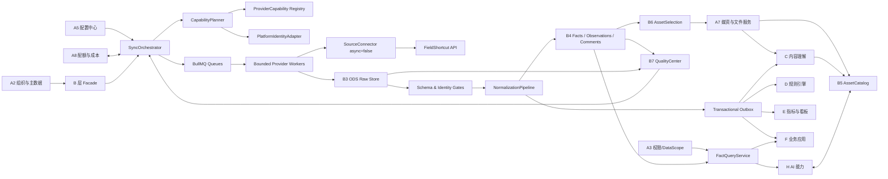
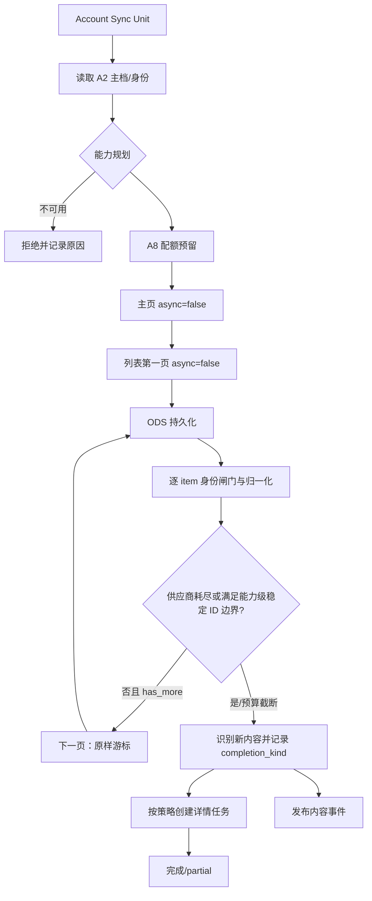

# media-platform 3.0 模块详细设计：B. 数据供给与资产层

> **状态：`superseded`（2026-09-02）**  
> **替代文档**：[`database-design-v2.md`](../../domains/data-foundation/database-design-v2.md) 与 [`data-foundation-tracer`](../../../.kiro/specs/data-foundation-tracer/)  
> **保留原因**：追溯供应商 capability、反腐层、限流/熔断、成本治理、原始事实和资产归档的早期设计。  
> **禁止用途**：本文件不是当前实现依据；其中的候选 schema、固定同步执行模式、旧身份模型和技术选型均未被自动继承。冲突时以 [`HBECHO设计方案/INDEX.md`](../../INDEX.md) 的权威顺序为准。

> **状态**：详细设计稿，可用于技术评审、任务拆解与接口契约评审
> **适用范围**：media-platform 3.0 的 B1～B9 及其与 A/C/D/E/F/H 的边界
> **事实基线**：FieldShortcut A Master API V1.2、现有 146+ 次原始调用、最新 `async=false` 实测结果
> **优先级规则**：真实响应 > 最新供应商书面说明 > 本文设计 > 历史总纲中的旧能力假设
> **配套实测文档**：`aimaster接口文档/FieldShortcut A Master API V1.2-同步模式实测分析.md`

本文是对 `hbecho-设计大纲.md` 中“B. 数据供给与资产层”的深化与修订。保留原总纲的 ODS、DWD、资产版本、质量稽核、存量导入和血缘骨架；覆盖以下过时假设：固定最近 20 条、固定每周同步、固定 6,000 次调用、四平台原始 JSON 完全一致、列表永远含全部详情字段、所有原始数据均可无条件永久保存。

---

## 0. 执行摘要

### 0.1 核心方案

1. **供应商执行采用同步，系统编排保持异步。** Worker 调 FieldShortcut 时显式使用 `async=false`；2,000～3,000 个账号通过 BullMQ 长任务、有限并发、令牌桶、配额和断点续跑执行。
2. **B 层对外是深模块。** 对外只暴露“账号同步、内容补采、评论采集、资产请求、事实查询”五类稳定意图；平台链接、供应商接口、分页、限流、重试、字段差异和计费全部封装在内部。
3. **能力不是布尔值。** `ProviderCapability` 同时记录平台、接口、同步/异步模式、状态、证据等级、schema 版本、游标规则和有效期；“供应商声称支持”不能自动升级为“同步实测可用”。
4. **先存原文，再做解释。** 每次供应商请求的输入、HTTP 元数据、完整响应、`task_id/request_id`、耗时和 attempt 都进入不可变 ODS；归一化失败不影响原文留存。
5. **静态事实、时点观测、用户评论、二进制资产和 AI 衍生资产分离。** 作品标题不是互动观测，评论不是作品字段，AI 摘要不是平台事实，生成视频也不是源视频的新版本。
6. **平台原始模型分开，DWD 才统一。** `DouyinVideoItem`、`XhsNoteItem` 等在适配层保留差异；DWD 统一为 `Content`、`ContentObservation`、`Comment`、`Asset` 等领域对象。
7. **身份先于数据。** `(platform, platform_native_id)` 是平台身份核心；短链、昵称和展示 URL 都不是稳定主键。返回账号或作品身份不一致时隔离，禁止自动改绑。
8. **分页完成分级。** 不再假设固定 20 条，也不以最早发布时间独立停页；区分供应商耗尽、具排序合同的稳定 ID 重叠、启发式重叠和成本截断 partial，游标始终原值透传。
9. **成本按请求预留、执行记录、账单核销三阶段管理。** `task_id/request_id` 只提供外部定位，不能单独证明收费；最终费用由 A8 对接账单/控制台。
10. **技术选型务实。** 当前规模优先 MySQL 8 + OSS + Redis/BullMQ + transactional outbox；不为“大厂感”提前引入 Kafka 和重型湖仓。事件量、团队能力或跨系统订阅达到阈值后再演进。

### 0.2 本设计解决的历史问题

| 历史失效模式 | 本设计防线 |
|---|---|
| 接口 HTTP 200 被误判为成功 | 五层成功判定：HTTP、`code`、`status`、`error`、`result schema` |
| 字段语义漂移但系统静默运行 | schema 指纹、字段画像、契约告警、隔离队列 |
| `sec_uid`/账号错绑 | 平台身份注册表、别名表、有效期、冲突人工裁决 |
| 同步失败后窗口滑走、永久漏内容 | deadline-aware 重试、分页水位、窗口溢出 P0 告警 |
| 互动量覆盖更新、无法回溯 | append-only `ContentObservation` |
| AI 摘要与原始内容混在一行 | `DerivedAsset` 独立版本、输入/模型/Prompt 血缘 |
| 重复调用详情/评论造成费用浪费 | 能力规划器、同批去重、调用缓存、默认最小采集策略 |
| 大批账号无界并发 | 分层队列、bounded concurrency、token bucket、circuit breaker |
| 原始 signed URL 过期后不可用 | A7 归档、sha256、来源引用、资产版本 |
| 只有成功/失败，无法定位成本和阶段 | `SyncRun → SyncUnit → ProviderRequest → Attempt` 四级追踪 |

---

## 1. 背景、规模与产品目标

### 1.1 业务背景

media-platform 面向超管、总部、分公司和经销商四类角色，管理品牌、组织、门店、专员及其抖音、快手、小红书、视频号账号。B 层为内容识别、规则判定、指标看板、账号档案、内容库和 AI 创作提供可信数据底座。

当前容量目标：

- 日常可能查看或刷新约 **2,000 个账号**；
- 总体按 **3,000 个账号**设计容量和批次恢复；
- 旧系统已有约 39,346 条内容、5,752 条快照、1,294 门店、1,334 账号、1.6 万张素材需要迁移，精确数量以迁移前盘点为准；
- 外部 API 每次请求均有成本，因此“少调、不错调、可对账”与数据完整性同等重要。

### 1.2 已确认的供应商现实

- 默认调用模式：`async=false`；
- 抖音：目标能力包括主页、列表、详情、评论；最新同步证据主要覆盖列表，其余能力按各自证据等级管理；
- 快手：主页、列表、详情可用；评论不支持；
- 小红书：主页、列表、详情、评论可用，详情/评论可由列表 `post_id` 派生 `/explore/{post_id}`；
- 视频号：具体作品详情有历史成功证据，主页作品列表目前不支持；
- 同一接口跨平台外层相似，但原始字段、类型和可空性存在真实差异；
- QPS、并发、价格、失败计费和轮询计费均未形成正式合同。

### 1.3 产品构想落点

内容详情页需要同时展示：

1. 平台源内容：作品 URL、作者、标题/正文、封面/图集/视频、发布时间；
2. 最新互动观测：点赞、评论、收藏、分享、播放及数据截至时间；
3. AI 视频摘要与文案提取：摘要、转写、原始文案；
4. 后续创作入口：文案改写、脚本/分镜生成、AI 视频生成；
5. 数据新鲜度、来源和处理状态。

这些内容在 UI 上组合，在存储上必须分离并可追溯。

---

## 2. 目标、非目标与设计原则

### 2.1 目标

- 为四平台建立可演进、可替换供应商的数据接入层；
- 在未知供应商 QPS 下安全支持 2,000～3,000 账号批量同步；
- 保证每次外部调用可追踪、可重放、可对账、可解释；
- 以不可变原始数据支撑 schema 修复、规则重算和供应商切换；
- 建立平台中立的账号、内容、互动观测、评论和资产模型；
- 提供分页完整性、身份一致性、字段突变和窗口缺口检测；
- 给 C/D/E/F/H 提供版本化事件和查询契约；
- 支撑源资产、识别资产和 AI 生成资产的完整血缘；
- 在满足业务新鲜度的前提下降低调用、存储和 AI 成本。

### 2.2 非目标

- B 层不负责定义考核规则或计算最终完成率；
- B 层不直接调用视觉/大模型完成识别与生成，分别由 C/H 负责；
- B 层不承诺供应商未提供的 QPS、SLA 或价格；
- B 层不做程序化投流；
- B 层不绕过平台授权下载或长期保存受限内容；
- 第一阶段不建设 Kafka、通用数据湖平台或复杂多供应商自动裁决引擎；
- 不把供应商返回的展示 URL、昵称、签名资源 URL当作永久身份。

### 2.3 设计原则

1. **Evidence over assumption**：能力和字段以证据升级，不以接口名称猜测。
2. **Raw is immutable, interpretation is versioned**：原文不可变，解释可重跑。
3. **Facts are not observations**：作品事实与互动观测分离。
4. **Derived is not source**：AI、OCR、ASR、派生 URL均标明来源和版本。
5. **Backpressure by default**：先有限，再扩容；禁止无界队列消费和无界并发。
6. **At-least-once + idempotency**：队列按至少一次投递设计，每阶段均幂等。
7. **Fail closed on identity, fail open on additive fields**：身份冲突阻断；新增非关键字段先接收、告警、待评审。
8. **DataScope at every read/export seam**：数据采集不因展示权限丢数据，读取与导出必须继承 A3 范围。
9. **Cost is a first-class signal**：每个计划、请求、重试、资产和 AI 任务都可归因。
10. **Pragmatic evolution**：选择团队能运维的组件，给未来升级留 seam，而非一次性堆满基础设施。

---

## 3. 术语与不变量

### 3.1 核心术语

| 术语 | 定义 |
|---|---|
| `PlatformAccount` | A2 管理的平台账号主档，拥有内部稳定 ID、平台及组织归属历史 |
| Platform identity | 平台原生身份，如抖音 `sec_uid`、小红书 user ID、视频号 finder ID |
| Provider identity | 某供应商对同一对象使用的标识，可能与平台原生 ID 不同 |
| Source URL | 用户录入或上游提供的原始 URL/短链 |
| Resolved URL | 短链跳转后的 URL |
| Canonical URL | 经平台规则归一后的首选地址，不作为唯一身份本身 |
| Derived URL | 由稳定 ID 和版本化规则构造的地址，如小红书 `/explore/{post_id}` |
| ODS | 原始请求与响应层，不改变供应商表达 |
| DWD | 清洗后的平台中立事实层 |
| Observation | 某时点对可变化指标的观测，不覆盖历史 |
| Source asset | 平台原始头像、背景、封面、图片、音频或视频 |
| Derived asset | OCR、ASR、摘要、改写、分镜、生成视频等衍生物 |
| Sync run | 一次业务同步批次 |
| Sync unit | 批次中一个账号/作品/评论目标的可恢复工作单元 |
| Provider request | 一个逻辑供应商请求，可有多个 attempt |
| Attempt | 实际一次 HTTP 尝试 |
| Capability evidence | 某平台、能力、执行模式可用性的证据记录 |

### 3.2 不变量

- `PlatformAccount.id` 一经创建不复用；
- 平台对象唯一键至少包含 `platform`；
- 任何自动合并身份必须有确定的同平台原生 ID，昵称相同不足以合并；
- ODS 在批准的保留期内 append-only；修复通过新增解释版本完成；
- 每条 DWD 数据可追溯到 ODS 对象、provider request 和 attempt；
- `null` 不等于 0，空串不等于缺键；
- 供应商游标原类型、原值透传；
- 互动指标不覆盖，只追加观测；
- AI 资产不能修改源内容事实；
- 任何外部调用必须先经过 A8 配额判定；
- 任何用户查询、下载、导出、AI 工具调用必须经过 A3 `DataScope`；
- `task_id/request_id` 是外部追踪键，不是本系统主键或收费结论。

---

## 4. 模块分解：沿用 B1～B9，重写内部职责

| 模块 | 详细职责 |
|---|---|
| **B1 供应商能力与适配层** | `ProviderCapability`、平台身份适配、URL 解析/派生、请求构造、原始模型、错误归一；隐藏 FieldShortcut 细节并预留第二供应商 |
| **B2 同步编排** | 计划、批次、优先级、能力规划、A8 准入、BullMQ、有限并发、限流、重试、熔断、分页 checkpoint、断点续跑 |
| **B3 原始层 ODS** | 完整请求/响应、HTTP 元数据、追踪键、schema 指纹、hash、对象存储位置；不可变、压缩、可重放 |
| **B4 明细与观测层 DWD** | 账号快照、内容静态事实、互动观测、评论及评论观测、当前投影；平台中立且版本化 |
| **B5 资产目录与归档** | 源资产、资产版本、内容/账号绑定、sha256/pHash、签名 URL 归档、A7 协作、AI 衍生资产注册 |
| **B6 资产选择与物化** | 基于互动、排名、规则候选和用户请求选择下载；视频/音轨/图像派生；优先级、审批、成本与生命周期 |
| **B7 数据质量与稽核** | 身份、schema、分页、窗口、计数、时间、资产、跨层对账、供应商异常；隔离与人工裁决 |
| **B8 存量导入** | 旧系统内容/快照/账号/素材导入、来源标记、身份冲突清单、可回滚批次和数量对账 |
| **B9 元数据、契约与血缘** | 表/字段/schema/能力/事件/资产/规则依赖登记；字段级和对象级血缘；供 E/H 语义查询 |

### 4.1 对旧总纲的关键覆盖

- B2 同步频率不再默认固定“每周末”，由 A5 按平台、账号分层、活动和风险配置；
- B2 不再按“每账号固定两次”估算，调用计划由能力、分页、新内容数和评论策略动态生成；
- B4 新增评论域和 append-only 观测，不把最新互动覆盖到内容主表；
- B5 “每周全量下载所有头像/背景”改为策略化物化，并受授权、变更检测和 A8 约束；
- B7 窗口检测不依赖“恰好 20 条”或时间最小值，而依赖游标、有效身份 item、稳定 ID 边界、排序合同和供应商耗尽状态；
- ODS 的 append-only 指“保留期内不可修改”，评论/个人信息仍服从合法保留和删除策略。

---

## 5. 总体架构



### 5.1 物理组件建议

| 组件 | 首期选型 | 理由与演进 |
|---|---|---|
| 事务/元数据/DWD | MySQL 8.0 + Prisma/Kysely | 遵循总纲唯一事实库；支持事务、JSON、分区、唯一约束和 binlog 恢复 |
| 原始响应与二进制 | OSS，经 A7 统一抽象 | 大对象低成本、生命周期、hash、签名访问 |
| 队列/调度 | Redis + BullMQ | 与总纲一致，支持延时、优先级、重试、并发和可观测任务 |
| 事件发布 | MySQL transactional outbox + relay | 事实落库与 outbox 同事务；订阅规模扩大后可接 Kafka |
| 本地缓存/锁 | Redis | 去重、分布式 lease、短期速率状态；不作为事实源 |
| OLAP | 首期 MySQL 分区表/预聚合 | E2 先用 ADS 表与 Kysely 聚合；达到瓶颈再按总纲 ADR 引入只读实例或 ClickHouse |
| 向量检索 | 归 C5 | B 只提供资产与事实引用，不内建向量库 |

B 层严格沿用总纲的全局 ADR：**MySQL 8.0 是唯一业务事实来源，不新增 PostgreSQL 影子库**；schema 变更以 Prisma Migrate 为单一来源，复杂聚合使用 Kysely，备份走每日全备 + binlog。ODS 大 body 在 OSS，但其权威元数据和血缘仍在 MySQL。

### 5.2 为什么首期不直接上 Kafka/湖仓

大厂经验的本质是边界、契约、幂等、可观测和恢复，不是组件数量。当前外部吞吐受付费 API 和未知 QPS 限制，3,000 账号规模远低于必须 Kafka 化的量级。使用 outbox 保留事件 seam：未来只替换 relay 和 broker，不改变 B 层领域契约。

---

## 6. 深模块接口与内部 seam

### 6.1 对外 Facade

```ts
type Platform = 'douyin' | 'kuaishou' | 'xiaohongshu' | 'wechat_channels';
type Priority = 'interactive' | 'deadline' | 'scheduled' | 'backfill';

declare const authorizedContextBrand: unique symbol;
type AuthorizedRequestContext = {
  actorId: string;                         // 用户或受控 service principal
  authorizationDecisionId: string;        // A3 已完成鉴权的不可伪造决策引用
  dataScope: DataScope;
  brandIds: string[];
  traceId: string;
  purpose: string;
  campaignId?: string;
  readonly [authorizedContextBrand]: true; // 只能由统一鉴权 SDK 构造
};

type SyncScope = {
  profile: boolean;
  contentList: boolean;
  contentDetailPolicy: 'none' | 'new_only' | 'selected';
  commentsPolicy: 'none' | 'selected';
};

interface DataSupplyFacade {
  requestAccountSync(context: AuthorizedRequestContext, command: {
    platformAccountIds: string[];
    scope: SyncScope;
    priority: Priority;
    reason: string;
    deadlineAt?: string;
  }): Promise<{ syncRunId: string; acceptedCount: number; rejected: Rejection[] }>;

  requestContentRefresh(context: AuthorizedRequestContext, command: {
    contentIds: string[];
    refreshMetrics: boolean;
    priority: Priority;
    reason: string;
  }): Promise<{ syncRunId: string }>;

  requestCommentCollection(context: AuthorizedRequestContext, command: {
    contentIds: string[];
    replyPolicy: 'none' | 'all' | { maxPagesPerRoot: number };
    maxRootPages: number;
    reason: string;
  }): Promise<{ syncRunId: string }>;

  requestAssetMaterialization(context: AuthorizedRequestContext, command: {
    subjects: Array<{ type: 'account' | 'content'; id: string }>;
    assetKinds: Array<'avatar' | 'profile_cover' | 'cover' | 'image' | 'video' | 'audio'>;
    reason: string;
    priority: Priority;
  }): Promise<{ requestId: string }>;
}
```

`AuthorizedRequestContext` 由 API 网关/任务调度器通过 A3 统一 SDK 创建，B 层不信任客户端自行提交的 actor、品牌或 DataScope。交互命令、定时计划和补偿任务都必须有上下文：系统计划使用最小权限 service principal，并记录配置版本。B 层用该上下文做资源范围校验，传给 A4 审计，并让 A8 按 actor/品牌/活动归因和预留费用。

Facade 返回“已接受的内部任务”，不会让页面连接等待供应商同步 HTTP 完成。交互页可立即读取缓存事实，并通过 job 状态订阅刷新结果。

### 6.2 查询接口

```ts
interface FactQueryService {
  getAccountView(context: AuthorizedRequestContext, input: {
    platformAccountId: string;
    asOf?: string;
  }): Promise<AccountView>;

  getContentDetailView(context: AuthorizedRequestContext, input: {
    contentId: string;
    observationPolicy: 'latest' | { publishedAfterDays: number };
  }): Promise<ContentDetailView>;

  searchContents(
    context: AuthorizedRequestContext,
    input: ContentSearch,
  ): Promise<Page<ContentSummary>>;

  getSyncRun(
    context: AuthorizedRequestContext,
    input: { syncRunId: string },
  ): Promise<SyncRunView>;
}
```

任何应用都不得绕过 Query Service 直接拼供应商字段或查询 ODS；Query Service 只接受 A3 已签发的 `AuthorizedRequestContext`。

### 6.3 内部 seam

```ts
interface PlatformIdentityAdapter {
  platform: Platform;
  classifyUrl(rawUrl: string): UrlClassification;
  resolveUrl(rawUrl: string): Promise<ResolvedUrl>;
  parseIdentity(url: ResolvedUrl): ParsedIdentity;
  canonicalize(identity: ParsedIdentity): CanonicalSubject;
  deriveContentUrl(input: { postId: string; ruleVersion: string }): DerivedUrl | null;
}

type UnparsedTransportResponse = {
  httpStatus: number;
  headers: ReadonlyArray<[string, string]>;
  bodyBytes: Uint8Array;
  receivedAt: string;
};

interface SourceConnector {
  provider: string;
  // 只返回 transport 事实；在 ODS 提交前禁止 JSON.parse、schema 校验或业务成功判定。
  executeTransport(request: ProviderRequest): Promise<UnparsedTransportResponse>;
}

interface CapabilityPlanner {
  planAccountSync(input: AccountSyncIntent): Promise<PlannedProviderRequest[]>;
  planContentRefresh(input: ContentRefreshIntent): Promise<PlannedProviderRequest[]>;
}

interface NormalizationPipeline {
  normalize(input: RawResponseRef, contractVersion: string): Promise<NormalizationResult>;
}

interface AssetCatalog {
  registerSource(input: SourceAssetDescriptor): Promise<AssetRef>;
  registerDerived(input: DerivedAssetDescriptor): Promise<AssetRef>;
  resolveForUse(input: AssetUseRequest): Promise<SignedAssetRef>;
}

interface QualityCenter {
  evaluateRaw(input: RawResponseRef): Promise<GateDecision>;
  evaluateNormalized(input: NormalizationResult): Promise<QualityReport>;
}
```

### 6.4 边界规则

- `SourceConnector` 只理解供应商 transport 请求：读取 HTTP 状态、headers 与 body bytes，不理解组织和角色，也不得在 `RawStore.persistTransport` 提交成功前执行 JSON 解码、schema 校验或业务成功判定；
- `PlatformIdentityAdapter` 只理解平台 URL/ID，不负责发付费业务请求；
- `CapabilityPlanner` 决定“能否调、调哪个接口、是否需要派生 URL”；
- `SyncOrchestrator` 负责状态、顺序、成本、恢复，不解析业务字段；
- `NormalizationPipeline` 不发外部请求；
- `AssetCatalog` 不决定哪些内容优秀，选择策略在 B6/D/E；
- `FactQueryService` 不暴露供应商原始字段名。

---

## 7. `ProviderCapability`：版本化能力事实

### 7.1 为什么不能用一个 `supported: true`

同一个平台能力可能出现：供应商确认支持、异步失败、同步成功、特定 URL 类型才成功、只支持第一页、评论回复未验证等状态。能力注册表必须表达证据和约束。

### 7.2 模型

```ts
type EvidenceLevel =
  | 'SYNC_TESTED'
  | 'ASYNC_TESTED'
  | 'PROVIDER_CONFIRMED'
  | 'BUSINESS_CONFIRMED'
  | 'HISTORICAL'
  | 'UNVERIFIED'
  | 'UNSUPPORTED';

type EvidenceOutcome = 'succeeded' | 'failed' | 'confirmed' | 'unsupported';
type CapabilityStatus = 'enabled' | 'gray' | 'disabled' | 'unsupported';

type CapabilityEvidence = {
  id: string;
  level: EvidenceLevel;
  executionMode?: 'sync' | 'async';
  outcome: EvidenceOutcome;
  evidenceRef: string;                    // fixture、供应商文档或审批记录
  observedAt?: string;
  inputKind?: UrlKind;
  requestContractVersion?: string;
  responseContractVersion?: string;
  constraints?: Record<string, unknown>;  // 平台、URL 形态、页数、reply policy 等适用边界
  notes?: string;
};

type ProviderCapability = {
  id: string;
  capabilitySetVersion: string;
  provider: string;
  platform: Platform;
  operation:
    | 'account.resolve'
    | 'account.profile'
    | 'content.list'
    | 'content.detail'
    | 'comment.list'
    | 'comment.text';
  executionMode: 'sync' | 'async';
  status: CapabilityStatus;               // 由 evidence 派生后经发布审批冻结
  evidence: CapabilityEvidence[];
  requestContractVersion: string;
  responseContractVersion: string;
  acceptedUrlKinds: UrlKind[];
  pagination?: {
    cursorInput: 'max_cursor';
    cursorOutput: 'max_cursor' | 'cursor';
    cursorType: 'integer' | 'opaque_string' | 'union';
    hasMoreType: 'boolean' | 'integer' | 'union';
  };
  defaultTimeoutMs: number;
  rateLimitPolicyRef: string;
  billingPolicyRef?: string;
  effectiveFrom: string;
  effectiveTo?: string;
  notes?: string;
};
```

`CapabilityEvidence` 只增不改：同一能力可以同时保存“异步成功”“同步失败”“业务确认”等多条证据，测试 outcome 不能被 `ASYNC_TESTED` 这一标签压扁。发布流程根据最新适用证据、失败范围和业务风险计算候选状态，再由审批冻结到新的 `capabilitySetVersion`；失败样本不会删除历史成功证据，成功样本也不会掩盖受限输入。

### 7.3 初始能力快照

| 平台/能力 | 运行状态 | 证据 | 默认动作 |
|---|---|---|---|
| 抖音主页 | gray/enabled 由发布评审决定 | 异步成功 + 业务确认，缺最新同步代表样本 | 可小流量同步，持续收集证据 |
| 抖音列表 | enabled | 最新同步成功 | `async=false` |
| 抖音详情 | gray | 业务/历史确认 | 仅新内容/显式刷新 |
| 抖音评论 | gray | 异步成功，缺最新同步代表样本 | 选择性采集 |
| 快手主页/列表 | gray | 业务/历史确认 | 低并发灰度 |
| 快手详情 | enabled/gray | 历史成功，缺最新同步样本 | 选择性采集 |
| 快手评论 | unsupported | 业务确认 + 空上游证据 | 请求前拒绝，不触发 API |
| 小红书主页/列表/详情/结构化评论 | enabled | 最新同步成功 | `async=false` |
| 视频号主页列表 | unsupported | 供应商明确不支持 | 请求前拒绝 |
| 视频号详情 | gray | 历史异步成功 | 小流量验证后升级 |
| 视频号其他能力 | disabled | 未验证 | 不调用 |

能力升级流程：新增证据 → fixture 回放 → 小样本付费灰度（须批准）→ 质量观察 → 发布新 capability set；不得原地修改历史版本。

---

## 8. 平台身份、URL 与防错绑

### 8.1 URL 类型

```ts
type UrlKind =
  | 'account_homepage'
  | 'content_permalink'
  | 'platform_shortlink'
  | 'provider_share_url'
  | 'derived_content_url'
  | 'signed_media_url'
  | 'unknown';
```

| URL 类型 | 是否可作身份键 | 保存策略 |
|---|---:|---|
| 用户输入主页 URL | 否 | 原样保存 + 规范化版本 |
| 短链 | 否 | 保存原链、跳转链、解析时间和最终域名 |
| canonical URL | 否 | 作为当前首选访问地址 |
| 平台原生 ID | 是，与 platform 组合 | 身份注册表核心 |
| 小红书 derived URL | 否 | 保存 `post_id + rule_version + evidence_ref` |
| signed media URL | 否 | 作为短期下载候选，不直接面向长期 UI |

### 8.2 身份表

**`platform_subject`**

| 字段 | 说明 |
|---|---|
| `id` | 内部 UUID/ULID |
| `subject_type` | `account/content/comment` |
| `platform` | 四平台枚举 |
| `native_id` | 平台原生 ID |
| `identity_status` | `verified/provisional/conflicted/retired` |
| `first_seen_at/last_seen_at` | 首末观测时间 |
| `created_from_ods_id` | 首次身份来源 |

唯一约束：`(platform, subject_type, native_id)`。

**`platform_identity_alias`**

记录 `sec_uid`、provider user ID、旧 ID、短链、canonical URL 等别名，含 `valid_from/valid_to/confidence/source_ods_id`。昵称不得成为 verified alias。

### 8.3 账号主档关联

A2 拥有 `PlatformAccount` 与组织归属；B 只维护采集身份。关联表必须有效期化：

```text
platform_account_binding(
  platform_account_id,
  platform_subject_id,
  valid_from,
  valid_to,
  decision_source,
  decided_by,
  conflict_case_id
)
```

同一时点出现多个门店/账号绑定时停止自动归集，创建 B7 稽核单。历史考核按观测时点解析 A2 归属，不用当前归属改写历史。

### 8.4 小红书派生 URL

```text
post_id = user_video_list.result[i].post_id
url = https://www.xiaohongshu.com/explore/{post_id}
rule = xiaohongshu.explore.v1
```

使用前校验 post ID 格式；调用后校验响应 `post_id`。派生规则失效时发布 v2，不覆盖 v1 血缘。

### 8.5 URL 安全

- 仅允许注册的平台域名和 HTTPS；
- 短链解析限制跳转次数、DNS 重绑定和私网地址，防 SSRF；
- 不把任意 URL交给内部下载器；
- 资源下载由 A7 allowlist、MIME、大小、病毒/恶意文件检查统一执行；
- 日志展示 URL 时过滤 token、signature 等敏感 query。

---

## 9. 同步编排与状态机

### 9.1 四级追踪对象

```text
SyncRun                 一次用户/计划触发的批次
  └─ SyncUnit           一个账号或内容的逻辑工作单元
      └─ ProviderRequest 一个端点 + 目标 + 游标的逻辑请求
          └─ Attempt    一次真实 HTTP 调用
```

| 层级 | 解决的问题 |
|---|---|
| `SyncRun` | 谁触发、范围、预算、完成率、截止时间 |
| `SyncUnit` | 哪个账号/作品成功、失败或部分完成 |
| `ProviderRequest` | 调了什么能力、哪一页、幂等键、预估费用 |
| `Attempt` | HTTP 状态、耗时、`task_id/request_id`、原始响应、重试原因 |

### 9.2 状态机

```text
planned
  → admitted
  → queued
  → provider_running
  → response_received
  → raw_persisted
  → provider_succeeded
  → validated
  → normalized
  → published
  → completed
```

终止/分支状态：

- `rejected_capability`：能力禁用或不支持；
- `rejected_quota`：A8 硬限；
- `deferred_quota`：软限/窗口不足，等待；
- `failed_transient`：可重试；
- `failed_permanent`：输入或不支持；
- `outcome_unknown`：客户端超时，供应商是否执行未知；
- `quarantined`：身份/schema/数据质量失败；
- `partial`：部分分页成功但未达到完成边界；
- `cancelled`：用户/运维取消未执行部分。

`response_received` 只表示 transport body 已收齐，不能提前判定供应商业务成功。若 ODS 提交失败，attempt 进入 `raw_persist_failed`、触发 P0 且禁止 JSON 解析/归一化；只有 `raw_persisted` 后，解析流水线才可设置 `provider_succeeded`、业务失败或 schema 隔离。供应商 `succeeded` 也不等于 SyncUnit 完成：只有质量闸门和归一化发布全部成功后才是 `completed`。

### 9.3 账号同步 DAG



主页与列表是否并行由身份依赖决定：首次录入必须先解析身份；已验证账号可并行，但写入各自独立数据集，不共享易变状态。

### 9.4 分页完成语义

对每个账号保存 `content_list_watermark`：

- 上次完整同步的已知 `post_id` 边界集合与最近 ID 窗口；
- 最新/最老发布时间仅作为风险画像，不作为独立完成证明；
- 上次 provider/capability/schema 版本与其排序合同；
- 最后一页游标只用于同一 run 的恢复，不跨长期同步复用，除非供应商明确保证；
- 本次每页的输入游标、输出游标、条数、有效目标账号 item 数、异账号 item 数、最早/最晚发布时间和 ODS 引用。

真实小红书 fixture 已证明页内乱序：前三个 `created` 为 `1770845385000 → 1729824287000 → 1787113666000`，旧内容之后仍会出现新内容。因此**时间水位只能触发风险告警，不能让任务提前停页**。

每页先完整处理并做逐 item 身份闸门，再计算分页边界：

1. item 的账号原生 ID/`sec_uid` 与目标一致：进入目标账号候选集；
2. item 身份不一致：整页 ODS 保留，item 写 `unattributed_content_candidate` 并开质量单；它不得绑定目标账号、不得参与新内容数、ID 重叠或时间水位；
3. 当前抖音同步 fixture 已出现 1/20 条异 `sec_uid`（索引 9，`post_id=7659351337045413172`），所以这不是理论分支；
4. 若整页或超过配置比例不一致，隔离整个分页单元并停止自动归一，禁止按昵称猜归属；只有平台显式提供合拍/转载关系时才能按独立关系模型接纳。

“停止继续付费翻页”与“证明全量完成”分开记录：

1. `has_more=false/0`：记 `completion_kind=provider_exhausted`，当前供应商视角下完整；
2. `has_more=null` 或字段缺失：不再发下一次付费请求，但记 `completion_kind=ambiguous_has_more`、SyncUnit=`partial` 并开质量单；它是保守停止，不是供应商耗尽证明；
3. 仅当该平台能力有书面排序合同，并在完整页处理后达到配置的连续已知 ID 阈值、且额外 look-ahead 页没有新 ID，才可记 `completion_kind=stable_id_overlap`；任何新 ID 都重置重叠计数；
4. 对没有排序合同的平台，ID 重叠只能作为增量优化证据，不能与 `provider_exhausted` 等价；若选择停止，必须记录 `completion_kind=heuristic_overlap`、风险等级和规则版本；
5. 达到页数/成本硬限：记 `completion_kind=capped_partial`，SyncUnit 为 `partial` 并开质量单，不能伪装完整。

异常：

- `has_more=true` 但 `max_cursor/cursor` 均为空；
- 游标重复或循环，包括回到初始 `0`；
- 下一页大量重复但没有稳定 ID 边界；
- 返回满页且有效 item 仍全部是新 ID；
- 发布时间乱序或跨越异常区间——只告警，不据此停页；
- 列表 `post_id` 重复、单条/整页账号身份变化。

### 9.5 幂等

请求去重分成两个键：

```text
request_fingerprint = sha256(
  provider + capability_set_version + endpoint +
  platform_subject_id + canonical_payload_without_secrets +
  cursor_type + cursor_value
)

logical_request_key = sha256(request_fingerprint + sync_run_id)
```

- `logical_request_key` 防止同一 run 同一页重复排队；
- `request_fingerprint` 只用于 active-request lease：不同用户/run 在同一供应商请求尚未终态时复用该 `ProviderRequest`，终态后释放，未来的新业务观测仍可创建新请求；
- 每次 Facade 受理先创建独立 `provider_request_intent`，保存 A3 decision、actor、品牌、活动、purpose 和原始 run，再把一个或多个 intent 关联到新建/复用的 `ProviderRequest`；因此共享请求不会丢失第二个调用者，也不会创建第二个 attempt；
- attempt 重试不创建第二个逻辑 request，但每个实际 attempt 单独经过 A8；
- 业务身份表 `content` 以 `(platform, post_id)` 幂等创建，但不在该行覆盖静态事实；
- `content_fact_revision` 以 `(content_id, source_ods_id, normalization_version, merge_policy_version)` 幂等追加；
- 互动先以 `(content_id, provider_attempt_id, observation_kind)` 创建唯一 source observation，再以 `(observation_source_id, normalization_version)` 追加解释 revision；
- normalization v2 回放同一 ODS 会产生可追溯的新 revision，不与 v1 冲突，也不伪造第二次业务观测；
- outbox event 使用领域对象 revision ID/版本作为幂等键；
- 资产以 sha256 做内容寻址，URL 相同不代表文件相同。

---

## 10. 队列、并发、限流与恢复

### 10.1 队列拓扑

| 队列 | 优先级/用途 | 说明 |
|---|---|---|
| `b.sync.deadline` | 最高 | 临近内容窗口、上次失败补偿；受独立预算保护 |
| `b.sync.interactive` | 高 | 用户在详情页请求刷新；快速受理，不保证绕过配额 |
| `b.sync.scheduled` | 中 | 日常 2,000～3,000 账号计划 |
| `b.sync.backfill` | 低 | 历史回补、迁移后补采，可暂停 |
| `b.normalize` | 高 | 纯内部，无外部 API 成本 |
| `b.asset.materialize` | 中/低 | 下载和归档，走 A7 限流 |
| `b.quality.reconcile` | 中 | 对账与稽核 |
| `b.outbox.relay` | 高 | 领域事件发布 |

需要 weighted fair scheduling，避免持续交互任务饿死日常批次，也避免 backfill 挤占窗口补偿。

### 10.2 多维限流

每个外部请求同时获取以下许可：

```text
provider 总令牌
  ∩ provider + platform 令牌
  ∩ provider + endpoint 令牌
  ∩ tenant/brand 预算令牌
  ∩ worker 本地并发 semaphore
```

配置项：

- `max_concurrency`：同时在途请求数；
- `sustained_rps`：持续速率；
- `burst`：短时容量；
- `timeout_ms`：接口级超时；
- `max_attempts`、`retry_budget_ratio`；
- `circuit_breaker` 窗口、错误率和半开探针；
- `max_pages_per_unit`、`max_cost_per_run`。

QPS 未确认前配置状态应为 `provisional`，从保守低值灰度；不能把本地成功的几次并发当供应商上限。

### 10.3 同步 HTTP 与内部异步任务

每个 BullMQ worker 内部执行一个 `async=false` HTTP 请求并等待终态。同步等待会占连接，因此并发通过 worker pool 控制；绝不在一个 Web 请求里串行跑 2,000 个账号，也绝不 `Promise.all(2000)`。

```ts
async function processProviderJob(job: Job<ProviderJob>): Promise<void> {
  const permit = await limiter.acquire(job.data.rateLimitKeys);
  try {
    await quota.assertReservation(job.data.costReservationId);
    const transport = await connector.executeTransport({
      ...job.data.request,
      query: { async: 'false' },
      timeoutMs: job.data.timeoutMs,
    });

    // persistTransport 成功前，transport.bodyBytes 绝不能交给 JSON/schema/business parser。
    const rawRef = await ods.persistTransport(transport, job.data);
    await attempts.markRawPersisted(job.data.attemptId, rawRef.id);
    await pipeline.enqueue(rawRef); // 后续 job 才做 envelope/JSON/schema/业务判定
  } finally {
    permit.release();
  }
}
```

`ods.persistTransport` 是付费调用链上的强制提交点，不提供“关闭 ODS”的配置。对象存储写入与 MySQL 元数据提交失败时，job 不得进入 parser；运维只能从已保存 transport ODS 重放解析，不能为修复 parser 再次调用供应商。

### 10.4 重试矩阵

| 失败 | 自动重试 | 策略 |
|---|---:|---|
| DNS/TCP 连接前失败 | 是 | 可确认请求未送达；新 attempt 仍需 A8 retry reserve，指数退避 + full jitter |
| 请求写出后的连接重置 | **不盲目重试** | 可能已送达，标 `outcome_unknown`；优先外部任务/账单核对 |
| 429 | 是 | 尊重 `Retry-After`，全局降速；每个 attempt 单独预留与记账 |
| 明确声明“未执行”的 5xx/业务码 | 白名单 | 有限重试；错误率触发熔断 |
| 其他 5xx、网关错误、read timeout | 谨慎/人工策略 | 默认视为可能已送达；重试前重新经过 A8，并接受潜在重复计费 |
| `code!=0/status=failed` 临时错误码 | 白名单 | 仅供应商正式说明可重试且执行语义明确的错误 |
| invalid URL/unsupported | 否 | 永久失败，修复输入/能力 |
| result schema 不符 | 否 | ODS 保留、隔离、供应商告警 |
| 身份不一致 | 否 | 阻断归一化，人工稽核 |
| A8 硬限 | 否 | 拒绝；需调整预算/范围 |
| A8 软限 | 延后 | 记录 deferred，不算失败 |

本系统幂等键只能防止重复排队/重复落库，**不能保证供应商不重复执行或不重复收费**。每个新增 attempt 都必须重新经过 A8 预留并写 `provider_usage_ledger`，同时关联原逻辑 request 与前一 attempt。只有供应商正式支持幂等键时，才把内部逻辑键映射到其请求头；不能自行假定。对 `outcome_unknown` 应设置人工/自动等待窗口，避免快速重试形成双调用。

### 10.5 熔断与降级

- 粒度至少为 `provider + platform + endpoint`，避免快手评论故障拖垮小红书列表；
- 熔断开启后不再发付费探针风暴，只允许定时单探针；
- 交互页显示缓存数据、`stale_at` 与刷新失败原因；
- 列表不可用时不自动用详情接口遍历旧 post ID 替代，避免调用爆炸；
- 某字段异常时可降级为“保留 ODS、暂停该字段归一化”，身份字段异常不能降级放行。

### 10.6 断点续跑

- 每页 ODS 持久化后写 checkpoint；
- worker 崩溃从最后已完成的逻辑 request 继续；
- checkpoint 记录 cursor 的 JSON 类型和值；
- 同一 run 恢复前检查 capability/schema 版本，版本改变则新建 run，不混用；
- 批次取消只取消未发请求，已发请求仍收集响应并记账；
- Redis 丢失后可由 MySQL 8 中 `queued/running` 超时单元重建队列。

---

## 11. 2,000～3,000 账号容量模型

### 11.1 调用量不是固定常数

定义：

```text
N       账号数
Rp      本批需刷主页的账号比例
Lp(i)   账号 i 列表实际页数
M(i)    账号 i 新增且需详情的内容数
Rc      需评论采集的内容比例
Cp(j)   作品 j 评论页数

总调用数 = N×Rp + ΣLp(i) + ΣM(i) + Σ[被选作品的 Cp(j)] + 重试
```

示例仅用于量级理解，不代表计费：

| 场景 | 2,000 账号逻辑调用下限 |
|---|---:|
| 仅刷新列表第一页 | 2,000 |
| 主页 + 列表第一页 | 4,000 |
| 上述基础上每账号平均 1 条新内容详情 | 6,000 |
| 评论 | 只对选中作品追加，不能纳入固定基线 |

原总纲的“固定 6,000 次/周”只能是某一假设场景，不能作为容量合同。

### 11.2 时间窗口计算

```text
target_rps = total_calls / allowed_window_seconds
required_concurrency ≈ ceil(target_rps × provider_p95_latency_seconds)
effective_rps = min(provider_qps, concurrency / latency, budget_rate)
```

纯算术示例：4,000 次请求若允许 8 小时完成，平均约 0.139 RPS；6,000 次约 0.208 RPS。若要求 1 小时完成，则分别约 1.11 和 1.67 RPS。是否允许这些速率仍由供应商 QPS 决定，不能由公式代替合同。

### 11.3 调度策略

- 将账号按品牌、平台、分公司做稳定散列，均匀铺开时间，避免整点洪峰；
- 活动账号、窗口风险账号进入 deadline lane；
- 页面“查看 2,000 个账号”默认读本地 current projection，不在页面打开时同步触发 2,000 个供应商请求；
- 交互刷新按 `request_fingerprint` 去重：已有 in-flight 则返回同一供应商任务，但为每个调用者新增独立 intent/attribution；真实 attempt 和供应商费用只记录一次；
- 主页快照、列表、详情、评论分别配置频率，不做一刀切全量；
- 评论和视频下载采用选择性任务，绝不随每次账号同步全量执行。

### 11.4 容量验证

在不调用真实付费 API 的情况下完成：

1. 用保存的 raw fixture 模拟 3,000 账号响应；
2. 注入 5～120 秒延迟、429、5xx、超时和 schema 突变；
3. 验证队列积压、令牌桶、熔断、恢复和数据库写入；
4. 真实供应商只做经批准的小样本灰度，绝不做 2,000 账号压测。

---

## 12. B3 ODS 原始层

### 12.1 原则

- HTTP 请求元数据与响应原始 bytes 必须在 JSON 解码、schema 校验和业务判定之前持久化；
- HTML 网关页、空 502、截断 JSON、未知 content-type 和迟到响应同样保存，解析错误作为派生字段，不能替代原文；
- 成功、失败、`outcome_unknown` 后收到的响应均保存；
- 原始 body 不改字段、不改类型、不补默认值；
- Key、Authorization、Cookie 和敏感 query 在写入前脱敏；
- payload 用 gzip/zstd 压缩，保存原始 hash、压缩 hash 和字节数；
- append-only 是保留期内不可变，不阻止依法删除/加密擦除。

### 12.2 `provider_attempt`

| 字段 | 说明 |
|---|---|
| `id` | attempt UUID |
| `provider_request_id` | 内部逻辑请求 |
| `attempt_no` | 从 1 开始 |
| `provider`/`platform`/`operation` | 调用维度 |
| `endpoint`/`execution_mode` | 路径与 `sync` |
| `request_started_at/response_received_at` | 本方 UTC 时钟 |
| `http_status` | 可空，网络失败时无值 |
| `provider_task_id/provider_request_id_external` | 外部追踪键 |
| `provider_status/provider_code` | 供应商业务状态 |
| `outcome` | succeeded/failed/outcome_unknown |
| `elapsed_ms` | 本方耗时 |
| `error_class/error_code` | 归一错误 |
| `cost_reservation_id` | A8 预留 |
| `raw_request_ref/raw_response_ref` | ODS 对象 |
| `trace_id` | 全链路追踪 |

### 12.3 ODS 对象元数据

```text
ods_api_object(
  id,
  provider_attempt_id,
  object_kind,            -- request / response / late_response
  storage_uri,
  content_type,
  content_encoding,
  raw_sha256,
  stored_sha256,
  raw_bytes,
  stored_bytes,
  schema_fingerprint,
  redaction_policy_version,
  encryption_key_ref,
  retention_class,
  recorded_at
)
```

建议对象路径：

```text
ods/provider=fieldshortcut/platform=xiaohongshu/operation=content_list/
dt=YYYY-MM-DD/sync_run={runId}/attempt={attemptId}/response.json.gz
```

路径用于管理，不作为数据库查询的唯一索引。

### 12.4 跨 OSS/数据库一致性

1. 写临时对象并计算 hash；
2. 完成对象写入；
3. 数据库事务写 `ods_api_object`、attempt 状态和 normalize outbox；
4. 事务成功后 job ack；
5. 定时 orphan sweeper 清理无数据库引用的临时对象；
6. 禁止在 ODS 元数据提交前发布 DWD 事件。

---

## 13. B4 DWD：事实、观测和评论模型

### 13.1 时间字段统一

每个归一对象至少区分：

| 字段 | 语义 |
|---|---|
| `source_created_at` | 平台内容/评论创建时间 |
| `source_updated_at` | 供应商声称的更新时间 |
| `observed_at` | 本方完成此次观测的时间 |
| `ingested_at` | 进入本系统的时间 |
| `normalized_at` | 当前 schema 版本归一化时间 |

当前 FieldShortcut 实测中的 `created/updated` 多为 **13 位毫秒时间戳**，与 V1.2 文档部分“秒”说明不一致。ODS 必须保留原始整数与推断单位，DWD 再统一转换为 UTC；遇到 10 位秒级值时按数量级识别并产生字段画像，不能把所有值固定除以 1,000。

同时保留 `source_timestamp_raw` 和推断单位。所有标准时间存 UTC。

### 13.2 不可变归一化修订模型

业务身份、原始观测事件和“对该原文的某版解释”必须分开：

```text
BusinessIdentity         (platform, native_id)，稳定对象
  └─ SourceObservation   一个 ODS/attempt 对该对象的观测，时间不变
      └─ NormalizedRevision  normalization v1/v2/... 对同一原文的解释
```

通用字段：

```text
normalized_revision(
  id,
  entity_type,
  entity_id,
  source_observation_id,
  source_ods_id,
  normalization_version,
  merge_policy_version,
  revision_status,          -- candidate / approved / rejected / superseded
  supersedes_revision_id nullable,
  normalized_at,
  payload_hash,
  quality_status
)
```

幂等唯一键为 `(source_ods_id, entity_id, normalization_version, merge_policy_version)`，而不是业务身份键。修复 parser 后从同一 ODS 运行 v2 会新增 revision，并通过 `supersedes_revision_id` 关联 v1；评审/自动质量闸门通过后，current projector 原子切换指针。v1 不被物理覆盖，回滚只切回旧 revision。所有 D/E/F/H 消费 current/as-of projection，不直接扫描全部 revision 造成重复计数。

### 13.3 账号画像观测与修订

**`account_profile_observation`** 只记录一次源观测：

```text
id, platform_account_id, platform_subject_id,
observed_at, provider_attempt_id, source_ods_id,
source_timestamp_raw, created_at
```

**`account_profile_revision`** 保存该观测的版本化解释：

```text
id, observation_id, normalization_version, merge_policy_version,
nickname, signature, location,
follower_count nullable, following_count nullable,
like_count nullable, post_count nullable,
avatar_source_url, profile_cover_source_url,
revision_status, supersedes_revision_id nullable,
normalized_at, quality_status
```

- 同一 source observation 的 v2 不新增虚假的业务观测时间；
- `account_profile_current` 选择最新有效 observation 的 approved revision；
- 头像/背景 URL 变化触发 B5 资产候选，不等于文件一定变化。

### 13.4 内容身份与静态事实修订

**`content`** 只承载稳定身份：

```text
id, platform, platform_post_id,
first_seen_at, first_source_ods_id,
identity_status, created_at
```

唯一约束：`(platform, platform_post_id)`。

**`content_fact_revision`** 承载可修订事实：

```text
id, content_id, source_ods_id,
normalization_version, merge_policy_version,
supersedes_revision_id nullable, revision_status,
platform_account_id nullable, content_type,
source_created_at, author_name_observed,
title, body, tags_raw, publish_location, canonical_url,
normalized_at, payload_hash, quality_status
```

列表标题可能截断、详情通常更完整。字段合并产生新的 fact revision，并记录每个字段的来源与 precedence；新值为空不能覆盖旧非空值，除非供应商明确表达删除并有证据。`content_current` 只指向一条 approved fact revision，切换可审计、可回滚。

### 13.5 内容互动观测与修订

**`content_observation_source`** 表示“何时对该内容观测了一次”：

```text
id, content_id, observed_at,
provider, provider_attempt_id, source_ods_id,
observation_kind, visibility_context
```

**`content_observation_revision`** 表示某 normalization 对这次观测的解释：

```text
id, observation_source_id,
normalization_version, supersedes_revision_id nullable,
revision_status,
play_count nullable, like_count nullable,
comment_count nullable, collect_count nullable,
share_count nullable, duration_seconds nullable,
anomaly_flags, normalized_at
```

- source observation append-only，修订也 append-only；
- 0 与 null 分开；
- 指标倒退不删除旧观测，标 anomaly；
- E 层通过 `content_observation_approved` 视图只取每个 source observation 的 approved revision，再选择“最后观测值”或“发布后 N 天最接近观测值”；
- `metrics_frozen` 是派生状态，不阻止以后人工刷新产生新 source observation。

### 13.6 评论身份与事实修订

**`comment`** 只保存稳定身份：

```text
id, platform, platform_comment_id, content_id,
first_seen_at, first_source_ods_id, identity_status
```

唯一约束：`(platform, content_id, platform_comment_id)`。

**`comment_fact_revision`** 保存版本化正文与作者展示信息：

```text
id, comment_id, source_ods_id,
normalization_version, supersedes_revision_id nullable,
revision_status,
parent_comment_id nullable, root_comment_id nullable,
author_platform_id nullable, author_display_name nullable,
author_avatar_source_url nullable,
content_text, source_created_at,
privacy_class, normalized_at, quality_status
```

### 13.7 评论互动观测

```text
comment_observation_source(
  id, comment_id, observed_at, provider_attempt_id, source_ods_id
)

comment_observation_revision(
  id, observation_source_id, normalization_version,
  supersedes_revision_id nullable, revision_status,
  like_count nullable, reply_count nullable,
  is_liked nullable, normalized_at
)
```

回复正文只有在 `reply_pages` 策略获取后才创建 Comment；`reply_count` 不代表回复已落库。

### 13.8 评论批次 `comment_collection`

保存：`reply_policy`、主评论页数、回复页数、供应商 `total`、返回主评论数、返回回复数、是否完整、停止原因、游标序列和费用归因。小红书样本 `total=9`、主评论 5、四条 `reply_count=1`，因此 `total` 很可能包含回复，但在供应商确认前模型只命名为 `provider_reported_total`。

### 13.9 current/as-of projection

为页面和下游建立可重建投影：

- `account_profile_current`；
- `content_current`；
- `content_observation_approved` 与 `content_latest_observation`；
- `comment_current` 与 `comment_observation_approved`；
- `content_asset_summary`；
- `content_ai_asset_summary`；
- `sync_health_current`。

current 表只保存 approved revision 指针或可重建结果，不承载唯一历史事实。`as-of` 查询按 revision 的生效/审批时间和 source observation 时间重建；任何回放都必须出具 v1/v2 差异清单后才能切换 current。

---

## 14. 平台原始模型与归一化

### 14.1 原始模型分开

```ts
type DouyinVideoItem = {
  post_id: string;
  user_id?: string;
  sec_uid?: string;
  publish_location?: string;
  related_search_terms?: string[];
  cover?: string[];
  video?: { urls?: string[]; url?: string; duration?: number };
  // 其余已观测字段
};

type XhsNoteItem = {
  post_id: string;
  user_id?: string;
  red_id?: string;
  cover?: string;
  images?: string[];
  text?: { content?: string };
  video?: { url?: string; duration?: number };
  // 其余已观测字段
};
```

不是为每个平台复制全部业务逻辑，而是在反腐层承认真实差异，防止一个严格 union 把平台特有信息吞掉。

### 14.2 归一化阶段

```text
ODS response
  → envelope parser
  → provider contract parser
  → platform raw parser
  → identity gate
  → semantic conversion
  → field-level provenance merge
  → DWD transaction + outbox
```

### 14.3 schema 兼容策略

- 新增可选字段：接收、记录 schema fingerprint 变化、开低级告警；
- 关键字段缺失/改型：隔离，不写 DWD；
- 非关键字段改型：保留 ODS，字段置 null，质量告警；
- `result` object 变 JSON string：不在线伪装修复供应商 failed；可离线诊断；
- 归一化版本不可变，修复发布 v2 后从 ODS 回放，不重调付费 API；
- 回放写入新的 `*_revision`，唯一键包含 `source_ods_id + normalization_version`，绝不覆盖 v1 或新增虚假 source observation；
- v2 通过质量闸门并完成差异评审后才切换 current projection，失败可原子回滚到旧 revision。

### 14.4 字段级血缘

对关键字段记录：

```text
field_provenance(
  entity_type, entity_id, field_name, fact_revision_id,
  source_ods_id, source_json_path,
  normalization_version, merge_policy_version,
  selected_at, precedence_reason
)
```

例如 `content.title` 可来自列表或详情；页面可展示最终值，但申诉/排障能追到原 JSON path。

---

## 15. B5/B6 资产目录与物化

### 15.1 资产不是 URL

`Asset` 表示已识别或已归档的二进制对象；供应商 URL 只是 `AssetSourceCandidate`。同一 URL 内容可能变化，多个 URL也可能指向同一文件。

### 15.2 核心模型

**`asset_object`**

```text
id, sha256, byte_size, mime_type,
width, height, duration_ms,
storage_provider, storage_key, storage_class,
encryption_key_ref, materialized_at,
malware_scan_status, lifecycle_policy,
created_at
```

**`asset_source_candidate`**

```text
id, subject_type, subject_id, asset_kind,
source_url_encrypted, source_url_redacted,
provider_attempt_id, discovered_at, expires_at nullable,
materialization_status, failure_reason
```

**`asset_binding`**

```text
id, subject_type, subject_id, asset_id,
role, ordinal, valid_from, valid_to,
source_ods_id, binding_version
```

**`asset_fingerprint`**

保存 sha256、pHash/dHash、算法版本，用于精确与近似去重。

### 15.3 资产类型与默认策略

| 类型 | 发现 | 物化策略 | 生命周期建议 |
|---|---|---|---|
| 头像 | 主页快照 | URL/指纹变化或首次出现时 | 历史版本按业务/合规策略保留 |
| 主页背景 | 主页快照 | 活动/装修判定需要时优先 | 支撑历史装修证据 |
| 内容封面 | 列表/详情 | 新内容首次入库，按授权 | 标准存储；长期证据 |
| 图文图片 | 小红书等列表/详情 | 进入内容库/识别/创作时 | 按热度与访问分层 |
| 视频源 | 详情/列表候选 URL | B6 筛选后下载 | 热/低频/归档分层 |
| 音轨 | 视频物化后抽取 | C3/ASR 需要时生成 | 体积小，可长期复用 |
| 评论头像/附件 | 评论 | 默认不下载，业务必要时例外 | 最短必要保留 |
| 导出件 | E6 | 用户下单生成 | 临时，默认 7 天可配 |

“发现”和“下载”分离，防止同步阶段因媒体下载拖慢并放大成本。

### 15.4 B6 选择策略

资产物化命中任一条件：

- 互动绝对门槛；
- 可比观测口径下排名前 N%；
- 被 D 规则候选依赖（如含 ASR/视觉算子）；
- 进入优秀内容池或案例库；
- 用户在权限与预算范围内显式请求；
- AI 创作任务需要。

排名必须在同步批次数据到齐后独立计算，不能边同步边排名。阈值由 A5 版本化，费用由 A8 预估和准入。

### 15.5 signed URL 处理

- 不假定供应商 URL永久有效；
- 下载失败按 403/404/过期分类，可选择重新获取详情，但需新费用审批；
- UI 展示优先使用 A7 私有 OSS 签名 URL；
- 不直接把第三方 signed URL长期暴露给前端；
- 下载保存响应 MIME、长度、ETag、时间和来源 attempt；
- 文件名不作为唯一键。

---

## 16. AI 衍生资产与产品详情页

### 16.1 资产分层

| 层 | 示例 | 所有者 |
|---|---|---|
| 平台事实 | 标题、正文、作者、发布时间 | B4 |
| 互动观测 | 点赞、评论、收藏、分享、播放 | B4 Observation |
| 源二进制 | 封面、图集、视频、音轨 | B5/A7 |
| 识别资产 | ASR、OCR、对象、场景、关键帧 | C，B5 登记引用 |
| AI 理解资产 | 摘要、亮点、文案提取、结构分析 | H，B5 登记 |
| AI 生成资产 | 改写文案、脚本、分镜、生成视频 | H/A7，B5 登记 |

### 16.2 `derived_asset`

```text
derived_asset(
  id,
  subject_type, subject_id,
  asset_kind,                 -- transcript/summary/copy/rewrite/storyboard/generated_video
  status,                     -- draft/reviewed/approved/rejected/obsolete
  text_content nullable,
  binary_asset_id nullable,
  input_bundle_hash,
  producer_type,              -- C/H/manual/import
  producer_name,
  model_provider/model_name/model_version nullable,
  prompt_template_id/prompt_version nullable,
  workflow_id/workflow_version nullable,
  knowledge_version_set nullable,
  parameters_json,
  generated_at,
  reviewed_by/reviewed_at nullable,
  cost_usage_ref,
  lineage_root_id,
  supersedes_id nullable
)
```

### 16.3 输入 bundle

每次 AI 任务冻结输入引用，而不是复制一份不知来源的文本：

```json
{
  "content_fact_revision_id": "...",
  "observation_revision_id": "...",
  "source_asset_ids": ["..."],
  "transcript_asset_id": "...",
  "feature_version_set": {"asr": 2, "ocr": 3},
  "knowledge_version_set": ["product-kb@12", "marketing-policy@7"]
}
```

输入变化不覆盖旧输出，而是产生新版本并通过 `supersedes_id` 建立链。

### 16.4 页面读模型

```ts
type ContentDetailView = {
  source: {
    contentId: string;
    platform: Platform;
    canonicalUrl?: string;
    author: { accountId?: string; name?: string };
    title?: string;
    body?: string;
    publishedAt?: string;
    assets: AssetView[];
  };
  latestObservation?: {
    play?: number | null;
    like?: number | null;
    comment?: number | null;
    collect?: number | null;
    share?: number | null;
    observedAt: string;
  };
  ai: {
    transcript?: DerivedAssetView;
    summary?: DerivedAssetView;
    extractedCopy?: DerivedAssetView;
    rewrites: DerivedAssetView[];
    storyboards: DerivedAssetView[];
    generatedVideos: DerivedAssetView[];
  };
  actions: {
    canRefresh: boolean;
    canRewrite: boolean;
    canGenerateStoryboard: boolean;
    canGenerateVideo: boolean;
    rejectionReason?: string;
  };
  freshness: { lastSyncedAt?: string; syncStatus: string };
  provenance: {
    factRevisionId: string;
    observationRevisionId?: string;
    sourceRequestId?: string;
    sourceTaskId?: string;
  };
};
```

这与产品构想一致：页面上并排呈现源内容基础数据、“AI 视频摘要 & 文案提取”和“文案改写/分镜/视频生成”入口；底层不混成一条记录。

### 16.5 AI 触发边界

- B 发布事实/资产 ready 事件；
- C 产出结构化信号；
- H 根据用户动作或工作流生成衍生资产；
- H 调用前走 A8 配额与 H1 模型路由；
- H6 合规审核结论与依据作为独立 derived asset；
- B5 只登记、存储和提供血缘，不替 H 决定 Prompt 或模型；
- 生成结果默认 draft，不自动伪装为平台已发布内容。

---

## 17. B7 数据质量与稽核

### 17.1 质量闸门

| 闸门 | 检查 | 失败动作 |
|---|---|---|
| Transport | HTTP 可达、body 可读取 | 重试/失败 |
| Envelope | `code=0/status=succeeded/error=null/result` 类型 | 隔离，不归一 |
| Capability | 平台/URL/接口/模式与能力版本一致 | 请求前拒绝或隔离 |
| Identity | user/post/comment ID 与目标一致 | **硬阻断**、人工稽核 |
| Schema | 关键键、类型、可空性、schema 指纹 | 关键变化硬阻断；新增字段告警 |
| Semantic | 时间单位、负计数、异常时长、平台码 | 标记/隔离 |
| Pagination | 游标、重复、循环、重叠、水位 | partial + 补偿任务 |
| Reconciliation | 列表数、详情 ID、评论 total、ODS/DWD 数量 | 差异清单 |
| Asset | 下载状态、MIME、hash、损坏 | 重试/重新取 URL/隔离 |
| Freshness | 同步截止时间、账号停更、缓存过期 | 告警/升优先级 |

### 17.2 字段画像与 schema 漂移

每个 `provider + platform + operation + schema_version` 持续统计：

- 字段出现率；
- JSON type 集合；
- null/空串/缺键比例；
- 数值分位数和负数；
- 数组长度；
- 未知枚举值；
- schema fingerprint。

例如 `cover` 从 string 变 list 是平台差异，不应简单报错；同平台同操作突然变型则需要契约告警。

### 17.3 身份一致性

- 主页返回 `user_id` 与已绑定身份不一致；
- 列表 item 的 user ID/`sec_uid` 大面积变化；
- 详情 `post_id` 与请求派生 ID 不一致；
- 评论 item `post_id` 不等于目标作品；
- 同一 `sec_uid` 同时绑定多个有效账号/门店。

任何身份冲突都不能通过“取最新值”自动解决。

### 17.4 窗口与缺口

不再写死“满 20 条”。风险条件包括：

- 第一页条数达到该响应/能力的页容量，且最早时间仍晚于上次水位；
- `has_more=true` 但因预算/页上限停止；
- 同步失败接近内容可见窗口截止；
- 新旧列表没有任何 ID 重叠且账号身份未变；
- 发布时间跨越异常大区间；
- 账号 `post_number` 增长但列表没有新 ID。

级别：

- P0：批量窗口即将滑走、身份错绑可能污染考核、全平台 schema 阻断；
- P1：平台/接口持续不可用、批次大量 partial；
- P2：单账号永久输入错误、个别资产缺失；
- P3：非关键新增字段、可延后修复的展示异常。

### 17.5 互动异常

互动数倒退不一定是错误（平台删除、风控、统计修正均可能），处理方式：保留新旧观测、写 `anomaly_flags`、不自动取 max 伪造事实。E 层可按指标口径决定如何展示。

### 17.6 质量单

```text
quality_issue(
  id, issue_type, severity,
  subject_type, subject_id,
  sync_run_id, provider_attempt_id, source_ods_id,
  detected_at, evidence_json,
  status, assignee, decision,
  resolved_at, resolution_version
)
```

人工裁决本身必须审计，并可触发特定范围的 ODS 重放或身份重绑。

---

## 18. 评论合规、个人信息与保留

评论包含用户生成内容、昵称、头像和平台 ID。设计要求：

- 仅为明确业务目的采集，默认不抓回复、不下载评论头像；
- ODS/DWD 访问限制在必要角色和服务账号；
- F/H 展示与工具输出按 A3 脱敏，禁止批量导出作者标识；
- 搜索索引不默认索引完整作者 ID；
- 保留期按平台条款、企业政策和法务意见配置，不在代码写死；
- append-only 表在保留期内不改写，但不阻止依法删除、tombstone 或密钥销毁；
- AI 输入记录评论集合版本，不在普通日志复制整段评论；
- 供应商/模型跨境、训练使用和二次处理边界需单独完成合规评审。

### 18.1 基于血缘的删除与失效传播

删除不能只处理 `comment` 表。创建 `privacy_deletion_case`，从目标评论/作者沿 B9 lineage 遍历：

```text
ODS/DWD comment
  → current projection / 搜索索引
  → C5 embedding / 特征缓存
  → H Prompt 输入缓存 / 对话缓存
  → summary / extracted_copy / rewrite / storyboard / generated_video
  → 外部模型或处理供应商副本
```

处理规则：

1. 仅由待删除评论直接生成的 transcript/summary/embedding/cache：硬删除或加密擦除，并保留不含正文的审计 tombstone；
2. 混合多输入的 AI 资产：立即标 `invalid_due_to_source_deletion`、停止展示和继续派生；按政策删除或用剩余合法输入重生成，不允许继续把旧输出当有效资产；
3. 已不可逆匿名化的聚合是否保留，由法务/数据保护策略判定，技术层不能自行声称“匿名所以可留”；
4. 向 C5、H、F 搜索/缓存和外部处理商发布 `b.privacy.source.deleted.v1`，各消费者必须幂等回执；超时进入 P1 合规工单；
5. 外部模型/供应商没有删除 API 或无法确认删除时，记录风险与人工处置，不把本地删除标记为全链路完成；
6. A4 保留 case ID、范围、决策、执行者、各系统回执和完成时间，但不保留被删除正文。

### 18.2 保留与访问状态

`active → restricted → pending_deletion → deleted/crypto_shredded` 状态与业务 revision 分开。处于 `restricted/pending_deletion` 的数据立即从 Query Service、AI 工具、导出和资产签名接口中隐藏，不等待后台物理清理完成。

本文是技术设计，不替代法律意见。

---

## 19. B8 存量数据导入

### 19.1 原则

- 导入来源统一标 `source_system='legacy'`；
- 原始数据库导出文件作为 import ODS 保存 hash；
- 不伪造 FieldShortcut `task_id/request_id`；
- 所有导入都有 `import_run`、行号、转换版本和错误文件；
- 先导身份和组织映射，再导内容/快照/资产；
- 可重复运行且幂等，可按批次回滚新写记录。

### 19.2 流程

```text
盘点冻结 → 导出与 hash → schema mapping → dry-run
→ 身份冲突清单 → 人工裁决 → 分批导入
→ 数量/金额/时间范围对账 → 抽样页面验证 → 冻结旧系统
```

### 19.3 重点风险

- 历史约 52 组 `sec_uid` 重叠必须进入稽核，禁止自动选一个；
- 旧内容互动字段可能是最后覆盖值，只能标 `observation_kind='legacy_latest_unknown_at'`，不能伪造精确观测时间；
- 旧素材缺 hash 时重新计算；找不到原文件的记录保留 metadata 并标 missing；
- 旧时间戳单位不明时保留 raw，按规则推断并标置信度；
- 导入数量以迁移时实际盘点为准，不把总纲数字当唯一验收值。

---

## 20. B9 元数据、数据契约与血缘

### 20.1 注册对象

- provider/capability/request/response schema；
- ODS、DWD、current projection、ADS 表与字段；
- 事件及版本；
- 资产类型与生命周期；
- C 信号、D 算子/规则、E 指标；
- H 模型、Prompt、工作流、知识版本；
- 字段级与对象级 lineage edge。

### 20.2 血缘边

```text
source_of      ODS → DWD field
observed_by    Content → Observation
materialized_as URL candidate → Asset
derived_from   Asset/Fact → C/H DerivedAsset
consumed_by    Fact/Feature → Rule result
aggregated_into Observation/Rule → Metric
supersedes     DerivedAsset v2 → v1
```

### 20.3 数据合同

每个合同包含：owner、schema、可空性、语义、枚举、版本、兼容策略、示例 fixture、SLO、变更通知期。调用方绑定 major version；新增可选字段是兼容变更，改类型/语义必须升 major。

---

## 21. 事件契约与下游关系

### 21.1 领域事件

| 事件 | 触发 | 主要消费者 |
|---|---|---|
| `b.account.profile.observed.v1` | 新账号快照发布 | C、D、F |
| `b.content.discovered.v1` | 首次发现内容 | C1、D5、F4 |
| `b.content.fact.updated.v1` | 静态事实版本变化 | C、D、F、H |
| `b.content.observation.appended.v1` | 新互动观测 | D、E、F |
| `b.comments.collected.v1` | 评论批次完成 | F、H（按权限） |
| `b.asset.ready.v1` | 源资产物化 | C、D、F、H |
| `b.asset.derived.ready.v1` | C/H 衍生资产登记 | F、H |
| `b.sync.unit.completed.v1` | 单账号/作品工作完成 | F3、运维 |
| `b.sync.run.completed.v1` | 批次终态 | E、运维、A8 |
| `b.quality.issue.opened.v1` | 数据质量异常 | 运维、F3 |
| `b.privacy.source.deleted.v1` | 评论/个人信息进入删除传播 | C5、F、H、缓存/索引服务 |

事件包含 `event_id/event_version/occurred_at/trace_id/subject_id/fact_revision_id/data_scope_hints`，不内嵌大响应或二进制。消费者按 `event_id` 幂等。

### 21.2 与 A 层

| 模块 | B 读取 | B 输出/调用 |
|---|---|---|
| A2 组织与主数据 | PlatformAccount、品牌/门店/专员关系及有效期 | 同步健康、身份冲突建议；不直接改主档 |
| A3 权限中心 | DataScope、资源权限、脱敏策略 | 查询/下载/评论/AI 输入均执行范围校验 |
| A4 审计 | 审计接口 | 手工同步、重试、身份裁决、导出、回放、删除留痕 |
| A5 配置中心 | 频率、并发、限流、页数、阈值、保留期 | 配置版本引用和效果指标 |
| A7 媒资服务 | 上传/下载/签名/转码/生命周期 | AssetCatalog 注册与引用 |
| A8 配额与成本 | 预算、硬限/软限、费率版本 | 预留、实际请求、重试、账单核销用量 |

### 21.3 与 C/D/E/F/H

| 层 | 接口关系 |
|---|---|
| C 内容理解 | 订阅内容/资产 ready；产出带版本特征和识别资产，B 登记血缘 |
| D 规则引擎 | 只读 DWD/特征，不直接调供应商；可调用 `requestAssetMaterialization` |
| E 指标与看板 | 消费观测/判定事件；明确 latest 与 N-day 口径；不读 ODS |
| F 业务应用 | 通过 Query Service 获取账号、内容、评论、资产、同步状态；刷新走 Facade |
| H AI | 通过授权工具读事实/资产；产出摘要、文案、分镜、生成视频；成本走 A8，结果登记 B5 |

---

## 22. 成本与对账

### 22.1 三阶段模型

```text
Estimate   计划阶段：按费率版本估算
Reserve    发请求前：A8 预留预算
Record     attempt 完成：记录调用事实和外部追踪键
Reconcile  供应商账单到达：按账单键核销差异
```

### 22.2 `provider_usage_ledger`

```text
id, provider, platform, operation,
sync_run_id, provider_request_id, attempt_id,
provider_task_id, provider_request_id_external,
rate_card_version, estimated_units,
reserved_amount, billed_amount nullable,
billing_status, outcome,
primary_intent_id nullable,
occurred_at, reconciled_at nullable
```

账本一行表示一次真实 attempt/供应商计费事实，不能为每个共享调用者复制。多 actor/run/品牌归因使用两张关联表：

```text
provider_request_intent(
  id, provider_request_id,
  requested_sync_run_id,
  actor_id, authorization_decision_id, data_scope_hash,
  brand_id, campaign_id nullable, purpose,
  relation,                    -- initiator / coalesced_requester / system
  accepted_at
)

provider_usage_attribution(
  usage_ledger_id, intent_id,
  allocation_policy_version, allocation_weight,
  allocated_reserved_amount,
  allocated_billed_amount nullable,
  created_at, reconciled_at nullable
)
```

A8 按版本化策略选择“首个发起方承担、系统成本中心承担或按权重分摊”。无论有多少 intent，`provider_usage_ledger` 的真实 `estimated_units/billed_amount` 只出现一次；核销后所有 `allocated_billed_amount` 之和必须等于账本金额。第二个调用者的 intent 用于授权、审计和归因，不得被误算成第二次供应商调用。

### 22.3 不能做的推断

- `request_id` 存在不等于收费；
- `succeeded` 不等于一定收费，`failed` 也不等于免费；
- `request_id == task_id` 不表示只产生一个计费单元；
- 本地耗时不能推出供应商资源消耗。

### 22.4 节省策略

- 首页/列表/详情/评论分频率；
- 增量列表按 capability 的稳定 ID 边界或 `has_more=false/0` 停止；没有排序合同时，启发式停止必须标风险，绝不只看最早时间；
- 详情仅新内容或显式刷新；
- 评论只对选中内容，默认不抓回复；
- 已有结构化评论时本地生成展示文本；
- 同一作品不重复调两个 stats 接口；
- 同批 in-flight 去重；
- 从 ODS 回放修复，不因 parser bug 重调 API；
- backfill 需要费用预估、范围和审批。

---

## 23. 安全与审计

- FieldShortcut Key 存 A5 密钥引用/专用 Secret Manager，禁止入数据库明文、日志、前端和 ODS；
- 服务账号最小权限，生产/测试 Key 隔离，定期轮换；
- ODS、评论、身份别名和 source URL字段分级加密；
- OSS bucket 私有，访问经 A7 短时签名；
- Query Service 强制 A3 DataScope，后台 job 使用最小系统身份；
- 每次人工重试、批量回放、身份合并、质量裁决、资产下载和 AI 任务写 A4；
- URL allowlist、SSRF 防护、MIME/文件大小限制和恶意文件扫描；
- trace/log 不打印正文、评论、完整 signed URL 和 Key；
- 管理员也不默认获得原始评论/ODS 内容，需要独立权限点；
- 数据删除、封禁账号和离职账号处理走可审计工作流。

---

## 24. 可观测性与 SLO

### 24.1 指标

**队列**：depth、oldest age、enqueue/dequeue rate、retries、dead-letter。
**供应商**：按 provider/platform/operation 的 RPS、in-flight、HTTP、业务状态、P50/P95/P99、429、schema error、circuit state。
**数据**：ODS 持久化率、归一化成功率、身份冲突、分页 partial、窗口风险、字段 null 突变。
**资产**：候选、下载成功、过期 URL、hash 去重率、存储量。
**成本**：预估/预留/已记录/已核销、重试浪费、品牌/活动归因。
**新鲜度**：账号最后成功时间、内容水位、互动最后观测时间。

### 24.2 建议 SLI/SLO（评审后定值）

| SLI | 初始目标表达 |
|---|---|
| 外部调用可追踪率 | 100% attempt 有内部 ID；收到 task/request ID 时 100% 保存 |
| ODS 持久化完整率 | 所有已收到响应 100% 有 hash 与对象引用 |
| 批次截止完成率 | 在供应商可用和预算允许前提下，≥99% unit 在配置 deadline 前终态 |
| 身份污染 | 0 条已知身份冲突数据进入可见 DWD |
| 交互查询 | 从本地投影读取 P95 目标由 F/B 联合压测；不等待供应商 |
| 事件发布 | DWD 事务提交后最终发布，积压 age 有告警阈值 |

供应商耗时/可用率单独作为依赖 SLI，不伪装成本系统完全可控 SLO。

### 24.3 告警

- P0：窗口即将丢失、批量身份污染、ODS 无法持久化；
- P1：某平台关键接口熔断、schema 全量阻断、deadline 队列超时；
- P2：失败率/429/成本异常、批次 partial 超阈值；
- P3：新增可选字段、个别资产或账号错误。

每个告警带 run/unit/attempt/ODS/外部追踪键，不要求运维从日志手工拼接。

---

## 25. 测试与验证策略

### 25.1 优先使用已付费原始 fixture

- 将现有成功/失败 JSON脱敏后纳入 contract fixture；
- 覆盖抖音 `cover=list/max_cursor=int`；
- 覆盖小红书 `cover=string/max_cursor=opaque string/images/text`；
- 覆盖小红书页内乱序 fixture，断言最早发布时间不能触发停页；
- 覆盖抖音 1/20 异 `sec_uid` item，断言该 item 隔离且不污染水位/目标账号；
- 覆盖 `has_more=false/0`，断言 `provider_exhausted`；覆盖 `null/缺键`，断言停止新付费请求但结果为 `partial/ambiguous_has_more`；覆盖真值 + 空游标，断言协议异常；
- 覆盖 HTML/空 502/截断 JSON，断言原始 bytes 先于解析错误落 ODS；
- 覆盖 `media_stats_number` 的 `action=media_stats`；
- 覆盖异步 JSON-string、TaskLog limit、空上游；
- parser/归一化/分页/质量回归全部本地运行，不产生 API 费用。

### 25.2 测试层次

| 层次 | 内容 |
|---|---|
| 单元 | URL 分类、游标保真、时间单位、nullable count、内容类型、错误归一 |
| Contract | 每平台/能力 raw fixture → 原始模型 |
| Replay | 同一 ODS 用 normalization v2 回放：新增 revision、不新增虚假 source observation，输出差异并可切换/回滚 current |
| 集成 | MySQL 8 + OSS mock + BullMQ，验证状态机/outbox/恢复 |
| 负载 | 3,000 账号 mock，注入延迟/429/5xx/超时，不调用真实 API |
| Chaos | worker 崩溃、Redis 重启、OSS 写成功 DB 失败、事件重复 |
| 安全 | SSRF、Key 泄漏、DataScope 越权、signed URL、评论导出 |
| 真实 smoke | 经用户批准的最小样本，保存输入输出，按费用预算执行 |

### 25.3 关键验收场景

1. 非 JSON、空 502 和截断 JSON 均由 `SourceConnector` 先以未解析 bytes 原子提交 ODS，再产生解析错误；ODS 不可关闭，提交失败时 parser 不执行；
2. 同步 HTTP 超时、请求写出后连接重置及语义不明 5xx 标 `outcome_unknown`，不无限重试；每次新 attempt 重新走 A8；
3. 小红书游标作为 string 原样进入下一页；`max_cursor` 为空时兼容 `cursor`，回到初始 0 会在重复请求前阻断；
4. 小红书乱序 fixture 不因页内最早时间提前停页；
5. 抖音异 `sec_uid` item 的 ODS 保留，但 item 被隔离且不影响目标账号、水位和新增数；
6. parser v2 从同一 ODS 回放会新增 revision、不新增虚假 source observation，current 可切换和回滚；
7. capability 可同时保留同步/异步成功、失败与确认等多条 evidence；
8. 四类付费 Facade 命令缺少 `AuthorizedRequestContext` 时一律拒绝；
9. 两个用户同时刷新同一账号只产生一个 in-flight `ProviderRequest`/attempt，但各自有独立 intent 与 A3/A4 记录；真实费用只入账一次，分摊金额之和与账本金额一致；
10. 快手评论、视频号主页列表在调用前被 capability 拒绝；
11. DataScope 不同用户读取同一 ContentDetailView 得到合法范围；
12. AI 摘要版本可追到输入 fact/observation revision、源资产、模型、Prompt 和成本；源评论删除可传播到 C5/F/H 并获得回执；
13. 评论 `has_more=0` 正确停止并记 `provider_exhausted`；`has_more=null/缺键` 同样不发下一请求，但记 `partial/ambiguous_has_more` 和质量单；
14. Redis/BullMQ 重启后根据 MySQL 8 恢复未终态 unit。

---

## 26. 分阶段实施与上线

### Phase 0：供应商合同与基线

- 确认认证、QPS、并发、超时、价格、失败/分页计费；
- 冻结 capability set v1 与错误分类；
- 对现有 fixture 脱敏、建 schema fingerprint；
- 建 A5/A8 配置和密钥引用。

### Phase 1：同步最小闭环

- B1 adapter + sync `SourceConnector`；
- SyncRun/Unit/Request/Attempt；
- B3 ODS；
- 小红书与抖音列表同步；
- 严格成功判定、有限并发、送达状态感知的重试和追踪；
- current account/content read model。

### Phase 2：增量、分页和质量

- 原样游标、checkpoint、逐 item 身份隔离、稳定 ID 边界与 completion kind；
- B7 身份/schema/窗口闸门；
- 详情按新内容补采；
- outbox 与 C/D/E/F 事件。

### Phase 3：评论与资产

- 小红书/抖音结构化评论选择性采集；
- 快手评论 capability 阻断；
- B5/A7 资产目录、封面/图集物化；
- B6 视频选择任务与成本审批。

### Phase 4：AI 资产链路

- C3 转写/识别资产注册；
- H5 摘要、文案、改写、分镜；
- 生成视频资产；
- ContentDetailView 与产品页；
- 模型/Prompt/知识/合规/成本血缘。

### Phase 5：容量与迁移

- 3,000 账号 mock 负载与恢复；
- 小批真实灰度，按供应商 QPS逐步提升；
- B8 存量导入和身份冲突裁决；
- 新旧口径对账；
- 旧系统只读观察后下线。

### 回滚

- capability set 可立即禁用平台/接口；
- 队列可暂停但不删除；
- normalization 版本可切回并从 ODS 重放；
- current projection 可重建；
- DWD 新事实版本不物理覆盖旧版本；
- 资产/AI 新版本可标 obsolete，不删除源证据。

---

## 27. 技术决策记录

| 决策 | 采用 | 拒绝 | 原因 |
|---|---|---|---|
| 供应商执行模式 | `async=false` | 默认 `async=true` | 异步大结果有日志上限和序列化缺陷 |
| 批量执行 | 内部异步队列 + 同步 HTTP worker | Web 请求串行 2,000；`Promise.all(2000)` | 可恢复、可限流、可审计 |
| 原始 schema | 按平台/供应商区分 | 一个严格统一 raw schema | 真实字段/类型差异 |
| 详情接口 | `media_stats_number` 优先 | 同作品双调 stats | 降成本、数值更好计算 |
| 评论 | 结构化与文本分离 | 合并成一个 schema | 粒度、字段和用途不同 |
| 互动存储 | append-only observation | 覆盖 content 当前值 | 可回溯、支持 N-day 口径 |
| AI 输出 | DerivedAsset 独立版本 | 写回 content 行 | 保持源事实与生成内容边界 |
| 事件 | MySQL 8 outbox 首期 | 立即 Kafka 化 | 当前规模/团队下 outbox 更务实 |
| 能力表达 | 证据化版本注册表 | boolean supported | 同模式/平台存在不同证据 |
| 小红书 URL | 版本化 derived URL | 当永久原始 URL | 当前规则可能变化，需要血缘 |

---

## 28. 待决问题

### 供应商必须确认

1. 每平台/接口 QPS、burst、最大并发和 timeout；
2. 单价、分页、失败、超时重试和异步轮询计费；
3. `task_id/request_id` 与账单关联；
4. 时间戳单位、`total` 是否含回复、时长单位；
5. signed URL 有效期和下载授权；
6. schema 变更通知机制；
7. 快手评论与视频号能力的正式矩阵。

### 业务/产品必须确认

1. 2,000 账号是每日必须刷新，还是每日可能浏览但允许缓存；
2. 各平台主页、列表、详情和评论的新鲜度目标；
3. 评论采集范围、回复策略、保留期和展示权限；
4. 头像/背景/封面/视频的授权和保留政策；
5. 互动指标采用 latest 还是发布后 N 天；
6. AI 摘要/改写/分镜是否必须人工审核后可见；
7. 真实同步失败接近窗口时，软预算是否允许自动超额。

### 技术评审必须确认

1. MySQL 8 分区粒度与预估年增长；
2. ODS payload 是否同时保留数据库小对象副本；
3. `DataScope` 在 Query Service 与事件消费者中的统一 SDK；
4. outbox relay 的投递保证和死信运维；
5. 身份冲突人工工作台归属 B7 还是 F3；
6. 数据删除与 lineage 保留的实现方式。

---

## 29. 完成定义（Definition of Done）

- [ ] 所有供应商调用显式 `async=false`，且没有无界并发；
- [ ] 四类付费 Facade 命令及查询都要求 A3 签发的 `AuthorizedRequestContext`，定时/补偿任务使用最小权限 service principal；
- [ ] capability set 以 `CapabilityEvidence[]` 同时保存同步实测、异步实测、确认、历史、失败、未验证和不支持证据；
- [ ] 快手评论、视频号主页列表调用前阻断；
- [ ] 2,000～3,000 账号可通过 mock 压测完成、暂停、恢复和取消；
- [ ] 每个已收到响应的 attempt 在任何 JSON 解析前强制、原子写入完整脱敏 ODS bytes、hash、trace 和外部追踪键；ODS 提交失败时 parser 不执行；
- [ ] 非 JSON、空 502、截断 JSON 可从 ODS 核对，parser 修复可离线回放且不重调付费 API；
- [ ] 请求写出后的连接重置/read timeout/语义不明 5xx 标 `outcome_unknown` 且不盲重试；每个新增 attempt 重新经过 A8；
- [ ] 同一 in-flight 请求可关联多个 actor intent，真实 attempt/费用只记一次，授权审计不丢失且分摊金额可核销；
- [ ] 抖音 integer 游标、小红书 string 游标均原样翻页，`max_cursor` 空时回退 `cursor`，初始游标纳入循环检测；
- [ ] `has_more=false/0` 才证明耗尽；`null/缺键` 停止新调用但必须记 `partial/ambiguous_has_more`；
- [ ] 账号/作品/评论身份不一致不会污染 DWD；异账号 item 保留整页 ODS、逐条隔离且不参与水位；
- [ ] 同一 ODS 的 normalization v2 新增 immutable revision、不新增虚假 source observation，current 可审计切换和回滚；
- [ ] 静态事实、互动观测、评论、源资产、识别资产、AI 资产分表；
- [ ] `null/0/空串/缺键` 语义不丢失；
- [ ] A2/A3/A5/A7/A8 与 C/D/E/F/H 契约版本化；
- [ ] 页面可组合展示源数据、最新观测、AI 摘要/文案和生成入口；
- [ ] AI 输出可追溯输入、模型、Prompt、知识、审核和成本；
- [ ] 评论/个人信息删除按 lineage 传播至 C5/F/H、缓存/索引、embedding 与 AI 衍生资产，并收齐幂等回执或升级 P1；
- [ ] A8 可按品牌/活动/模块/用户完成预留、记录、分摊和账单核销；
- [ ] B7 可发现 schema 漂移、窗口缺口、游标循环、身份冲突和资产缺失；
- [ ] 存量导入有批次、原始 hash、身份裁决、数量对账和回滚方案；
- [ ] 安全评审确认 Key、SSRF、DataScope、评论隐私、OSS 与保留策略。

---

## 附录 A：对总纲 B1～B9 的覆盖关系

| 总纲模块 | 保留内容 | 本文新增/修订 |
|---|---|---|
| B1 | 多供应商 seam、字段/错误映射 | 证据化 capability、平台 identity adapter、同步模式合同 |
| B2 | BullMQ、重试、断点 | 四级追踪、多维限流、状态机、分页 checkpoint、成本准入 |
| B3 | ODS 只增不改 | hash、压缩、脱敏、retention class、OSS/DB 一致性 |
| B4 | 平台中立 DWD | facts/observations/comments/current projection、字段级来源 |
| B5 | 资产版本与去重 | URL candidate、AssetCatalog、AI DerivedAsset、授权边界 |
| B6 | 筛选后下载 | 事件化选择、规则候选、用户请求、费用审批 |
| B7 | 缺口和异常 | schema 画像、身份硬闸门、游标循环、评论对账、质量单 |
| B8 | 存量数据 | import ODS、幂等、冲突裁决、legacy 观测语义 |
| B9 | 元数据与血缘 | capability/event/schema/AI/字段级契约与 lineage |

## 附录 B：本设计的架构风格

本设计吸收大型内容与数据平台常见做法：反腐层、不可变原始层、medallion 式分层、append-only observation、事务 outbox、at-least-once + 幂等、令牌桶/熔断/背压、schema registry、数据血缘、FinOps 归因与最小权限。落地时按本项目规模做了裁剪：首期不建设重型中间件，把复杂度集中在不可替代的身份、契约、恢复、质量和成本控制上。
