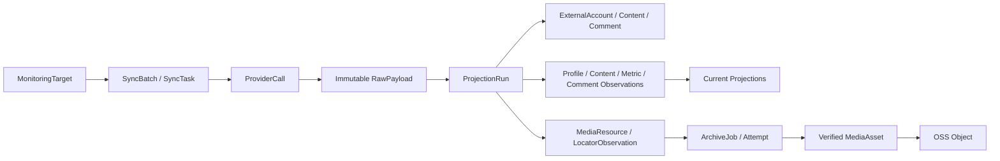
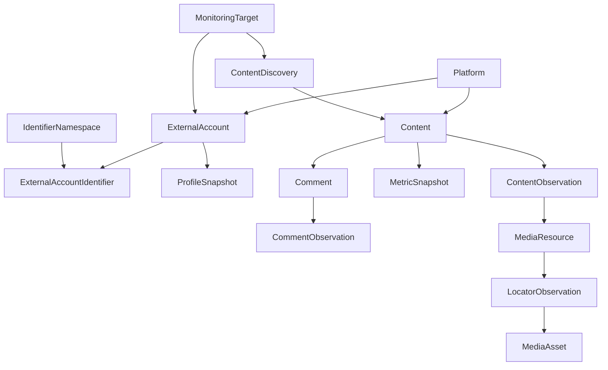
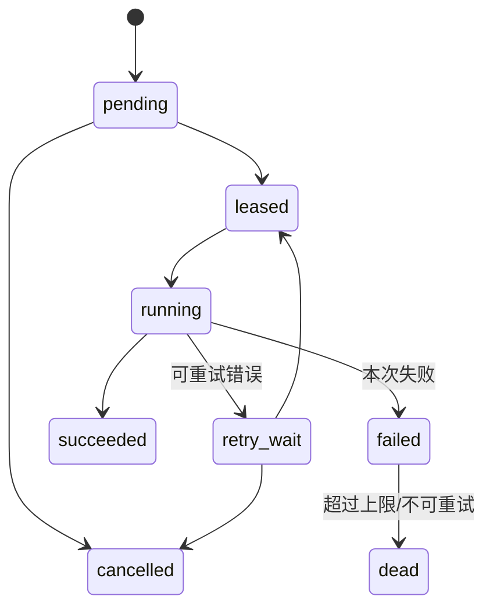

# Media Platform 3.0 数据底座数据库详细设计 v1

> **文档状态**：`archived`  
> **当前替代**：[`database-design-v2.md`](../../domains/data-foundation/database-design-v2.md)  
> **保留说明**：下方正文按历史原貌保留，其中“P0 可实施基线”等原标签只反映当时状态，已被本归档声明和 [`HBECHO设计方案/INDEX.md`](../../INDEX.md) 覆盖。  
> **禁止用途**：不得据此实施旧 DDL、状态、身份、归属、ODS 或媒资模型；只有被 v2 或当前 Spec 明确吸收的结论才生效。

---

- **目标数据库**：MySQL 8（InnoDB）
- **对象存储**：OSS
- **开发语言**：TypeScript、Python
- **文档状态**：P0 可实施基线
- **证据范围**：仅使用 `HBECHO设计方案/archive/legacy/项目历史文档/hbecho-设计大纲.md` 与 `aimaster接口文档/测试结果/raw3/*.json`

---

## 1. 结论先行【已确认：2026-08-31】

本设计采用五层事实模型：

1. **采集控制层**：批次、任务、租约、重试、游标和窗口完整性；
2. **不可变 ODS 层**：保存请求/响应原始字节、摘要及结构化包络，作为审计和重放依据；
3. **平台中立 DWD 层**：账号、内容、评论、画像及指标观察；
4. **当前投影层**：从历史观察中按确定性规则选出当前画像、内容和字段级指标；
5. **OSS 媒资层**：区分逻辑媒资、表现形式、临时定位地址、验证后的字节资产和物理 OSS 对象。

不可妥协的建模选择：

- 内容键是 `(platform_id, platform_content_id)`，评论键是 `(content_id, platform_comment_id)`；外部 ID 一律保存为字符串。
- 共创不新增独立 `content_account_relations`：若内容出现在监控目标主页列表、但接口返回作者账号不同，按已确认业务规则默认解释为共创；由 discovery 与 returned author 两份事实共同表达。
- 供应商请求动作与返回任务动作分列保存。raw3 已出现外层 `media_stats_number`、任务层 `media_stats`。
- `0`、`null`、字段缺失、空字符串不互换；指标使用固定列 `value + state`，不执行 `COALESCE(..., 0)`。
- 抓取 checkpoint 与 projection 状态分离；只要原始字节可靠落地，投影就可独立重放。
- 第三方 URL 仅是 locator；长期媒资权威定位是已验证字节的 SHA-256 与自有 OSS key。
- 不按 URL 数量创建视频。一个抖音作品的 `video.url`、`video.urls[]`、`download_urls[]` 是同一逻辑视频的候选地址。
- 初期不启用 MySQL 原生分区。五年约 550 万内容在正确索引和 ODS 大对象外置 OSS 后可控；达到事实表维护阈值后再单独评估。

---

## 2. 证据、容量与非目标

### 2.1 raw3 全量覆盖

| 项目 | 观察结果 |
|---|---:|
| JSON 文件 | 25，全部可解析 |
| HTTP / 任务结果 | 全部 HTTP 200、`code=0`、`status=succeeded` |
| 平台 | 小红书 20、抖音 4、视频号 1；无快手样本 |
| `media_user_info` | 3 |
| `user_video_list` | 3，共 61 条内容 |
| `media_stats_number` | 10，共 10 条详情 |
| `post_comments_list` | 9，共 57 条评论 |

样本没有覆盖失败响应、异步轮询、真实回复对象、视频号主页/列表/评论及快手。因此这些场景只能通过 ODS 保真、可扩展状态和数据质量告警承接，不能假装已经验证。

### 2.2 大纲约束

- 约 3,000 个监控账号，每周同步，列表单次通常取最近约 20 条；
- 五年内容规模约 550 万；
- ODS 原始事实只增不改，DWD 平台中立；
- 必须检测“最近 20 条”窗口溢出，并支持当周补抓/重试；
- 头像、主页图版本化，封面永久归档，视频按筛选策略下载；
- 媒资采用 `SHA-256 + pHash`：SHA-256 精确去重，pHash 仅作近似检索；
- 当前只有一家供应商，但身份和采集模型预留多供应商。

### 2.3 P0 非目标

1. 不构造评论回复树：raw3 只有 `reply_count`，没有 parent/root/replies 的真实契约。
2. 不承诺快手和视频号完整字段映射：没有相应全链路样本。
3. 不把 `duration` 强制换算成毫秒：样本形态像秒，但证据未声明单位。
4. 不根据昵称、头像或名称相似度自动合并账号。
5. 不根据完整签名 URL 建媒资身份，也不把 pHash 设为唯一键。
6. 不在 P0 引入数仓宽表、全文检索引擎或 MySQL 原生分区。

---

## 3. raw3 字段事实与接口映射

### 3.1 统一包络

所有 raw3 文件均包含：

```text
label / action / mode / endpoint / request / http_status /
response_body / transport_error / started_at / finished_at / elapsed_seconds
```

`response_body.data` 又包含 `task_id/action/status/result/error/created_at/updated_at`。外层捕获包络、HTTP body 和任务层是不同证据层，不能只保存 `result`。

### 3.2 四类动作映射

| 请求动作 | 原始结果 | DWD 写入 | 控制/媒资副作用 |
|---|---|---|---|
| `media_user_info` | `user_id`、`nickname`、`signature`、`*_count`、`*_number`、`updated` | 账号标识、画像快照、画像当前指针 | 若未来出现头像/主页图则生成 locator；URL 变化不直接切版本 |
| `user_video_list` | `result[]`、`has_more`、`max_cursor` 等 | 内容、作者账号、内容观察、列表指标快照、目标发现关系 | 封面/图片/音频/视频 locator；完整覆盖后才推进 checkpoint |
| `media_stats_number` | 内容字段、`*_count`、`*_number`、`duration*`、媒资地址 | 内容/观察、详情指标快照 | 分列请求动作与响应动作；可补高优先级 locator |
| `post_comments_list` | 评论数组、作者、互动、`total`、`reply_page_count`、游标 | 评论、评论观察、评论作者账号 | 评论作者头像 locator；`total` 只作响应摘要 |

### 3.3 必须保真的类型漂移

| 漂移 | raw3 证据 | 规则 |
|---|---|---|
| 动作 | 外层 `media_stats_number`，任务层 `media_stats` | `requested_action`、`response_action` 分列，不检查相等 |
| `has_more` | 内容列表 boolean，评论列表 integer 0/1 | DWD 归一成 boolean，ODS 保留原类型 |
| `max_cursor` | 字符串、整数、空串、字符串内嵌 JSON | 类型保真 CursorEnvelope；不强转数字，不擅自拆内嵌 JSON |
| `cover` | string 或 array | 一个逻辑封面；元素成为有顺序的 locator/rendition 线索 |
| `download_urls` | array 或换行拼接 string | 适配器按来源形态展开 locator，ODS 保留原值 |
| 时间 | 包络 ISO-8601 UTC 微秒；业务 13 位 epoch ms；`x-expires` 10 位 epoch s | 业务列转 UTC `DATETIME(6)`，ODS 保留原表示 |
| ID | 数字字符串和普通字符串混合，部分超过 JS safe integer | 外部 ID 只接受文本；未加引号大整数须无损解析 |
| 指标 | `*_count` 与 `*_number` 并存；0/null/缺失不同 | 每项保存值、状态、来源字段；current 字段级仲裁 |
| 时长 | 整数、小数、null，单位未证实 | 保存 `DECIMAL` 原值、状态、来源字段、单位状态 |

### 3.4 已验证的平台特例

- 小红书画像 `user_id="49328995493"`，同主页内容作者为类似 `5decba2300000000010007e1` 的值；它们属于不同命名空间，不能自动绑定。
- 抖音同时有 `user_id` 与 `sec_uid`；仅当同一响应实体明确提供关联时，才挂到同一账号。
- 抖音主页列表 20 条中有 1 条合法共创作品：监控目标为“日立中央空调”，接口返回作者为“日立变频中央空调”。按已确认业务规则，只要主页列表目标账号与接口返回作者账号不同，就默认解释为共创，不作为数据质量问题；P0 不新增独立参与关系表，而由 discovery 与 returned author 两份事实共同表达。
- 抖音列表 `play_count=0` 与详情 `play_number=48825` 可冲突；列表 0 可按版本化规则标为 `suspected_placeholder`，但不能全局认定所有 0 都是假值。
- 小红书列表有 `comment_count=null`、详情为 0；显式 null 与有效 0 均需保留。
- 视频号样本 `cover == download_urls`，字段名不足以判断实际媒体类型。
- 57 条评论 ID 在样本内唯一，但不足以证明平台全局唯一。
- 4 条评论有 `reply_count=1`，没有回复实体。

---

## 4. 总体模型与数据流





- **不可变事实**：ODS payload、各类 observation、locator observation、archive attempt。
- **稳定身份**：platform、external account、content、comment、media resource、media asset。
- **可更新控制状态**：sync task、checkpoint、projection run、archive job。
- **可重建投影**：profile/content/comment current、content metric current。

---

## 5. MySQL 全局规范

### 5.1 数据库、时区与字符集

```sql
CREATE DATABASE media_platform
  CHARACTER SET utf8mb4
  COLLATE utf8mb4_0900_ai_ci;
```

- 表统一使用 `InnoDB`；连接统一执行 `SET time_zone = '+00:00'`。
- 人类文本默认 `utf8mb4_0900_ai_ci`。
- 平台代码、对象 key、外部标识等精确值使用 `utf8mb4_0900_bin` 或二进制列。
- 要求 MySQL 8.0.16+，确保 `CHECK` 真正执行。

### 5.2 类型规范

| 语义 | MySQL 类型 | 规则 |
|---|---|---|
| 内部 PK/FK | signed `BIGINT` | 根实体可 `AUTO_INCREMENT`；TS 用 `bigint`，API 输出字符串 |
| 外部 ID | `VARCHAR(2048)` + `BINARY(32)` 摘要 | 原值不转数值；按 UTF-8 原字节计算 SHA-256 |
| 计数 | signed `BIGINT` | `CHECK >= 0`；不用 unsigned，降低跨语言差异 |
| 未确认单位数值 | `DECIMAL(20,6)` | 不使用 float |
| 时间 | `DATETIME(6)` | UTC；epoch ms/s 在适配器边界转换 |
| JSON | MySQL `JSON` | MySQL 没有 JSONB；JSON 不替代高频查询固定列 |
| 原始字节 | `LONGBLOB` 或 OSS 引用 | 同时保存长度、SHA-256 |
| URL | `LONGTEXT` + `BINARY(32)` 摘要 | 不索引完整 URL；保留签名参数用于下载 |
| 布尔 | `BOOLEAN` | 若需区分 missing/null/false，必须另有 state |
| 状态 | `VARCHAR(32)` + `CHECK` | 不用难迁移的 MySQL `ENUM` |

### 5.3 通用约束

1. 外键显式建索引，默认 `ON UPDATE RESTRICT ON DELETE RESTRICT`；证据链不级联删除。
2. 外部标识哈希命中后必须再比较原文；极端哈希碰撞写入质量问题并停止合并。
3. SHA-256 保存 32 字节二进制，不存 64 字符 hex。
4. ODS 与 observation 的应用账号只有 INSERT/SELECT 权限，不授予普通 UPDATE/DELETE。
5. URL 可能带 token；应用日志必须脱敏，数据库账号按最小权限隔离。
6. 所有 `created_at/updated_at/observed_at` 均为 UTC。

### 5.4 值状态

| 状态 | 含义 | `value` |
|---|---|---|
| `value` | 有效值 | 非 null、非负 |
| `missing` | JSON 属性不存在 | null |
| `explicit_null` | 属性存在且为 null | null |
| `invalid` | 类型、范围或解析非法 | null；原值仍在 ODS/`raw_fields` |
| `suspected_placeholder` | 有数值但来源规则判断疑似占位 | 非 null、非负 |

每个指标的 `value/state` 均使用等价检查：

```sql
CHECK (
  (state IN ('value', 'suspected_placeholder') AND value IS NOT NULL AND value >= 0)
  OR
  (state IN ('missing', 'explicit_null', 'invalid') AND value IS NULL)
)
```

---

## 6. 表结构总览

| 分组 | 表 |
|---|---|
| 参考 | `platforms`, `data_providers`, `identifier_namespaces` |
| OSS 基础 | `oss_objects` |
| 同步/ODS | `sync_batches`, `sync_tasks`, `sync_checkpoints`, `ods_provider_calls`, `ods_payloads`, `projection_runs`, `data_quality_issues` |
| 账号 | `external_accounts`, `external_account_identifiers`, `monitoring_targets`, `account_profile_snapshots`, `account_profile_current` |
| 内容/指标 | `contents`, `content_identifiers`, `monitoring_target_content_discoveries`, `content_observations`, `content_current`, `content_metric_snapshots`, `content_metric_current` |
| 评论 | `comments`, `comment_observations`, `comment_current` |
| 媒资 | `media_resources`, `media_renditions`, `media_locator_observations`, `media_archive_jobs`, `media_archive_attempts`, `media_assets`, `media_resource_assets`, `account_media_bindings`, `account_media_versions`, `content_media_bindings`, `comment_media_bindings` |

下文 `PK/FK/UQ/CK` 分别指主键、外键、唯一约束和检查约束。

---

## 7. 参考与 OSS 基础表

### 7.1 `platforms`【已确认：2026-08-31】

列：`platform_id BIGINT AUTO_INCREMENT PK`；`platform_code VARCHAR(64) ..._bin NOT NULL`；`display_name VARCHAR(128) NOT NULL`；`status VARCHAR(32) NOT NULL`；`created_at/updated_at DATETIME(6) NOT NULL`。

约束与索引：`UQ(platform_code)`；`CK status IN ('active','inactive')`。可种入 `xiaohongshu`、`douyin`、`wechat_channels`、`kuaishou`；快手可配置不代表字段已被样本验证。

### 7.2 `data_providers`【已确认：2026-08-31】

列：`provider_id BIGINT AUTO_INCREMENT PK`；`provider_code VARCHAR(64) ..._bin NOT NULL`；`display_name VARCHAR(128) NOT NULL`；`status VARCHAR(32) NOT NULL`；`base_endpoint VARCHAR(512) NULL`；`created_at/updated_at DATETIME(6) NOT NULL`。

约束与索引：`UQ(provider_code)`；状态检查同上。认证密钥只进密钥系统，不进此表。

### 7.3 `identifier_namespaces`【已确认：2026-08-31】

| 列 | 类型/约束 | 说明 |
|---|---|---|
| `namespace_id` | `BIGINT AUTO_INCREMENT PK` | 内部 ID |
| `namespace_code` | `VARCHAR(128) ..._bin NOT NULL` | 如 `xiaohongshu.profile.user_id` |
| `platform_id` | `BIGINT NULL FK` | 供应商私有空间可空 |
| `provider_id` | `BIGINT NULL FK` | 平台原生空间可空 |
| `entity_type` | `VARCHAR(32) NOT NULL` | `account/content/comment` |
| `comparison_mode` | `VARCHAR(32) NOT NULL` | P0 为 `exact` |
| `description` | `VARCHAR(512) NOT NULL` | 语义说明 |
| `status` | `VARCHAR(32) NOT NULL` | `active/inactive` |
| `created_at/updated_at` | `DATETIME(6) NOT NULL` | UTC |

约束/索引：`UQ(namespace_code)`；`FK(platform_id/provider_id)`；各状态 `CK`；`IDX(platform_id, entity_type)`。

至少准备 `xiaohongshu.profile.user_id`、`xiaohongshu.content.user_id`、`xiaohongshu.comment.author.id`、`douyin.user_id`、`douyin.sec_uid`、`wechat_channels.user_id` 以及各平台 content/comment 空间。

### 7.4 `oss_objects`

| 列 | 类型/约束 | 说明 |
|---|---|---|
| `oss_object_id` | `BIGINT AUTO_INCREMENT PK` | 物理对象 |
| `provider_code` | `VARCHAR(32) ..._bin NOT NULL` | 如 `aliyun_oss` |
| `region` | `VARCHAR(64) ..._bin NOT NULL` | OSS 区域 |
| `bucket` | `VARCHAR(255) ..._bin NOT NULL` | bucket |
| `object_key` | `VARCHAR(1024) ..._bin NOT NULL` | 自有 key |
| `object_version` | `VARCHAR(512) ..._bin NOT NULL DEFAULT ''` | 未启用版本时为空串 |
| `etag` | `VARCHAR(256) ..._bin NULL` | 不把 ETag 当内容摘要 |
| `byte_length` | `BIGINT NULL` | 完成后非负 |
| `sha256` | `BINARY(32) NULL` | 完成后必填 |
| `content_type` | `VARCHAR(255) NULL` | OSS 元数据 |
| `storage_class` | `VARCHAR(32) NOT NULL` | `standard/ia/archive/deep_archive` |
| `encryption_mode` | `VARCHAR(32) NOT NULL` | `none/sse_oss/sse_kms` |
| `status` | `VARCHAR(32) NOT NULL` | `uploading/available/quarantined/deleted` |
| `verified_at/deleted_at` | `DATETIME(6) NULL` | 生命周期时间 |
| `created_at/updated_at` | `DATETIME(6) NOT NULL` | UTC |

约束/索引：`UQ(provider_code, region, bucket, object_key, object_version)`；`CK byte_length >= 0`；`CK available => byte_length/sha256/verified_at 非空`；各状态 `CK`；`IDX(sha256)`（非唯一，多个物理副本可同字节）；`IDX(status, storage_class, created_at)`。

---

## 8. 同步控制与 ODS

### 8.1 `sync_batches`【已确认：2026-08-31】

列：`batch_id BIGINT AUTO_INCREMENT PK`；`batch_key BINARY(32) NOT NULL`；`trigger_type VARCHAR(32) NOT NULL`；`window_start/window_end DATETIME(6) NULL`；`status VARCHAR(32) NOT NULL`；`planned_task_count/succeeded_task_count/failed_task_count BIGINT NOT NULL DEFAULT 0`；`started_at/finished_at DATETIME(6) NULL`；`created_at/updated_at DATETIME(6) NOT NULL`。

约束/索引：`UQ(batch_key)`；trigger 为 `scheduled/manual/recovery/backfill`；status 为 `planned/running/succeeded/partial_failed/failed/cancelled`；计数非负；窗口同空或 `start < end`；`IDX(status, created_at)`、`IDX(window_start, window_end)`。

### 8.2 `sync_tasks`【已确认：2026-08-31】

| 列 | 类型/约束 | 说明 |
|---|---|---|
| `task_id` | `BIGINT AUTO_INCREMENT PK` | 任务 |
| `batch_id` | `BIGINT NOT NULL FK` | 所属批次 |
| `parent_task_id` | `BIGINT NULL FK -> sync_tasks` | 分页/派生链 |
| `monitoring_target_id` | `BIGINT NULL FK` | 详情任务可只由内容派生 |
| `provider_id/platform_id` | `BIGINT NOT NULL FK` | 供应商与平台 |
| `requested_action` | `VARCHAR(64) ..._bin NOT NULL` | 调度动作 |
| `subject_type` | `VARCHAR(32) NOT NULL` | `account/content/comment_page` |
| `subject_key` | `VARCHAR(2048) ..._bin NOT NULL` | 外部原值 |
| `subject_key_sha256` | `BINARY(32) NOT NULL` | 摘要 |
| `task_parameters` | `JSON NOT NULL` | 游标封装、页数、策略 |
| `idempotency_key` | `BINARY(32) NOT NULL` | 任务幂等键 |
| `status` | `VARCHAR(32) NOT NULL` | 状态机 |
| `priority` | `INT NOT NULL DEFAULT 0` | 越大越优先（需统一约定） |
| `attempt_count/max_attempts` | `INT NOT NULL` | `0 <= attempt <= max` |
| `next_attempt_at` | `DATETIME(6) NULL` | 重试时间 |
| `lease_owner` | `VARCHAR(128) ..._bin NULL` | worker |
| `lease_expires_at` | `DATETIME(6) NULL` | 租约 |
| `fencing_token` | `BIGINT NOT NULL DEFAULT 0` | 每次领取递增 |
| `page_count/fetched_item_count` | `BIGINT NOT NULL DEFAULT 0` | 非负 |
| `oldest_published_at/newest_published_at` | `DATETIME(6) NULL` | 覆盖判断 |
| `has_more_at_stop` | `BOOLEAN NULL` | 无法判断时 null |
| `window_overflow_detected` | `BOOLEAN NOT NULL DEFAULT FALSE` | 是否溢出 |
| `stop_reason` | `VARCHAR(64) NULL` | 停止原因 |
| `result_summary` | `JSON NULL` | `total` 等非权威摘要 |
| `last_error_code` | `VARCHAR(128) NULL` | 错误分类 |
| `last_error_detail` | `JSON NULL` | 脱敏详情 |
| `started_at/finished_at` | `DATETIME(6) NULL` | 执行时间 |
| `created_at/updated_at` | `DATETIME(6) NOT NULL` | UTC |

约束：`UQ(idempotency_key)`；status 为 `pending/leased/running/retry_wait/succeeded/failed/dead/cancelled`；租约状态要求 owner/expiry 非空；计数与 fencing token 非负；所有 FK restrict。

索引：`IDX(status, next_attempt_at, priority, task_id)`、`IDX(batch_id, status)`、`IDX(monitoring_target_id, requested_action, created_at)`、`IDX(parent_task_id)`、`IDX(provider_id, subject_key_sha256)`。

### 8.3 `sync_checkpoints`【已确认：2026-08-31】

列：`checkpoint_id BIGINT AUTO_INCREMENT PK`；`monitoring_target_id/provider_id BIGINT NOT NULL FK`；`action VARCHAR(64) ..._bin NOT NULL`；`checkpoint_scope VARCHAR(64) ..._bin NOT NULL DEFAULT 'default'`；`cursor_envelope JSON NULL`；`cursor_sha256 BINARY(32) NULL`；`covered_through_at DATETIME(6) NULL`；`boundary_external_id VARCHAR(2048) ..._bin NULL`；`boundary_external_id_sha256 BINARY(32) NULL`；`last_successful_task_id BIGINT NULL FK`；`version BIGINT NOT NULL DEFAULT 0`；`status VARCHAR(32) NOT NULL`；`updated_at DATETIME(6) NOT NULL`。

约束/索引：`UQ(monitoring_target_id, provider_id, action, checkpoint_scope)`；游标与 hash 同空同非空；边界 ID 与 hash 同空同非空；`version >= 0`；status 为 `ready/blocked`；`IDX(last_successful_task_id)`。

CursorEnvelope 规范：

```json
{"kind":"string","value":""}
{"kind":"integer","lexeme":"0"}
{"kind":"boolean","value":false}
{"kind":"null"}
{"kind":"object","value":{"cursor":"..."}}
```

“字符串内嵌 JSON”仍保存成 `kind=string`；解析结果只能作为辅助信息，不能覆盖原值。

### 8.4 `ods_provider_calls`【已确认：2026-08-31】

| 列 | 类型/约束 | 说明 |
|---|---|---|
| `provider_call_id` | `BIGINT AUTO_INCREMENT PK` | 一次实际调用 |
| `sync_task_id/provider_id` | `BIGINT NOT NULL FK` | 来源 |
| `platform_id` | `BIGINT NULL FK` | 未判定可空 |
| `attempt_no/call_sequence` | `INT NOT NULL` | 均 >= 1 |
| `outer_label` | `VARCHAR(512) NULL` | raw3 label |
| `requested_action` | `VARCHAR(64) ..._bin NOT NULL` | 请求动作 |
| `response_action` | `VARCHAR(64) ..._bin NULL` | data.action |
| `mode_text` | `VARCHAR(128) NULL` | 原始 mode |
| `endpoint` | `VARCHAR(1024) NOT NULL` | 不含认证秘密 |
| `request_method` | `VARCHAR(16) NULL` | 如 POST |
| `http_status` | `SMALLINT NULL` | 100..599 |
| `provider_code` | `VARCHAR(128) NULL` | body code 文本化 |
| `provider_task_id` | `VARCHAR(512) ..._bin NULL` | task_id |
| `provider_task_status` | `VARCHAR(64) NULL` | 原始状态 |
| `provider_request_id` | `VARCHAR(512) ..._bin NULL` | request_id |
| `outcome` | `VARCHAR(32) NOT NULL` | 统一调用结果 |
| `transport_error` | `JSON NULL` | 结构化脱敏版本 |
| `started_at/finished_at` | `DATETIME(6) NOT NULL` | UTC 微秒 |
| `elapsed_seconds` | `DECIMAL(20,6) NOT NULL` | >= 0 |
| `captured_at` | `DATETIME(6) NOT NULL` | 入库时间 |

约束/索引：`UQ(sync_task_id, attempt_no, call_sequence)`；outcome 为 `succeeded/http_error/provider_error/transport_error/invalid_response`；无动作相等约束；`IDX(provider_task_id)`、`IDX(provider_request_id)`、`IDX(captured_at, provider_call_id)`、`IDX(outcome, captured_at)`。

### 8.5 `ods_payloads`【已确认：2026-08-31】

| 列 | 类型/约束 | 说明 |
|---|---|---|
| `payload_id` | `BIGINT AUTO_INCREMENT PK` | 原始载荷 |
| `provider_call_id` | `BIGINT NOT NULL FK` | 所属调用 |
| `payload_role` | `VARCHAR(32) NOT NULL` | request/response/capture/error |
| `content_type` | `VARCHAR(255) NULL` | 原响应 MIME 类型 |
| `content_encoding` | `VARCHAR(64) NULL` | 原响应编码 |
| `storage_mode` | `VARCHAR(16) NOT NULL` | `inline/oss` |
| `inline_bytes` | `LONGBLOB NULL` | 小载荷原始字节 |
| `oss_object_id` | `BIGINT NULL FK` | 大载荷自有 OSS |
| `byte_length` | `BIGINT NOT NULL` | 原始长度 |
| `sha256` | `BINARY(32) NOT NULL` | 原始字节摘要 |
| `parse_status` | `VARCHAR(32) NOT NULL` | `not_attempted/parsed/invalid` |
| `parsed_json` | `JSON NULL` | 查询缓存，不是原始事实替代品 |
| `parse_error` | `VARCHAR(2048) NULL` | 脱敏错误 |
| `captured_at` | `DATETIME(6) NOT NULL` | UTC |

约束：`UQ(provider_call_id, payload_role)`；role 为 `request_body/response_body/capture_envelope/transport_error`；`byte_length >= 0`；`inline` 时仅 inline 非空，`oss` 时仅 oss FK 非空；parsed 时 JSON 非空，invalid 时 error 非空。索引：`IDX(sha256)`（不唯一）、`IDX(oss_object_id)`、`IDX(captured_at, payload_id)`。

**重要**：先保存原始字节再解析。只保存 MySQL JSON 会失去字节级原貌，并可能在未来遇到未加引号长整数时造成不可逆精度损失。

### 8.6 `projection_runs`【已确认：2026-08-31】

列：`projection_run_id BIGINT AUTO_INCREMENT PK`；`source_payload_id BIGINT NOT NULL FK`；`projector_name VARCHAR(128) ..._bin NOT NULL`；`projector_version VARCHAR(64) ..._bin NOT NULL`；`projector_revision INT NOT NULL`；`status VARCHAR(32) NOT NULL`；`lease_owner VARCHAR(128) NULL`；`lease_expires_at DATETIME(6) NULL`；`fencing_token BIGINT NOT NULL DEFAULT 0`；`input_entity_count/output_entity_count/issue_count BIGINT NOT NULL DEFAULT 0`；`error_detail JSON NULL`；`started_at/finished_at DATETIME(6) NULL`；`created_at/updated_at DATETIME(6) NOT NULL`。

约束/索引：`UQ(source_payload_id, projector_name, projector_revision)`；status 为 `pending/running/succeeded/failed/dead`；计数非负；运行态要求租约；`IDX(status, created_at)`、`IDX(projector_name, projector_revision, source_payload_id)`。

一次 run 对应一个源 payload 和一个明确 projector revision。升级投影器时新增 run，不修改旧 observation。

### 8.7 `data_quality_issues`【已确认：2026-08-31】

列：`issue_id BIGINT AUTO_INCREMENT PK`；`issue_fingerprint BINARY(32) NOT NULL`；`issue_code VARCHAR(128) ..._bin NOT NULL`；`severity VARCHAR(16) NOT NULL`；`provider_call_id/projection_run_id BIGINT NULL FK`；`entity_type VARCHAR(32) NULL`；`entity_internal_id BIGINT NULL`；`json_path VARCHAR(1024) NULL`；`detail JSON NOT NULL`；`status VARCHAR(16) NOT NULL`；`occurrence_count BIGINT NOT NULL DEFAULT 1`；`first_seen_at/last_seen_at DATETIME(6) NOT NULL`；`resolved_at DATETIME(6) NULL`。

约束/索引：`UQ(issue_fingerprint)`；severity 为 `info/warning/error/critical`；status 为 `open/acknowledged/resolved/ignored`；次数 >=1；resolved 状态要求 `resolved_at`；`IDX(status, severity, last_seen_at)`、`IDX(issue_code, last_seen_at)`、各 FK 索引。

---

## 9. 账号与监控目标

### 9.1 `external_accounts`【已确认：2026-08-31】

列：`account_id BIGINT AUTO_INCREMENT PK`；`platform_id BIGINT NOT NULL FK`；`account_kind VARCHAR(32) NOT NULL DEFAULT 'unknown'`；`status VARCHAR(32) NOT NULL DEFAULT 'active'`；`first_seen_at/last_seen_at DATETIME(6) NOT NULL`；`created_at/updated_at DATETIME(6) NOT NULL`。

约束/索引：kind 为 `unknown/person/organization/brand`；P0 status 为 `active/unavailable/deleted`；`last_seen_at >= first_seen_at`；`IDX(platform_id, last_seen_at)`。昵称不进稳定身份表。P0 不提供账号合并状态；未来若需要合并，必须同时增加 `merged_into_account_id` 等完整机制。

### 9.2 `external_account_identifiers`【已确认：2026-08-31】

列：`account_identifier_id BIGINT AUTO_INCREMENT PK`；`account_id/namespace_id BIGINT NOT NULL FK`；`identifier_value VARCHAR(2048) ..._bin NOT NULL`；`identifier_sha256 BINARY(32) NOT NULL`；`source_projection_run_id BIGINT NULL FK`；`evidence_kind VARCHAR(32) NOT NULL`；`confidence VARCHAR(16) NOT NULL`；`first_seen_at/last_seen_at DATETIME(6) NOT NULL`；`created_at DATETIME(6) NOT NULL`。

约束/索引：`UQ(namespace_id, identifier_sha256)`，命中后再比原文；evidence 为 `same_entity_payload/same_monitoring_target/manual/provider_mapping`；confidence 为 `observed/verified`；`IDX(account_id, namespace_id)`、`IDX(source_projection_run_id)`。跨命名空间关联不能依据昵称；可依据同一响应实体、受控的同监控目标规则、供应商映射或人工确认建立。列表中的所有 returned author 不得仅因出现在目标主页就自动挂到目标账号，避免误合并共创账号。

### 9.3 `monitoring_targets`【已确认：2026-08-31】

| 列 | 类型/约束 | 说明 |
|---|---|---|
| `monitoring_target_id` | `BIGINT AUTO_INCREMENT PK` | 业务目标 |
| `platform_id` | `BIGINT NOT NULL FK` | 目标平台 |
| `account_id` | `BIGINT NULL FK` | 解析前可空 |
| `target_key` | `BINARY(32) NOT NULL` | 业务幂等键 |
| `seed_locator` | `LONGTEXT NOT NULL` | 用户输入主页/口令原值 |
| `seed_locator_sha256` | `BINARY(32) NOT NULL` | 摘要 |
| `display_name` | `VARCHAR(256) NULL` | 业务展示，不参与身份 |
| `status` | `VARCHAR(32) NOT NULL` | `pending/active/paused/unresolvable/retired` |
| `schedule_expression` | `VARCHAR(128) NULL` | 调度表达式 |
| `timezone` | `VARCHAR(64) NOT NULL DEFAULT 'UTC'` | 调度解释时区 |
| `sync_policy` | `JSON NOT NULL` | 页上限、重叠窗口、媒资策略 |
| `next_sync_at/last_success_at` | `DATETIME(6) NULL` | 调度信息 |
| `created_at/updated_at` | `DATETIME(6) NOT NULL` | UTC |

约束/索引：`UQ(target_key)`；`IDX(status, next_sync_at)`；`IDX(account_id)`；active 目标要求 account 与 schedule 非空。`target_key` 建议由租户边界（若未来有）、平台、规范化业务种子生成，但必须保留原始 seed。

### 9.4 `account_profile_snapshots`【已确认：2026-08-31】

固定字段：`profile_snapshot_id BIGINT AUTO_INCREMENT PK`；`account_id/provider_id/provider_call_id/projection_run_id BIGINT NOT NULL FK`；`source_entity_key BINARY(32) NOT NULL`；`observed_at DATETIME(6) NOT NULL`；`provider_updated_at DATETIME(6) NULL`；`nickname VARCHAR(512) NULL`；`signature LONGTEXT NULL`；`raw_fields JSON NOT NULL`；`created_at DATETIME(6) NOT NULL`。

下列每项均为 `BIGINT value NULL + VARCHAR(32) state NOT NULL + VARCHAR(256) source_field NULL`：

- `follower_*`
- `following_*`
- `like_*`
- `post_*`

约束/索引：每项执行值状态 `CK`；`UQ(projection_run_id, source_entity_key)`；`IDX(account_id, observed_at DESC, profile_snapshot_id DESC)`；各来源 FK。raw3 同时出现字符串 `*_count` 和数值 `*_number`，source_field 必须记录实际选取路径，所有其他表示保留在 `raw_fields`。

### 9.5 `account_profile_current`【已确认：2026-08-31】

列：`account_id BIGINT PK/FK`；`profile_snapshot_id BIGINT NOT NULL FK`；`selection_rule_version VARCHAR(64) NOT NULL`；`selected_at DATETIME(6) NOT NULL`；`updated_at DATETIME(6) NOT NULL`。

索引：`UQ(profile_snapshot_id)` 不是必须；允许同一快照仅属于一个账号的事实由 snapshot FK 验证，建议 `IDX(profile_snapshot_id)`。更新条件必须是候选排序优于当前，而不是任务完成顺序更晚。

---

## 10. 内容、发现关系与指标

### 10.1 `contents`【已确认：2026-08-31】

列：`content_id BIGINT AUTO_INCREMENT PK`；`platform_id BIGINT NOT NULL FK`；`platform_content_id VARCHAR(2048) ..._bin NOT NULL`；`platform_content_id_sha256 BINARY(32) NOT NULL`；`content_kind VARCHAR(32) NOT NULL DEFAULT 'unknown'`；`status VARCHAR(32) NOT NULL DEFAULT 'active'`；`first_seen_at/last_seen_at DATETIME(6) NOT NULL`；`created_at/updated_at DATETIME(6) NOT NULL`。

约束/索引：`UQ(platform_id, platform_content_id_sha256)`，冲突时复核原文；kind 为 `unknown/video/image/text/mixed`；status 为 `active/unavailable/deleted`；`IDX(platform_id, last_seen_at)`。供应商私有 ID 禁止写入 `platform_content_id`。

### 10.2 `content_identifiers`【已确认：2026-08-31】

为第二供应商可能返回的别名预留。列：`content_identifier_id BIGINT AUTO_INCREMENT PK`；`content_id/namespace_id BIGINT NOT NULL FK`；`identifier_value VARCHAR(2048) ..._bin NOT NULL`；`identifier_sha256 BINARY(32) NOT NULL`；`source_projection_run_id BIGINT NULL FK`；`first_seen_at/last_seen_at DATETIME(6) NOT NULL`。

约束/索引：`UQ(namespace_id, identifier_sha256)`；`IDX(content_id, namespace_id)`。只有确认它是平台原生内容 ID 时才可用于创建 `contents` 的 canonical key。

### 10.3 `monitoring_target_content_discoveries`【已确认：2026-08-31】

列：`monitoring_target_id/content_id BIGINT NOT NULL FK`；`first_sync_task_id/last_sync_task_id BIGINT NOT NULL FK`；`first_seen_at/last_seen_at DATETIME(6) NOT NULL`；`occurrence_count BIGINT NOT NULL DEFAULT 1`；复合 `PK(monitoring_target_id, content_id)`。

约束/索引：次数 >=1；时间有序；`IDX(content_id, monitoring_target_id)`。该表表达“内容在目标主页列表中被发现”。当目标绑定账号与 `content_observations.author_account_id` 不同时，按已确认业务规则默认解释为共创；不报数据质量错误，也不另建参与关系表。

### 10.4 `content_observations`【已确认：2026-08-31】

| 列 | 类型/约束 | 说明 |
|---|---|---|
| `content_observation_id` | `BIGINT AUTO_INCREMENT PK` | 不可变观察 |
| `content_id/provider_id/provider_call_id/projection_run_id` | `BIGINT NOT NULL FK` | 来源 |
| `source_entity_key` | `BINARY(32) NOT NULL` | JSON 路径/序号稳定摘要 |
| `source_kind` | `VARCHAR(32) NOT NULL` | `list/detail` |
| `observed_at` | `DATETIME(6) NOT NULL` | API 观察时间 |
| `author_account_id` | `BIGINT NULL FK` | 不强绑目标账号 |
| `author_name` | `VARCHAR(512) NULL` | 观察值 |
| `published_at/provider_updated_at` | `DATETIME(6) NULL` | epoch ms 转 UTC |
| `title/body/tag_text` | `LONGTEXT NULL` | 原文本 |
| `publish_location` | `VARCHAR(512) NULL` | 如抖音地域 |
| `related_search_terms` | `JSON NULL` | 保留数组结构 |
| `share_url` | `LONGTEXT NULL` | 分享 locator，不作身份 |
| `share_url_sha256` | `BINARY(32) NULL` | 同空同非空 |
| `duration_raw` | `DECIMAL(20,6) NULL` | 未确认单位 |
| `duration_state` | `VARCHAR(32) NOT NULL` | 值状态 |
| `duration_source_field` | `VARCHAR(256) NULL` | `video.duration` 等 |
| `duration_unit` | `VARCHAR(32) NOT NULL` | `unknown/seconds/milliseconds` |
| `raw_fields` | `JSON NOT NULL` | 未 canonical 字段及原表示 |
| `created_at` | `DATETIME(6) NOT NULL` | 入库时间 |

约束/索引：`UQ(projection_run_id, source_entity_key)`；时长执行状态检查且非负；URL 与 hash 同空同非空；`IDX(content_id, observed_at DESC, content_observation_id DESC)`；`IDX(author_account_id, published_at)`；来源 FK 索引。

### 10.5 `content_current`【已确认：2026-08-31】

列：`content_id BIGINT PK/FK`；`content_observation_id BIGINT NOT NULL FK`；`selection_rule_version VARCHAR(64) NOT NULL`；`selected_at/updated_at DATETIME(6) NOT NULL`。

索引：`IDX(content_observation_id)`。P0 选择整条内容观察作为当前元数据，优先详情、再按观察时间、投影 revision、observation ID 稳定决胜；不能覆盖历史 observation。

### 10.6 `content_metric_snapshots`【已确认：2026-08-31】

固定列：`metric_snapshot_id BIGINT AUTO_INCREMENT PK`；`content_id/provider_id/provider_call_id/projection_run_id BIGINT NOT NULL FK`；`source_entity_key BINARY(32) NOT NULL`；`source_kind VARCHAR(32) NOT NULL`（`list/detail`）；`observed_at DATETIME(6) NOT NULL`；`provider_updated_at DATETIME(6) NULL`（供应商返回的 `updated`，列表未提供时为空）；`raw_fields JSON NOT NULL`；`created_at DATETIME(6) NOT NULL`。

以下每项均为 `BIGINT value NULL + VARCHAR(32) state NOT NULL + VARCHAR(256) source_field NULL`：

- `play_*`
- `like_*`
- `comment_*`
- `collect_*`
- `share_*`

约束/索引：五组值状态 `CK`；`UQ(projection_run_id, source_entity_key)`；`IDX(content_id, observed_at DESC, metric_snapshot_id DESC)`；`IDX(provider_id, source_kind, observed_at)`。

不能把 `*_count` 与 `*_number` 预先 `COALESCE`。适配器先依据属性存在性构造候选，记录实际 `source_field`，其余原表示留在 `raw_fields`。

### 10.7 `content_metric_current`【已确认：2026-08-31】

列：`content_id BIGINT PK/FK`；`selection_rule_version VARCHAR(64) NOT NULL`；`selected_at/updated_at DATETIME(6) NOT NULL`。对 play/like/comment/collect/share 每项保存：

- `<metric>_value BIGINT NULL`
- `<metric>_state VARCHAR(32) NOT NULL`
- `<metric>_source_snapshot_id BIGINT NOT NULL FK`

约束/索引：每项值状态 `CK`；五个 source FK 索引。应用必须校验 source snapshot 的 `content_id` 等于 current 的 `content_id`；若要完全由数据库强制，可在后续迁移增加包含 content_id 的五组复合 FK，但 P0 会显著增加列宽。

这样允许点赞取详情快照、评论取另一个详情快照、播放暂取列表快照，同时每项都可追溯。

---

## 11. 评论

### 11.1 `comments`【已确认：2026-08-31】

列：`comment_id BIGINT AUTO_INCREMENT PK`；`content_id BIGINT NOT NULL FK`；`platform_comment_id VARCHAR(2048) ..._bin NOT NULL`；`platform_comment_id_sha256 BINARY(32) NOT NULL`；`status VARCHAR(32) NOT NULL DEFAULT 'active'`；`first_seen_at/last_seen_at DATETIME(6) NOT NULL`；`created_at/updated_at DATETIME(6) NOT NULL`。

约束/索引：`UQ(content_id, platform_comment_id_sha256)`，命中后复核原文；status 为 `active/unavailable/deleted`；`IDX(content_id, last_seen_at)`。不建立平台全局 comment ID 唯一键。

### 11.2 `comment_observations`【已确认：2026-08-31】

| 列 | 类型/约束 | 说明 |
|---|---|---|
| `comment_observation_id` | `BIGINT AUTO_INCREMENT PK` | 不可变观察 |
| `comment_id/provider_id/provider_call_id/projection_run_id` | `BIGINT NOT NULL FK` | 来源 |
| `source_entity_key` | `BINARY(32) NOT NULL` | 路径/序号摘要 |
| `author_account_id` | `BIGINT NULL FK` | 评论作者 |
| `author_name` | `VARCHAR(512) NULL` | 观察值 |
| `content_text` | `LONGTEXT NULL` | 评论正文 |
| `like_value/reply_value` | `BIGINT NULL` | 计数 |
| `like_state/reply_state` | `VARCHAR(32) NOT NULL` | 值状态 |
| `is_liked_value` | `BOOLEAN NULL` | 当前调用视角值 |
| `is_liked_state` | `VARCHAR(32) NOT NULL` | `value/missing/explicit_null/invalid` |
| `platform_created_at` | `DATETIME(6) NULL` | raw3 `created` 转 UTC，表示评论创建时间 |
| `provider_updated_at` | `DATETIME(6) NULL` | raw3 `updated` 转 UTC，不宣称是平台编辑时间 |
| `observed_at` | `DATETIME(6) NOT NULL` | API 观察时间 |
| `raw_fields` | `JSON NOT NULL` | download_urls 等原字段 |
| `created_at` | `DATETIME(6) NOT NULL` | 入库时间 |

约束/索引：`UQ(projection_run_id, source_entity_key)`；计数值状态 `CK`；布尔 state 与值一致；`IDX(comment_id, observed_at DESC, comment_observation_id DESC)`；`IDX(author_account_id, observed_at)`。

P0 只保存 `reply_count` 观察，不建立 `parent_comment_id/root_comment_id/depth`。响应 `total`、数组长度、回复数量分别存放，绝不互相替代。

### 11.3 `comment_current`【已确认：2026-08-31】

列：`comment_id BIGINT PK/FK`；`comment_observation_id BIGINT NOT NULL FK`；`selection_rule_version VARCHAR(64) NOT NULL`；`selected_at/updated_at DATETIME(6) NOT NULL`；索引 `IDX(comment_observation_id)`。按有效状态、来源、观察时间、投影 revision 和 ID 确定性选择。

---

## 12. 媒资与 OSS 归档

### 12.1 `media_resources`

列：`media_resource_id BIGINT AUTO_INCREMENT PK`；`expected_media_kind VARCHAR(32) NOT NULL`；`status VARCHAR(32) NOT NULL`；`first_seen_at/last_seen_at DATETIME(6) NOT NULL`；`created_at/updated_at DATETIME(6) NOT NULL`。

约束：kind 为 `unknown/image/video/audio`；status 为 `active/archived/unavailable`。owner、role、slot 由下方 binding 表唯一化；一个 resource 只能被一种 owner binding 使用，由服务层和定期完整性检查保证。

### 12.2 `media_renditions`

列：`media_rendition_id BIGINT AUTO_INCREMENT PK`；`media_resource_id BIGINT NOT NULL FK`；`rendition_key VARCHAR(128) ..._bin NOT NULL`；`mime_hint VARCHAR(255) NULL`；`width/height INT NULL`；`bitrate BIGINT NULL`；`codec VARCHAR(128) NULL`；`watermark_state VARCHAR(32) NOT NULL DEFAULT 'unknown'`；`raw_attributes JSON NOT NULL`；`created_at/updated_at DATETIME(6) NOT NULL`。

约束/索引：`UQ(media_resource_id, rendition_key)`；尺寸/码率非负；watermark 为 `unknown/present/absent`；`IDX(media_resource_id)`。元数据不足时只建 `rendition_key='unknown'`，不要按每个 URL 猜一个 rendition。

### 12.3 `media_locator_observations`

| 列 | 类型/约束 | 说明 |
|---|---|---|
| `locator_observation_id` | `BIGINT AUTO_INCREMENT PK` | 一次地址观察 |
| `media_rendition_id` | `BIGINT NOT NULL FK` | 所属表现形式 |
| `provider_call_id/projection_run_id` | `BIGINT NOT NULL FK` | 来源 |
| `source_json_path` | `VARCHAR(1024) ..._bin NOT NULL` | 如 `...video.urls[0]` |
| `source_order` | `INT NOT NULL` | 原数组/分行顺序 |
| `locator_role` | `VARCHAR(32) NOT NULL` | `primary/candidate/download/share` |
| `locator_url` | `LONGTEXT NOT NULL` | 完整原 URL |
| `locator_url_sha256` | `BINARY(32) NOT NULL` | URL 原文摘要 |
| `scheme` | `VARCHAR(16) NULL` | URL scheme 解析辅助 |
| `host` | `VARCHAR(255) NULL` | URL host 解析辅助 |
| `expires_at` | `DATETIME(6) NULL` | 如 `x-expires` epoch s |
| `observed_at` | `DATETIME(6) NOT NULL` | 观察时间 |
| `fetch_eligibility` | `VARCHAR(32) NOT NULL` | `unknown/eligible/ineligible/expired` |
| `created_at` | `DATETIME(6) NOT NULL` | 入库时间 |

约束/索引：`UQ(provider_call_id, source_json_path, source_order, locator_url_sha256)`；order >=0；role/status `CK`；`IDX(media_rendition_id, expires_at, observed_at)`；`IDX(locator_url_sha256)`；`IDX(host, observed_at)`。

不去掉 URL query 后做身份键；签名参数可能决定可下载性。`cover == download_urls` 时保留两条不同来源路径的 observation，但可在下载后关联到同一个 asset。

### 12.4 `media_archive_jobs`

列：`archive_job_id BIGINT AUTO_INCREMENT PK`；`media_resource_id/media_rendition_id BIGINT NOT NULL FK`；`selected_locator_observation_id BIGINT NULL FK`；`policy_version VARCHAR(64) NOT NULL`；`idempotency_key BINARY(32) NOT NULL`；`status VARCHAR(32) NOT NULL`；`priority INT NOT NULL DEFAULT 0`；`not_before DATETIME(6) NULL`；`attempt_count/max_attempts INT NOT NULL`；`lease_owner VARCHAR(128) NULL`；`lease_expires_at DATETIME(6) NULL`；`fencing_token BIGINT NOT NULL DEFAULT 0`；`selection_reason JSON NOT NULL`；`last_error JSON NULL`；`created_at/updated_at DATETIME(6) NOT NULL`。

约束/索引：`UQ(idempotency_key)`；status 为 `pending/leased/downloading/verifying/succeeded/retry_wait/failed/dead/skipped`；次数与 fencing 非负；运行态有租约；`IDX(status, not_before, priority, archive_job_id)`、`IDX(media_resource_id, status)`。

### 12.5 `media_archive_attempts`

列：`archive_attempt_id BIGINT AUTO_INCREMENT PK`；`archive_job_id/locator_observation_id BIGINT NOT NULL FK`；`attempt_no INT NOT NULL`；`fencing_token BIGINT NOT NULL`；`outcome VARCHAR(32) NOT NULL`；`http_status SMALLINT NULL`；`response_content_type VARCHAR(255) NULL`；`bytes_received BIGINT NOT NULL DEFAULT 0`；`computed_sha256 BINARY(32) NULL`；`temporary_oss_object_id BIGINT NULL FK`；`error_detail JSON NULL`；`started_at/finished_at DATETIME(6) NOT NULL`；`created_at DATETIME(6) NOT NULL`。

约束/索引：`UQ(archive_job_id, attempt_no)`；outcome 为 `downloaded/http_error/transport_error/expired/type_mismatch/checksum_mismatch/too_large`；字节数非负；downloaded 要求摘要和临时对象；`IDX(locator_observation_id)`、`IDX(computed_sha256)`。attempt 只增不改。

### 12.6 `media_assets`

| 列 | 类型/约束 | 说明 |
|---|---|---|
| `media_asset_id` | `BIGINT AUTO_INCREMENT PK` | 已验证字节资产 |
| `sha256` | `BINARY(32) NOT NULL` | 精确身份 |
| `byte_length` | `BIGINT NOT NULL` | >=0 |
| `detected_media_kind` | `VARCHAR(32) NOT NULL` | 由字节探测 |
| `detected_mime_type` | `VARCHAR(255) NOT NULL` | 由字节探测 |
| `width/height` | `INT NULL` | 图片/视频维度 |
| `duration_ms` | `BIGINT NULL` | 仅由已下载字节探测得到 |
| `codec/container` | `VARCHAR(128) NULL` | 探测信息 |
| `phash_algorithm` | `VARCHAR(64) NULL` | 如具体算法名 |
| `phash_version` | `VARCHAR(32) NULL` | 算法版本 |
| `phash_value` | `VARBINARY(64) NULL` | 近似检索，不唯一 |
| `primary_oss_object_id` | `BIGINT NOT NULL FK` | 长期对象 |
| `verification_status` | `VARCHAR(32) NOT NULL` | `verified/quarantined` |
| `verified_at/created_at` | `DATETIME(6) NOT NULL` | UTC |

约束/索引：`UQ(sha256)`；所有尺寸/时长非负；pHash 三列同空同非空；`UQ(primary_oss_object_id)`；`IDX(phash_algorithm, phash_version, phash_value)` 非唯一；`IDX(detected_media_kind, created_at)`。

精确去重流程是先计算 SHA-256，再 `INSERT ... ON DUPLICATE KEY` 获取既有 asset。pHash 只能产出近似候选，不得自动合并字节资产。

### 12.7 `media_resource_assets`

列：`media_resource_id/media_rendition_id/media_asset_id BIGINT NOT NULL FK`；`first_locator_observation_id BIGINT NOT NULL FK`；`association_kind VARCHAR(32) NOT NULL`；`first_verified_at/last_verified_at DATETIME(6) NOT NULL`；复合 `PK(media_resource_id, media_rendition_id, media_asset_id)`。

约束/索引：association 为 `verified_exact/near_duplicate_candidate`；时间有序；`IDX(media_asset_id, media_resource_id)`。只有 `verified_exact` 可进入账号版本或内容归档使用；近似候选必须人工/业务规则另行处理。

### 12.8 `account_media_bindings`

列：`account_media_binding_id BIGINT AUTO_INCREMENT PK`；`account_id/media_resource_id BIGINT NOT NULL FK`；`role VARCHAR(32) NOT NULL`；`slot_index INT NOT NULL DEFAULT 0`；`created_at DATETIME(6) NOT NULL`。

约束/索引：`UQ(account_id, role, slot_index)`；`UQ(media_resource_id)`；role 为 `avatar/profile_cover`；slot >=0。评论作者头像也绑定到其 ExternalAccount，而不是绑到评论文本。

### 12.9 `account_media_versions`

列：`account_media_version_id BIGINT AUTO_INCREMENT PK`；`account_media_binding_id/media_asset_id BIGINT NOT NULL FK`；`sequence_no BIGINT NOT NULL`；`valid_from DATETIME(6) NOT NULL`；`valid_to DATETIME(6) NULL`；`opened_by_locator_observation_id BIGINT NOT NULL FK`；`closed_by_locator_observation_id BIGINT NULL FK`；`active_binding_guard BIGINT GENERATED ALWAYS AS (CASE WHEN valid_to IS NULL THEN account_media_binding_id ELSE NULL END) STORED`；`created_at DATETIME(6) NOT NULL`。

约束/索引：`UQ(account_media_binding_id, sequence_no)`；`UQ(active_binding_guard)` 保证一个 active 版本；`valid_to > valid_from`；关闭时 closing locator 非空；`IDX(media_asset_id)`。

切换算法：下载失败或仅 URL 变化时保持旧版本；新 asset SHA-256 与 active 相同则只更新观察，不新增版本；不同则同一事务关闭旧版本并插入新版本。A→B→A 会得到三个连续版本，不能因 A 曾出现过而省略第三段。

### 12.10 `content_media_bindings`

列：`content_media_binding_id BIGINT AUTO_INCREMENT PK`；`content_id/media_resource_id BIGINT NOT NULL FK`；`role VARCHAR(32) NOT NULL`；`slot_index INT NOT NULL`；`archive_policy VARCHAR(32) NOT NULL`；`created_at DATETIME(6) NOT NULL`。

约束/索引：`UQ(content_id, role, slot_index)`；`UQ(media_resource_id)`；role 为 `cover/gallery_image/video/audio`；policy 为 `permanent/selective/metadata_only`；slot >=0；`IDX(content_id, role)`。封面使用 permanent；视频按筛选策略 selective。

### 12.11 `comment_media_bindings`

列与内容 binding 同构：`comment_media_binding_id PK`；`comment_id/media_resource_id FK`；`role`（P0 仅 `attachment`）；`slot_index`；`archive_policy`；`created_at`。

约束/索引：`UQ(comment_id, role, slot_index)`；`UQ(media_resource_id)`；slot >=0。raw3 的评论 `download_urls` 为空，但该表为以后真实评论附件预留；评论作者 avatar 仍走 account binding。

---

## 13. 媒资归组规则

### 13.1 从 raw3 字段到逻辑资源

| owner | 原路径 | resource role / slot | rendition / locator 处理 |
|---|---|---|---|
| Content | `.cover` string | `cover/0` | unknown rendition，一条 locator |
| Content | `.cover[]` | `cover/0` | 同一封面资源；按数组顺序记录候选，确认尺寸后才拆 rendition |
| Content | `.images[i]` | `gallery_image/i` | 每个 i 是独立逻辑图片 |
| Content | `.video.url`, `.video.urls[]`, `.download_urls` | `video/0` | 同一逻辑视频，多 locator；不要建 N 个视频 |
| Content | `.audio.url`, `.audio.urls[]` | `audio/0` | 同上 |
| Account | 画像/评论作者 `.avatar` | `avatar/0` | 地址观察，下载验证后才切版本 |
| Comment | 未来非空附件地址 | `attachment/i` | 无真实样本前保持 unknown kind |

`download_urls` 为换行字符串时，适配器只按非空行展开，并在 locator 中保留原 JSON path 与行序；原字符串仍在 ODS。

### 13.2 下载、验证、去重和发布

1. 按归档策略选未过期 locator，记录选择理由；
2. 领取 archive job 并递增 fencing token；
3. 流式下载到临时 OSS key，同时计算字节数与 SHA-256；
4. 通过 magic bytes/媒体探针验证真实类型，不相信 URL 后缀和字段名；
5. 精确查重：按 SHA-256 获取/创建 `media_assets`；
6. 必要时计算带算法版本的 pHash，仅写近似候选；
7. 将稳定 OSS 对象绑定到 asset，再写 resource-asset 关联；
8. 账号图按版本切换事务执行；内容封面永久保留，视频按策略保留；
9. 临时对象延迟清理，清理前确认没有成功 attempt/asset 引用。

推荐 OSS key（不是身份键）：

```text
assets/sha256/{hex[0:2]}/{hex[2:4]}/{full_hex}.{detected_ext}
ods/{yyyy}/{mm}/{dd}/{provider_call_id}/{payload_role}-{sha256_hex}.bin
tmp/archive/{archive_job_id}/{attempt_no}/{random}
```

### 13.3 生命周期

- `assets/`：封面/画像版本长期保存；视频根据业务筛选和保留策略决定；
- `ods/`：作为不可变原始事实，按合规策略从 Standard 转 IA/Archive，不直接删除；
- `tmp/`：成功发布或失败超过安全延迟后清理；
- 降冷前需校验 DB 引用和对象校验和；恢复归档对象期间 job 进入明确等待态，不伪装失败。

---

## 14. 指标字段级当前值规则

### 14.1 候选生成

对每个 `play/like/comment/collect/share` 独立生成候选。必须先判断 JSON 属性是否存在：

```text
不存在 -> missing
存在且 null -> explicit_null
存在且非整数/负数/越界 -> invalid
存在且满足已版本化占位规则 -> suspected_placeholder
其余非负整数 -> value
```

字符串计数只有在完整匹配十进制非负整数时才能转换，原字符串和来源路径仍保留。

### 14.2 确定性排序

每个指标独立按以下元组降序选择：

1. **状态质量**：`value > suspected_placeholder > explicit_null > missing > invalid`；
2. **来源质量**：版本化规则中通常为详情 `*_number` > 详情 `*_count` > 列表 `stats.*_count`，但可按平台/指标细化；
3. **observed_at**；
4. **projector_revision**；
5. **metric_snapshot_id**（稳定决胜）。

结果写入 `content_metric_current`，同时保存每项 source snapshot。规则版本必须入库；规则升级通过重建 current 完成。

### 14.3 明确禁止

- 禁止 last-write-wins：异步任务完成顺序不代表事实新旧或质量。
- 禁止 `MAX(value)`：指标可能因平台清理、供应商纠正而下降。
- 禁止把 null/缺失转 0。
- 禁止将所有列表 0 一概视为占位；占位规则须平台、动作、字段、版本限定。
- 禁止用一条整体“最佳快照”覆盖所有指标来源。

---

## 15. 同步状态机、租约与事务

### 15.1 状态机



### 15.2 领取任务与 fencing token

领取应在短事务中使用 `SELECT ... FOR UPDATE SKIP LOCKED`：

1. 选 `pending/retry_wait` 且到期的任务；
2. 将状态设为 leased，写 owner/expiry；
3. `fencing_token = fencing_token + 1`；
4. 提交后再做网络请求。

后续每次更新必须带：

```sql
WHERE task_id = ? AND lease_owner = ? AND fencing_token = ?
```

受影响行数为 0 表示旧 worker 已失去所有权，必须丢弃其控制状态更新；但若它已经得到响应，可通过新的、明确拥有所有权的恢复流程保存原始响应，不能静默覆盖新 worker 结果。

### 15.3 幂等键

| 对象 | 幂等/唯一材料 |
|---|---|
| Batch | trigger + 业务窗口 + 调度版本 |
| Task | batch/target/provider/action/subject + CursorEnvelope 规范字节 + policy version |
| Provider call | `(task_id, attempt_no, call_sequence)` |
| Payload | call + role；SHA-256 只作校验，不全局去重证据 |
| Projection | source payload + projector name + revision |
| Account identifier | namespace + identifier SHA-256（再比原文） |
| Content | platform + platform content ID SHA-256（再比原文） |
| Comment | content + comment ID SHA-256（再比原文） |
| Observation | projection run + source entity key |
| Locator | call + JSON path + order + URL SHA-256 |
| Asset | 下载字节 SHA-256 |
| Archive job | resource/rendition + policy version + generation |

规范哈希输入必须使用带字段名、长度前缀或 canonical JSON 的 UTF-8 字节，不能简单字符串拼接造成歧义。

### 15.4 原始调用事务边界

网络调用不持有数据库事务。响应后的落地顺序：

1. 生成不可变原始字节、长度和 SHA-256；
2. 大响应先上传自有 OSS 并验证，得到 `oss_objects`；小响应可 inline；
3. 一个数据库事务插入 `ods_provider_calls`、所有 `ods_payloads`，并更新该 attempt 摘要；
4. 事务成功后任务才可进入 succeeded；
5. projection 在独立事务/worker 中运行，失败不回退抓取成功状态。

若 OSS 上传成功但数据库事务失败，对象成为可安全扫描的孤儿候选；清理器须等待安全期并确认无 DB 引用。

### 15.5 投影事务边界

- 一份 payload 创建/领取一个 projection run；
- 单 payload 规模较小时，在一个事务内 upsert 稳定身份、insert observation、insert locator、更新 current；
- 大 payload 可按实体分块，但 observation 唯一键保证重试；run 只有全部分块完成才 succeeded；
- current 更新需比较完整排序元组，不能盲写；
- 投影失败保留错误并重试，绝不重新请求 API 才能恢复。

### 15.6 checkpoint 推进与窗口溢出

列表按新到旧分页：

1. 读取上次 `covered_through_at + boundary_external_id`，用重叠窗口允许迟到和同毫秒多条内容；
2. 持续抓页，直到命中旧边界、`has_more=false`，或达到策略上限；
3. 若达到上限时仍 `has_more=true` 且未命中旧边界，标记 `window_overflow_detected=true`；
4. 溢出时不推进稳定 checkpoint，立刻创建同周 continuation/recovery task；
5. 只有相关页面的 ODS 全部可靠落地、覆盖判定完成后，才用 `version` 乐观锁推进 checkpoint；
6. checkpoint 事务同时确认聚合任务 fencing token，避免旧 worker 推进；
7. projection 是否完成不阻止“抓取 checkpoint”推进，但另由 projection run 独立追踪和告警。

供应商 cursor 默认只在当前分页链中复用；除非后续契约证明跨周稳定，否则长期边界以发布时间 + 平台内容 ID 为主。首次建立基线时必须在策略中明确是“完整回溯”还是“从当前开始”，不能把截断基线误报为完整覆盖。

---

## 16. TypeScript / Prisma / Zod 映射

### 16.1 基础映射

| MySQL | TypeScript | Prisma | API JSON |
|---|---|---|---|
| `BIGINT` 内部 ID/计数 | `bigint` | `BigInt` | 十进制字符串 |
| 外部 ID | `string` | `String @db.VarChar(...)` | string |
| `DECIMAL(20,6)` | `Decimal` 或原始 string | `Decimal` | string |
| `DATETIME(6)` | DB 边界建议 ISO string/Temporal；JS Date 仅毫秒 | `DateTime @db.DateTime(6)` | ISO-8601 UTC string |
| `BINARY(32)` | `Buffer`/`Uint8Array` | `Bytes @db.Binary(32)` | hex/base64 string |
| `JSON` | `unknown` 后验证 | `Json` | JSON |
| `LONGBLOB` | `Buffer` | `Bytes @db.LongBlob` | 不直接响应 |

`JSON.stringify` 不能直接序列化 bigint，统一 DTO 转字符串：

```ts
type FieldState<T> =
  | { state: 'value'; value: T }
  | { state: 'suspected_placeholder'; value: T }
  | { state: 'missing' | 'explicit_null' | 'invalid'; value: null };

const externalIdSchema = z.string().min(1);
const dbBigIntSchema = z.union([
  z.bigint(),
  z.string().regex(/^\d+$/).transform((value) => BigInt(value)),
]);
const apiBigInt = (value: bigint): string => value.toString(10);
```

### 16.2 missing 与 null

Zod 输入字段使用 `.optional().nullable()` 后仍须先检查对象自身属性：

```ts
function readPresence(obj: Record<string, unknown>, key: string) {
  if (!Object.prototype.hasOwnProperty.call(obj, key)) return { state: 'missing' as const };
  if (obj[key] === null) return { state: 'explicit_null' as const };
  return { state: 'present' as const, raw: obj[key] };
}
```

不要用 `obj.key ?? 0`、truthiness 或默认值，因为会合并缺失、null、空串和 0。

### 16.3 Prisma 注意点

- Prisma schema 不能完整表达本文全部 `CHECK`；SQL migration 是约束事实源，Prisma model 不能取代 migration review。
- Prisma `Json` 不能存 JS bigint；CursorEnvelope 的整数用 `lexeme: string`。
- MySQL driver 必须启用大整数保真；若直接用 `mysql2`，配置 `supportBigNumbers: true`、`bigNumberStrings: true`。
- 原始响应先作为 bytes 落 ODS，再解析。若上游未来返回未加引号的超大 JSON number，标准 `JSON.parse` 会丢精度，应使用无损 token 解析路径。
- JS `Date` 只有毫秒精度；包络微秒的原始证据仍由 ODS 保留。若业务必须往返微秒，repository 层使用 UTC SQL 时间字符串或支持微秒的时间类型。

---

## 17. Python / Pydantic 映射

| MySQL | Python | Pydantic v2 |
|---|---|---|
| `BIGINT` | `int` | `StrictInt`，API 输出前转 `str` |
| 外部 ID | `str` | `StrictStr`，禁止数字自动转字符串 |
| `DECIMAL` | `Decimal` | `Decimal` |
| `DATETIME(6)` | aware `datetime`（UTC） | validator 要求时区；DB DATETIME 取出后在 repository 标记 UTC |
| `BINARY/VARBINARY/BLOB` | `bytes` | `bytes` |
| `JSON` | `dict/list/scalar` | discriminated models / `JsonValue` |

Pydantic v2 可用 `model_fields_set` 区分字段缺失与显式 null：

```python
from decimal import Decimal
from typing import Literal, Generic, TypeVar
from pydantic import BaseModel, StrictStr

T = TypeVar("T")

class FieldState(BaseModel, Generic[T]):
    state: Literal["value", "missing", "explicit_null", "invalid", "suspected_placeholder"]
    value: T | None

class ProviderItem(BaseModel):
    post_id: StrictStr
    comment_count: int | None = None

item = ProviderItem.model_validate(payload)
comment_present = "comment_count" in item.model_fields_set
```

规则：

- Python `int` 虽可表示任意精度，外部 ID 仍必须是 `str`，避免跨 TS/JSON 边界改变语义。
- `Decimal` 不经 float 中转。
- aware datetime 入库前转 UTC；MySQL `DATETIME` 不带时区，repository 读出后明确附加 UTC。
- 同 TS，原始 bytes 必须先落 ODS。标准 JSON 解析只用于投影；遇到未加引号大数时采用无损 token 解析，而不是依赖事后修复。
- SQLAlchemy（若采用）使用 `BigInteger/DateTime(fsp=6)/JSON/LargeBinary/Numeric(20,6)`；数据库 CHECK 仍由 migration 管理。

---

## 18. 索引、容量与分区策略

### 18.1 查询路径与关键索引

| 查询 | 起始索引 |
|---|---|
| 领取同步任务 | `sync_tasks(status, next_attempt_at, priority, task_id)` |
| 某目标同步历史 | `sync_tasks(monitoring_target_id, requested_action, created_at)` |
| 内容按平台 ID 定位 | `contents(platform_id, platform_content_id_sha256)` + 原文复核 |
| 账号按命名空间定位 | `external_account_identifiers(namespace_id, identifier_sha256)` |
| 内容时间线 | 需要时增加 `content_observations(author_account_id, published_at, content_id)`；先以实际查询验证 |
| 指标历史 | `content_metric_snapshots(content_id, observed_at, metric_snapshot_id)` |
| 内容评论 | `comments(content_id, last_seen_at)` + comment current |
| 可下载 locator | `media_locator_observations(media_rendition_id, expires_at, observed_at)` |
| 媒资精确查重 | `media_assets(sha256)` |
| ODS 增量投影 | `ods_payloads(captured_at, payload_id)` + projection 唯一键 |

不要给低选择性的 status 单列滥建索引；用组合索引服务队列。上线后以真实 `EXPLAIN ANALYZE`、慢查询和 buffer pool 命中率调整。

### 18.2 容量原则

- 550 万 `contents` 本身无需分区；主要增长来自 metric snapshot、comment observation、locator 和 ODS。
- ODS 的大 body 优先外置 OSS，MySQL 仅保存小载荷或热数据、摘要与结构化包络，避免 buffer pool 被 LONGBLOB 挤占。
- snapshot/observation 只增不改，按 `observed_at + id` 做增量扫描和归档。
- 当前投影是一实体一行，服务在线查询，避免每次从历史表做窗口函数。
- 批量写入按 payload 分块，并控制事务时长；不要为一周全量账号开启一个超大事务。

### 18.3 暂不分区的原因与触发条件

MySQL 分区表要求所有唯一键包含分区列，并与外键能力/运维方式存在冲突。当前内容体量不足以抵消复杂度，因此 P0 保持普通 InnoDB 表。

仅当追加事实表出现以下证据之一再评估按月 RANGE 分区或冷热迁移：

- 单表达到数千万至上亿行并出现可复现的维护/查询瓶颈；
- 删除/归档窗口需要通过整分区操作完成；
- 索引、分层存储、批量策略优化后仍无法满足 SLO。

届时只优先评估 ODS、metric snapshots、comment observations、locator observations 等追加事实表，不对核心 identity/current 表机械分区。

---

## 19. MVP 建表与上线顺序

1. **全局设置**：数据库、时区、字符集、迁移账号和最小权限账号。
2. **参考/OSS**：`platforms`、`data_providers`、`identifier_namespaces`、`oss_objects`。
3. **账号根与目标**：`external_accounts`、`monitoring_targets`。
4. **同步控制**：`sync_batches`、`sync_tasks`、`sync_checkpoints`。
5. **ODS**：`ods_provider_calls`、`ods_payloads`、`projection_runs`、`data_quality_issues`。
6. **身份与观察**：账号标识/画像、内容/指标、评论及 current 表。
7. **媒资**：resource/rendition/locator、archive job/attempt、asset 和各 binding/version 表。
8. **后补 FK**：若 migration 工具无法处理创建顺序循环，先建 nullable 列和索引，再 `ALTER TABLE` 加 projection/source FK；禁止永久遗漏。
9. **权限**：采集器仅写 sync/ODS，投影器写 DWD/current，归档器写媒资，查询服务只读 current/identity。
10. **首次基线**：明确每个目标是完整回溯还是从当前开始；执行窗口溢出演练和失败重放演练后再开启周调度。

建议先做一条 tracer flow：一个小红书/抖音目标 → profile → list → 一条 detail → comments → 封面归档，再扩成批量调度。

---

## 20. 可回放与运维不变量

上线验收至少验证：

1. 同一原始 payload 用同一 projector revision 重跑不会增加重复 observation。
2. 新 projector revision 可并存地产生新 observation，并重建 current。
3. 抓取成功、投影失败后无需重新请求供应商即可恢复。
4. 两个 worker 竞争同一任务时，旧 fencing token 无法更新控制状态。
5. 窗口达到限制且未命中边界时 checkpoint 不推进，并生成同周 recovery。
6. `0/null/missing/invalid/suspected_placeholder` 在 DB、TS、Python 和 API 间往返不丢语义。
7. 超过 `Number.MAX_SAFE_INTEGER` 的 post/comment/user ID 往返后字节相同。
8. 同一视频的多 URL 只形成一个逻辑 resource；重复下载相同字节只形成一个 asset。
9. URL 变化、下载失败都不关闭账号旧头像版本；A→B→A 保留三段。
10. 视频号 `cover == download_urls` 可落到同 asset，而不靠字段名误判媒体类型。
11. 评论 `total` 不会被当作已抓评论行数，`reply_count` 不会凭空生成回复实体。
12. 所有 current 字段都可追溯到具体 observation/snapshot、provider call 和 ODS payload。

---

## 21. 开放假设与安全默认值

| 未验证事项 | 当前安全行为 | 获得证据后的演进 |
|---|---|---|
| `duration` 官方单位 | `duration_raw + unit=unknown` | 契约确认后投影 canonical `duration_ms`，不改旧 ODS |
| 失败/异步响应结构 | 完整 ODS + outcome/error 分类，不假定 result 存在 | 增加状态适配与轮询任务 |
| 回复真实 schema | 只保存 `reply_count` | 有真实 payload 后新增 reply identity/edge，不污染 P0 comment |
| 视频号/快手全链路 | unknown kind/raw_fields/DQ issue | 用真实样本新增适配器和命名空间 |
| cursor 跨周期稳定性 | 仅分页链内使用，长期用时间+ID 边界 | 官方确认后允许断点复用 |
| 平台删除/隐藏语义 | 多次 unavailable 作为观察，不立即物理删除 | 定义状态确认策略 |
| provider 私有内容 ID | 仅进 `content_identifiers` | 证实平台原生后才允许 canonical alias |
| profile 头像/主页图字段 | generic account media binding | 真实字段出现后补路径映射 |
| URL 过期参数 | 能解析 `x-expires` 才写 expiry，否则 unknown | 增加平台特定解析器版本 |
| 评论附件 | 保留空列表原貌，不建虚假资源 | 非空真实样本后启用 binding |

---

## 22. raw3 覆盖回验矩阵

| 样本事实 | 承接结构 | 结果 |
|---|---|---|
| 25 个捕获包络 | provider call + payload | 覆盖 |
| 请求/响应 action 漂移 | 两个动作列 | 覆盖 |
| 3 个画像 | account identifier + profile snapshot/current | 覆盖 |
| 61 条列表内容 | content + observation + discovery | 覆盖 |
| 共创作品出现在目标主页列表，但返回作者为另一账号 | discovery 保存目标主页发现，content observation 保存 returned author；二者不同时默认解释为共创 | 覆盖，不新增独立参与关系表 |
| XHS 两种 user_id 空间 | identifier namespace | 覆盖 |
| 抖音 user_id + sec_uid | 同账号多标识及证据 | 覆盖 |
| 10 个详情指标 | fixed metric snapshot/current | 覆盖 |
| count/number 冲突 | value/state/source field + 字段级仲裁 | 覆盖 |
| 57 条评论 | content-scoped comment key + observation | 覆盖 |
| reply_count 无 replies | 仅 reply_count，不建树 | 覆盖 |
| boolean/int has_more | ODS 保真 + DWD boolean | 覆盖 |
| cursor 多类型 | CursorEnvelope | 覆盖 |
| cover string/array | resource + ordered locator | 覆盖 |
| download_urls array/string | 按来源展开 locator，ODS 原值 | 覆盖 |
| 一个视频多候选 URL | resource/rendition/locator 分层 | 覆盖 |
| 视频号 cover 与下载地址相同 | 下载后按 SHA-256 归一 asset | 覆盖 |
| 临时签名/过期 URL | locator observation + expiry | 覆盖 |
| 账号图版本要求 | verified asset 后切 account version | 覆盖 |
| 无失败/异步/真实回复/快手样本 | ODS + unknown/raw_fields + 开放假设 | 安全承接，尚未验证 |

---

## 23. 最终实施决策摘要

- 关系库保存身份、事实索引、观察时序、状态机和 OSS 控制面；原始大载荷与媒体字节进入 OSS。
- ODS 不可变，DWD 平台中立，current 可重建。
- 所有外部 ID 文本化并用 SHA-256 支撑可索引唯一性；命中后复核原文。
- 多供应商通过 provider、namespace、alias、source provenance 承接，不污染 canonical 平台键。
- 指标采用固定宽表 `value/state/source`，当前值按字段确定性选择。
- 媒资采用 resource → rendition → locator → asset → OSS object；SHA-256 是精确去重唯一依据。
- checkpoint 只在窗口覆盖完整且原始事实落地后推进；projection 与媒资归档有独立状态。
- P0 不分区、不虚构回复树、不猜时长单位、不按昵称合并、不按 URL 数量建资产。
