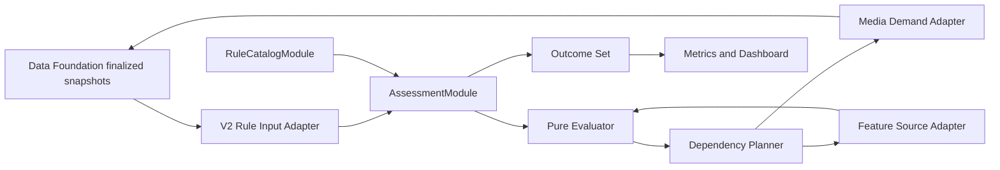
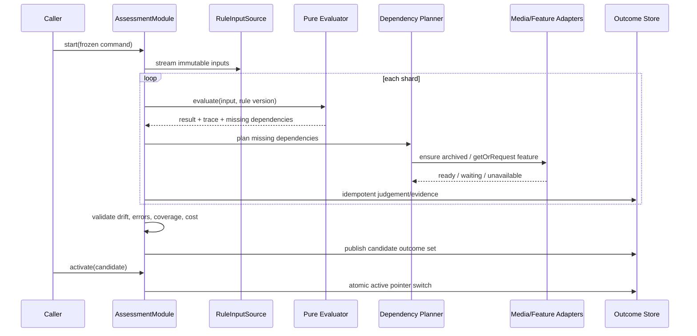

# Rule Engine Design（旧草案）
> **状态**：`superseded` / `archived`（2026-11-16）

> **替代文档**：[`.kiro/specs/d-rule-engine/`](../../.kiro/specs/d-rule-engine/design.md)（requirements / design / tasks / acceptance 四件套）

> **禁止用途**：不得作为实现依据；其 `AssessmentItem`、`composite`、分项完成率、同平台多账号聚合、`OutcomeSet` 的 item→run 映射都已被 D 域 PRD v1.2 与新 spec 取代。保留只为追溯 2026-09 的技术思路。


> **模式**：Design-First；本轮重构历史技术设计，不包含 requirements/tasks  
> **适用范围**：考核项、规则目录、纯求值、依赖规划、运行与证据、结果激活及下游契约  
> **所属域**：D 规则与考核 · **目录命名**：旧名 `rule-engine`，按域代号应为 `d-rule-engine`；本目录当前只有 design.md（`requirements.md` 已从仓库移除）  
> **最近核对**：2026-10-29（偏差见文末附录）  
> **2026-11-04 已知过时**（以 D 域 PRD v1.1 §2.0.2 为准，正文未改，`d-rule-engine` 开工时重写）：
> 1. 判定模型改为「内容逐层过滤，再按专员聚合」（D-71）：同一条内容须满足全部层条件；内容 / 评论 / 账号各一条要求、各一个达标方式；**没有** `composite` 跨考核项组合、没有分项完成率；
> 2. 一个专员在同一平台最多一个账号（D-69），且一个计划只有一个平台；本文「同一专员同平台多个账号的聚合策略」与开放项 5 **不再存在**，账号级只判那一个账号；
> 3. 开放项 6 已由 D-65 关闭（不排除同步异常）；零内容规则见 D-D14 修订（同步失败或有缺口 → 未获取成功）。
> **更新日期**：2026-09-02

## 1. Overview

规则引擎把版本化数据事实转换为可解释、可重放的业务结论。它不是对 `contents` 当前行做一次布尔判断，而是对以下不可变输入求值：

```text
终态内容/主页快照
+ ContentDiscovery / AccountAssignment 上下文
+ 固定规则与算子版本
+ 版本化媒资和派生特征
+ 冻结的活动范围与时间边界
```

设计采用两个生命周期不同的深模块：

1. `CollectionDecisionModule`：同步批次内决定是否补抓详情/评论；输出采集决定，不输出活动考核结论；
2. `AssessmentModule`：对活动考核项执行异步、可恢复、可重放的业务判定。

两者可共享表达式内核和 Operator Registry，但输入、状态、结果粒度和激活方式必须分开。首个规则实现 Spec 是否同时交付两者仍是开放决定。



## 2. Design Authority and Migration Rule

优先级：

1. [`CONTEXT.md`](../../CONTEXT.md)：身份、归属、发现、快照、ValueState 和媒资不变量；
2. [`database-design-v2.md`](../domains/data-foundation/database-design-v2.md)：数据底座实体、状态、事务和当前接入契约；
3. [`b-access-control/design.md`](../../.kiro/specs/b-access-control/design.md)：Capability、DataScope、异步范围交集与当前查询授权语义；
4. 本设计：规则域拥有的规则、运行、证据和 outcome；
5. 历史输入：[`hbecho-模块设计-规则引擎.md`](prd-drafts/hbecho-模块设计-规则引擎.md)。

历史设计中的产品能力可被吸收，但旧 DDL、SQL、表名和组织假设不是实施基线。本文刻意不定义物理 schema。

## 3. Goals and Non-goals

### 3.1 Goals

- `AssessmentItem` 是业务一等概念：稳定 ID、别名、规则版本和达标方式；
- 规则版本不可变，发布、试运行、差异和历史结果可追溯；
- Operator 是纯函数，无 IO；外部依赖由模块内部规划和恢复；
- 表达式使用受限 DSL、三值逻辑、短路和成本排序；
- SQL/查询下推只做保守剪枝，绝不能排除内存中本应命中的对象；
- 输入固定到终态快照、发现/归属和版本，不沿 current 指针漂移；
- 技术失败、等待、不适用、范围排除和业务不命中分别表达；
- 新 run 完整写入与验证后原子激活，旧结果无空窗；
- 判定证据能解释实际求值、短路、依赖、版本和历史归属；
- 规则按需请求媒资/特征，但不直接写数据底座内部表；
- 向指标域输出 campaign-level 一致 `OutcomeSet`，避免混用不同运行版本。

### 3.2 Non-goals

- 不实现供应商 HTTP、列表 checkpoint、ODS 或数据底座 current 选择；
- 不实现 OCR/ASR/视觉模型算法；
- 不渲染报表、Excel 或看板，不重新定义指标口径；
- 不定义 User、Role 或 DataScope，只消费授权上下文；
- 不把活动 UI、规则向导 UI 或审批界面当作本模块接口；
- 不复制 v2 的 30 表，不把规则字段追加到 finalized 快照；
- 不默认启用 MySQL 分区、Redis 锁或某个队列/ORM；
- 不把旧 `Staff`、主账号、结构化 hashtags 或 `sync_status='ok'` 假设带入新设计。

## 4. Domain Alignment and Ownership

### 4.1 Rule-owned concepts and unresolved cross-domain contract

除 `AttributionSnapshot` 外，下表概念由规则域拥有。`AttributionSnapshot` 只是当前设计所需的跨域合同占位；owner、schema、freeze time 在 P0 决定前不得由规则域或指标域单方面建模。

| 概念 | 说明 |
|---|---|
| `CampaignScopeRevision` | 活动公共范围的不可变版本；含业务时间窗及解析后的 UTC 半开区间 |
| `AssessmentItem` | 别名、对象类型、规则版本与达标方式的业务聚合 |
| `RuleDefinition` / `RuleVersion` | 稳定规则身份和不可变表达式版本 |
| `OperatorDefinition` | 参数 schema、对象类型、依赖信号、成本、实现版本和下推能力 |
| `EvaluationRun` | 一次固定输入、范围、版本和 evaluator build 的执行 |
| `InputManifest` | run 实际读取的快照、discovery、assignment 或可确定重建的冻结选择 |
| `Judgement` | 一个版本化 subject occurrence/profile 的业务结果 |
| `EvidenceBundle` | 输入、节点、版本、值状态、媒资/特征和失败依据 |
| `ParticipantFact` | 活动参与资格及排除原因，是指标完成率分母的权威来源 |
| `OutcomeSet` | campaign 级原子一致结果 token，冻结 item→run 映射和参与者集合 |
| `AttributionSnapshot` | **Owner unresolved**；运行需要冻结组织稳定 ID，但 owner、schema、冻结时点和主档变化策略须由数据底座/规则/指标/访问控制共同裁决 |

### 4.2 Data-foundation facts consumed

- 稳定身份：`contents`、`external_accounts`；
- 观察：`content_snapshots`、`account_profile_snapshots`；
- 发现与归属：`content_discoveries`、`staff_account_assignments`；
- 组织：`media_staff`、`stores`、`brands`、`sectors`、`branches`、`regions`、`dealers`；
- 媒资：`media_references`、`media_assets`；
- 质量/覆盖：同步任务、连续性缺口和 `data_quality_issues` 的只读摘要。

规则域不得创建 `staffs`、`staff_accounts`、`staff_store_relations`、平台账号或媒资平行主档。

### 4.3 Correct input grains

内容型规则的默认 grain 是 **content occurrence**：

```text
content_snapshot_id + discovery_id + assignment_id
```

同一 `content_snapshot` 可能有多个 discovery；必须保留每个列表出现及其历史归属。账号型规则的 grain 是：

```text
profile_snapshot_id + assignment_id
```

仅保存 `content_id` 或 `account_id` 会让历史输入跟随 current 漂移，也无法表达账号转移和多 discovery。

## 5. Deep Module Interfaces

### 5.1 RuleCatalogModule

```ts
interface RuleCatalogModule {
  validate(draft: RuleDraft): Promise<RuleValidation>;
  dryRun(command: DryRunCommand): Promise<DryRunReport>;
  publish(command: PublishRuleCommand): Promise<RuleVersionRef>;
}
```

接口隐藏 schema 校验、Operator manifest、版本递增、试运行抽样、费用估算、差异分析和发布审计。调用方不拼表达式 SQL，也不直接改 current version。

### 5.2 AssessmentModule

```ts
interface AssessmentModule {
  start(command: StartAssessmentCommand): Promise<EvaluationRunRef>;
  getStatus(run: EvaluationRunRef): Promise<EvaluationRunStatus>;
  explain(query: ExplainJudgementQuery): Promise<JudgementExplanation>;
  activate(command: ActivateOutcomeSetCommand): Promise<OutcomeSetRef>;
}
```

接口隐藏输入选择、分片、下推、求值、依赖恢复、验证和原子激活。调用方提交业务意图，不控制 Worker 重试或写 judgement。

### 5.3 CollectionDecisionModule

```ts
interface CollectionDecisionModule {
  decide(input: ListObservedContent, policies: FrozenCollectionPolicySet): FollowupDecision;
}
```

它是低延迟纯决策接口，输出详情/评论需求、decision ID、policy version 和原因。`sync_batches.detail_rule_version/comment_rule_version` 在批次开始时冻结；数据底座负责把决定落入后续 `sync_tasks`。活动 assessment 不能用该接口的结果代替 judgement。

### 5.4 Internal seams

```ts
interface RuleInputSource {
  streamContentOccurrences(selection: FrozenInputSelection): AsyncIterable<ContentOccurrenceInput>;
  streamAccountProfiles(selection: FrozenInputSelection): AsyncIterable<AccountProfileInput>;
}

interface MediaDemand {
  ensureArchived(request: MediaDemandRequest): Promise<DependencyState>;
}

interface FeatureSource {
  getOrRequest(request: FeatureRequest): Promise<FeatureState>;
}
```

这些 seam 把 v2 查询、下载任务、识别能力和测试 fake 隔开。AssessmentModule 的外部接口不暴露 polling、event、cache 或 task ID 细节。

## 6. Rule and Expression Model

### 6.1 Assessment item types

保留三类业务语义：

| 类型 | 输入 | 达标方式 |
|---|---|---|
| `content_based` | content occurrence | 某参与者在窗口内命中数量达到阈值 |
| `account_based` | 固定 profile snapshot + assignment | 指定平台账号观察是否满足规则 |
| `composite` | 其他 assessment item 的 achievement | 按显式 AND/OR 组合，不重新求值底层表达式 |

“综合完成”是否自动 AND 全部计入项还是业务可编辑，仍待确认。同一专员同平台多个账号不能使用已不存在的 `is_primary` 假设，必须单独定义聚合策略。

### 6.2 Restricted expression DSL

```ts
type Expr =
  | { type: 'and'; children: Expr[] }
  | { type: 'or'; children: Expr[] }
  | { type: 'not'; child: Expr }
  | { type: 'op'; nodeId: string; operator: string; params: unknown };
```

发布时校验：

- 全部 Operator 对象类型与规则一致；
- 参数通过版本化 schema；
- `nodeId` 在版本内稳定且唯一；
- 树深、节点数和高成本节点数有上限；
- 含高成本依赖时必须先完成不产生新付费调用的 dry-run；
- 引用已废弃 Operator 或未冻结实现版本时拒绝发布；
- 向导表单与执行表达式同时版本化，向导升级不改历史语义。

### 6.3 Applicability and three-valued logic

结构适用性在布尔表达式之前判断：例如图文没有音轨属于 `not_applicable`，不是未知，也不请求 ASR。对适用 subject，表达式使用 Kleene 三值：

- `and`：任一 false 为 false；否则有 unknown 为 unknown；否则 true；
- `or`：任一 true 为 true；否则有 unknown 为 unknown；否则 false；
- `not unknown = unknown`；
- 缺失但可补齐的信号为 unknown。

最终结果映射：

| 条件 | Subject outcome |
|---|---|
| 表达式 true | `matched` |
| 表达式 false | `not_matched` |
| 结构不适用 | `not_applicable` |
| 依赖仍可能补齐 | `waiting` |
| 依赖终态失败、单位未知或无法可靠解释 | `indeterminate` |
| 不在活动范围 | `excluded_scope`，不是 judgement false |
| 保守预过滤排除 | `excluded_prefilter`，可 explain/replay |

技术失败绝不能转换为 `not_matched`。

### 6.4 Cost tiers and conservative pushdown

- 便宜、确定、无外部 IO 的节点先求值；
- short-circuit 跳过的节点也记录原因；
- 下推只沿 AND 必要条件收集，遇到 OR/NOT 停止；
- 每个可下推 Operator 的契约测试必须证明：

```text
PushdownCandidates ⊇ InMemoryMatches
```

v2 没有结构化 hashtags 数组；`tag_text` 的提取/归一化版本未决定前，不能使用旧 `JSON_OVERLAPS(hashtags, ...)`。`content_kind` 使用 v2 的 `unknown/video/image/text/mixed`，不伪造旧 `video/note` 列。

## 7. Frozen Inputs and Evidence

### 7.1 Input selection

Assessment run 创建时冻结：

- campaign scope revision；
- Asia/Shanghai 业务日期解析成的 UTC `[from,to)`；
- assessment item 与 rule/operator/evaluator versions；
- snapshot 选择策略与 cutoff；
- participant set revision；
- DataScope/执行授权摘要；
- 输入 manifest 或足以确定重建的 batch/snapshot ID 集合。

活动考核只读取 `snapshot_status='finalized'` 的内容快照。`building` 只可用于同步期 collection decision，不进入正式 outcome。

### 7.2 ValueState and time

- `0` 是有效值；`missing/explicit_null/invalid` 不转成 0；
- duration 只有 `state='value'` 且单位已知时才能比较；
- `published_at` 缺失的处理必须由规则/活动策略明确为 waiting、indeterminate 或排除；
- `response_received_at`、`snapshot_at`、`published_at` 和 run `computed_at` 不互相冒充；
- 数据库时间按 UTC，业务自然日只在范围解析时使用 Asia/Shanghai。

### 7.3 EvidenceBundle

长期证据至少包含：

- campaign、assessment item、rule version、run/outcome set；
- operator key、实现与参数 schema version、node ID 和参数指纹；
- content/profile snapshot、batch、discovery、assignment 和 AttributionSnapshot；
- 实际使用值、ValueState、单位和观察时间；
- media reference/asset、SHA-256、role/slot 和 archive status；
- feature capability/model/prompt/extractor version、参数指纹和置信度；
- 每个实际求值、短路、跳过、范围排除和依赖失败节点；
- evaluator build、logical cutoff 和评估时间。

`provider_call_id` 可用于保留期内追踪，但 ODS 一年后会删除，不能作为长期解释的唯一证据。

## 8. Evaluation and Dependency Flow

### 8.1 Main assessment sequence



### 8.2 Media and feature demand

1. 只使用绑定当前输入 snapshot 的 `media_references`；
2. `archived + verified` 是无争议可用素材；
3. 缺少素材时，通过 `MediaDemand` 请求数据底座创建或复用 `download_media` 任务；规则域不直写 `sync_tasks`；
4. 请求携带 snapshot、content/account、assignment、rule decision/version 和稳定幂等键；
5. 下载成功后由数据底座按完整字节 SHA-256 归档；媒资失败不改 finalized 快照；
6. 识别 Adapter 以 asset SHA + capability/version + params fingerprint 复用或生成特征；
7. 状态变化通过事件或轮询恢复受影响 judgement；具体通知机制尚未冻结；
8. `carried_forward` 不证明本轮当前图未变化，默认不能无标记地用于“当前图匹配”。

### 8.3 Resume and idempotency

- 同一 assessment item 同时只允许一个冲突执行，但机制不预设 Redis；
- judgement 的幂等键包含 run + subject grain；
- dependency request 使用稳定指纹，Worker 重启不重复付费事实；
- 恢复只重算受影响 subject，不全量重跑；
- 重复完成事件无副作用；
- run 取消后旧 fencing/lease 不得继续写结果。

## 9. Run, Outcome and Activation States

### 9.1 Run lifecycle

```text
planned → running ↔ waiting_dependencies → validating
        → ready_to_activate → active → superseded
        → failed | cancelled
```

run lifecycle 与 subject outcome 分开。`partial` 不是含糊的万能状态；coverage、waiting 和 indeterminate 通过统计与发布策略表达。

### 9.2 Validation gates

激活前至少检查：

- 输入数量、候选数量和命中率相对旧 active outcome 的漂移；
- waiting/indeterminate/not-applicable/coverage gap 比例；
- Operator error、schema drift 和未知 ValueState；
- 高成本调用实际值与 dry-run 估算偏差；
- participant 分子是否为分母子集；
- item→run 映射是否完整且来自同一 candidate outcome set；
- 强制激活是否有有权 actor、理由和审计。

阈值属于配置和业务决定，旧稿中的 50%/30%/20%/1% 仅是历史建议，不是本设计硬编码。

### 9.3 Atomic activation

所有新 judgement/evidence/achievement 完整写入后，原子切换 campaign-level active OutcomeSet。旧 outcome 在切换前持续服务，切换失败不产生空窗。单个 item 分别切 active 而缺少 campaign token 会让点检表混合版本，因此不允许作为最终下游合同。

## 10. Downstream Contract

### 10.1 OutcomeSet interface

```ts
interface RuleOutcomeReader {
  getOutcomeSet(campaignId: string): Promise<OutcomeSetDescriptor>;
  streamParticipants(outcomeSetId: string): AsyncIterable<ParticipantFact>;
  streamScopedContents(outcomeSetId: string): AsyncIterable<ScopedContentFact>;
  streamItemOutcomes(outcomeSetId: string): AsyncIterable<ItemOutcomeFact>;
  explainOutcome(query: ExplainRequest, scope: DataScope): Promise<JudgementExplanation>;
}
```

`OutcomeSetDescriptor` 固定 campaign scope、item→run versions、participant revision、source batches、cutoff 和 attribution schema version。指标域只通过该接口消费结果，不 JOIN 规则内部表或重新实现 composite。

### 10.2 Three business views

规则域提供事实，不负责渲染：

1. **全量数据事实**：活动范围内所有 content occurrence，包括未命中、待定和质量状态；
2. **命中业务事实**：至少命中一个 item 的 occurrence，带证据引用；
3. **参与者与达标事实**：staff × item × outcome set 的 achievement 和 pending/indeterminate。

旧稿“一条内容一行”与 v2 多 discovery 存在冲突。默认保留 occurrence grain；若产品要 content 去重展示，指标/报表层必须显式定义 `attributions[]` 或 content-participation grain，不能静默丢归属。

## 11. Authorization, Cost and Audit

- 规则查看、编辑、试运行、发布、重算、强制激活和证据查看分别使用 Capability；
- campaign applicability 不是授权；所有查询和 explain 经当前 DataScope；
- run 保存授权摘要，但异步执行使用提交范围与执行时当前范围交集；
- 原始 ODS、手机号和正式媒资仍需各自敏感权限；
- dry-run 不发起未缓存付费调用，只估算成本；
- 大范围回溯必须指定范围、显示预计调用/费用并经过成本守卫；
- 规则发布、参数/阈值、重算、强制激活和人工结案追加写审计。

## 12. Failure Semantics

| 情形 | 语义 |
|---|---|
| 不在 CampaignScope | `excluded_scope`，不是 false |
| 保守下推排除 | `excluded_prefilter`，必须可解释 |
| Operator 正常判否 | `not_matched` |
| subject 结构不适用 | `not_applicable`，不触发依赖 |
| 字段/素材/特征仍可补齐 | `waiting` |
| 依赖终态失败、单位未知、证据不可靠 | `indeterminate` |
| sync task pending/running/retry_wait | 继续 waiting，不凭任务状态猜业务结果 |
| task failed/dead/cancelled | indeterminate 或人工策略，不变成 not_matched |
| continuity gap | outcome coverage warning，不推断未出现内容为 false |
| Operator 异常/schema 漂移 | run error；达到阈值阻断激活 |
| ODS 已过期 | 历史解释依赖长期 snapshot/media/feature evidence，不要求调用 body 永存 |
| DataScope 收缩 | 查询结果立即收缩，历史 outcome 本身不改写 |

## 13. Observability

至少记录：

- 每 run 的 scope/input/candidate/matched/not_matched/waiting/indeterminate/not_applicable；
- 各成本层候选漏斗、短路率、下推比例及下推等价性抽样；
- run 状态耗时、等待年龄和缺失原因；
- 媒资/特征请求、缓存命中、复用、重试、失败、carried-forward 年龄；
- rule/operator/evaluator/model/prompt version 的错误率、置信度和成本；
- continuity gap、ValueState 覆盖和数据质量问题；
- 新旧 outcome 漂移、人工批准和原子激活失败。

关联键包括 `evaluationRunId`、`outcomeSetId`、`assessmentItemId`、`contentSnapshotId`、`discoveryId`、`assignmentId`、`mediaReferenceId`、`mediaAssetId` 和依赖任务引用。日志不写临时签名 URL 或模型 secret；手机号按明文记录（B 域 PRD v1.9）。

## 14. Verification and Acceptance Boundaries

1. 输入 Adapter 只使用 v2 当前实体；历史规则文档中的旧表名不出现在实现查询；
2. Assessment 不读取 building snapshot，run 固定输入 ID/选择版本；
3. 账号转移、多 discovery、返回作者不同均不串错或改写历史归属；
4. `0/missing/explicit_null/invalid` 与 duration unit 全链路保真；
5. Asia/Shanghai 自然日正确转换为 UTC 半开区间；
6. 技术失败绝不产生业务 `not_matched`；
7. 每个可下推 Operator 都验证候选超集性质；
8. Operator evaluate 无 IO，可由纯 fixture 单测；
9. 规则按需媒资经过 Adapter 和幂等数据底座任务，不直接写 v2 表；
10. Evidence 在 ODS 到期后仍可解释使用的 snapshot、规则、算子、媒资和特征版本；
11. 新 OutcomeSet 原子激活，旧结果无空窗，重复事件不制造重复事实；
12. 指标域使用单一 outcomeSetId，不混合 item run；
13. explain 同时展示使用、跳过、范围排除、等待和终态失败节点；
14. 成本、漂移、长期 waiting 和 Operator error 闸门可配置、可观察、可审计。

## 15. Migration from Legacy Design

以下旧假设被明确淘汰：

- `staff_accounts`、`staffs`、`staff_store_relations`、`dealers.brand/sector`；
- `contents.title/published_at/duration/hashtags` 当前行模型；
- `staff_accounts.is_primary`；
- `sync_status='ok'` 作为候选条件；
- `content_features(content_id)` 不带 snapshot/asset/version 的缓存键；
- `judgements.org_snapshot` 由查询时当前组织临时重建；
- MySQL `ENUM`、旧 DDL、默认分区和旧 SQL；
- 素材终态失败自动写 `not_matched`；
- 先删旧结果再重算；
- 将表 1/2 强制为一条 content 一行而不处理多 discovery。

可保留并重构的能力包括：考核项、公共范围、Operator Registry、不可变 RuleVersion、受限 DSL、三值逻辑、成本剪枝、dry-run、证据、突变闸门、原子切换和三类业务输出。

## 16. Open Decisions

### P0 before requirements/tasks

1. 首个 Rule Engine Spec 是否同时实现 CollectionDecisionModule 和 AssessmentModule；
2. 活动 assessment 的 snapshot 选择策略：指定 batch、截止时点 as-of，还是运行开始时冻结 current；
3. 内容结果 grain 和多 discovery/共创计数规则；
4. ~~历史归属按 discovery 时 assignment 还是 published_at 回溯~~ —— 已关闭：**判定按执行时的当前归属**，已保存结果不因改绑回溯改写（2026-10-29）；
5. 同一专员同平台多账号的账号型考核聚合策略；
6. participant 集合是否排除同步异常，及 coverage 质量指标；
7. `published_at` 缺失和 `content_kind` 归一化策略；
8. 四平台 tag/hashtag 抽取、归一化和版本；
9. 派生特征的 owner、事实键、保留期与失效策略；
10. 媒资/特征完成通知采用事件还是轮询；批次结束后媒资需求如何关联新 task；
11. carried-forward 素材是否允许判当前图及最大陈旧期；
12. run 是否允许带 waiting/indeterminate 激活，以及如何进入 achievement；
13. AttributionSnapshot owner、schema 和组织主档变更策略；
14. 长期重放是否保存旧 operator executable，还是只保证可解释、不保证原二进制执行。

### Product decisions retained as open

- 综合完成自动 AND 还是可编辑 composite；
- `metric.gte` 和互动观察基准何时启用；
- 通用规则跨品牌可见性；
- 考核项跨活动复制；
- 大 dry-run 的分层抽样阈值；
- OCR 是否可一票否决、frames 是否首版开放；
- 视频下载预算、审批阈值和各类漂移阈值。

## 17. Operator Catalog（2026-10-28 定稿）

> 来源：三层向导的业务操作（D 域 PRD §2）。本节只列**能力目录**，不定义物理 schema。
>
> 状态含义：**1.0 / 2.0** 启用；**暂不添加** 清单保留但暂不注册，等业务提出时再加（2026-10-29 决策：没有被业务操作消费的算子先不做）；**搁置** 随刷流量一起暂缓；**admin** 仅研发应急。

### 17.1 第 1 层 · 基础筛选（0 档，只用列表与主页字段）

| 算子 | 业务操作 | 依赖信号 | 状态 |
|---|---|---|---|
| `published.within_window` | 发布时间在窗口内 | `content.published_at` | 1.0 |
| `published.on_dates` | 发布在指定日期（多个） | `content.published_at` | 暂不添加 |
| `platform.in_list` | 平台属于某几个 | `content.platform` | 1.0（公共条件注入） |
| `content_type.equals` | 内容形态等于 | `content.kind` | 1.0（公共条件注入） |
| `duration.between` | 视频时长在区间 | `content.duration_sec` | 1.0 |
| `image.count_gte` | 图文图片数量 ≥ N | `content.image_count` | 1.0 |
| `text.contains_all` | 文本含全部关键词 | `text.title_normalized`、`text.body_normalized` | 1.0 |
| `text.contains_any` | 文本含任一关键词 | 同上 | 1.0 |
| `hashtag.includes_all` | 话题含全部 | `text.hashtags` | 1.0 |
| `hashtag.includes_any` | 话题含任一 | `text.hashtags` | 1.0 |
| `metric.like.gte` | 点赞数 ≥ N | `content.like_count` | 1.0 |
| `metric.comment.gte` | 评论数 ≥ N | `content.comment_count` | 1.0 |
| `metric.collect.gte` | 收藏数 ≥ N | `content.collect_count` | 1.0 |
| `metric.share.gte` | 转发数 ≥ N | `content.share_count` | 1.0 |
| `in_campaign.is_true` | 在活动参与范围内 | 无（名单注入） | 1.0（隐式） |
| `mention.includes` | @ 提及某人 | `text.mentions` | 暂不添加 |
| `poi.in_list` | 位置在列表 | `text.poi` | 暂不添加 |
| `link.contains` | 正文含链接 | `text.links` | 暂不添加 |
| `content.author_is_account` | 作者就是被采集账号 | `content.author_id` | 暂不添加 |
| `store_tier.in_list` | 门店等级属于 | 组织事实 | 暂不添加 |
| `certified.is_true` | 专员已认证 | 组织事实 | 暂不添加 |
| `sync_health.is_ok` | 同步状态正常 | 同步事实 | 暂不添加 |
| `text.regex` | 正则匹配 | `text.title_normalized`、`text.body_normalized` | admin |

### 17.2 第 2 层 · 素材比对（1–3 档，输出 0–10 分，阈值由业务定）

| 算子 | 业务操作 | 依赖信号 | 状态 |
|---|---|---|---|
| `image.matches_reference` | 图和标准图是不是同一张 | `content.cover_template_score` / `account.bg_template_score` / `account.avatar_template_score`（按 target） | 1.0 |
| `image.contains_element` | 图里有没有这张元素图 | `content.cover_element_score` / `account.bg_element_score` / `account.avatar_element_score`（按 target） | 1.0 |
| `image.contains_text` | 图里有没有这些字 | `content.cover_ocr_text` / `account.bg_ocr_text` / `account.avatar_ocr_text`（按 target） | 2.0 |

### 17.3 第 3 层 · 内容理解（2–3 档）

| 算子 | 业务操作 | 依赖信号 | 形态 | 状态 |
|---|---|---|---|---|
| `speech.contains` | 口播提到某些词 | `content.asr_text` | 判定算子 | 2.0 |
| `speech.matches_standard` | 口播内容符合标准 | `content.asr_judgement` | 判定算子（读 AI 信号） | 2.0 |
| `vision.matches_standard` | 画面内容符合标准 | `content.vision_judgement` | 判定算子（读 AI 信号） | 2.0 |
| `vision_frame.contains_element` | 关键帧里出现某元素 | `content.frame_element_score` | 判定算子 | 2.0 |
| `ai.judge` | 多信号综合判定 | `content.ai_judgement` | 判定算子（读 AI 信号） | 2.0 |
| `comment.text_contains` | 评论正文含关键词 | `comment.text_normalized` | 判定算子 | 1.0 |
| `comment.author_is_account` | 评论作者是某账号 | `comment.author_id` | 判定算子 | 1.0（待 ID 对齐验证） |
| `comment.count_anomaly` | 评论数异常 | `content.comment_count_ratio` | 判定算子 | 搁置 |
| `comment.emoji_ratio_gte` | 表情占比 ≥ N | `content.comment_emoji_ratio` | 判定算子 | 搁置 |
| `comment.duplicate_ratio_gte` | 重复率 ≥ N | `content.comment_duplicate_ratio` | 判定算子 | 搁置 |
| `content.engagement_anomaly` | 互动量偏离账号常态 | `content.engagement_ratio` | 判定算子 | 搁置 |
| `content.play_engagement_ratio` | 播放互动比异常 | `content.play_ratio` | 判定算子 | 搁置 |
| `content.rank_top_percent` | 账号内排名前 N% | `content.rank_percentile` | 判定算子 | 搁置 |

### 17.4 三条硬约束

1. **`requiredSignals` 静态声明，不随参数变化。** 因此互动数拆成四个算子，而不是一个 `metric.gte(metric: ...)`——后者只能把四个信号全声明，导致「只要点赞却因分享缺失判 `signal_missing`」。
2. **第 3 层判定算子不调模型**，只读 C 已产出的判定信号（D 域 PRD §2.5 做法 B）。真正调模型的是 C 的识别能力，结果落库并带模型与提示词版本。
3. **评论比率是内容级聚合**，挂在 `content` 对象上，不是单条评论。

### 17.5 对 §16 的影响

2026-10-28 已关闭或收窄的开放项：

| §16 项 | 现状 |
|---|---|
| 8. 四平台 tag/hashtag 抽取、归一化和版本 | 1.0 只做抖音与小红书；归一化规则见 C 域 PRD §4.2 |
| 9. 派生特征的 owner、事实键、保留期与失效策略 | owner = C；保留期按 3 个月申诉期分档（C 域 PRD §6.4） |
| 10. 媒资/特征完成通知 | 1.0 用轮询（C 域 PRD 13.6 建议），事件机制 2.0 |
| 11. carried-forward 是否允许判当前图 | 不允许（C 域 PRD §5.5） |
| `metric.gte` 何时启用 | 已拆为四个 `metric.*.gte`，1.0 启用；互动基线类搁置 |

---

## 附录：已知过时内容（2026-10-29 核对）

> 本节只记录偏差，不修改正文。§17 算子目录本身已按 2026-10-28 / 10-29 的 D 域与 C 域结论对齐。

| # | 位置 | 原写法 | 现处理或当前事实 | 来源 |
|---|---|---|---|---|
| 1 | §17.3 第 3 层 | 三个评论刷量算子原标 **1.0** | 已改为**搁置**（刷评、刷表情随 D 域 §4 一起搁置） | D 域 PRD §4 |
| 2 | §16 标题 | “P0 before requirements/tasks” | 本目录 `requirements.md` 已从仓库移除，当前只有 design.md；何时补写 requirements / tasks 未定 | git 记录 |
| 3 | 日志字段 | 原写「日志不写完整手机号」 | 已按 2026-10-30 决定改为手机号明文可记录；签名 URL 与模型 secret 仍不写 | D-42、B 域 PRD v1.9 |
