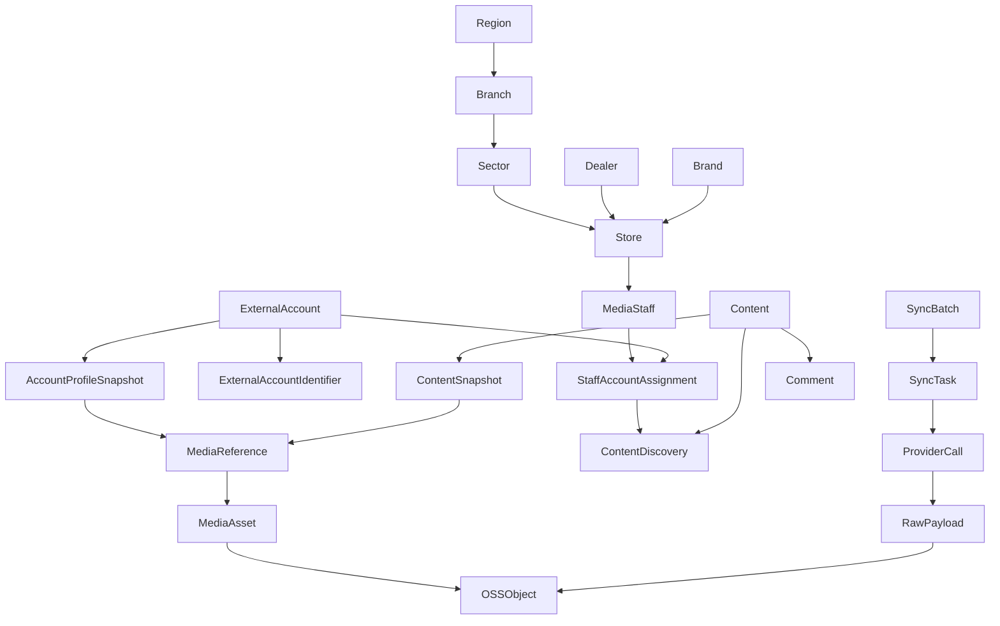

# hbecho 数据底座数据库详细设计 v2

- **目标数据库**：MySQL 8.0.16+（InnoDB）
- **对象存储**：私有 OSS
- **开发语言**：TypeScript、Python
- **文档状态**：`draft`（2026-10-27 起，待 A 域 PRD 逐表复核；复核前不作为建表依据）
- **设计日期**：2026-09-02
- **表数量**：28
- **前版关系**：v1 的历史正文保留并已标 archived；本文件是依据新业务口径重新设计的唯一当前 v2
- **待修订（2026-10-27 起）**：① §8.3 归属表去掉有效区间，改为账号上的当前归属；② §10.3 取消独立 `content_discoveries`，位置信息并入内容快照；③ §12.5–§12.6 去掉跨账号 fan-in；④ §20 验收项 3 改为“一个账号只有一条当前归属”；⑤ §9.2 批次状态增加 `queued`（串行排队）

---

## 1. 结论与边界

### 1.1 最终结论

v2 采用五层模型：

1. **组织与稳定身份层**：品牌、组织、经销商、门店、专员、平台账号和账号归属；
2. **同步控制层**：全局计划、批次、任务、租约、重试和列表检查点；
3. **一年期 ODS 层**：每次真实 HTTP 交互的请求 body、响应 body 或传输错误原文，以及脱敏调用元数据；
4. **长期业务快照层**：账号主页快照、内容批次快照、列表出现记录和评论最新态；
5. **长期媒资层**：OSS 对象、SHA-256 字节资产和快照媒资引用。

v1 的 37 张表压缩并补齐业务主档后，v2 共 30 张表。主要简化：

- 删除 `monitoring_targets`，账号监控职责进入账号归属；
- 删除 `projection_runs`，快照保存 `adapter_version`，必要时使用维护脚本；
- 内容描述与指标合并为每内容每批次一条 `content_snapshots`；
- current 指针合入 `external_accounts` 和 `contents`；
- 评论三层合并为一张最新态表；
- OSS 媒资从 12 张压缩为 3 张，下载任务复用同步任务；
- 不预留当前没有证据的供应商私有内容标识表；
- 新增 `import_batches` 与 `import_row_results` 两张导入审计表（2026-11-02）：主数据导入与名单导入共用，失败行与冲突行长期可查、可重试。

### 1.2 本轮范围

纳入：

- 经销商、门店、新媒体专员和平台账号主档；
- 抖音、小红书、视频号、快手的数据获取；
- 定时全量同步和新账号手工补抓；
- 账号主页、内容、互动指标的长期批次快照；
- 一级评论最新态；
- ODS 原始调用证据；
- 头像、背景图、封面、图文图片、视频和音频归档；
- 数据质量问题与批次进度。

不纳入：

- 活动、关键词、规则定义和规则执行结果；
- 头像、背景、封面和视频内容合规；
- AI、ASR、OCR、视觉特征；
- 管理员、角色、权限和 DataScope；
- 指标字典、看板、报表和导出任务实现；
- 旧库数据迁移；
- 多租户隔离。

规则引擎只通过稳定契约接入：读取批次内容快照，输出详情/评论采集决策 ID 与规则版本；规则表不属于本文。

### 1.3 已确认规模

参考规模：约 2,000 个经销商、3,000 个门店、3,500 名专员、6,000 个跨平台账号；一万个账号以内不改变架构。

按 6,000 账号、每周两次估算：

- 账号主页快照约 62.4 万条/年；
- 若以每次首个完整返回页约 20 条估算，内容批次快照约 1,248 万条/年；供应商单页可能返回 21 条或更多，容量与处理逻辑不得把 20 当硬上限；
- ODS 原始字节和正式媒资进入 OSS，MySQL 保存结构化数据和控制面；
- 初期使用普通 InnoDB 与组合索引，不启用 MySQL 原生分区。

数据库不是主要成本瓶颈，外部 API 配额、媒资下载流量和 OSS 容量更重要。

---

## 2. 证据与样本事实

### 2.1 raw3 回验范围

`aimaster接口文档/测试结果/raw3` 共 25 个 JSON，均为成功样本：

| 动作 | 文件数/实体数 | 已验证平台 |
|---|---:|---|
| `media_user_info` | 3 | 小红书、抖音 |
| `user_video_list` | 3，内容 61 条 | 小红书、抖音 |
| `media_stats_number` | 10 | 小红书、抖音、视频号 |
| `post_comments_list` | 9，评论 57 条 | 小红书、抖音 |

raw3 未覆盖：失败响应、完整异步轮询链、快手全链路、视频号主页/列表/评论、真实回复对象。v2 通过 ODS 保真、动作状态、值状态和数据质量问题承接这些未知，不宣称已验证。

### 2.2 必须承接的类型与语义差异

| 样本事实 | v2 规则 |
|---|---|
| 请求动作 `media_stats_number`，返回动作 `media_stats` | 请求动作与响应动作分列，不能要求相等 |
| 小红书主页 ID 与列表作者 ID 值形态不同 | 使用账号标识命名空间和主导作者绑定规则 |
| 抖音同时返回 `user_id` 与 `sec_uid` | 作为同账号的不同官方标识 |
| 外部 ID 可能超过 JavaScript 安全整数 | 所有外部 ID 按文本保存和传输 |
| `*_count` 与 `*_number` 并存 | 适配器先判断字段存在性；真实零有效，null/缺失未知 |
| `has_more` 有 boolean 与 0/1 | ODS 保留原类型，业务层归一为布尔 |
| `max_cursor` 有整数、字符串、空字符串 | 使用类型保真的游标封装 |
| `cover` 为字符串或数组 | 归一成一个封面角色和有序候选地址 |
| `download_urls` 为数组或换行字符串 | 适配器展开候选地址，ODS 保留原字节 |
| 列表与详情字段、指标可能不同 | 同批次后来获得的有效字段覆盖，null/缺失不擦除 |
| 列表目标与返回作者不同 | 默认共创；保存列表出现与返回作者，不建共创账号/关系 |
| 评论有 `reply_count` 但没有回复实体 | 只保存回复数量，不构造回复树 |
| 视频号封面地址可能等于下载地址 | 下载后按 SHA-256 精确归一，不靠字段名判定字节身份 |

### 2.3 时间口径

- 数据库业务时间统一保存 UTC `DATETIME(6)`；
- 全局调度使用 `Asia/Shanghai` 解释；
- 供应商 13 位 epoch 按毫秒转换，10 位按秒转换；
- `provider_updated_at` 是供应商时间，可能为空；
- `response_received_at` 是系统收到并持久化响应的时间；
- 同批次先后顺序为 `response_received_at`，相同时以 `provider_call_id` 决胜；
- 投影或维护脚本执行时间不得冒充数据获取时间。

---

## 3. 核心业务不变量

1. 经销商、门店、专员、平台账号必须分离；一个门店单品牌，经销商可多品牌。
2. 专员只属于一个门店；归属型账号同一时间只属于一名专员，外部型账号没有专员归属；归属变更不迁移历史。
3. 分公司、经销商、门店、专员、账号五级共同决定实际监控状态；外部型账号没有上级链，只由自身开关决定。
4. 账号不合并；昵称和主页链接不是账号身份。
5. 账号普通采集失败不改变状态；`deleted` 只能由运营人工确认。
6. 每个已经返回的列表页面必须完整处理；检查点只决定是否继续请求下一页。
7. 列表最前 3 条按可能置顶处理，但仍入库、更新、参与规则筛选和媒资处理。
8. 每账号每批次最多一份主页快照；每内容每批次最多一份最终合并快照。
9. 同批次后来有效值和真实零覆盖；null、缺失、非法值不擦除已有有效值。
10. 较新逻辑批次优先；旧批次迟到不能使 current 倒退。
11. 评论只保存最新态；只有完整获取全部一级评论后，缺失才可标记疑似删除。
12. ODS 保留一年；结构化快照、评论最新态和正式媒资长期保留。
13. 临时 URL 不是媒资身份；下载字节 SHA-256 是唯一精确去重依据。
14. 业务主档与历史数据不使用 `ON DELETE CASCADE`。

---

## 4. 总体关系模型



### 4.1 30 张表总览

| 分组 | 表 |
|---|---|
| 平台参考（3） | `platforms`, `data_providers`, `identifier_namespaces` |
| 组织主档（7） | `brands`, `regions`, `branches`, `sectors`, `dealers`, `stores`, `media_staff` |
| 账号与画像（4） | `external_accounts`, `external_account_identifiers`, `staff_account_assignments`, `account_profile_snapshots` |
| 同步、导入与 ODS（9） | `sync_settings`, `sync_batches`, `sync_tasks`, `sync_checkpoints`, `ods_provider_calls`, `ods_payloads`, `data_quality_issues`, `import_batches`, `import_row_results` |
| 内容与评论（4） | `contents`, `content_snapshots`, `content_discoveries`, `comments` |
| OSS 与媒资（3） | `oss_objects`, `media_assets`, `media_references` |

---

## 5. MySQL 全局规范

### 5.1 数据库与类型

```sql
CREATE DATABASE media_platform
  CHARACTER SET utf8mb4
  COLLATE utf8mb4_0900_ai_ci;
```

| 语义 | 类型/规则 |
|---|---|
| 内部主外键 | signed `BIGINT`；TypeScript 使用 `bigint`，API 输出字符串 |
| 外部 ID | `VARCHAR(2048)` + `BINARY(32)` SHA-256；绝不转整数 |
| 业务编码 | `VARCHAR(64)`，二进制排序规则，稳定后不可修改 |
| 计数 | signed `BIGINT` + 非负检查 |
| 时间 | UTC `DATETIME(6)` |
| 未确认单位数值 | `DECIMAL(20,6)` |
| 状态 | `VARCHAR(32)` + `CHECK`，不用 MySQL `ENUM` |
| 可变参数/摘要 | MySQL `JSON`；高频筛选字段不得只放 JSON |
| SHA-256 | `BINARY(32)` |
| URL/口令原文 | `LONGTEXT` + SHA-256，不索引完整文本 |

连接建立后统一设置 `time_zone='+00:00'`。人类文本用 `utf8mb4_0900_ai_ci`；平台标识、代码、对象 key 使用二进制排序规则。

### 5.2 值状态

指标状态统一为：

```text
value | missing | explicit_null | invalid
```

约束：

```sql
CHECK (
  (state = 'value' AND value IS NOT NULL AND value >= 0)
  OR
  (state IN ('missing','explicit_null','invalid') AND value IS NULL)
)
```

`0` 属于有效值；禁止 `COALESCE(value, 0)` 把未知变成零。

### 5.3 外键与删除

- 业务主档、身份、快照、评论和正式媒资默认 `ON UPDATE RESTRICT ON DELETE RESTRICT`；
- 所有长期业务表指向一年期调用的字段统一使用可空 FK + `ON DELETE SET NULL`，包括主页快照、内容快照、列表出现、评论、媒资引用和数据质量问题中的来源调用；
- 检查点指向一年期任务的 `cursor_task_id/last_successful_task_id` 使用 `ON DELETE SET NULL`，任务的 `parent_task_id` 也使用 `ON DELETE SET NULL`；
- ODS 到期按远端原始字节、payload、call、task 和无引用 ODS 对象元数据的显式顺序清理，不得级联删除业务快照；
- 业务对象使用停用、结束区间或逻辑状态，不物理删除。

### 5.4 current 指针

`external_accounts.current_profile_snapshot_id` 与 `contents.current_snapshot_id` 均可空，且业务写入只能选择自身已终态化的快照。数据库复合外键强制“只能指向自身快照”；受限仓储事务在切换前锁定候选快照并验证其已终态化，业务账号没有绕过该写路径直接更新 current 的权限：

```text
external_accounts(account_id, current_profile_snapshot_id)
  -> account_profile_snapshots(account_id, profile_snapshot_id)
contents(content_id, current_snapshot_id)
  -> content_snapshots(content_id, content_snapshot_id)
```

两张快照表分别提供 `UQ(account_id, profile_snapshot_id)`、`UQ(content_id, content_snapshot_id)`；先建根表和快照表，再用 `ALTER TABLE` 添加上述循环复合 FK。

更新 current 只比较 `(sync_batches.logical_at, sync_batches.batch_id)`。同一内容或账号在同一批次只有一份快照，因此同批次后续响应只更新该 `building` 行，不切换指针；快照 `finalized` 后，才在同一事务中尝试切换 current。`logical_at` 创建后不可修改，`batch_id` 仅用于逻辑时间相同的确定性决胜。旧批次迟到不得覆盖较新批次。

### 5.5 版本化 JSON 的 canonical bytes 与摘要

`data-foundation-tracer-command.v1` 和 `dominant-list-author-evidence.v1` 的摘要统一使用 **RFC 8785 JSON Canonicalization Scheme (JCS)**：closed schema 先拒绝重复 key、未知字段、非法类型和 schema 未允许的 absent/null，再按 JCS 生成 UTF-8、无 BOM bytes，最后计算完整 SHA-256。禁止依赖语言默认 serializer、MySQL JSON 内部文本形态或输入 key 顺序。

附加不变量：

- JSON string 保留输入的 exact Unicode code point sequence；摘要前不得执行 NFC/NFD、大小写、空白、URL 或数字文本归一化；
- 内部 `BIGINT` 和 batch ID 在 JSON 中使用十进制 string；外部 ID、locator 也始终是 exact string；
- limit 与 author count 使用 schema 约束范围内的 JSON integer；两个 schema 都禁止浮点数、指数形式和非有限数；
- command v1 的 5 个字段全部必有且非 null；evidence v1 的字段全部必有，只有 rejected decision 的 `candidate_identifier` 可以显式为 null；
- 摘要保存为 32 bytes `BINARY(32)`；日志或验收向量展示时才编码为小写 hex。

跨实现验收向量 1（代码块内容为一行 JCS UTF-8 bytes；其中 `\n` 是 JSON escape，不是实际换行）：

```json
{"effective_initial_content_limit":20,"home_locator_exact_utf8":"https://www.xiaohongshu.com/user/profile/测试?x=\"a\"&line=一\n二","media_staff_id_decimal":"9007199254740993","platform_id_decimal":"2","schema_version":"data-foundation-tracer-command.v1"}
```

```text
SHA-256 = 7dcf255d17be6de663a23e92310bb0f835e00b6cb223d46a9a2c8abd0bf8ec36
```

跨实现验收向量 2：

```json
{"author_counts":[{"count":21,"identifier":"5decba2300000000010007e1"}],"candidate_identifier":{"count":21,"namespace":"xiaohongshu.content.user_id","value":"5decba2300000000010007e1"},"decision":"accepted","empty_author_entry_count":0,"evidence_batch_id":"42","non_empty_author_entry_count":21,"policy_version":"xhs-dominant-author.v1","reason":"unique_highest_and_policy_passed","schema_version":"dominant-list-author-evidence.v1","total_entry_count":21}
```

```text
SHA-256 = 2ecbbeebd4d015bb5685d288c0230ab92646f1d0cba08a0937b2a5def673b36d
```

TypeScript、Python、SQL migration fixture 与任何其他实现必须对上述 exact bytes 产生相同摘要；不一致时禁止写入幂等键或 binding evidence。

---

## 6. 平台参考表（3）

### 6.1 `platforms`

**作用**：平台主档；平台身份不与供应商混合。

字段：`platform_id BIGINT PK`；`platform_code VARCHAR(64) NOT NULL`；`platform_name VARCHAR(128) NOT NULL`；`status VARCHAR(32) NOT NULL`；`created_at/updated_at DATETIME(6) NOT NULL`。

约束/索引：`UQ(platform_code)`；状态为 `active/inactive`。初始化 `douyin/xiaohongshu/wechat_channels/kuaishou`。

### 6.2 `data_providers`

**作用**：数据供应商主档，支持未来同平台多供应商。

字段：`provider_id BIGINT PK`；`provider_code VARCHAR(64) NOT NULL`；`provider_name VARCHAR(128) NOT NULL`；`base_endpoint VARCHAR(512) NULL`；`status VARCHAR(32) NOT NULL`；`created_at/updated_at DATETIME(6) NOT NULL`。

约束/索引：`UQ(provider_code)`；状态为 `active/inactive`；认证密钥只存密钥系统。

### 6.3 `identifier_namespaces`

**作用**：定义账号外部标识的语义和比较边界。

字段：`namespace_id BIGINT PK`；`namespace_code VARCHAR(128) NOT NULL`；`platform_id BIGINT NOT NULL FK`；`provider_id BIGINT NULL FK`；`description VARCHAR(512) NOT NULL`；`status VARCHAR(32) NOT NULL`；`created_at/updated_at DATETIME(6) NOT NULL`。

约束/索引：`UQ(namespace_code)`；`IDX(platform_id, status)`。首批包括 `douyin.user_id`、`douyin.sec_uid`、`xiaohongshu.profile.user_id`、`xiaohongshu.content.user_id` 及视频号、快手账号空间。

---

## 7. 组织主档（7）

### 7.1 `brands`

字段：`brand_id BIGINT PK`；`brand_code VARCHAR(64) NOT NULL`；`brand_name VARCHAR(128) NOT NULL`；`status VARCHAR(32) NOT NULL`；`created_at/updated_at DATETIME(6) NOT NULL`。

约束/索引：`UQ(brand_code)`、`UQ(brand_name)`；编码可由后台生成；名称视为稳定主档值。

### 7.2 `regions`

字段：`region_id BIGINT PK`；`region_code VARCHAR(64) NOT NULL`；`region_name VARCHAR(128) NOT NULL`；`status VARCHAR(32) NOT NULL`；`created_at/updated_at DATETIME(6) NOT NULL`。

约束/索引：`UQ(region_code)`；编码由后台生成；状态为 `active/inactive`。

### 7.3 `branches`

字段：`branch_id BIGINT PK`；`region_id BIGINT NOT NULL FK`；`branch_code VARCHAR(64) NOT NULL`；`branch_name VARCHAR(128) NOT NULL`；`status VARCHAR(32) NOT NULL`；`monitoring_enabled BOOLEAN NOT NULL DEFAULT TRUE`；`created_at/updated_at DATETIME(6) NOT NULL`。

约束/索引：`UQ(branch_code)`；`UQ(region_id, branch_name)`；`IDX(region_id, status)`。

### 7.4 `sectors`

字段：`sector_id BIGINT PK`；`branch_id BIGINT NOT NULL FK`；`sector_code VARCHAR(64) NOT NULL`；`sector_name VARCHAR(128) NOT NULL`；`status VARCHAR(32) NOT NULL`；`created_at/updated_at DATETIME(6) NOT NULL`。

约束/索引：`UQ(sector_code)`；`UQ(branch_id, sector_name)`；`IDX(branch_id, status)`。板块表示产品线/业务类型，不表示地理片区。

### 7.5 `dealers`

字段：`dealer_id BIGINT PK`；`dealer_code VARCHAR(64) NULL`；`dealer_name VARCHAR(200) NOT NULL`；`status VARCHAR(32) NOT NULL`；`monitoring_enabled BOOLEAN NOT NULL DEFAULT TRUE`；`created_at/updated_at DATETIME(6) NOT NULL`。

约束/索引：`UQ(dealer_code)`（MySQL 允许多个 null）；`IDX(dealer_name)`；`IDX(status, monitoring_enabled)`。`dealer_code` 在 CRM 提供前可空，首次写入稳定编码后不得随名称修改。

### 7.6 `stores`

字段：

- `store_id BIGINT PK`；
- `store_code VARCHAR(64) NOT NULL`；
- `store_name VARCHAR(200) NOT NULL`；
- `dealer_id/brand_id/sector_id BIGINT NOT NULL FK`；
- `store_tier VARCHAR(64) NULL`；
- `status VARCHAR(32) NOT NULL`：`active` / `closed`；
- `monitoring_enabled BOOLEAN NOT NULL DEFAULT TRUE`；
- `source_batch_id BIGINT NULL FK`：最近一次写入该行的 `import_batches`；
- `created_at/updated_at DATETIME(6) NOT NULL`。

约束/索引：`UQ(brand_id, store_code)`；`IDX(dealer_id, status)`；`IDX(brand_id, status)`；`IDX(sector_id, status)`；`IDX(source_batch_id)`。

门店单品牌：`brand_id` 是门店身份的一部分，不是可变属性。名称、等级、经销商、板块更新当前值，不保留变化历史（2026-11-02 决策，推翻「经销商 / 品牌 / 板块不可变」）。

`store_id` 是唯一权威身份，门店编码只是属性。门店编码在全公司一个编号池内使用，同一编码在每个品牌下最多一条，因此唯一键是 `(brand_id, store_code)`；编码变更不改变 `store_id`。

`status='closed'` 只由有权限的人在导入差异确认或主数据修正时写入。**导入不会因为某行在文件中消失就自动关闭门店**——消失只产生待确认项，因为导出范围和编码变更都可能造成同样的现象。

### 7.7 `media_staff`

字段：`staff_id BIGINT PK`；`store_id BIGINT NOT NULL FK`；`staff_name VARCHAR(100) NOT NULL`；`phone VARCHAR(32) NOT NULL`；`status VARCHAR(32) NOT NULL`；`monitoring_enabled BOOLEAN NOT NULL DEFAULT TRUE`；`created_at/updated_at DATETIME(6) NOT NULL`。

约束/索引：`UQ(phone)`；`IDX(store_id, status, monitoring_enabled)`。手机号先规范化再比较，明文保存；姓名不唯一。该记录代表门店/品牌业务身份。

---

## 8. 账号身份、归属与主页快照（4）

### 8.1 `external_accounts`

**作用**：稳定平台账号根，不保存昵称等可变画像。

字段：

- `account_id BIGINT PK`；
- `platform_id BIGINT NOT NULL FK`；
- `status VARCHAR(32) NOT NULL DEFAULT 'active'`；
- `status_reason VARCHAR(256) NULL`；
- `status_changed_at DATETIME(6) NULL`；
- `current_profile_snapshot_id BIGINT NULL`；
- `current_profile_selected_at DATETIME(6) NULL`；
- `first_seen_at/last_seen_at DATETIME(6) NOT NULL`；
- `created_at/updated_at DATETIME(6) NOT NULL`。

状态：`active/unavailable/deleted`。普通失败不改状态；明确暂不可访问可设 `unavailable`；`deleted` 只能人工确认；重新验证可恢复 `active`。

索引：`IDX(platform_id, status, last_seen_at)`、`IDX(current_profile_snapshot_id)`。

### 8.2 `external_account_identifiers`

字段：

- `account_identifier_id BIGINT PK`；`account_id/namespace_id BIGINT NOT NULL FK`；
- `identifier_value VARCHAR(2048) NOT NULL`；`identifier_sha256 BINARY(32) NOT NULL`；
- `binding_method VARCHAR(32) NOT NULL`；`confidence VARCHAR(16) NOT NULL`；
- `binding_policy_version VARCHAR(64) NULL`；
- `binding_evidence JSON NULL`；`binding_evidence_sha256 BINARY(32) NULL`；
- `evidence_batch_id BIGINT NULL FK`；
- `first_seen_at/last_seen_at DATETIME(6) NOT NULL`；`created_at DATETIME(6) NOT NULL`。

约束/索引：`UQ(namespace_id, identifier_sha256)`，哈希命中后必须复核原文；`IDX(account_id, namespace_id)`；`IDX(evidence_batch_id)`。`binding_method` 包括 `same_payload/dominant_list_author/provider_mapping/manual`；`confidence` 为 `observed/verified`。四个 evidence 字段必须同空同非空；`binding_method='dominant_list_author'` 时四者必须全部非空，`evidence_batch_id` 指向长期保留的 `sync_batches` 并使用 `ON DELETE RESTRICT`。

自动绑定证据使用版本化 `dominant-list-author-evidence.v1`：

```json
{
  "schema_version": "dominant-list-author-evidence.v1",
  "decision": "accepted",
  "reason": "unique_highest_and_policy_passed",
  "policy_version": "<version>",
  "evidence_batch_id": "<decimal BIGINT>",
  "candidate_identifier": {
    "namespace": "xiaohongshu.content.user_id",
    "value": "<exact text>",
    "count": 21
  },
  "total_entry_count": 21,
  "non_empty_author_entry_count": 21,
  "empty_author_entry_count": 0,
  "author_counts": [
    { "identifier": "<exact text>", "count": 21 }
  ]
}
```

`author_counts` 必须覆盖该完整页所有非空作者、按 identifier 的 exact UTF-8 bytes 确定性排序，count 之和必须等于 `non_empty_author_entry_count`；`total_entry_count = non_empty_author_entry_count + empty_author_entry_count`。成功行要求 `decision='accepted'`，candidate namespace/value 必须与本标识行精确一致，JSON 中 policy/batch 必须分别等于列值。`binding_evidence_sha256` 按 §5.5 对 closed `dominant-list-author-evidence.v1` 生成 RFC 8785 JCS bytes 后计算；受限身份写入过程必须在提交前验证 shape、计数、列值、canonical bytes 和摘要，并通过 §5.5 验收向量。

小红书自动绑定规则：同一主页任务产生的完整列表页中，只有出现次数唯一最高且通过版本化 policy 的作者 ID 才能作为内容场景标识。成功决策将上述 evidence 与首次建立的 identifier 一起长期、不可变保存；后续重放只更新 observation 时间，不覆盖首次绑定证据。tie、空集合、唯一但未过阈值或异常分布不猜测、不创建 identifier，而是在长期 `data_quality_issues` 中要求 `batch_id` 非空，并以同一 evidence schema 保存 `decision='rejected'`、exact counts、denominator 和 reason；此时 candidate 可为 null。列表少数其他作者只进入内容快照，不创建账号。

一年期 task、ProviderCall 与 raw payload 清理后，成功 identifier 仍可仅凭 policy version、canonical evidence、摘要和长期 batch 引用解释绑定决定；拒绝决定仍可由长期质量问题解释。两条路径都不得把一年期 ODS 引用作为唯一证据。

### 8.3 `staff_account_assignments`

**作用**：账号的当前监控对象。表名沿用 v1，语义扩展为「谁在关注这个账号」：`watch_type='staff'` 时是原有的专员归属；`watch_type='external'` 时是外部监控对象（竞品、官方号），没有门店与专员。

字段：

- `assignment_id BIGINT PK`；
- `watch_type VARCHAR(16) NOT NULL DEFAULT 'staff'`：`staff` / `external`；
- `staff_id BIGINT NULL FK`；`account_id BIGINT NOT NULL FK`；
- `monitoring_enabled BOOLEAN NOT NULL DEFAULT TRUE`；
- `current_home_locator LONGTEXT NOT NULL`、`current_home_locator_sha256 BINARY(32) NOT NULL`；
- `previous_home_locator LONGTEXT NULL`、`previous_home_locator_sha256 BINARY(32) NULL`；
- `resolved_home_url LONGTEXT NOT NULL`、`resolved_home_url_sha256 BINARY(32) NOT NULL`；
- `valid_from DATETIME(6) NOT NULL`；
- `valid_to DATETIME(6) NULL`；
- `ended_reason VARCHAR(128) NULL`；
- `active_account_guard BIGINT GENERATED`：有效记录时等于 `account_id`，否则 null；
- `created_at/updated_at DATETIME(6) NOT NULL`。

约束/索引：`CHECK ((watch_type='staff' AND staff_id IS NOT NULL) OR (watch_type='external' AND staff_id IS NULL))`；`UQ(active_account_guard)` 保证一个账号在当前只有一条记录，两种类型都适用；`valid_to > valid_from`；上一入口值与摘要同空同非空；`IDX(staff_id, valid_from, valid_to)`；`IDX(account_id, valid_from)`；`IDX(watch_type, monitoring_enabled)`。

**两种类型的行为差异**：

| | `staff` | `external` |
|---|---|---|
| 归属 | 门店 → 专员 → 经销商 → 组织链 | 无 |
| 实际监控 | 五级状态与开关共同计算 | 只取账号状态与自身开关，没有上级链 |
| 15 天无计划引用自动停采 | 适用 | **不适用**，纯开关控制（2026-11-02 决策） |
| 数据范围 | 组织子树 × 品牌 | 默认只有平台级可见 |
| 创建入口 | 活动计划名单导入 | 外部账号监控清单（仅超管） |

`external` 型与竞品、官方号共用一套表达：业务上它们都只是「被观察的账号」，不区分归属主体（2026-11-02 决策，放弃第三型 `brand`）。

运营提交账号后先创建 `resolve_account` 任务，最多解析 3 次。全部失败时不创建账号和归属，但任务与 ODS 保留一年。若已存在账号归属于他人，不自动抢占，创建归属冲突问题等待人工处理。

### 8.4 `account_profile_snapshots`

字段：

- `profile_snapshot_id BIGINT PK`；
- `batch_id/account_id/assignment_id/provider_id BIGINT NOT NULL FK`；
- `source_provider_call_id BIGINT NULL`；
- `nickname VARCHAR(512) NULL`；`signature LONGTEXT NULL`；`location VARCHAR(256) NULL`；
- `follower_value/following_value/like_value/post_value BIGINT NULL`；
- 对应 `follower_state/following_state/like_state/post_state VARCHAR(32) NOT NULL`；
- `provider_updated_at DATETIME(6) NULL`；
- `response_received_at DATETIME(6) NOT NULL`；
- `adapter_version VARCHAR(64) NOT NULL`；
- `created_at DATETIME(6) NOT NULL`。

约束/索引：`UQ(batch_id, account_id)`；`UQ(account_id, profile_snapshot_id)` 供账号 current 复合 FK 引用；四组 value/state 检查；`IDX(account_id, batch_id)`；`IDX(assignment_id, batch_id)`。主页失败不创建空快照；创建成功即为不可变的终态快照。头像和背景图通过可独立推进归档状态的 `media_references` 关联，不改变主页快照终态。结构化快照长期保留；`source_provider_call_id` 为 `ON DELETE SET NULL`，ODS 到期后可置空。

---

## 9. 同步控制、导入审计、ODS 与质量问题（9）

### 9.1 `sync_settings`

**作用**：全系统单例同步配置，不使用无类型的通用键值表。

字段：

- `settings_id TINYINT PK DEFAULT 1`；
- `timezone VARCHAR(64) NOT NULL DEFAULT 'Asia/Shanghai'`；
- `schedule_slots JSON NOT NULL`：一或两个 `{weekday,time}`；
- `initial_content_limit INT NOT NULL DEFAULT 20`；
- `list_safety_page_limit INT NOT NULL`；
- `comment_page_limit INT NULL`；`comment_item_limit INT NULL`；
- `account_resolve_max_attempts INT NOT NULL DEFAULT 3`；
- `task_max_attempts INT NOT NULL`；
- `config_version BIGINT NOT NULL`；
- `updated_by_actor VARCHAR(128) NULL`；
- `created_at/updated_at DATETIME(6) NOT NULL`。

约束：`settings_id=1`；`JSON_LENGTH(schedule_slots) BETWEEN 1 AND 2`；`initial_content_limit BETWEEN 1 AND 20`；各上限为正；评论页数/条数至少配置一项。`initial_content_limit` 只是在完整页面之间判断是否继续请求的本地目标，不限制供应商单页实际返回条目数；即使单页返回超过 20 条也必须全部处理。管理员权限由权限模块控制，本文只保存操作者引用。

### 9.2 `sync_batches`

字段：

- `batch_id BIGINT PK`；`batch_key BINARY(32) NOT NULL`；
- `trigger_type VARCHAR(32) NOT NULL`：`scheduled/manual`；
- `logical_at DATETIME(6) NOT NULL`：跨批次新旧排序基准；
- `status VARCHAR(32) NOT NULL`：`planned/running/succeeded/partial_succeeded/failed/cancelled/skipped`；
- `settings_version BIGINT NOT NULL`；`settings_snapshot JSON NOT NULL`；
- `detail_rule_version/comment_rule_version VARCHAR(128) NULL`；
- `planned_task_count/succeeded_task_count/failed_task_count/skipped_task_count/gap_task_count BIGINT NOT NULL DEFAULT 0`；
- `skip_reason VARCHAR(128) NULL`；
- `started_at/finished_at DATETIME(6) NULL`；
- `created_at/updated_at DATETIME(6) NOT NULL`。

约束/索引：`UQ(batch_key)`；计数非负；`IDX(status, logical_at)`。错过计划不补跑；前一全量批次未完成时创建 `skipped` 摘要，不创建任务。批次长期保留。

### 9.3 `sync_tasks`

字段：

- `task_id BIGINT PK`；`batch_id BIGINT NOT NULL FK`；`parent_task_id BIGINT NULL`；
- `provider_id/platform_id BIGINT NOT NULL FK`；
- `assignment_id/account_id/content_id BIGINT NULL FK`；
- `requested_action VARCHAR(64) NOT NULL`；
- `subject_type VARCHAR(32) NOT NULL`；`subject_id BIGINT NULL`；
- `subject_key VARCHAR(2048) NULL`；`subject_key_sha256 BINARY(32) NULL`；
- `task_parameters JSON NOT NULL`；
- `rule_decision_id VARCHAR(256) NULL`；`rule_version VARCHAR(128) NULL`；`source_content_snapshot_id BIGINT NULL`；
- `idempotency_key BINARY(32) NOT NULL`：内部 logical effect 幂等键；
- `submitted_by_actor VARCHAR(128) NULL`；
- `caller_idempotency_key_sha256 BINARY(32) NULL`；`canonical_command_sha256 BINARY(32) NULL`；
- `status VARCHAR(32) NOT NULL`；`priority INT NOT NULL DEFAULT 0`；
- `attempt_count/max_attempts INT NOT NULL`；`next_attempt_at DATETIME(6) NULL`；
- `lease_owner VARCHAR(128) NULL`；`lease_expires_at DATETIME(6) NULL`；`fencing_token BIGINT NOT NULL DEFAULT 0`；
- `page_count/fetched_item_count BIGINT NOT NULL DEFAULT 0`；
- `oldest_published_at/newest_published_at DATETIME(6) NULL`；
- `has_more_at_stop BOOLEAN NULL`；`continuity_gap_detected BOOLEAN NOT NULL DEFAULT FALSE`；`window_overflow_detected BOOLEAN NOT NULL DEFAULT FALSE`；
- `stop_reason VARCHAR(64) NULL`；`result_summary JSON NULL`；
- `last_error_code VARCHAR(128) NULL`；`last_error_detail JSON NULL`；
- `started_at/finished_at DATETIME(6) NULL`；`expires_at DATETIME(6) NOT NULL`；`created_at/updated_at DATETIME(6) NOT NULL`。

动作：`resolve_account/fetch_profile/fetch_content_list/fetch_content_detail/fetch_comments/download_media`。

状态：`pending/leased/running/retry_wait/succeeded/succeeded_with_gap/failed/dead/cancelled`。

约束/索引：`UQ(idempotency_key)`；`UQ(submitted_by_actor, caller_idempotency_key_sha256)`；调用者幂等摘要、canonical command 摘要与 actor 对根命令必须同空同非空；`0 <= attempt_count <= max_attempts`；运行租约状态要求 owner/expiry；`window_overflow_detected=true` 必须同时有 `continuity_gap_detected=true`；`succeeded_with_gap` 必须有 continuity gap 和明确 `stop_reason`；`IDX(status, next_attempt_at, priority, task_id)`；`IDX(batch_id, status)`；`IDX(account_id, requested_action, created_at)`；`IDX(content_id, requested_action, created_at)`；`IDX(parent_task_id)`；`IDX(expires_at)`。

领取任务使用 `SELECT ... FOR UPDATE SKIP LOCKED`。fencing token 不只保护任务控制状态，也必须由受限写入过程校验后才能写业务快照、发现和评论；token 过期、任务非运行态或目标不匹配时整笔事务失败。同账号同动作已有活动任务时复用。任务创建时写入一年期 `expires_at`；`parent_task_id` 使用 `ON DELETE SET NULL`，任务详情到期后按清理闭包删除。

Tracer 提交映射为一个 `trigger_type='manual'` 的批次和一个根 `resolve_account` 任务；对外 `root_task_id` 即该根任务 `task_id`。根任务固定：`platform_id` 为提交平台，`subject_type='media_staff'`，`subject_id=media_staff_id`，`subject_key` 为原始 HomeLocator 且复核其摘要；后续 profile/list/media 阶段使用 `parent_task_id` 指向根任务。

根任务 `task_parameters` 必须通过版本化 `data-foundation-tracer-task-parameters.v1` persistence-projection schema，当前只允许：

```json
{
  "schema_version": "data-foundation-tracer-task-parameters.v1",
  "effective_initial_content_limit": 20
}
```

该两字段 projection 只承载没有独立列的命令参数，不是完整 canonical command，也不复用 `data-foundation-tracer-command.v1` 的 validator。完整 command aggregate 由根任务显式 platform/staff/locator 字段与本 projection 的 effective limit 组装，再由 command v1 closed schema 校验和摘要。

`effective_initial_content_limit` 等于调用方显式提供的 1～20，未提供时复制本批次冻结的 `sync_settings.initial_content_limit`；未知字段拒绝。`canonical_command_sha256` 的逻辑对象固定为 `{schema_version, platform_id_decimal, media_staff_id_decimal, home_locator_exact_utf8, effective_initial_content_limit}`，并按 §5.5 的 closed schema、RFC 8785 JCS bytes 与验收向量计算；两个内部 ID 使用十进制 string，locator 保留 exact Unicode text 且不得 normalization，limit 使用 JSON integer。原始 locator 由显式字段保留，不能只留 hash。相同 actor + caller idempotency key 命中时比较该摘要：相同则在一年任务保留窗口内返回原根任务，不同则报告冲突。`result_summary` 只承载可重建展示摘要，不能替代上述显式命令、幂等字段、任务状态或业务主档。账号标识 namespace 直接使用 §6.3 的注册代码，不由 tracer 另建命名空间。

### 9.4 `sync_checkpoints`

字段：

- `checkpoint_id BIGINT PK`；
- `account_id/provider_id BIGINT NOT NULL FK`；
- `action VARCHAR(64) NOT NULL DEFAULT 'fetch_content_list'`；
- `checkpoint_scope VARCHAR(64) NOT NULL DEFAULT 'default'`；
- `anchor_mode VARCHAR(16) NOT NULL`：`time/id_window/empty`；
- `high_watermark_published_at DATETIME(6) NULL`；
- `high_watermark_content_ids JSON NULL`；
- `cursor_envelope JSON NULL`；`cursor_sha256 BINARY(32) NULL`；
- `cursor_task_id BIGINT NULL`；
- `last_successful_batch_id BIGINT NULL FK`；`last_successful_task_id BIGINT NULL`；
- `continuity_status VARCHAR(32) NOT NULL`：`ready/in_progress/rebased_after_gap/blocked`；
- `last_gap_at DATETIME(6) NULL`；
- `version BIGINT NOT NULL DEFAULT 0`；
- `updated_at DATETIME(6) NOT NULL`。

约束/索引：`UQ(account_id, provider_id, action, checkpoint_scope)`；游标与摘要同空同非空；ID 集合必须为 JSON 数组；`time` 要求高水位时间非空，`id_window` 要求时间为空且 ID 集合非空，`empty` 要求时间为空且 ID 集合为空；`version >= 0`；`IDX(last_successful_batch_id)`。`cursor_task_id/last_successful_task_id` 是可空的一年期任务引用，均使用 `ON DELETE SET NULL`；批次引用长期保留。

游标使用类型保真封装，例如：

```json
{"kind":"string","value":""}
{"kind":"integer","lexeme":"0"}
{"kind":"null"}
```

#### 列表检查点算法

1. 首次采集没有旧锚点，`initial_content_limit<=20` 只是完整条目数的续页目标：供应商已返回的整个页面必须全部处理，即使单页超过 20 条；整页完成后若累计条目已达到目标即可停止并建立基线，不把供应商仍有更多历史页视为缺口；
2. 后续每页所有返回内容无论新旧都 upsert 内容、快照候选和发现记录，边界判断永远发生在整页处理之后；
3. 第一页位置 1～3 仅标记为可能置顶，不作为“命中旧 ID”或“跨过旧时间”的单独停止证据；第一页位置 4 以后和后续页全部位置属于正常时间序列；
4. `anchor_mode=time` 时，正常时间序列出现旧高水位 ID，或出现 `published_at` 严格早于旧高水位时间，才判定进入历史重叠区；等于高水位时间但 ID 不在旧集合中时继续；
5. `anchor_mode=id_window` 时，正常时间序列出现旧 ID 窗口中的任一内容才判定进入历史重叠区；`anchor_mode=empty` 没有可命中的历史边界，只抓本轮首个完整页面；
6. 第一页不足 4 条时仍完整处理；`has_more=true` 则按锚点规则继续，`has_more=false` 则按自然结束处理，绝不因前三条单独停止；
7. 命中历史重叠区后处理完当前整页，任务 `succeeded`，不再请求下一页；
8. 未命中且 `has_more=true` 时继续翻页；达到安全页数仍未命中时，任务为 `succeeded_with_gap`，设置 continuity gap 与 window overflow，`stop_reason=safety_limit_rebased`，记录数据质量问题且不创建自动续跑；
9. `has_more=false` 但仍未命中旧边界时，无法证明旧窗口连续，任务同样为 `succeeded_with_gap`，但 window overflow 为 false，`stop_reason=end_of_list_rebased`，记录数据质量问题；
10. 建立或重建锚点时，若本轮存在有效 `published_at`，使用全部返回内容的最大时间及同时间 ID 集合，模式为 `time`；若没有有效发布时间但有内容 ID，使用本轮第一页全部内容 ID 作为 `id_window`；
11. 首次采集返回空列表时建立 `empty` 锚点，任务成功；已有非空旧锚点的后续任务若返回空列表，则不能证明新基线，不覆盖旧锚点，检查点进入 `blocked`，任务 `succeeded_with_gap` 且 `stop_reason=empty_window_not_rebased`；后续计划任务仍允许抓首个页面，但在获得可用时间或 ID 前不追深页；
12. 两类可重建的 gap 按第 10 条建立新锚点，检查点进入 `rebased_after_gap`，下一周不追旧缺口；无法重建的空窗口按第 11 条保留旧锚点；
13. 可能置顶内容始终参与 upsert 和新锚点候选计算；旧置顶内容不会提高最大发布时间；
14. `succeeded_with_gap` 同时计入批次 `succeeded_task_count` 和 `gap_task_count`；任一 gap 使批次至少为 `partial_succeeded`，即使没有普通失败任务。

检查点只控制翻页，不过滤更新范围。

### 9.5 `ods_provider_calls`

字段：

- `provider_call_id BIGINT PK`；`sync_task_id/provider_id BIGINT NOT NULL FK`；`platform_id BIGINT NULL FK`；
- `attempt_no/call_sequence INT NOT NULL`；
- `requested_action VARCHAR(64) NOT NULL`；`expected_response_action VARCHAR(64) NOT NULL`；`response_action VARCHAR(64) NULL`；
- `endpoint VARCHAR(1024) NOT NULL`；`request_method VARCHAR(16) NULL`；
- `http_status SMALLINT NULL`；`provider_code VARCHAR(128) NULL`；
- `provider_task_id/provider_request_id VARCHAR(512) NULL`；`provider_task_status VARCHAR(64) NULL`；
- `call_status VARCHAR(32) NOT NULL`：`prepared/in_flight/terminal/ambiguous`；
- `outcome VARCHAR(32) NULL`；`transport_error JSON NULL`；
- `prepared_at/request_captured_at DATETIME(6) NOT NULL`；
- `send_started_at/response_received_at/finished_at DATETIME(6) NULL`；
- `elapsed_seconds DECIMAL(20,6) NULL`；`terminal_captured_at DATETIME(6) NULL`；
- `ambiguous_at/reconciled_at DATETIME(6) NULL`；`reconciliation_method VARCHAR(64) NULL`；`reconciled_by_provider_call_id BIGINT NULL`；
- `expires_at DATETIME(6) NOT NULL`。

状态字段矩阵如下。`requested_action` 与 `expected_response_action` 在创建 `prepared` intent 时由版本化 Adapter/capability 合同写入并终生不可变；`response_action` 只保存完整响应实际声明的 action，二者不得复用同一列，实际值与预期不一致时仍保留两值并分类为 `invalid_response`。矩阵直接使用列名；除 `provider_task_id/provider_request_id` 等可由请求上下文预先获知的 correlation metadata 外，状态字段未列入“必须非空”或“条件允许”时必须为 null。`response_action/http_status/provider_code/provider_task_status` 只能来自已捕获的响应证据，不能由预期值回填。

| call_status / outcome | 必须非空的状态字段 | 必须为空的状态字段 | 条件允许 | Payload/说明 |
|---|---|---|---|---|
| `prepared / null` | `prepared_at`, `request_captured_at` | `send_started_at`, `response_received_at`, `finished_at`, `elapsed_seconds`, `terminal_captured_at`, `ambiguous_at`, `reconciled_at`, `reconciliation_method`, `reconciled_by_provider_call_id`, `transport_error` | 无 | 仅有且必有 `request_body`；尚未允许发送 |
| `in_flight / null` | `prepared_at`, `request_captured_at`, `send_started_at` | `response_received_at`, `finished_at`, `elapsed_seconds`, `terminal_captured_at`, `ambiguous_at`, `reconciled_at`, `reconciliation_method`, `reconciled_by_provider_call_id`, `transport_error` | 无 | 仅有 `request_body`；已开始发送，等待确定结果 |
| `terminal / not_sent` | `prepared_at`, `request_captured_at`, `finished_at`, `terminal_captured_at` | `send_started_at`, `response_received_at`, `elapsed_seconds`, `ambiguous_at`, `reconciled_at`, `reconciliation_method`, `reconciled_by_provider_call_id`, `transport_error` | 无 | 发送前因取消、预算或本地策略封口；只有 request payload |
| `terminal / succeeded/http_error/provider_error/invalid_response` | `prepared_at`, `request_captured_at`, `send_started_at`, `response_received_at`, `finished_at`, `elapsed_seconds`, `terminal_captured_at`, `http_status` | `ambiguous_at`, `reconciled_at`, `reconciliation_method`, `reconciled_by_provider_call_id`, `transport_error` | response action/code/task/status 仅按完整 body 实际形态填写 | 必有完整 `response_body`，不得有 `transport_error` payload；只有该行设置 `response_received_at` |
| `terminal / transport_error` | `prepared_at`, `request_captured_at`, `send_started_at`, `finished_at`, `elapsed_seconds`, `terminal_captured_at`, `transport_error` | `response_received_at`, `ambiguous_at`, `reconciled_at`, `reconciliation_method`, `reconciled_by_provider_call_id` | 收到 headers 后 body 中断时 `http_status` 可非空 | 必有 `transport_error` payload；该终态只用于有证据确认远端 effect 未完成或可安全按新 attempt 重试的失败，部分响应 bytes 进入 error artifact，不得伪装成完整 `response_body` |
| `ambiguous / ambiguous` | `prepared_at`, `request_captured_at`, `send_started_at`, `ambiguous_at` | `response_received_at`, `finished_at`, `elapsed_seconds`, `terminal_captured_at`, `reconciled_at`, `reconciliation_method`, `reconciled_by_provider_call_id` | timeout/reset 等已捕获故障要求 `transport_error` 列和同 role payload；纯进程失联时二者可空 | 远端是否接收、完成或计费未知；不得有完整 `response_body`，禁止盲目重发 |
| reconciled `terminal / reconciled_succeeded/reconciled_failed` | `prepared_at`, `request_captured_at`, `send_started_at`, `finished_at`, `terminal_captured_at`, `ambiguous_at`, `reconciled_at`, `reconciliation_method`, `reconciled_by_provider_call_id` | `response_received_at`, `elapsed_seconds` | 保留原 ambiguous 的 transport error；provider task/request ID 只作 correlation | 原调用不伪造 response body；实际终态必须来自 `reconciled_by_provider_call_id` 指向的另一条已 capture ProviderCall |

合法转换只有 `prepared → in_flight | terminal(not_sent)`、`in_flight → terminal(succeeded/http_error/provider_error/invalid_response/transport_error) | ambiguous`、`ambiguous → terminal(reconciled_succeeded/reconciled_failed)`；terminal 不再转换。只有确认远端 effect 未完成或供应商幂等合同明确允许新 attempt 时，`transport_error` 才能作为可重试终态；否则必须进入 `ambiguous`。原调用上的 `provider_task_id/provider_request_id` 只能授权发起 bounded reconciliation lookup，不能单独证明远端终态。

`ambiguous → reconciled terminal` 只能由受限 reconciliation 写入事务完成：事务同时锁定原调用和 `reconciled_by_provider_call_id` 指向的非自身调用；要求两者 `sync_task_id/provider_id/platform_id` 一致、至少一个 provider task/request ID exact 匹配；目标调用必须已经是 terminal、`terminal_captured_at` 非空且拥有完整、完整性校验通过的 response payload；版本化 `reconciliation_method` 必须从该 captured payload 解码出同一 remote effect 的明确 terminal success 或 terminal failure，并分别唯一映射到 `reconciled_succeeded` 或 `reconciled_failed`。pending、invalid、correlation-only、自引用、其他 logical effect 或没有完整终态 payload 的调用都不能终态化原调用，原调用保持 `ambiguous`。

CHECK 约束按矩阵实现，并要求：reconciled 终态的 `reconciled_by_provider_call_id` 非空且不等于自身 ID；`send_started_at >= prepared_at`；完整响应 `response_received_at >= send_started_at`；ambiguous `ambiguous_at >= send_started_at`；普通 sent terminal `finished_at >= send_started_at`；reconciled terminal `finished_at >= reconciled_at >= ambiguous_at`；所有 terminal 的 `terminal_captured_at >= finished_at`；非空 `elapsed_seconds >= 0`。跨行相关性与 outcome 映射由上述受限事务强制。`reconciled_by_provider_call_id` 是可空一年期自引用并使用 `ON DELETE SET NULL`；清理器先删除引用该 reconcile call 且同样到期的原调用，避免把自引用作为唯一证明的存续行置空后违反 CHECK。索引：`UQ(sync_task_id, attempt_no, call_sequence)`；`IDX(provider_task_id)`；`IDX(provider_request_id)`；`IDX(reconciled_by_provider_call_id)`；`IDX(prepared_at, provider_call_id)`；`IDX(call_status, prepared_at)`；`IDX(outcome, finished_at)`；`IDX(expires_at)`。

每次提交、轮询、分页和重试都是独立调用。发送前必须先持久化 `prepared` call intent 及 exact request body；切到 `in_flight` 后才允许网络发送。若进程在发送后、终态落地前失去确定结果，该 call 进入 `ambiguous`：供应商幂等合同或 provider task/request ID 只能证明可以安全发起新 attempt/lookup，不能直接证明成功或失败；原调用的终态化必须遵守上述 captured reconcile-call 事务，否则停止盲目重发并进入人工/对账处理。调用元数据创建时写入一年期 `expires_at`，即使没有终态 payload 也可独立到期。API Key、Authorization、Cookie 等秘密不入库。

### 9.6 `ods_payloads`

字段：`payload_id BIGINT PK`；`provider_call_id BIGINT NOT NULL FK`；`payload_role VARCHAR(32) NOT NULL`；`content_type VARCHAR(255) NULL`；`content_encoding VARCHAR(64) NULL`；`oss_object_id BIGINT NOT NULL`；`object_category VARCHAR(32) NOT NULL DEFAULT 'ods'`；`byte_length BIGINT NOT NULL`；`sha256 BINARY(32) NOT NULL`；`parse_status VARCHAR(32) NOT NULL`；`adapter_version VARCHAR(64) NULL`；`parse_error VARCHAR(2048) NULL`；`captured_at DATETIME(6) NOT NULL`；`expires_at DATETIME(6) NOT NULL`。

约束/索引：`UQ(provider_call_id, payload_role)`；`UQ(oss_object_id)` 保证每个 ODS 对象只属于一个 payload、期限不会混用；`CHECK(object_category='ods')`；复合 FK `(oss_object_id, object_category)` 指向 `oss_objects`；role 为 `request_body/response_body/transport_error`；状态为 `not_attempted/parsed/invalid`；`not_attempted` 时 Adapter version 为空，`parsed/invalid` 时记录实际执行的版本；`byte_length>=0`；`IDX(expires_at)`；`IDX(sha256)`。

这里的“原始字节”精确定义为 HTTP 请求 body、响应 body 或传输错误原文；方法、端点、状态码和必要的非秘密调用信息结构化保存在 call 中，请求头与响应头不作为完整原始证据保存。所有 payload 压缩后存 OSS，不在 MySQL 保存 LONGBLOB 或重复 parsed JSON。先可靠保存原始 body 字节再解析；同一调用的 payload 及其专属 ODS 对象使用与 call 一致的一年期截止时间。

### 9.7 `data_quality_issues`

字段：

- `issue_id BIGINT PK`；`issue_fingerprint BINARY(32) NOT NULL`；
- `issue_code VARCHAR(128) NOT NULL`；`severity VARCHAR(16) NOT NULL`；`status VARCHAR(16) NOT NULL`；
- `entity_type VARCHAR(32) NULL`；`entity_id BIGINT NULL`；
- `batch_id/account_id/content_id/assignment_id BIGINT NULL`；
- `provider_call_id BIGINT NULL`；`json_path VARCHAR(1024) NULL`；
- `detail JSON NOT NULL`；`occurrence_count BIGINT NOT NULL DEFAULT 1`；
- `first_seen_at/last_seen_at DATETIME(6) NOT NULL`；
- `resolved_at DATETIME(6) NULL`；`resolution_note VARCHAR(1024) NULL`；
- `created_at/updated_at DATETIME(6) NOT NULL`。

约束/索引：`UQ(issue_fingerprint)`；severity 为 `info/warning/error/critical`；status 为 `open/acknowledged/resolved/ignored`；`IDX(status, severity, last_seen_at)`；`IDX(issue_code, last_seen_at)`；各业务 FK 索引。问题不自动删除；ODS 来源到期后可置空。

### 9.8 `import_batches`

**作用**：每一次主数据导入或名单导入的批次账。导入分「预检 → 确认 → 落库」三段，批次记录贯穿全程；没有它，失败行无法追溯、也无法重试。

字段：

- `import_batch_id BIGINT PK`；
- `import_kind VARCHAR(16) NOT NULL`：`master_data`（权威主档）/ `roster`（活动计划名单）；
- `plan_id BIGINT NULL`：`roster` 时必填，逻辑引用 A 域活动计划；`master_data` 时为空；
- `uploaded_by_user_id BIGINT NOT NULL`；`uploaded_at DATETIME(6) NOT NULL`；
- `file_name VARCHAR(512) NULL`；`file_sha256 BINARY(32) NULL`；`template_version VARCHAR(32) NULL`；
- `brand_scope JSON NULL`：本次可写入的品牌集合，用于解释被跳过的行；
- `total_rows INT NOT NULL`；`new_rows/skipped_rows/error_rows/conflict_rows INT NOT NULL DEFAULT 0`；
- `status VARCHAR(16) NOT NULL`：`prechecking / precheck_failed / awaiting_confirm / writing / completed / failed`；
- `confirmed_by_user_id BIGINT NULL`；`confirmed_at DATETIME(6) NULL`；
- `created_at/updated_at DATETIME(6) NOT NULL`。

约束/索引：`IDX(import_kind, uploaded_at)`；`IDX(plan_id, uploaded_at)`；status 取值受 CHECK 约束；批次不物理删除，失败批次保留以便重试与追责。

> 预检阶段只写本表与 `import_row_results`，不改业务表；确认后才进入 `writing`。这是「解析与落库分阶段」的落点，见 §12.1。

### 9.9 `import_row_results`

**作用**：批次内每一行的处理结果。它让「失败行留在页面可追溯、可重试」成为数据事实，而不是一份关掉就找不回的 CSV。

字段：

- `import_row_result_id BIGINT PK`；
- `import_batch_id BIGINT NOT NULL FK`；
- `row_no INT NOT NULL`：文件内行号，从 1 开始，不含表头；
- `raw_row JSON NOT NULL`：原始单元格按模板列名的快照，不做规范化；
- `outcome VARCHAR(32) NOT NULL`：`imported / unchanged / conflict / invalid`；
- `reason_code VARCHAR(64) NULL`；`reason_detail VARCHAR(1024) NULL`；
- `store_id/account_id/staff_id BIGINT NULL`：命中对象；
- `resolved_at DATETIME(6) NULL`；`resolved_by_user_id BIGINT NULL`；
- `created_at DATETIME(6) NOT NULL`。

约束/索引：`UQ(import_batch_id, row_no)`；`IDX(outcome, created_at)`；`IDX(store_id)`；`IDX(account_id)`；行结果与批次同寿命保留，不随业务数据删除。

| `outcome` | 含义 | 是否需要人处理 |
|---|---|---|
| `imported` | 本次写入成功 | 否 |
| `unchanged` | 与库中一致、未写入；名单中即「账号已存在且归属同一专员」 | 否 |
| `conflict` | 与既有事实冲突（归属他人、编码重复等） | 是 |
| `invalid` | 行级校验不通过（门店不存在、品牌不符、链接无效等） | 是 |

> 账号解析是异步的：`invalid` 中的「链接解析失败」可在解析失败后回写同一行，不新增第二行。

---

## 10. 内容、批次快照、列表出现与评论（4）

### 10.1 `contents`

字段：

- `content_id BIGINT PK`；`platform_id BIGINT NOT NULL FK`；
- `platform_content_id VARCHAR(2048) NOT NULL`；`platform_content_id_sha256 BINARY(32) NOT NULL`；
- `content_kind VARCHAR(32) NOT NULL DEFAULT 'unknown'`；
- `status VARCHAR(32) NOT NULL DEFAULT 'active'`；
- `status_reason VARCHAR(256) NULL`；`status_changed_at DATETIME(6) NULL`；
- `current_snapshot_id BIGINT NULL`；`current_snapshot_selected_at DATETIME(6) NULL`；
- `first_seen_at/last_seen_at DATETIME(6) NOT NULL`；
- `created_at/updated_at DATETIME(6) NOT NULL`。

约束/索引：`UQ(platform_id, platform_content_id_sha256)`，命中后复核原文；kind 为 `unknown/video/image/text/mixed`；status 为 `active/unavailable/deleted`；`IDX(platform_id, status, last_seen_at)`；`IDX(current_snapshot_id)`。

内容未出现在后续增量列表不改变状态。详情明确暂不可访问时设 `unavailable`，明确删除时设 `deleted`，再次成功获取恢复 `active`。

### 10.2 `content_snapshots`

**作用**：内容描述和互动指标的每批次最终合并快照。

字段：

- `content_snapshot_id BIGINT PK`；`batch_id/content_id BIGINT NOT NULL FK`；
- `snapshot_status VARCHAR(16) NOT NULL`：`building/finalized`；
- `returned_author_namespace_id BIGINT NULL FK`；
- `returned_author_identifier VARCHAR(2048) NULL`；`returned_author_name VARCHAR(512) NULL`；
- `published_at DATETIME(6) NULL`；
- `title/body/tag_text LONGTEXT NULL`；
- `publish_location VARCHAR(512) NULL`；`related_search_terms JSON NULL`；
- `share_url LONGTEXT NULL`；`share_url_sha256 BINARY(32) NULL`；
- `duration_value DECIMAL(20,6) NULL`；`duration_state VARCHAR(32) NOT NULL`；`duration_unit VARCHAR(32) NOT NULL DEFAULT 'unknown'`；
- `play_value/like_value/comment_value/collect_value/share_value/forward_value BIGINT NULL`；
- 对应 `play_state/like_state/comment_state/collect_state/share_state/forward_state VARCHAR(32) NOT NULL`；
- `list_observed BOOLEAN NOT NULL DEFAULT FALSE`；`detail_observed BOOLEAN NOT NULL DEFAULT FALSE`；
- `last_list_provider_call_id/last_detail_provider_call_id BIGINT NULL`；
- `list_response_received_at/detail_response_received_at DATETIME(6) NULL`；
- `snapshot_at DATETIME(6) NOT NULL`；
- `merge_policy_version VARCHAR(64) NOT NULL`；
- `list_adapter_version/detail_adapter_version VARCHAR(64) NULL`；
- `finalized_at DATETIME(6) NULL`；`created_at/updated_at DATETIME(6) NOT NULL`。

约束/索引：`UQ(batch_id, content_id)`；`UQ(content_id, content_snapshot_id)` 供内容 current 复合 FK 引用；指标 value/state 检查；URL 与摘要同空同非空；`CHECK((snapshot_status='building' AND finalized_at IS NULL) OR (snapshot_status='finalized' AND finalized_at IS NOT NULL))`；`IDX(content_id, batch_id)`；`IDX(batch_id, published_at)`；`IDX(published_at, content_id)`。

合并与终态规则：

1. 批次运行中允许多个列表或详情任务对同一 `building` 行幂等合并；同一内容在多个账号列表出现时共享此行，但分别保留 discovery；
2. 所有 worker 只能通过受限写入过程提交业务候选：过程在同一事务中锁定任务，校验 `status`、`fencing_token`、`batch_id` 和目标实体，再执行带 `snapshot_status='building'` 条件的更新并检查受影响行数；worker 账号没有快照/root 基础表的直接 UPDATE 权限；
3. `finalized` 后结构化业务字段不可修改；唯一允许的行内变化是 ODS 删除触发的来源调用 FK 置空，媒资归档状态保存在独立引用行；
4. 同批次后收到的有效字段和真实零覆盖；null/缺失/非法值不擦除；调用先后以 `response_received_at`、相同时以尚在保留期内的 `provider_call_id` 判定，但该顺序只影响本行构建，不参与跨批次 current 选择；
5. 同时收到 `*_count`、`*_number` 时适配器按属性存在性与平台映射选择有效候选；每个列表返回的旧内容也创建本批次快照；
6. 同一内容的快照不能由首个列表任务独立终态化。批次中所有可能产生内容的列表任务都进入终态后，列表阶段才封口；失败、取消或重试耗尽的列表任务也必须先终止写权限；
7. 列表阶段封口后，汇总该内容全部 discovery 的组织上下文和规则决定。详情任务可提前启动，但只有所有去重后的详情任务成功或重试耗尽/取消后，该内容才能终态化；不需要详情时在列表阶段封口后终态化；
8. 批次取消时先通过任务状态与 fencing 终止列表/详情写入，再封口并终态化已有可靠事实；没有可靠业务事实的残留 building 行由恢复过程清除。进程崩溃后同样先恢复或终止关联任务，再处理 building 行；
9. 评论和媒资下载不写内容结构化字段，不阻塞快照终态；媒资引用拥有独立可变的归档状态；
10. current 只能选择 `finalized` 快照。每个内容满足 fan-in 和详情依赖后即可独立切换 current，不等待评论、媒资或整个批次结束；后续人工重抓使用新批次；
11. ODS 到期后来源调用 ID 通过 `ON DELETE SET NULL` 置空，快照本身长期保留。

### 10.3 `content_discoveries`

字段：`discovery_id BIGINT PK`；`batch_id/assignment_id/content_id BIGINT NOT NULL FK`；`page_no INT NOT NULL`；`position_in_page INT NOT NULL`；`absolute_position INT NOT NULL`；`is_potentially_pinned BOOLEAN NOT NULL`；`discovered_at DATETIME(6) NOT NULL`；`source_provider_call_id BIGINT NULL`；`created_at DATETIME(6) NOT NULL`。

约束/索引：`UQ(batch_id, assignment_id, content_id)`；页码和位置非负；`IDX(assignment_id, batch_id, absolute_position)`；`IDX(content_id, batch_id)`；`IDX(batch_id, is_potentially_pinned)`。

同一内容出现在两个被监控账号列表时保留两条记录，共享同一内容和批次快照。返回作者不同默认共创，不创建作者账号。

### 10.4 `comments`

字段：

- `comment_id BIGINT PK`；`content_id BIGINT NOT NULL FK`；
- `platform_comment_id VARCHAR(2048) NOT NULL`；`platform_comment_id_sha256 BINARY(32) NOT NULL`；
- `status VARCHAR(32) NOT NULL DEFAULT 'active'`；
- `author_identifier VARCHAR(2048) NULL`；`author_name VARCHAR(512) NULL`；
- `content_text LONGTEXT NULL`；
- `like_value/reply_value BIGINT NULL`；`like_state/reply_state VARCHAR(32) NOT NULL`；
- `platform_created_at/provider_updated_at DATETIME(6) NULL`；
- `first_seen_at/last_seen_at DATETIME(6) NOT NULL`；
- `suspected_deleted_at/deleted_at DATETIME(6) NULL`；
- `last_provider_call_id BIGINT NULL`；
- `created_at/updated_at DATETIME(6) NOT NULL`。

约束/索引：`UQ(content_id, platform_comment_id_sha256)`，命中后复核原文；status 为 `active/suspected_deleted/deleted`；计数 value/state 检查；`IDX(content_id, status, platform_created_at)`；`IDX(last_seen_at)`。

只保存一级评论最新态；不建作者账号、作者历史、头像媒资或回复树。达到配置上限的部分抓取不改变未出现评论状态；只有自然翻页至 `has_more=false` 的完整抓取，才能把缺失旧评论设为 `suspected_deleted`。重新出现自动恢复 `active`。

内容快照的 `comment_value` 是平台报告总数，`comments` 行数是系统实际抓取数，两者不要求相等。

---

## 11. OSS 与正式媒资（3）

### 11.1 `oss_objects`

字段：

- `oss_object_id BIGINT PK`；
- `object_category VARCHAR(32) NOT NULL`：`ods/media/temp`；
- `provider_code VARCHAR(32) NOT NULL`；`region VARCHAR(64) NOT NULL`；
- `bucket VARCHAR(255) NOT NULL`；`object_key VARCHAR(1024) NOT NULL`；`object_version VARCHAR(512) NOT NULL DEFAULT ''`；
- `etag VARCHAR(256) NULL`；`byte_length BIGINT NULL`；`sha256 BINARY(32) NULL`；`content_type VARCHAR(255) NULL`；
- `storage_class VARCHAR(32) NOT NULL`；`encryption_mode VARCHAR(32) NOT NULL`；
- `status VARCHAR(32) NOT NULL`；
- `expires_at DATETIME(6) NULL`；`verified_at/deleted_at DATETIME(6) NULL`；
- `created_at/updated_at DATETIME(6) NOT NULL`。

约束/索引：`UQ(provider_code, region, bucket, object_key, object_version)`；`UQ(oss_object_id, object_category)` 供子表用复合 FK 强制用途隔离；available 对象要求长度、SHA 和验证时间；`IDX(status, expires_at)`；`IDX(sha256)`。Bucket 私有，启用服务端加密；数据库不保存长期可访问 URL。

### 11.2 `media_assets`

字段：`media_asset_id BIGINT PK`；`sha256 BINARY(32) NOT NULL`；`byte_length BIGINT NOT NULL`；`media_kind VARCHAR(32) NOT NULL`；`mime_type VARCHAR(255) NOT NULL`；`width/height INT NULL`；`duration_ms BIGINT NULL`；`oss_object_id BIGINT NOT NULL`；`object_category VARCHAR(32) NOT NULL DEFAULT 'media'`；`verification_status VARCHAR(32) NOT NULL`；`verified_at/created_at DATETIME(6) NOT NULL`。

约束/索引：`UQ(sha256)`；`UQ(oss_object_id)`；`CHECK(object_category='media')`；复合 FK `(oss_object_id, object_category)` 指向 `oss_objects`，确保正式媒资不能引用 ODS 对象；长度、尺寸、时长非负；kind 为 `image/video/audio/unknown`；verification 为 `verified/quarantined`；`IDX(media_kind, created_at)`。

不保存 pHash、rendition、多码率、codec、watermark。后续合规引擎需要相似度时另建特征模型。

### 11.3 `media_references`

字段：

- `media_reference_id BIGINT PK`；
- `profile_snapshot_id BIGINT NULL FK`；`content_snapshot_id BIGINT NULL FK`；
- `role VARCHAR(32) NOT NULL`；`slot_index INT NOT NULL DEFAULT 0`；
- `source_locator LONGTEXT NULL`；`source_locator_sha256 BINARY(32) NULL`；
- `source_json_path VARCHAR(1024) NULL`；`observed_at DATETIME(6) NOT NULL`；
- `media_asset_id BIGINT NULL FK`；
- `archive_status VARCHAR(32) NOT NULL`；
- `is_carried_forward BOOLEAN NOT NULL DEFAULT FALSE`；
- `last_error_code VARCHAR(128) NULL`；
- `source_provider_call_id BIGINT NULL`；
- `created_at/updated_at DATETIME(6) NOT NULL`。

约束：profile/content 快照恰有一个非空；`slot_index>=0`；地址与摘要同空同非空；`UQ(profile_snapshot_id, role, slot_index)`；`UQ(content_snapshot_id, role, slot_index)`；`IDX(media_asset_id)`；`IDX(archive_status, updated_at)`。`source_provider_call_id` 使用 `ON DELETE SET NULL`。

角色：账号 `avatar/background`；内容 `cover/gallery_image/video/audio`。

归档状态：

- `pending`：已发现本轮地址，等待下载；`media_asset_id` 和错误均为空；
- `archived`：本轮下载并验证成功，`media_asset_id` 非空、错误为空、`is_carried_forward=false`；
- `carried_forward`：本轮地址下载失败或本轮未返回可用地址，但上一快照存在已验证资产；保留本轮实际观察到的 locator（允许为空），引用上一资产，`last_error_code` 非空、`is_carried_forward=true`；
- `failed`：下载失败且没有可续用资产；`media_asset_id` 为空、`last_error_code` 非空、`is_carried_forward=false`。

CHECK 约束必须保证上述 asset/error/carried 组合。新快照创建新的 reference，不修改上一快照引用；carry-forward 只复用已验证资产，不伪造“本轮下载成功”。`media_references` 的归档状态可在其所属业务快照 `finalized` 后继续推进；它不改变已终态化的结构化主页或内容快照。

下载范围：

- 所有有效监控账号每周重新下载头像、背景图并计算 SHA-256；
- 所有列表内容下载封面；
- 规则引擎圈定内容下载完整图文图片、视频和音频；
- 评论头像和附件不下载。

下载复用 `sync_tasks(action=download_media)`。成功时按 SHA-256 复用或创建资产；失败时保留上一快照的有效资产引用并标记 carried forward。正式媒资及历史引用长期保留。

---

## 12. 关键业务流程与事务边界

### 12.1 权威主档导入

**输入**：一份「在营、非数字门店」的权威导出，11 列——门店名称、撤店情况、是否数字门店、门店编码、经销商名称、经销商编码、所属分公司、分公司编码、主营业务、主营业务编码、店面标准。

品牌与板块**不在文件中**，由 `主营业务编码` 经映射产生：13/15 → 日立、23/25 → 海信、33 → 约克VRF；15/25 → 水机、其余 → 家装。大区由 42 行「分公司 → 大区」对照表解析。

**顺序**：

1. 建 `import_batches`（`import_kind='master_data'`），逐行写 `import_row_results`；此时只写导入审计表，不动业务表；
2. 文件级预检：模板列齐全、编码可识别、表头行检测、非空；
3. 只处理 `撤店情况='无撤销'` 且 `是否数字门店='否'` 的行；其余行记 `invalid` 并写明原因；
4. 按 `(brand_id, store_code)` 匹配门店：命中则更新属性，未命中则新建；
5. 经销商按经销商编码匹配；编码为空、`--`、`#N/A` 的行记 `invalid` 并回流，不静默丢弃；
6. 品牌、板块、大区、分公司由映射解析；未命中记 `invalid`；
7. 名称、等级、经销商、板块更新当前值，不保留变化历史；
8. **本期未出现的门店不自动关闭**：生成待确认项，由有权限的人确认「已撤店」后置 `status='closed'`；
9. 展示「新增 N / 更新 M / 未变 K / 错误 J / 待确认撤店 P」，确认后才写入业务表。

**幂等**：同一文件重复导入时，所有行都是 `unchanged`，不产生业务副作用。

**失败语义**：单行失败不影响其他行；整批拒绝只发生在文件级预检。

**品牌范围**：总部人员只能写入其授权品牌的行；其余品牌的行记 `invalid` 并说明「不在授权品牌内」。大区、分公司是跨品牌共享对象，只有超管可在主数据修正中修改。

### 12.2 新账号录入

```text
运营提交平台 + 专员 + 主页入口
→ 创建手工批次和 resolve_account 任务
→ 最多三次真实调用，每次写 ODS
→ 成功：匹配/创建账号与官方标识，创建归属
→ 已归属他人：不抢占，生成冲突问题
→ 三次失败：不创建账号和归属，任务/ODS 保留一年
→ 立即执行主页 + 首个完整返回列表页（`initial_content_limit<=20` 只决定整页完成后是否继续）
→ 建立检查点
→ 进入下一次全量同步
```

若修改后的入口解析为同一账号，更新当前/上次入口；若解析为另一账号，按换号处理：结束旧归属，创建新账号归属。

### 12.3 定时全量同步

1. 北京时间命中配置时点；
2. 若已有全量批次运行，记录 skipped；否则创建 scheduled 批次；
3. 冻结同步设置和详情/评论规则版本；
4. 计算五级实际监控状态；
5. `active` 和 `unavailable` 账号生成主页、列表任务；`deleted` 不生成；
6. 主页快照创建成功即为终态；全部列表任务终止并封口后，内容再按汇总后的详情依赖逐对象终态化和更新 current，不等待评论、媒资或批次其他收尾任务；
7. 部分任务失败或出现 continuity gap 时批次为 `partial_succeeded`，成功数据不回滚。

### 12.4 单次调用落地

网络请求期间不持有数据库事务。调用分为 durable intent 与终态 capture 两段：

1. 在内存中生成 canonical request body，计算长度与 SHA-256，先上传私有 ODS OSS 并验证；
2. 用短事务插入 `call_status='prepared'` 的 provider call、`request_body` payload 与 OSS 引用；该事务提交前禁止发送网络请求；
3. 用短事务把 call 切为 `in_flight` 并记录 `send_started_at`，事务提交后才执行网络 IO；
4. 收到完整响应 body 或传输错误原文后，计算长度与 SHA-256，上传私有 ODS OSS 并验证；
5. 用短事务写入 response/error payload、必要的非秘密调用元数据和 terminal outcome；原始终态证据提交成功后才运行适配器；
6. 若进程在 `in_flight` 后无法确认远端是否接收或计费，将 call 标为 `ambiguous`；没有供应商幂等或查询证据时不得自动重发；
7. 适配器使用固定版本写入业务候选，类型异常或契约漂移进入数据质量问题；
8. request intent、终态 ODS 或完整性验证失败时，不得把未留痕调用或解析结果当成可靠业务事实；prepared 但尚未发送的 intent 可由同一 logical call 安全恢复。

ODS 对象上传成功而数据库短事务失败时，由用途限定的 orphan sweeper 按对象摘要和创建时间回收；不能为避免 orphan 而把网络请求放进数据库事务。

### 12.5 列表、规则、详情与评论

1. 列表每页所有内容均更新稳定身份、批次快照候选和列表出现记录；
2. 检查点仅在整页处理后决定是否继续；
3. 同批次全部列表任务终止后封口列表阶段，确保跨账号重复发现已完成 fan-in；
4. 本轮全部返回内容都按其所有 discovery 的组织上下文重新进入规则引擎评估；
5. 账号长期范围、内容标题/时间/话题规则与平台指标门槛按规则引擎定义执行；
6. 详情和评论拥有独立规则版本与独立任务；
7. 同一内容同时命中时，两任务可在列表处理中提前并行；评论不依赖详情，但内容终态仍等待列表阶段封口及全部详情任务终止；
8. 详情有效字段合并进同一批次内容快照；
9. 内容满足 fan-in 与详情依赖后终态化；评论和媒资归档不阻塞结构化快照终态。

### 12.6 账号/内容 current 更新

- 账号主页快照创建成功即为终态；内容快照先在 `building` 中接收同批次全部列表来源和详情结果；
- 批次列表阶段封口后，且该内容全部详情依赖终止，才允许转为 `finalized`；
- current 只接受自身 `finalized` 快照，由复合 FK 保证所有权、受限事务保证状态；
- 比较 `(batch.logical_at, batch_id)`，候选严格更新时才切换；
- 快照终态化与 current 切换放在同一事务；
- 同批次后续响应只构建同一行，不产生 current 候选竞争；
- 旧批次迟到只保留历史，不改 current。

### 12.7 ODS 一年清理

1. task、call、payload 创建时写入同一保留政策下的一年期截止时间；只有 request payload、缺少终态 payload 的 `prepared/in_flight/ambiguous` call 也按自身截止时间进入受控清理；
2. 仅当一个 call 的全部 payload 都到期时才进入 call 清理；仅当 task 的全部 call 均已清理或到期时才进入 task 清理；
3. 先把长期业务表中的来源 call 引用，以及检查点/子任务中的 task 引用，按 FK 规则置空；长期 batch、快照、评论、正式媒资和质量问题主体保留；
4. 每个 ODS 对象与 payload 一对一且用途被复合 FK 锁定为 `ods`；只有所属 payload 已到期、对象不存在任何其他未到期引用时，才把对象标记为 `deleting` 并删除远端原始字节；成功后标记 `deleted`，失败则保留记录重试；
5. 远端删除完成后，按 payload、call、task 顺序显式删除数据库行；再删除不再被引用且类别为 ODS 的 `oss_objects` 元数据行；正式媒资对象因用途隔离绝不进入此流程；
6. 多 payload 调用必须作为整体判断，不得因其中一个 payload 到期提前删除 call；
7. 清理过程写运维日志并可幂等重跑，任何步骤都不得级联删除长期业务数据。

---

## 13. 核心查询、索引与性能边界

### 13.1 查询覆盖

| 场景 | 主要路径 |
|---|---|
| 组织与实际监控状态 | branch/dealer/store/staff/assignment 状态与开关 |
| 账号当前主页 | account current pointer -> profile snapshot |
| 账号周度趋势 | profile snapshots by account/batch |
| 内容资产库 | discovery -> assignment/store + content current snapshot |
| 内容历史变化 | content snapshots by content/batch |
| 某账号某批次列表 | discoveries by assignment/batch/position |
| 评论最新态 | comments by content/status/time |
| 批次进度与错误 | batches -> tasks by status/action |
| 检查点与缺口 | checkpoints + gap tasks + data issues |
| 正式媒资 | media references -> assets -> OSS object |
| 规则引擎供数 | batch content snapshots + discovery organization context |

### 13.2 基础索引原则

必须具备：

- 业务编码、手机号、平台标识唯一索引；
- 所有高频外键索引；
- 当前账号归属唯一约束；
- 快照 `(account_id,batch_id)`、`(content_id,batch_id)`；
- 发现 `(assignment_id,batch_id,position)`、`(content_id,batch_id)`；
- 评论 `(content_id,status,platform_created_at)`；
- 任务 `(status,next_attempt_at,priority,task_id)`、`(batch_id,status)`；
- 问题 `(status,severity,last_seen_at)`；
- 媒资 `UQ(sha256)`。

不为低选择性状态字段单独滥建索引。API/UI 明确后使用真实 SQL、`EXPLAIN ANALYZE`、慢查询和接近生产体量数据补充组合索引。

### 13.3 性能边界

- 普通详情通常 1 秒内，分页列表目标 1～3 秒；
- 所有在线列表必须分页，单次建议 20～100 行；
- 大范围历史导出必须异步生成文件；
- 本文不设计 API、UI 或导出任务表；
- 若跨年度复杂看板无法满足 3 秒，再在指标/看板模块设计聚合表或分析库；
- 暂不使用 MySQL 原生分区。单表达到数千万至上亿并出现可复现瓶颈后再评估冷热归档或按月分区。

---

## 14. TypeScript 与 Python 映射

### 14.1 TypeScript

| MySQL | TypeScript/API |
|---|---|
| `BIGINT` | repository 使用 `bigint`，JSON 输出十进制字符串 |
| 外部 ID | `string`，禁止转 number |
| `DECIMAL` | Decimal 或原始 string，不经 float |
| `DATETIME(6)` | repository 使用 UTC SQL 字符串或高精度时间类型；API ISO-8601 |
| `BINARY(32)` | `Buffer/Uint8Array`；API 必要时 hex |
| `JSON` | `unknown`，进入领域层前用 Zod 验证 |

`JSON.stringify` 不能直接序列化 bigint。`mysql2` 启用 `supportBigNumbers` 与 `bigNumberStrings`。字段存在性必须用 `hasOwnProperty` 判断，不能用 `?? 0`。

建议类型：

```ts
type ValueState<T> =
  | { state: 'value'; value: T }
  | { state: 'missing' | 'explicit_null' | 'invalid'; value: null };
```

### 14.2 Python

| MySQL | Python/Pydantic v2 |
|---|---|
| `BIGINT` | `int`，对外 ID 仍为 `StrictStr` |
| `DECIMAL` | `Decimal` |
| `DATETIME(6)` | aware `datetime`，入库前转 UTC |
| `BINARY` | `bytes` |
| `JSON` | 严格模型或验证后的 JSON value |

Pydantic 使用 `model_fields_set` 区分缺失与显式 null。外部 ID 即使全数字也不得声明为整数。标准 JSON 解析若遇到未加引号的超大数字可能丢精度，适配器需要无损 token 解析路径；原始字节始终先落 ODS。

---

## 15. 安全与生命周期

| 数据 | 保留期 | 说明 |
|---|---|---|
| 经销商、门店、专员、账号、归属 | 长期 | 停用/结束，不物理删除 |
| 账号主页与内容快照 | 长期 | current 只是指针 |
| 评论最新态 | 长期 | 不保留业务变化历史 |
| 批次摘要 | 长期 | 支撑快照批次语义 |
| 任务、调用、ODS payload | 一年 | 到期显式清理 |
| 正式媒资和引用 | 长期 | ODS 期限不适用 |
| 数据质量问题 | 长期 | 解决后仍保留处理状态 |

安全要求：

- OSS Bucket 私有，开启服务端加密；
- 只通过短期签名 URL 或后端代理读取；
- 数据库只保存 bucket/key，不保存长期下载 URL；
- API Key、Authorization、Cookie 不进入 ODS；
- 主页入口、评论文本和手机号按受限权限读取；
- 手机号按已确认业务要求明文保存，但前端展示与批量导出权限由权限模块控制；
- 正式媒资下载前验证 magic bytes/MIME/长度，不信任 URL 后缀。

---

## 16. v1 合并与删除映射

| v1 | v2 |
|---|---|
| `projection_runs` | 删除；快照记录 `adapter_version` |
| `monitoring_targets` | 删除；归属/入口进 `staff_account_assignments`，计划进 `sync_settings` |
| `account_profile_current` | 删除；指针进 `external_accounts` |
| `content_identifiers` | 删除；当前只使用平台官方内容 ID |
| `monitoring_target_content_discoveries` | 重构为批次级 `content_discoveries` |
| `content_observations` + `content_metric_snapshots` | 合并为 `content_snapshots` |
| `content_current` + `content_metric_current` | 删除；指针进 `contents` |
| `comments` + `comment_observations` + `comment_current` | 合并为 `comments` |
| `media_resources` | 合入 `media_references` |
| `media_renditions`、`media_locator_observations` | 删除 |
| `media_archive_jobs`、`media_archive_attempts` | 删除；下载复用 `sync_tasks` |
| `media_resource_assets` | 删除；reference 直接指向 asset |
| `account_media_bindings`、`account_media_versions` | 合入主页快照与 `media_references` |
| `content_media_bindings` | 合入 `media_references` |
| `comment_media_bindings`、评论作者账号/头像 | 删除；按已确认范围只保留一级评论文本与指标，不创建评论作者账号、不下载头像 |
| `account_kind` | 本轮不继承旧枚举；尚无已确认业务查询依赖，未来有可靠分类需求时再作为画像属性设计 |
| `suspected_placeholder` | 不保留专用业务字段；缺失/空/非法由 value state 表达，可疑占位模式进入 `data_quality_issues` |
| 同周自动 recovery/续跑 | 被新口径替代；窗口未追平时记录 gap、重设基线，等待下一计划时点，不自动追旧缺口 |

新增业务主档：`brands/regions/branches/sectors/dealers/stores/media_staff/staff_account_assignments/sync_settings`。

---

## 17. raw3 覆盖回验矩阵

| raw3 事实 | v2 承接 | 结果 |
|---|---|---|
| 25 个解析后成功包络 | provider call/payload 字段形态 | 字段形态覆盖；生产 raw-before-parse、失败与传输错误仍待独立验证 |
| 请求/响应动作不同 | requested/response action 分列 | 覆盖 |
| 3 个账号主页 | account identifier + profile snapshot | 覆盖 |
| 小红书两套 user ID | namespace + 主导作者绑定 | 覆盖 |
| 抖音 user_id/sec_uid | 同账号多标识 | 覆盖 |
| 61 条列表内容 | content + batch snapshot + discovery | 覆盖 |
| 列表旧内容重复出现 | 每批次重新形成快照并更新 current | 覆盖 |
| 目标主页与返回作者不同 | discovery + returned author，默认共创 | 覆盖 |
| 10 个详情响应 | 合并入同批次 content snapshot | 覆盖 |
| count/number、0/null/缺失冲突 | value/state + 后来有效值覆盖 | 覆盖 |
| 57 条评论 | content-scoped comment 最新态 | 覆盖 |
| reply_count 无回复实体 | 只保存数量 | 覆盖 |
| has_more boolean/int | ODS 保真，业务布尔 | 覆盖 |
| cursor 多类型 | CursorEnvelope | 覆盖 |
| cover string/array | reference role/slot + 候选下载 | 覆盖 |
| download_urls array/换行字符串 | 适配器展开候选地址，ODS 保真 | 覆盖 |
| 同一逻辑媒资存在多个候选 URL | 逐候选下载，成功后按下载字节 SHA-256 判同 | 字段形态覆盖，字节同一性待下载验证 |
| 视频号 cover 与 download URL 字符串相同 | 可复用同一候选地址；下载后再按 SHA-256 判定资产 | 地址事实覆盖，字节归档待验证 |
| 主页样本含头像/背景地址 | 每周重新下载并通过快照引用形成历史 | 单时点字段覆盖，变化历史待多批次验证 |
| 无失败/完整异步/快手全链路样本 | ODS、错误状态、DQ、安全默认 | 可承接但未验证 |

---

## 18. 旧业务需求覆盖回验

| 旧库体现的业务 | v2 处理 |
|---|---|
| 经销商与门店主档混表 | 拆为 dealer/store，保留品牌、组织、门店编码和等级 |
| 一行混合专员与平台账号 | 拆为 staff/account/identifier/assignment/profile snapshot |
| 人员多平台、多账号 | 一名专员可有多个当前账号归属 |
| 换号与账号转交 | 结束旧归属、新建归属，历史不迁移 |
| 当前账号画像 | current profile pointer |
| 每日简单账号快照 | 每批次长期主页快照 |
| videos 覆盖更新 | 稳定内容 + 每批次历史快照 + current pointer |
| 仅抖音 aweme_id 全局唯一 | 平台 + 平台内容 ID |
| 粗粒度 scrape_jobs/logs | batch/task/checkpoint/ODS |
| 下载状态与本地路径 | download task + OSS asset/reference |
| v1 同周 recovery/自动续跑 | 由新确认口径替代：gap 后重设基线，等待下一计划时点 |
| v1 评论作者账号、头像和评论媒资 | 由新确认范围替代：不建评论作者账号、不下载评论头像或附件 |
| 旧 `account_kind` 与可疑占位值 | 类型暂无已确认业务用途而不继承；占位异常由值状态与质量问题承接 |
| 活动、关键词、合规、AI、权限 | 明确留待对应模块，不混入数据资产表 |
| ON DELETE CASCADE | 业务证据链全部禁止级联删除 |

本项目已确认旧库只作为业务需求参考，不执行旧数据迁移。

---

## 19. 建表与实施顺序

1. 建数据库、UTC 连接规范和迁移账号；
2. 建平台参考与组织主档；
3. 建账号、标识和归属；
4. 建同步设置、批次、任务和检查点；
5. 建 OSS、调用、payload 和质量问题；
6. 建账号主页快照，再补账号 current 复合外键；
7. 建内容、快照、发现和评论，再补内容 current 复合外键；
8. 建媒资资产和引用；
9. 按最小权限拆分采集 worker、业务写入、媒资 worker 与查询账号；
10. 先完成 `data-foundation-tracer` 纵向切片：一个抖音账号和一个小红书账号，从解析、主页、完整首个返回列表页、初始检查点到头像/背景/封面媒资进度；内容详情、评论和后续完整增量同步由后续独立 Spec 验收；
11. 演练任务重复领取、旧批次迟到、窗口溢出重设基线、ODS 到期清理和账号归属转移；
12. 再开启全局每周调度。

---

## 20. 上线验收清单

1. 30 张表与本文总览完全一致；
2. 同手机号不能创建两个专员业务身份；
3. 同账号不能有两个同时有效归属；
4. 上级监控关闭后下级自身开关不被改写；
5. 账号转移后旧批次仍归原 assignment；
6. 解析失败三次不创建账号/归属，但 ODS 可查一年；
7. 首次与后续列表都完整处理供应商已返回页面；小红书 21 条首屏在 `initial_content_limit<=20` 时仍处理 21 条，命中旧检查点后也处理完当前页；
8. 前三条可能置顶不会作为单独边界证据导致错误停止；
9. 安全页数溢出或自然结束仍未命中旧边界时，不自动续跑；有可用内容时重设锚点，空窗口不得覆盖旧锚点；
10. 同一内容被多个账号在同批次发现时，全部 discovery 保留且共享快照在列表阶段封口前不得 finalized；
11. 本周列表里的历史内容形成新快照并更新指标；同批次详情有效值覆盖列表，null/缺失不擦除；
12. 过期 fencing token 不能写任务控制或业务事实；worker 无快照/root 基础表直接 UPDATE 权限；
13. current 复合 FK 阻止指向其他实体快照，受限仓储事务拒绝 building 候选；旧批次迟到不能覆盖新 current；
14. 评论部分分页缺失不标删除，完整分页缺失才疑似删除；
15. 每个真实 HTTP 调用在发送前已有 durable call intent 和 request body 私有 ODS；响应 body/传输错误也在解析前落 ODS；requested、expected response 与 captured actual response action 分列，mismatch 保留两值并进入 `invalid_response`；认证秘密和请求/响应头不作为原始 payload 入库；
16. ProviderCall 的 `not_sent`、完整响应、known non-delivery transport error、ambiguous 与 reconciled 终态均满足 §9.5 的字段/nullability/payload 矩阵；`in_flight` 崩溃或远端结果不明时不得盲目重发；
17. correlation ID、自引用、无关 task/provider/platform、pending/invalid 或缺少完整 terminal payload 的调用都不能终态化 ambiguous；只有同一 logical effect 的 captured reconcile call 经版本化结果映射后可以；
18. ODS 对象与 payload 一对一、与正式媒资用途隔离；含多 payload 和缺少终态 payload 的调用按状态完成一年清理且不影响长期数据；
19. 媒资下载可在结构化快照 finalized 后独立完成；失败 carry-forward 必须保留本轮失败证据且不得冒充本轮归档成功；
20. 同一字节被多个快照引用时只有一个 media asset；
21. 超过 JS 安全整数的外部 ID 往返不变；
22. `0/null/missing/invalid` 在 MySQL、TS、Python 间不丢语义；
23. TypeScript、Python 和 SQL fixture 对 §5.5 两个 exact RFC 8785 JCS bytes 产生文档指定的相同 SHA-256；Unicode/external ID/locator 不做 normalization，unknown/absent/null 按 closed schema 拒绝或保真；
24. fake clock 推进超过一年并清理 task/call/raw 后，成功 dominant-author identifier 仍能从长期 evidence、摘要和 batch 解释 policy、candidate、exact counts、denominator 与 accepted reason；拒绝路径仍由长期质量问题解释；
25. 普通分页查询在目标体量下达到 1～3 秒，大量导出不走同步接口。

---

## 21. 最终决策摘要

- v2 为 30 张表；v1 保留，不覆盖。
- 单企业、无 tenant、无旧库迁移。
- 组织、专员、账号和归属分离；业务状态与监控开关分离。
- 全局北京时间每周一或两次；错过不补跑；全量批次不重叠。
- 检查点只决定翻页，所有已返回内容完整更新。
- 每批次一份账号/内容最终快照；current 指针合入稳定根实体。
- 同批次后来有效值优先；真实零有效；null/缺失不擦除。
- 评论单表最新态，不保存作者账号、回复树和评论历史。
- 每个真实 HTTP 调用发送前先持久化 call intent 与请求 body 原始字节；requested/expected/actual action 分列；响应 body 或传输错误在解析前补入 ODS；无法确认远端结果的调用标为 ambiguous，只有引用同一 logical effect 的 captured terminal reconcile call 并通过版本化映射后才能终态化。
- Tracer command 与 dominant-author evidence 统一按 closed schema + RFC 8785 JCS UTF-8 bytes 计算 SHA-256，exact text 不做 Unicode normalization。
- 删除 projection run，保留可扩展数据质量问题中心。
- 正式媒资长期保存，SHA-256 全局精确去重，下载复用同步任务；归档状态独立于结构化快照终态。
- 不提前设计规则引擎、合规、AI、权限、看板、API 和 UI。
- 初期普通 InnoDB 与基础组合索引足够，不启用原生分区。