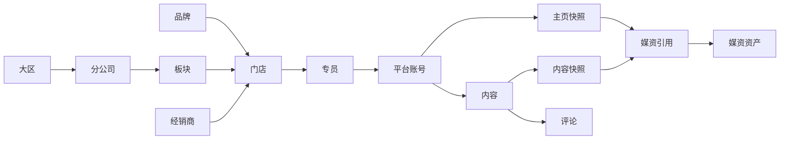

# 域 A · 数据底座 产品需求

**版本 v1.0 · 2026-10-28 · 定稿候选（盘问中）**

> **上游**：[`prd-platform.md`](prd-platform.md) 第四章 A 与第七章 1.0 范围。
>
> **本文档的范围**：只写"谁在什么场景下做什么、系统给什么反馈、明确不做什么"。**不含数据表、字段、SQL、接口定义**——那些属于 A 域 spec 与 `domains/data-foundation/` 的实施基线。
>
> **产品语义的唯一真相源是本文档。** 技术基线（v2）与 spec 的 design 若与本文冲突，以本文为准，并回来修订它们。
>
> **来源说明**：本域没有现成的独立 PRD 草稿。骨架取自 `prd-drafts-子PRD草案/hbecho-设计大纲.md` §6.B（数据供给与资产层）与 `hbecho-平台底座首版产品设计.md` 的组织主数据部分，并按 2026-10-27 的决策重写。

---

## 版本记录

| 版本 | 日期 | 变化 |
|---|---|---|
| v0.1 | 2026-10-27 | 初建骨架：7 个模块、四条业务链路、验收清单框架；待定项集中列在第十二章 |
| **v1.0** | **2026-10-28** | 定稿候选：平台范围确定为抖音 + 小红书 + 快手（视频号 2.0）；补入异步门控、封面/视频地址规则、评论分页与回复结构、错误分类 |

---

## 一、这个域管什么

### 1.1 四个问题

```
我们采谁         → 品牌、大区、分公司、板块、经销商、门店、专员、平台账号
采什么           → 主页、内容、评论、头像/背景/封面
什么时候采       → 每周计划同步 + 运营手工补抓
采到了吗         → 批次、任务、检查点、连续性缺口、质量问题
```

### 1.2 不管什么

| 事情 | 归谁 |
|---|---|
| 谁能看哪些账号与内容 | B 访问控制 |
| 从内容里抽话题、做模板匹配 | C 识别 |
| 什么算达标、哪条内容命中 | D 规则与考核 |
| 完成率怎么算、点检表怎么排 | E 指标与看板 |
| 活动怎么配、任务怎么下发 | F 业务应用 |
| 同步配置存哪、预算怎么控 | I 运维与成本 |

### 1.3 一条主线

```
主数据进来
→ 账号被确认并归属到专员
→ 每周把主页、内容、评论、图片取回来
→ 每次取数都留底
→ 规则与指标从这些事实里得出结论
```

**A 的职责到"事实"为止。** 它不解释事实的业务含义，也不决定事实该给谁看。

---

## 二、用户与场景

### 2.1 谁在用

| 使用者 | 来这个域做什么 | 频率 |
|---|---|---|
| 平台运营 | 导入主数据、提交新账号、处理归属冲突、查同步失败 | 每周 |
| 总部/分公司运营 | 提交本区账号、看同步状态与缺口 | 每天～每周 |
| 下游模块（C/D/E） | 读取已终态的事实 | 持续 |
| 运维 | 看批次、任务、配额与媒资失败 | 每周 |

### 2.2 四条真实路径

| # | 场景 | 走哪条链路 |
|---|---|---|
| 1 | 新一年度名单下来，要一次性导入门店与专员 | 主数据导入（第四章） |
| 2 | 某门店新开了一个抖音号，运营提交主页链接 | 单账号录入（第五章） |
| 3 | 每周固定时点，系统自动把所有在监控账号取一遍 | 周期同步（第七章） |
| 4 | 某周同步失败或有缺口，运营要知道缺了什么、怎么补 | 状态与缺口处理（第七、九章） |

### 2.3 规模

| 参数 | 数值 | 状态 |
|---|---|---|
| 跨平台账号总量 | 6,000 | 已确认（D-02） |
| 其中被监控账号数 | **6,000（全部有效账号）** | 已确认（D-30） |
| 经销商 / 门店 / 专员 | 2,000 / 3,000 / 3,500 | 沿用旧总纲，**待确认** |
| 支持平台（1.0） | **抖音、小红书、快手** | 已确认（2026-10-28） |
| 同步频率 | **每周一次** | 已确认（D-30） |

### 2.4 1.0 的边界

- 只对接一家供应商，不做可插拔适配层（D-21）；
- 1.0 = **抖音 + 小红书 + 快手**；视频号在 2.0（仅单条视频元数据、无下载地址）；
- 不做存量库迁移（D-03）；
- 视频源与音频**要做**：范围由规则圈定（与评论同一条策略），1.0 不做内容判定，只把文件存下来（D-29）；
- 不做内容识别（OCR、ASR、视觉大模型）；
- 主数据靠手工 CSV 导入，不接 CRM（D-20）。

---

## 三、数据是什么（业务对象）

### 3.1 组织七件套

| 对象 | 业务含义 | 关键规则 |
|---|---|---|
| 品牌 | 门店经营的品牌 | 一个门店只属于一个品牌 |
| 大区 | 分公司的上级范围 | 用于报表上卷 |
| 分公司 | 门店所属的运营组织 | 权限与考核的主要范围 |
| 板块 | 分公司下的产品线（氟机、水机等） | 不是地理片区 |
| 经销商 | 门店的经营主体 | 门店的所有者维度，不是组织父节点 |
| 门店 | 账号归属的基础单位 | 单品牌、单经销商、单板块 |
| 新媒体专员 | 某人在某门店与品牌下的业务身份 | 只属于一个门店；手机号唯一 |

### 3.2 账号、归属与标识

- **账号**：平台上的稳定身份，昵称、头像、主页链接的变化都不改变它。
- **归属**：这个账号属于哪位专员。**一个账号只有一条当前归属**，与账号是同一条业务记录；采集不得抢占，改绑只由管理员操作（D-16、D-28）。
- **标识**：供应商返回的官方 ID。同一账号可能有多类官方 ID；相同字符串在不同平台/场景下不代表同一身份。

### 3.3 主页快照

某次同步中看到的账号主页：昵称、签名、粉丝数、获赞数、头像、背景图。**它是"那次看到的"，不是账号本身。**

### 3.4 内容与评论

- **内容**：平台上的一条作品。本系统**按账号保存**：同一作品出现在两个账号的列表里，就各存一条，不跨账号合并（D-23）。
- **内容快照**：某次同步中看到的内容状态与互动数。互动数是**观测值**，不是最终值。
- **评论**：只保存最新态，不保存历史；只有完整翻完所有页，才能判断某条评论已被删除。

### 3.5 媒资

头像、背景图、封面这些图片。供应商给的是**会过期的临时地址**；系统把它们下载下来，按完整文件的字节判同，存成自己的资产。

### 3.6 原始证据

每次向供应商发请求，都留一份原始请求与响应（或传输错误）。保留一年，只增不改。

### 3.7 关系



---

## 四、A1 组织与主数据

### 4.1 业务规则

1. 品牌、大区、分公司、板块、经销商、门店、专员的**编码唯一**；
2. 专员的**手机号唯一**（先规范化再比较）；姓名不唯一；
3. 一个门店只属于一个品牌、一个经销商、一个板块；
4. 一个专员只属于一个门店；
5. 停用不等于删除：历史身份与数据永久保留；
6. 名称、门店等级的变更**覆盖当前值**，不保留历史（D-18）；
7. 门店的经销商、品牌、板块**不可变**；变更走受审计的主数据修正（D-18）。

### 4.2 两类导入文件与导入时机

**什么时候导入**：

| 时机 | 导入什么 |
|---|---|
| 初次上线 | 全量组织、门店、专员 + 已有账号的主页入口 |
| 年度 / 季度名单刷新 | 以新增为主的组织与人员 |
| 新门店开业 / 新专员入职 | 该门店与该专员 |
| 新开平台账号 | 账号信息文件（平台 + 主页链接） |

主数据**不随每周同步导入**；固定信息提交后基本不变。

**两类文件**，每次同时提交：

| 文件 | 内容 | 变化频率 |
|---|---|---|
| **固定信息** | 品牌、大区、分公司、板块、经销商、门店、专员姓名、手机号 | 低；提交后基本不变 |
| **账号信息** | 手机号、平台类型（抖音 / 小红书 / 快手）、主页链接 | 高；新开号时随时增加 |

- 顺序固定：先固定信息，后账号信息；
- 账号信息通过**手机号**匹配到专员（手机号在系统内唯一）；匹配不到的行报错，不创建账号；
- 账号信息导入后，每一行生成一次账号解析，解析规则与单条提交完全一致（第五章）；
- **CSV 只新增，不更新已有记录**（D-34）：已存在的编码或手机号一律标为冲突，不修改；
- 账号信息重复提交按幂等处理，不重复建账号。

**固定信息的导入流程**：

```
下载模板 → 填写 → 上传
→ 预检：编码重复、必填缺失、手机号冲突、组织挂靠是否存在
→ 展示「新增 N / 冲突 M / 错误 K」
→ 确认后按批次写入（只写新增）
→ 冲突与错误行生成同格式 CSV 回流
→ 批次历史保留；不提供按批次回滚，纠错走名单撤出与账号停用（F 域 F-D06）
```

- 格式为 **CSV**（D-08）；GBK 与 UTF-8 都要能识别；
- 冲突行**不写入、不覆盖**，回流给运营处理；
- 导入是异步任务，可查进度、可重试。

**已有记录要改怎么办**：

| 字段类 | 怎么改 |
|---|---|
| 名称、状态、门店等级、专员姓名 | 管理界面单条编辑，记审计 |
| 组织结构（所属大区 / 分公司 / 经销商 / 品牌 / 板块 / 门店） | 走受审计的组织调整，不进 CSV |
| 监控开关 | 批量选择 + 二次确认，不进 CSV |
| 手机号 | 删旧建新（D-43） |
| 编码 | 永不可改 |

### 4.3 监控开关

- 监控开关与业务状态是两件事：停用不等于暂停监控，暂停监控也不等于业务失效；
- 实际是否采集，由归属链上的业务状态与开关共同决定；
- **谁能改开关**：分公司及以上（`platform_admin`、`hq_manager`、`branch_manager`）；门店与专员本人只能看，不能改（D-32）；
- **开关挂在哪些层级**：分公司、经销商、门店、专员、账号五级（D-36）；
- 上级关闭后，下级自身开关值不被改写；上级恢复后按下级原值继续。

---

## 五、A2 账号、标识与归属

### 5.1 录入

运营提交：平台 + 专员 + 主页入口。可以单条提交，也可以按账号信息文件批量导入（§4.2）。

- 主页入口可以是 URL、短链接或分享口令；
- **只接受主页入口**：视频/笔记链接或作品分享文本判为"非主页入口"，不建账号、不建归属、不重试；
- 解析时记录入口类型（主页 / 视频 / 笔记 / 未知）；判断以供应商返回为准，不解析平台 HTML；
- 系统保留入口原文；
- 最多解析 3 次；
- 三次都失败：终态失败，**不创建账号、不创建归属**，只保留运维证据。

### 5.2 标识与绑定证据

- 同一账号可能有两类官方 ID（如抖音的 `user_id` 与 `sec_uid`）；
- 只有供应商在同一次返回里明确给出，或通过版本化规则（如小红书主导作者）确认，才能绑定为同一账号；
- 昵称、头像、主页文案、字符串相似度**都不是**绑定依据；
- 绑定决定要留下证据，出争议时能解释；
- 快手使用 `kuaishou.user_id` 单一命名空间，没有第二官方标识；昵称与主页链接不作为绑定证据。

### 5.3 归属与冲突

**归属是单值链，不可能多店共用**（2026-10-29 决策）：

```
经销商 1 ── N 门店 1 ── N 专员 1 ── N 平台账号
```

一个账号**只属于一个专员、一个门店、一个经销商**。现实中不存在「一个号两家店共用」的合法场景，遇到就是录错了。

- 账号没有归属：创建一条当前归属给提交的专员；
- 账号已属于同一位专员：复用，不重复创建；
- 账号已属于**另一位**专员：**不抢占**，保留原归属，报归属冲突，交管理员处理；
- **管理员改绑**：界面提供改绑入口。账号只可能属于一家经销商，改绑通常发生在人员变动或录错时，**不要求填原因、不进审计**；改绑不改写已发生的列表出现事实（D-16、D-28）。

### 5.4 专员离职与门店停用

- 专员离职：账号**停止采集**，归属不变；
- 门店停用：该门店下所有账号停止采集；
- 恢复：重新启用后继续采集，不补历史（D-17）。

### 5.5 账号状态

账号有三种状态：

| 状态 | 什么情况 | 是否继续采集 |
|---|---|---|
| **有效** | 正常可访问 | ✅ |
| **暂不可用** | 平台明确表示账号暂不可访问（封禁、设为私密等） | ✅ 仍按周重试 |
| **已删除** | 运营人工确认注销 | ❌ 停止常规采集 |

**三者的区别是「会不会恢复」**（2026-10-29 决策）：

- **暂不可用会恢复**：门店把号设成私密两周又公开，公开后自动接上，不需要人工干预；
- **已删除不会恢复**：注销的号继续采只是白花调用；
- **技术失败不改状态**：网络超时、供应商 5xx、临时限流都不算「暂不可用」——那只是这次没取到，账号本身没变（对应「技术失败不得转成业务空值」）。

- 网络错误、限流、供应商失败**不改变**账号状态；
- 暂不可用的账号在重新获取成功后自动恢复有效；
- 已删除只能由运营人工确认，系统不自动判定（D-38）。

### 5.5 主页入口变更

- 运营可以更新当前入口；
- 保留"当前入口"与"上一次入口"两份；
- 若新入口解析为同一账号，只更新入口；
- 若解析为另一个账号，按新账号处理，不改旧账号。

---

## 六、A3 AI Master 客户端与能力门控

### 6.1 只对接一家

1.0 只使用 AI Master 的三个动作：

| 动作 | 用途 |
|---|---|
| 主页信息 | 解析账号、获取主页快照 |
| 内容列表 | 获取某个账号的作品列表与翻页游标 |
| 任务查询 | 异步模式下查任务结果 |

**不做可插拔适配层**（D-21）。平台与供应商仍是两个维度，但不为"接第二家"提前抽象。

### 6.2 同步与异步

- 每个动作按**已验证的能力**决定同步或异步；
- 不把 `async=false` 或 `async=true` 写死为全局策略；
- 异步时，提交、每次轮询各算一次调用；
- 结果不明的调用不能盲目重发（见第七章）。

**供应商的排队与计费**：

- 供应商不给出 QPS 或并发上限，调用进入其队列按顺序执行；
- **"不限制"不等于"可以无限并发"**：我方仍需设置自己的并发上限与超时；队列意味着高峰期延迟会变长，超时按最坏情况设；
- 计费按**每次成功调用的固定点数**；**失败、超时、429 不计点，异步轮询不计点**；
- 1.0 点数：抖音主页 10/次、列表 10/页、详情 10/条、评论 5/页；小红书主页 15/次、列表 15/页、详情 15/条、评论 15/页；快手主页 10/次、列表 10/页、详情 10/条；
- 权威清单见 [`AI Master 能力与计费清单.xlsx`](../aimaster接口文档/AI%20Master%20能力与计费清单.xlsx)；成本模型见 [`计费点数表.md`](../aimaster接口文档/计费点数表.md)。

### 6.3 能力证据

| 等级 | 含义 | 能否用于生产 |
|---|---|---|
| 供应商声明 | 文档写了 | ❌ |
| fixture 观察 | 我们的样本里见过 | ❌ |
| smoke 验证 | 人工批准的有限真实调用通过 | 仅限验证过的平台×动作×模式 |
| 生产启用 | 明确批准 | ✅ |

**未验证的组合默认拒绝。**

**2026-10-28 实测（raw4，14 次调用）**：

| 平台 × 动作 × 模式 | 结论 | 1.0 |
|---|---|---|
| 抖音 / 小红书 × 主页 / 列表 / 详情 / 评论 × 同步 | ✅ 全部通过 | ✅ |
| 快手 × 主页 / 列表 / 详情 × 同步 | ✅ 全部通过（2026-10-28） | ✅ |
| 快手 × 评论 | ❌ 不支持（HTTP 500） | ❌ |
| 抖音 × 主页 × 异步 | ✅ 通过 | ✅ |
| 抖音 × 详情 × 异步 | ✅ 通过 | ✅ |
| 小红书 × 主页 × 异步 | ✅ 通过 | ✅ |
| 小红书 × 详情 × 异步 | ✅ 通过 | ✅ |
| 小红书 × 评论 × 异步 | ✅ 通过 | ✅ |
| 抖音 × 列表 × 异步 | ❌ 稳定失败（raw7/raw8） | ❌ |
| 抖音 × 评论 × 异步 | ❌ 稳定失败（raw7/raw8） | ❌ |
| 小红书 × 列表 × 异步 | ❌ 稳定失败（4 次） | ❌ |
| 快手 × 主页 / 详情 × 异步 | ✅ 通过（raw14） | ✅ |
| 快手 × 列表 × 异步 | ❌ 失败（raw14） | ❌ |

**异步可用：三平台的主页与详情、小红书评论；失败：三平台的列表、抖音评论。快手评论本身不支持。**

**错误表现**：无效链接、私密/已删除内容（含快手不可访问主页）返回 HTTP 500 `RESULT_VALIDATION_FAILED`；错误 Key 返回 HTTP 400 `INVALID_REQUEST`。不能只按状态码区分认证错误与输入错误。

字段结构与特殊情况见 [`aimaster接口文档/返回字段与特殊情况.md`](../aimaster接口文档/返回字段与特殊情况.md)。实测同时确认：认证用 `X-Api-Key`；响应不含用量或计费字段，QPS 与单价仍需向供应商确认；`media_stats_number` 的返回动作为 `media_stats`；视频详情新增 `author_homepage`；评论结果已移除 `cursor`；小红书评论存在间歇性 `RESULT_VALIDATION_FAILED`，必须重试。详见 `aimaster接口文档/测试结果/raw4-2026-10-28/REPORT.md`。

### 6.4 认证与秘密

- 认证方式以一次批准式 smoke 的实测为准（**待定**）；
- 密钥只从密钥系统注入，不进入数据库、日志、状态页与审计摘要。

---

## 七、A4 同步编排

### 7.1 计划与批次

- 全系统统一的每周计划，北京时间，**每周一次**（D-30）；**抖音、小红书、快手共用同一套计划**，不做平台级独立计划；
- 错过时点不自动补跑；
- **同一时刻只允许一个全量批次运行**，保持串行（D-33）；
- 每周到点时系统生成一条"本周批次"记录：
  - 没有正在跑的批次 → 立即开始；
  - 上一批次仍在跑 → 进入**排队**，上一批次结束后立即开始；
  - 队列里已经有 1 个在等 → 本次触发标记"跳过"，避免无界堆积；
- 排队等待上限为**下一个计划时点**（约一周）：到下一个时点仍未开始，则标记过期，由新的触发接替，避免跨周堆积；
- 手工补抓单独建批次；当前有批次在跑时，运营可选择"排队"或"取消当前批次"。

### 7.2 采集与登录无关

- 采集只看**业务身份是否存在**、**业务状态是否有效**、**监控开关是否打开**；
- 与门店专员的登录账号是否激活、是否存在**完全无关**；
- 专员从未首次登录，不影响该门店账号的采集；
- 反过来，登录账号停用也不会停止采集——停采只由业务状态与监控开关决定（D-46）。

### 7.3 一次同步做什么

```
算五级实际监控
→ 对每个在监控账号：抓主页 → 抓第一页内容 → 按检查点决定是否继续翻页
→ 列表处理完后：按规则决定哪些内容要拉详情、哪些要拉评论
→ 详情/评论完成后：内容定稿
→ 媒资异步下载
→ 批次汇总：成功 / 部分成功 / 失败
```

- 单个账号失败不影响其他账号；
- 任务有租约与 fencing，迟到的执行不能改写已定稿的结果；
- 同一账号同一动作不会并发重复执行。

### 7.4 检查点与连续性缺口

**它解决什么**：供应商的列表是"最新在前"的分页列表，一页约 20 条。每周同步只应抓"新增的部分"，但要能证明没有漏。

**检查点里记什么**：

- **高水位**：上次成功同步中最新一条的发布时间，以及同一时刻的内容 ID 集合；
- **游标**：供应商给的下一页位置，类型原样保留（数字还是字符串，不能互转）；
- **连续性状态**：本周与上周是否接上。

**每周怎么翻**：

1. 从第一页开始，**整页全部处理**——供应商返回 21 条就处理 21 条，不能因为本地目标是 20 条丢掉第 21 条；
2. 一直往下翻，直到遇到上周见过的内容：出现早于高水位的发布时间，或出现高水位时刻的已知 ID；
3. 遇到即"接上了"，停止翻页并更新检查点。

**三种停止原因，业务含义不同**：

| 停止原因 | 含义 | 是否缺口 |
|---|---|---|
| 命中历史重叠区 | 本周与上周接上 | 否 |
| 列表自然结束 | 供应商说没有更多，但一直没遇到旧边界 | 是 |
| 达到安全页数 | 翻了很多页仍未追到旧边界 | 是 |

**前三条内容特殊处理**：列表最前面三条可能是置顶的旧内容，只标记为"可能置顶"，不作为停止依据；从第 4 条起才按正常时间序列判断。

**缺口发生后**：记录缺口（哪一周、哪个账号、翻了几页、为什么停）→ 用本轮已获取内容重建起点 → 下周从新起点继续，不再追旧缺口。业务接受这一段可能缺，但要求缺口可见。

**空窗口**：本周返回 0 条而上周有内容时，不能用空窗口覆盖旧检查点；标记为阻塞，任务记为带缺口，下周仍只抓第一页，等有内容后再重建。

**为什么关键**：不做检查点会每周翻到底、成本失控；前三条就停会漏掉本周新内容；忽略缺口会让运营误以为数据完整。

### 7.5 详情与评论的圈定

**A 只执行，不决定。**

- 详情：只对规则圈定的内容拉取（D-31）；
- 评论：活动规则先用不花钱的条件（话题、封面等）过滤，再对剩余账号按排名或转评赞阈值筛选，只对这些账号的内容抓评论（D-27）；
- 视频源与音频：与评论同一条圈定逻辑；1.0 只下载与归档，不做画面/语音识别（D-29）；
- 这三项的具体参数（排名范围、依据、阈值、Top N、观察窗口、每账号页数）**由 D 域在活动规则中定义**；A 只接收圈定结果并执行，不在 A 域配置业务阈值。

### 7.6 运营能做什么

- 提交单账号补抓；
- 取消正在跑的任务；
- 查批次与账号级结果；
- 处理归属冲突；
- 不提供"手工改判定结果"的入口——判定属于 D。

---

## 八、A5 原始证据

### 8.1 留什么

- 每次请求的原文；
- 每次响应的原文；
- 传输错误的原文；
- 调用元数据：动作、期望响应、实际响应、时间、字节数、摘要、结果状态。

### 8.2 顺序

**先留底，再解析。** 留底失败就不解析、不产出业务事实。

### 8.3 保留

- 原始调用与载荷保留**一年**；
- 结构化快照、归属、评论最新态、正式媒资**不随一年到期删除**；
- 一年后按"载荷 → 调用 → 任务"顺序清理，不级联删除业务数据；
- 清理可重跑、可审计。

---

## 九、A6 明细层

### 9.1 主页快照

- 每个账号每个批次最多一份；
- 创建成功即为终态，不可修改；
- 0、缺失、null、非法值分别保留，不互相转换；
- 头像与背景只形成媒资引用，不影响快照终态。

### 9.2 内容快照

- **按账号保存**：同一作品在多个账号出现，各存一条（D-23）；
- 每个账号的每条内容每个批次最多一份最终快照；
- 同批次后到的有效值覆盖先前的值；后到的缺失/null/非法值不擦除已有有效值；
- 真实 0 是有效值；**但列表接口的播放数是"不支持"，不是 0**（抖音返回 0、小红书无字段）；
- 列表条目的作者可能与目标账号不同（共创/异作者）；作者身份单独保存，不创建账号；
- 封面与下载地址可能是多条 URL，保留全部候选，再按角色与优先级选一条；
- 同一接口的不同条目可能缺少某些字段（如部分条目没有 `text`），解析按条目容错，不假设固定 schema；
- 0 条作品是真实的空列表（`has_more=false`），不是失败；
- 无效链接、私密或已删除内容统一记为**不可访问**：不改账号状态，记数据质量问题，由运营人工删除或替换；
- `content_kind` 由 A 推断（JSON 没有显式类型）：有视频 → video；无视频有图片 → image；只有文本 → text；缺失或矛盾 → unknown；
- 封面只归档压缩图：**固定取封面数组的第 2 条（540 宽）**；第 1 条可能是视频首帧，也可能是同一张图，第 3 条尺寸不固定（实测 82 条，61 条可验证）；
- 视频主地址**不要用 `video.url`**（可能指向 403 的 CDN 对象）；优先可访问的 `api-play.amemv.com` / `api.amemv.com` 地址；多条 URL 保留候选；
- 小红书详情即使视频笔记也不返回播放数。
- 评论与媒资不阻塞内容快照定稿；
- 当前内容只接受已定稿的快照，旧批次迟到不能回退。

### 9.3 评论

- 只保存一级评论最新态；
- 不建评论作者账号、不下载评论头像、不建回复树；
- 部分分页没看到某条评论，不能判定删除；
- 只有完整翻完、自然结束分页后，缺失的旧评论才标记为"疑似删除"；
- 评论重新出现时恢复有效；
- `total` 统计评论总数（含回复）；`total>0` 但接口返回空数组时，记数据质量问题，不能记 0 条评论；
- 评论有三个接口（完整列表、摘要、热门），1.0 只用完整列表；摘要接口实测只返回文本摘要，不可用于结构化采集；
- 回复以**扁平条目 + `parent_id`** 返回，不是嵌套结构；一页可能大部分甚至全部来自同一条评论的对话串；
- 小红书评论可能出现 `total>0` 但 `has_more=0`，无法翻页（实测 28 条只返回 2 条、31 条只返回 4 条）；抖音评论翻页正常；
- 小红书评论接受"部分覆盖"：记一条"评论覆盖不完整"的数据质量问题，D/E 不得把小红书评论总数当完整；
- 快手不采集评论、不生成评论任务；依赖评论的考核项必须识别"平台不支持"并拒绝或标注。

### 9.4 质量问题

- 身份冲突、连续性缺口、字段异常、媒资失败都记成问题；
- 问题可确认、可忽略、可标记解决，但**不通过删除业务数据来"修复"**；
- 1.0 只记录与查询，不做完整的处置工作台；
- 不可访问的账号/内容由运营**人工删除或替换**，处置动作记审计；系统不自动改账号状态。

---

## 十、A7 媒资归档

### 10.1 1.0 下载什么

| 类型 | 是否下载 | 说明 |
|---|---|---|
| 主页头像 | ✅ 抖音；❌ 小红书/快手 | 每周 |
| 主页背景 | ✅ 抖音；❌ 小红书/快手 | 每周 |
| 内容封面 | ✅ 全部平台 | 首次入库 |
| 视频源（抖音/小红书） | ✅ | 由规则圈定；白天执行；1.0 只归档，不做内容识别；小红书详情 `download_urls` 实测 720p h264（3 分钟约 55MB） |
| 视频源（快手） | ✅ | 仅规则圈定；用详情 `download_urls` 的 720p h264，**不用列表 `video.url`**（单条 29–58MB） |
| 音频轨 | ✅ | 随视频下载后抽取，供后续 ASR 复用；**快手不从列表 `audio.url` 单独下载** |
| 图文图片 | ❌ 2.0 | |

**字段形态差异**：

- 小红书主页接口**不返回头像与背景**，因此小红书无法从主页归档这两类媒资；
- 抖音列表的封面是数组（实测 3 条），详情是字符串；下载地址同理；
- 多条 URL 保留为候选集，按角色与优先级选一条，不能默认取第一条。

### 10.2 格式与标准化

- **原始字节**是正式资产：按完整字节 SHA-256 判同，长期保留；
- **标准化衍生图**由 A 在归档时生成，作为独立资产（独立 SHA-256）：
  - 统一输出 **JPEG q80、540 宽**；
  - 抖音封面取**数组第 2 条**（540 宽，HEIC）→ sharp 解码（实测 540×722）；
  - 小红书封面/图片 WebP → sharp 缩放；
  - 快手封面 KVIF → 用 CDN 的 `?x-oss-process=image/format,jpg` 取 JPEG（实测 640×360；`resize,w_540` 得 540×304）；
  - 快手 CDN 参数是实测行为、不是供应商合同；转换失败时标记"封面不可用"，不阻塞内容；
  - **原始字节与衍生图都长期保留**，互不替代；
- **音频**：从视频抽成 m4a/AAC 原样，不重编码；C 需要时自行转 16k mono wav；
- **视频**：存原始 mp4 字节，不转码；记录 codec、分辨率、时长；
- **技术安全上限**：单文件与单批次总字节可配置（建议单文件 2GB），只防异常，不限制正常内容。

### 10.3 判同与去重

- 按**完整下载字节的 SHA-256** 判同；
- 临时地址不是媒资身份；
- 同一字节只存一份资产，多个引用共享。

### 10.4 失败与续用

- 下载失败不影响结构化快照；
- 上一份已验证的资产可以继续用，但必须记录"本轮没下载成功"；
- 不把"用旧图"表示成"本轮归档成功"；
- 视频与音频归档**不设业务上限**，不限定夜间窗口；并发由实施按服务器容量设定（D-37）；
- 下载有超时、大小、类型、重定向与目标地址的安全限制；
- 供应商 URL 有效期未确认（可能 7–15 天）；下载失败重试必须重新获取详情拿新地址，不能复用已过期地址。

---

## 十一、活动计划与监控清单

> **2026-10-28 决策（刘学奎）**：这一章把"谁、什么时候、按什么顺序把要监控的账号交进来"固定下来。D 的「活动规则判定计划」引用本章的活动计划，不重复定义参与范围。

### 11.1 两个层次的信息

| 层次 | 内容 | 谁提供 | 什么时候 |
|---|---|---|---|
| **权威基础信息** | 大区、分公司、板块、经销商、门店（品牌、编码等） | 开发者 | 平台上线时集中导入 |
| **门店监控信息** | 专员姓名、手机号、参与监控的平台、主页链接 | 分公司业务人员 | 加入活动计划时导入 |

基础信息是**档案**，全平台一份；监控信息是**名单**，按活动计划、按分公司提交。两者分开，避免每次活动都重导组织架构。

**采集与计划的关系（2026-10-28 决策）**：账号采集是**全局的、只采一份**。同一平台账号在系统中只有一条主档；被多个活动计划引用时，采集仍然只发生一次，各计划共享同一份数据。**上层计划不拥有账号，只引用账号。**

> 例：张三的抖音号先被 A 分公司导入"五一总部活动"，系统开始采集；几天后 B 分公司又把他导入同一活动，系统验证账号已存在——**不重复创建、不替换链接、不触发第二次采集**。两个计划共用这一份数据。

### 11.2 标准流程

```
① 有「活动计划」权限的人创建活动计划（按品牌）
        ↓
② 参与活动的分公司点击加入活动计划
        ↓
③ 分公司业务人员导入 Excel：权威基础信息 + 门店监控信息
        ↓
④ 系统校验权威基础信息
     一致 → 通过
     不一致 → 提示让其修改
     系统中不存在 → 提示联系管理员
        ↓
⑤ 导入门店监控信息，做业务校验（链接重复、专员手机号重复等）
        ↓
⑥ 异步调用**主页信息接口**完成首次采集（只调这一个接口）
        ↓
⑦ 导入完成后，通过监控开关做增减调整
```

**判重是全平台的**：同一平台账号按账号 ID 判重，已存在则直接引用，不新建、不替换链接、不再采集。后加入的活动计划复用同一份数据。

**几个要点**：

- **创建计划的人不管分公司层面的信息**。总部建计划、定品牌，分公司自己提报名单；
- **第一次批量导入本身就是一次账号核对**：调主页接口确认账号存在、拿到昵称与粉丝；内容采集仍按每周节奏走，不在此刻触发；
- **每次导入自动生成一个监控计划草稿**，业务确认后才生效；
- **监控开关是导入之后的调整手段**，不是导入的替代方式。

### 11.2.1 链接解析与失败处理

**短链跳转由 AI Master 处理**（`media_user_info` 直接接受主页链接），我方不自己跟跳转。旧系统自建的解析器（双 UA、最多 6 跳、12 秒超时）不再是必需的。

失败分类依据实测（`aimaster接口文档/测试覆盖与补测清单.md`）：

| 情况 | 接口表现 | 处理 |
|---|---|---|
| 正常账号 | 返回账号信息 | **成对写入**：原始链接 + 账号 ID，来自同一次调用 |
| 无效 / 私密 / 已删除 | HTTP 500 `RESULT_VALIDATION_FAILED` | 标「链接无效」，回流让业务修改 |
| 空账号（0 粉丝、0 作品） | 正常返回 | 标「疑似空账号」，人工确认后才纳入监控 |
| 链接带分享文案垃圾 | 传前做最小清洗（截断路径后的非路径字符） | — |

**继承旧系统的四条教训**（来源：`archive/legacy/项目历史文档/爬虫四环节问题复盘与解法.md`、`项目全面复盘与重构建议.md`）：

1. **链接与账号 ID 成对写入**，且来自同一次解析；解析失败时两者都保留原值，不能只更新一个——旧系统三个链接字段互相错位就是没成对写；
2. **失败记录不删，保持可重试**——旧系统导入时没解析成功的行变成僵尸 pending，小红书 xhslink 行永远无人接管；
3. **Excel 用固定模板，不做别名兼容**（2026-10-29 决策）：列名与顺序固定为「门店编码 | 门店名称 | 专员姓名 | 手机号 | 平台 | 主页链接」；列不对直接报错并展示正确模板。旧系统因为老数据混乱才不得不做别名表，新系统从零开始不必背这个包袱；
4. **表头行防护**：旧系统曾把「抖音主页链接」这一行当成数据导入。

> 新系统不需要「离线补解析」任务：解析由供应商完成，失败就重调一次主页接口，不需要自建解析器。

### 11.2.2 导入校验与失败分类

你问得对——链接只是其中一类。旧系统踩过的导入坑远不止这个（见 `项目全面复盘与重构建议.md` §一），完整校验分三层。

**第一层 · 文件级**（整批拒绝，不进逐行处理）

| 检查 | 失败处理 |
|---|---|
| 模板版本号 | 拒绝，要求下载当前模板 |
| 必填列齐全（门店编码 / 门店名称 / 专员姓名 / 手机号 / 平台 / 主页链接） | 拒绝，展示正确列名 |
| 表头行检测（首行值等于列名） | 拒绝，提示删除表头行 |
| 编码（GBK / UTF-8） | 自动识别；识别不出则拒绝，不导入乱码 |
| 平台列白名单 | 不在支持列表 → 整行失败，不默认成抖音 |

**第二层 · 权威信息级**（行级，与系统核对）

| 检查 | 失败处理 |
|---|---|
| 门店编码在系统中存在 | 不存在 → 提示联系管理员（分公司不能新增组织） |
| 门店归属一致（经销商 / 分公司 / 板块） | 不一致 → 回流让业务改 |
| 专员手机号在系统中存在 | 不存在 → 提示走专员新增流程 |

**第三层 · 监控信息级**（行级，业务判断）

| 检查 | 失败处理 |
|---|---|
| 链接格式可识别 | 不认 → 回流，标「链接格式错误」 |
| 贴的是视频链接而不是主页 | 回流，标「不是主页链接」 |
| 链接解析失败（接口 500） | 回流，标「链接无效」 |
| 疑似空账号（0 粉丝 0 作品） | 标记，人工确认后转为正常录入 |
| **账号已存在（全平台判重）** | 归属相同 → 直接引用；**归属不同 → 拒绝，提示走管理员改绑**（界面提供改绑入口） |
| **同一账号被同一分公司的两个专员报** | 同上，拒绝并指引改绑；不允许「先到先得」 |
| **同一条链接出现在两行** | 拒绝，列冲突（按账号 ID 判，不按链接文本） |
| 手机号重复 | 拒绝，列冲突 |

**三条设计原则**（全部来自旧系统的实际事故）：

1. **解析与落库分阶段**：先只读解析、出报告，人工确认无误后才写业务表。旧系统解析和落库混在一个循环里，出问题时一半数据已经写进去了。
2. **唯一约束按账号 ID，不按 URL**：旧系统用 `home_url` 前 200 字符做唯一索引，小红书带 `?xsec_token=` 的长链接前缀相同，被误判成冲突。
3. **冲突必须在落库前暴露**：旧系统靠数据库的 `ER_DUP_ENTRY` 事后兜底，而且 `home_url` 允许 NULL 时多行 NULL 不受唯一约束，冲突永远逃得过。

**导入报告必须包含四类**：解析失败、链接冲突、账号被多人持有、疑似表头或示例行。

### 11.3 权限边界

| 动作 | 1.0 谁能做 | 范围 |
|---|---|---|
| 创建活动计划 | 超级管理员、总部人员 | 按品牌 |
| 参加活动计划、提报名单 | 分公司及以上 | 本分公司 |

**分公司只能看到自己报的那部分名单**（2026-10-29 决策）：看不到同计划下其他分公司报的门店与专员手机号。总部人员看本品牌全部计划，超级管理员看全部。账号被重复报由全平台判重兜底，不靠人眼发现。

**导入报告可见范围**：本分公司都能看（不只导入的人），总部看本品牌的汇总，不看逐行明细。

**单个活动计划建议不超过 1,200 个账号**（2026-10-29 决策）。这是**软提示**：超过时显示当前数量与超出量，但不拒绝导入——业务上超过的情况极少，硬拦截反而添麻烦。

> **后续可能扩展**：分公司也会自己发起活动计划。因此权限按 Capability 发放，不写死角色；扩展时只改角色到 Capability 的映射，不改流程。Capability 定义见 B 域 PRD。

### 11.4 与相邻域的关系

| 对方 | 关系 |
|---|---|
| **D 规则与考核** | D 的活动规则判定计划引用活动计划 ID，不复制参与范围 |
| **B 访问控制** | 创建与参加活动计划各是一个 Capability，按品牌与组织范围校验 |
| **F 业务应用** | 活动计划的界面入口，1.0 可在 D 的判定计划里复用 |

### 11.5 监控状态与计划名单的联动

**两层东西，别混**（2026-10-28 决策）：

```
账号的监控状态（全局，一份）     ← 决定采不采
        ↕ 联动
各活动计划的参与名单（按计划）   ← 决定谁在这个计划里
```

- **监控状态是全局的**：一个账号只有一个"是否监控"的状态；
- **参与名单是分计划的**：同一个账号可以在计划 A、B、C 里，也可以只在 B 里；
- **采集只看全局监控状态**，不看它在几个计划里。

#### 四条联动规则

| 动作 | 全局状态 | 各计划名单 |
|---|---|---|
| 计划导入一个**新账号** | 打开 | 加入该计划名单 |
| 计划导入一个**已存在账号** | 打开 | 加入该计划名单 |
| 计划内移出账号 | **不变** | 从该计划名单移除 |
| **全局关闭**账号 | 关闭 | **所有计划名单标记为「被停止监控」**，不删除 |

**例**：

- 计划 A 想停掉 a1、a2，但计划 B 还要用 → **只调整计划 A 的名单**，全局状态不变，采集继续；
- 在监控里全局关停 a1、a2 → 先检查被哪些计划消费，**弹窗确认**后统一关闭，并在 A、B 的名单里都标记「被停止监控」；
- 之后计划 C 又把 a1、a2 加进来 → **全局重新打开**；但计划 A 的名单**不受影响**，因为上一步已经把它标记为停止监控了。

> 这个设计的好处：全局关闭是"这个账号我不采了"，计划内移除是"这次活动不算它"。两件事分开，互不覆盖。

#### 关闭的时机

2026-10-29 决策：**显式动作立即，自然到期等 15 天。**

| 触发 | 处理 |
|---|---|
| 活动计划被**删除** | **立即**按引用计数检查；无其他计划引用的账号立即关闭监控 |
| 分公司退出计划 / 单条移出名单 | 同上，**立即**检查 |
| 计划自然到期 | 该账号连续 **15 天**没有任何计划引用后关闭 |
| **上级开关关闭**（大区 / 分公司 / 经销商 / 门店） | **立即停采，优先于引用计数** |

**引用计数**：账号被 N 个计划引用，N 归零才关。删除或退出时逐个检查，还被别的计划引用就保持开启。

**上级开关优先**：即使还有计划引用，上级关闭也直接停采；名单里显示「XX 被关闭」，让业务知道为什么没数据。

**15 天的计时方式**：每天定时扫描一次，不追求精确到时刻；判断条件是「当前无任何计划引用」且「最后被引用时间 + 15 天已过」。

#### 采集触发规则

| 情况 | 是否立即采集 |
|---|---|
| 新账号第一次被任何计划导入 | ✅ 立即（异步） |
| 老账号被新计划导入，距上次采集**未满一周** | ❌ 不立即，等下一个周期 |
| 老账号被新计划导入，距上次采集**已满一周** | ✅ 立即 |
| 账号处于监控状态 | 每周自动采集一次 |
| 全局关闭，或满 15 天未被任何计划引用 | 停止采集 |
| 运营**手工触发单个账号** | 立即采集（不走周节奏） |

**手工触发入口**（2026-10-29 决策）：1.0 不提供全局提频，只提供单账号手工触发。运营看到某门店数据没更新时可以单独补一次，成本远低于全量提频。

**判重与抓取判断是两件事**：判重决定"要不要新建账号"，抓取判断决定"现在要不要调接口"。账号已存在但上次采集是一周前，仍然会立即采集。

**「15 天」从哪天算起**（2026-10-29 决策）：从该账号**最后一次被任何活动计划消费**之后、引用计数归零的时刻算起。计划到期后名单虽保留，但不再算「被消费」，计时从到期日启动。

**暂停不补采**（2026-10-28 决策）：中断较久后重新加入计划，只从加入时刻起按周期采集新内容，**不自动补采中断期间的历史**。

#### 监控开关的层级规则

2026-10-28 决策：**上级大于下级。**

| 关闭层级 | 影响范围 |
|---|---|
| 大区 | 该大区下所有分公司、经销商、门店、账号 |
| 分公司 | 该分公司下所有经销商、门店、账号 |
| 经销商 | 该经销商下所有门店、账号 |
| 门店 | 该门店下所有账号 |
| 账号 | 仅该账号 |

**下级打开不能覆盖上级的关闭。** 例如分公司被整体关闭，其下门店即使单独开着也不采集。

**导入与上级关闭的冲突**（由上级优先推导）：账号所属门店、分公司或大区已被关闭时，导入新计划**不会**打开监控，界面要提示关闭来自哪一级。

### 11.6 账号的状态

**状态分三个维度存，界面上合成一列显示**（2026-10-29 决策）。

| 维度 | 状态 | 作用范围 | 谁改 | 什么时候确定 |
|---|---|---|---|---|
| **录入状态** | `正常录入` / `链接无效` / `疑似空账号` | 账号 | 导入流程 | 导入时 |
| **名单状态** | `在名单` / `已移出活动计划` | 账号 × 计划 | 分公司 | 改名单时 |
| **监控状态** | `正常采集` / `被停止监控` / `大区关闭` / `分公司关闭` / `经销商关闭` / `门店关闭` | 账号 | 监控开关 | 开关操作时 |

**为什么不能合成一个字段**：三者的作用范围不同。录入状态是账号级的，名单状态是「账号 × 计划」的，监控状态又是账号级的。合成一个字段会造出「链接无效但已移出」「在名单但门店关闭」这类自相矛盾的存法。

#### 界面综合显示：按优先级取第一条命中的

| 优先级 | 条件 | 显示 |
|---:|---|---|
| 1 | 录入状态 = 链接无效 | **链接无效** |
| 2 | 录入状态 = 疑似空账号 | **疑似空账号** |
| 3 | 监控状态 = 大区/分公司/经销商/门店关闭 | **XX 被关闭**（取最上级） |
| 4 | 监控状态 = 被停止监控 | **被停止监控** |
| 5 | 名单状态 = 已移出活动计划 | **已移出活动计划** |
| 6 | 以上都不命中 | **正常采集** |

**每条状态变更都要带时间与操作者**，用于追诉。

#### 录入状态的含义

| 状态 | 含义 | 是否采集 |
|---|---|---|
| `正常录入` | 主页接口返回账号信息 | ✅ |
| `链接无效` | 接口返回 500 / 无法识别 | ❌，回流让业务改 |
| `疑似空账号` | 0 粉丝、0 作品，主页能打开 | ❌，人工确认后才转为正常录入 |

**账号级关闭与上级关闭相互独立**（2026-10-29 决策）：运营单独关闭某个账号后，即使所属门店后来被关闭又恢复，该账号**仍保持关闭**。上级开关只叠加，不覆盖账号级决定。要恢复必须单独打开账号开关。

**分公司退出与重新加入**：

- 分公司退出计划时，它报的名单记录**保留为「已移出活动计划」**，带退出时间与操作者；
- 分公司重新加入、报的还是原来那批账号时，**恢复原记录**（状态改回「在名单」），不新增第二行；历史变更写日志，不靠多行表达。

### 11.7 活动计划的状态

2026-10-29 决策：**三个状态，创建即发布，没有草稿。**

```
创建 → 采集中 ⇄ 暂停 / 归档 → 删除
```

| 状态 | 含义 | 名单 | 判定 |
|---|---|---|---|
| **采集中** | 正常活动 | 可随时增加、移出 | 业务可手动触发 |
| **暂停 / 归档** | 暂时停用，永久保留 | **冻结**，不能改 | 可触发已有判定，**不能新建** |
| **删除** | 真删除，不可恢复 | 一并删除 | 判定计划与结果一并删除 |

- **暂停 / 归档可随时转回采集中**；转回后名单解冻；
- **删除必须弹窗确认**，写明「下面有 N 个判定计划、共 M 条结果将被删除」；
- **删除不删账号、不删底层采集数据**，只影响计划本身与它名下的判定数据；
- 活动计划按品牌划分；总部人员只能看到本品牌的计划，超级管理员可见全部。

### 11.8 待定

| # | 问题 | 状态 |
|---|---|---|
| 1 | ~~活动计划关闭或归档后，监控清单与已采数据如何处理~~ | **已定**：已采数据保留；开关状态保持；无计划引用的账号 15 天后自动暂停 |
| 2 | ~~分公司退出活动计划时，已采内容是否保留~~ | **已定**：保留。账号被其他计划引用时照常采集 |
| 3 | ~~"链接重复"的判定范围~~ | **已定**：全平台按账号 ID 判重，不按链接文本 |
| 4 | ~~同一账号被不同分公司或不同计划导入、归属不一致时怎么处理~~ | **已定**：拒绝第二次导入，提示联系管理员改绑；账号只有一条当前归属 |
| 5 | ~~「15 天未被引用」的计时起点~~ | **已定**：从被完全移出所有计划名单的那天算起 |
| 6 | ~~中断较久后重新加入是否补采~~ | **已定**：不自动补采，只从加入时刻起采新内容 |
| 7 | ~~五级监控开关的优先级~~ | **已定**：上级大于下级，下级打开不能覆盖上级关闭 |

---

## 十二、明确不做总表

| 不做 | 原因 | 何时再做 |
|---|---|---|
| 多供应商适配层 | 1.0 只有一家（D-21） | 接第二家时 |
| 存量库迁移 | 新链路未验证前导入会带进旧问题（D-03） | 2.0 独立 spec |
| 视频号 | 仅单条视频元数据、无下载地址 | 2.0 |
| 内容识别（OCR / ASR / 视觉） | 1.0 只存文件，不解释内容 | 2.0 |
| 图文图片归档 | 同上 | 2.0 |
| 血缘与元数据注册 | 不影响主链 | 2.0 |
| 数据质量问题处置工作台 | 1.0 只记录 | 2.0 |
| 手工改判定结果 | 判定属于 D | 永不 |
| 自研爬虫 | 用商用供应商 | 永不 |

---

## 十三、待定项

**本域无 PRD 级未决项。** 下面三类不是决策缺口，分别记录。

### 13.1 平台范围（已决定，不是待定项）

- **快手纳入 1.0**（D-47、D-51）：主页、列表、视频详情可用；评论不支持；主页无头像/背景/位置。
- **视频号放 2.0**（D-47）：仅单条视频详情可用；主页、列表、评论不支持；详情无视频下载地址，只能存元数据与封面。

### 13.2 已知风险（业务已接受）

- SLA 由业务接受为已知风险（供应商未承诺）。

### 13.3 留给 spec 落地时确定

- 视频 URL 有效期、列表第二页字段、异步 tuple 门控。

---

## 十四、验收标准

用运营或测试人员照着就能判断真假的语言写。

### A1 组织与主数据

- [ ] `[手工]` 导入模板包含品牌、大区、分公司、板块、经销商、门店、专员七类，每类有必填列
- [ ] `[自动]` 同一手机号不能创建两个专员业务身份
- [ ] `[自动]` 同一编码不能创建两条主数据
- [ ] `[自动]` 一个门店不能有两个品牌 / 两个经销商 / 两个板块
- [ ] `[手工]` 预检会展示「新增 N / 冲突 M / 错误 K」，确认前没有任何写入
- [ ] `[自动]` CSV 不会修改任何已有记录；已存在的编码或手机号一律进入冲突清单
- [ ] `[自动]` 编码与手机号在任何情况下都不会被 CSV 更新
- [ ] `[自动]` 冲突行能导出成同格式 CSV，改完可重新导入
- [ ] `[自动]` 停用的门店/专员不物理删除，历史数据仍可查
- [ ] `[自动]` GBK 与 UTF-8 的 CSV 都能正确识别，编码不对时明确报错而不是导入乱码

### A2 账号、标识与归属

- [ ] `[自动]` 三次解析失败后，系统里没有新增账号、没有归属
- [ ] `[自动]` 同一账号重复提交返回原账号，不产生第二条
- [ ] `[自动]` 账号已属于他人时，原归属不变，并产生一条可处理的冲突
- [ ] `[自动]` 改绑必须填写原因，审计里能查到改前改后
- [ ] `[自动]` 专员离职后该账号不再生成采集任务
- [ ] `[自动]` 昵称相同、头像相同不会被判成同一账号

### A3 AI Master 客户端

- [ ] `[自动]` 未验证的平台 × 动作 × 模式组合在发请求前被拒绝
- [ ] `[自动]` 密钥不出现在数据库、日志、状态页与审计摘要里
- [ ] `[手工]` 一次批准式 smoke 能证明所选认证方式可用，并记录调用数与费用

### A4 同步编排

- [ ] `[自动]` 前一全量批次未结束时，新批次进入排队；上一批次结束后它立即开始
- [ ] `[自动]` 已有 1 个批次在排队时，新的触发标记为跳过，不堆积
- [ ] `[自动]` 排队超过等待上限仍未开始，标记过期并让运营可见
- [ ] `[自动]` 单账号失败不影响同批次其他账号
- [ ] `[自动]` 供应商返回 21 条时，即使本地目标是 20 条也处理全部 21 条
- [ ] `[自动]` 达到安全页数仍未追到旧边界时，记录连续性缺口并重建起点
- [ ] `[自动]` 旧批次迟到不能回退当前内容与检查点
- [ ] `[手工]` 运营能看到批次级与账号级结果，以及失败原因

### A5 原始证据

- [ ] `[自动]` 每次请求发送前，请求原文已经落盘；落盘失败时没有发出网络请求
- [ ] `[自动]` 响应原文落盘失败时，没有产生业务事实
- [ ] `[自动]` 一年后清理只删原始证据，不删结构化快照、归属与正式媒资
- [ ] `[自动]` 清理可重复执行，不产生重复删除或残留

### A6 明细层

- [ ] `[自动]` 同一账号同一作品同一批次只有一份最终快照
- [ ] `[自动]` 同一作品出现在两个账号时，两个账号各有一条内容事实
- [ ] `[自动]` 真实 0、缺失、null、非法值在页面与导出里不互相转换
- [ ] `[自动]` 后到的缺失值不会擦掉先前的有效值
- [ ] `[自动]` 部分翻页没看到旧评论时，不会把它标成疑似删除
- [ ] `[自动]` 完整翻页后缺失的旧评论才标记疑似删除，重新出现时恢复

### A7 媒资归档

- [ ] `[自动]` 相同字节的两张图只产生一份资产，多个引用共享
- [ ] `[自动]` 临时地址变化但字节相同，不会产生新资产
- [ ] `[自动]` 本轮下载失败时，快照仍然成功，并显示媒资警告
- [ ] `[自动]` 续用旧资产时标记为"本轮未成功"，不表示为本轮归档成功
- [ ] `[自动]` 规则未圈中的视频不会被下载；圈中的视频下载后按 SHA-256 判同
- [ ] `[自动]` 视频下载后能抽取音频轨并归档，结构化快照不等待视频完成
- [ ] `[手工]` 1.0 不产生任何 OCR、ASR 或视觉识别结果

---

## 十五、对上游 PRD 的修正

本节记录本域在细化过程中发现的上游表述需要修订的地方。定稿前为空。

| # | 上游位置 | 现写法 | 建议改为 | 状态 |
|---|---|---|---|---|
| — | — | — | — | — |