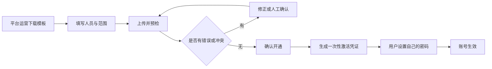
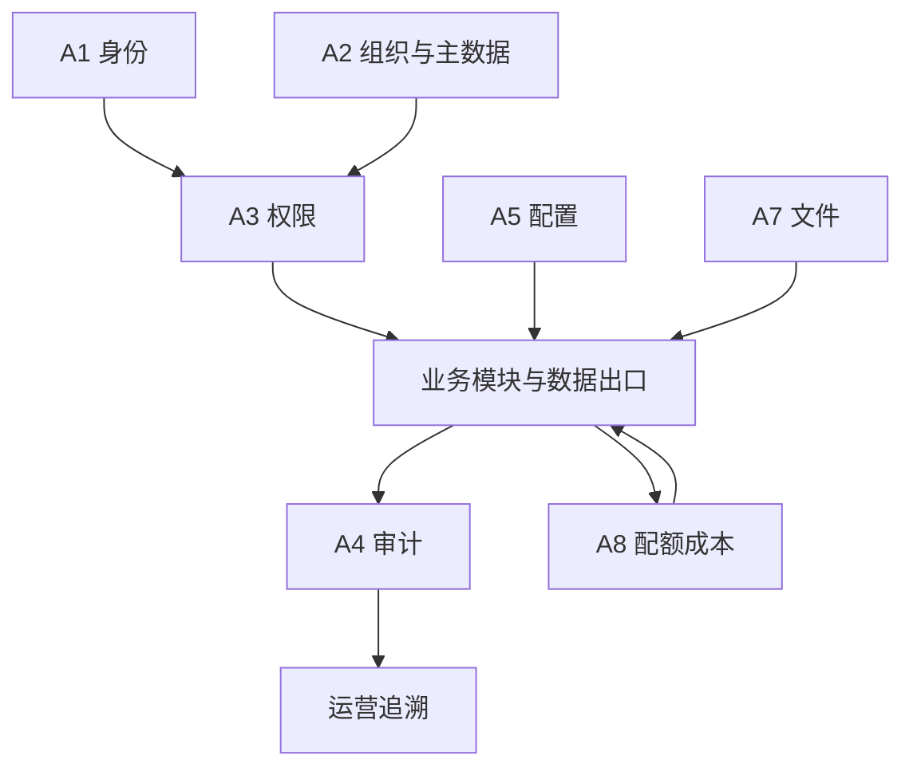

# hbecho 平台底座首版产品设计（草案）

> **状态**：`draft`（2026-10-26 由 liuxuekui 从归档恢复为子 PRD 草案，待复核）  
> **复核状态**：未复核。此前 2026-09-02 的 `archived` 标记作废。  
> **权威关系**：与 [`prd-platform.md`](../prd-platform.md) 和 [`access-control/design.md`](../../.kiro/specs/access-control/design.md) 冲突时，以它们为准。  
> **用途**：保留首版试点范围与反过度设计原则，作为访问控制子 PRD 的素材。

> **文档状态**：v0.1 业务讨论稿，尚未冻结  
> **更新日期**：2026-08-22  
> **主要读者**：业务负责人、产品、平台运营、研发负责人  
> **设计范围**：平台底座 A1～A8，重点细化 A3 / A4 / A5 / A7 / A8；A6 仅说明编号现状  
> **设计重心**：先讲用户、流程、规则和首期边界；技术实现只保留必要红线  
> **第一原则**：**不要过度设计。先让小范围试点安全、清楚、可运营地跑起来。**

---

## 0. 如何使用本文

本文不是一次性定稿，而是“**推荐首版 + 待确认问题**”的讨论底稿。

文中使用四种标记：

- **【既有结论】**：来自现有设计文档，且暂未发现新事实推翻。
- **【本稿建议】**：结合当前试点方式给出的默认方案，业务可调整。
- **【待确认 Qxx】**：需要业务负责人作答的问题；问题全集见第 18 章。
- **【明确后置】**：当前没有足够需求证据，不进入首版。

建议第一轮只回答 **Q01～Q16**。回复可以很简短，例如：

```text
Q01=B；先开放超管、总部、分公司，经销商第二批。
Q04=A；经销商仅看本人。
Q06=A；使用一次性激活码。
其他问题同意推荐默认值。
```

---

## 1. 执行摘要

### 1.1 平台底座首版到底要解决什么

首版平台底座不是建设六个“大中心”，而是跑通一条可信的最小业务闭环：

```text
平台运营导入并开通账号
  → 用户激活并登录
  → 按固定角色进入正确工作台
  → 只能看到自己有权查看的数据
  → 关键操作有记录
  → 少量运营参数可调整
  → 导出和素材文件受控访问
  → 付费能力的用量可见、异常可告警、高成本操作可止损
```

只要这条链路成立，后续的数据供给、规则、指标、活动、学习和 AI 模块就有可靠的共同底座。反之，如果一开始先做复杂权限策略、通用配置平台、完整媒资系统或财务级成本平台，项目会在真正业务上线前消耗大量精力。

### 1.2 本稿建议先定下来的八个方向

1. **不开放公开注册。** 首期所有账号由平台运营在后台单个创建或批量导入。
2. **“平台运营”先作为工作职责，不新增第五个角色。** 默认由超级管理员承担；未来职责稳定分离后再拆角色。
3. **A3 采用固定四角色和固定权限矩阵。** 首期不做自定义角色、个人例外、临时授权和通用审批。
4. **A4 只记录能追责、能排障的关键事件。** 不把每次打开列表、翻页和点击都做成审计。
5. **A5 是白名单式运营参数页。** 只开放已经有明确业务用途的参数，不做“任意键、任意层级、任意版本”的通用配置平台。
6. **A6 是历史编号空位。** 本版明确预留，不凭空发明模块，也不重排 A7/A8 编号。
7. **A7 围绕真实文件场景建设。** 首期优先服务导入件、导出件和确需留存的业务素材，不先做完整 DAM、VOD 和多云媒资平台。
8. **A8 先做到可见、可告警、可人工止损。** 不先做财务级 FinOps、内部结算和复杂成本分摊。

### 1.3 关于“身份认证后面再做”的边界

本稿不深入密码算法、Token、会话存储、短信、SSO、MFA 等技术方案；这些可以在 A1 详细设计时处理。

但只要总部、分公司或经销商开始真实使用，首版仍需具备最低限度的产品闭环：

- 一人一个账号，不使用多人共享账号；
- 用户通过一次性凭证激活并自行设置密码；
- 账号可停用，停用后不能继续访问；
- 忘记密码可由平台运营协助重置；
- 系统能可信地知道“当前是谁”，否则权限和审计都没有意义。

如果首阶段只有极少数平台运营做内部数据准备，可以先不开放外部用户激活；但不建议用共享口令作为未来试点方案。

---

## 2. 设计依据、项目现状与文档关系

### 2.1 本项目的现实前提

【既有结论】当前平台的核心业务背景包括：

- 品牌：海信、日立、约克、科龙；
- 业务角色：超级管理员、总部人员、分公司人员、经销商人员；
- 内容平台：抖音、视频号、小红书、快手；
- 组织和数据范围存在品牌、分公司、门店、人员等层级；
- 数据供给涉及外部付费接口，后续还会涉及视觉识别和大模型费用；
- 平台预计管理约 2,000～3,000 个社媒账号，并承接旧系统存量数据；
- 当前属于内部、小范围逐步开放的项目，不以一次性建设大型企业平台为目标。

【本次新增约束】首期不让经销商自助注册，账号由平台运营后台导入或创建；平台先小范围开放，再根据真实运营情况逐步增强。

### 2.2 文档事实优先级

当现有文档发生冲突时，建议按以下顺序理解：

1. 本次业务明确提出的新约束；
2. 已经完成实测或更晚形成的模块详细设计；
3. `hbecho-设计大纲.md` 中的总体方向；
4. 早期设计中的示例数字和技术构想。

例如，设计大纲曾使用固定同步频率、固定调用量等假设；后续《数据供给与资产层》已根据供应商实测改为按平台、账号、活动和风险动态规划，因此本稿不再把旧数字固化为产品规则。

### 2.3 与现有权限文档的关系

`hbecho-模块设计-权限中心.md` 是本平台角色和数据范围的主要依据。

根目录下的《域E-用户与权限详细设计》服务于另一套“推广平台 + Agent”产品。它的一次性激活、固定权限、会话撤销、默认拒绝等经验可以借鉴，但其 `external` 角色、纯品牌隔离和三层组织假设不能直接覆盖 hbecho。

本平台继续采用：

- `super_admin`：超级管理员；
- `hq_staff`：总部人员；
- `branch_staff`：分公司人员；
- `dealer_staff`：经销商人员。

---

## 3. 产品目标、非目标与成功标准

### 3.1 首版目标

| 目标 | 首版应达到的结果 |
|---|---|
| 受控开户 | 平台运营能批量导入、预检、开通、停用账号；系统没有公开注册入口 |
| 身份可信 | 每个真实使用者有独立身份，账号状态变化能阻止后续访问 |
| 范围正确 | 总部看授权品牌，分公司看本区，经销商默认看本人；不能通过导出、下载或异步任务绕过 |
| 操作可追溯 | 账号、权限、配置、导出、文件和成本相关关键操作能查到责任人、时间和结果 |
| 参数可运营 | 少量高频运营参数不用每次改代码，但修改范围和影响清楚 |
| 文件可控 | 私有文件只向有权限的人提供短期访问；过期、失败和补档有处理方式 |
| 成本不失控 | 付费调用至少能看到用量和估算成本，接近预算能告警，高成本动作能确认或暂停 |
| 能渐进演进 | 未来开放经销商注册、SSO、VOD 或精细成本治理时，不必推翻首版核心模型 |

### 3.2 首版非目标

以下能力没有真实需求触发前，明确不做：

- 公开注册、经销商自主入驻和复杂资质审核；
- 动态自定义角色、个人权限覆盖、复杂 ABAC、临时提权平台；
- 通用审批流、流程中心、工单中心；
- 全员短信登录、企业 SSO、强制 MFA、设备管理中心；
- 任意 Key-Value、任意作用域、任意灰度的通用配置平台；
- 完整数字资产管理系统、全量视频归档、复杂转码和多云存储抽象；
- 财务级成本核销、内部计费、用户级分摊和自动成本路由；
- 为了“架构先进”提前引入与当前规模不匹配的平台或基础设施。

### 3.3 判断是否过度设计的四个问题

每增加一个页面、状态、角色或流程前，先问：

1. 现在是否有明确用户会使用？
2. 是否有每周或每月重复发生的真实流程？
3. 人工处理是否已经明显不可接受？
4. 不做它是否会阻塞首期业务闭环或造成安全风险？

四问多数为“否”时，先记录触发条件，不进入首版。

---

## 4. 核心人物、角色与对象

### 4.1 平台运营与系统角色

“平台运营”是使用系统的一类人物，不一定等于新的系统角色。

【本稿建议】首期由少量超级管理员承担平台运营工作，包括：

- 维护基础组织和人员数据；
- 导入、开通、停用账号；
- 修正用户范围；
- 查看全平台日志、文件异常和用量；
- 修改首期开放的运营参数；
- 处理预算超限和高成本任务放行。

只有当“平台技术管理”和“日常业务运营”长期由不同团队承担，且权限差异稳定存在时，再新增“平台运营”角色。

### 4.2 四类业务角色

| 角色 | 首期产品定位 | 默认数据范围 |
|---|---|---|
| 超级管理员 | 平台运营与全局管理 | 全品牌、全组织 |
| 总部人员 | 品牌业务管理、规则/报表/活动等业务配置 | 一个或多个授权品牌下的全部组织 |
| 分公司人员 | 管理本分公司业务、门店和任务 | 本分公司及下属门店/人员 |
| 经销商人员 | 查看和执行与自己有关的内容、任务、学习 | 默认仅本人及本人绑定的平台账号 |

【待确认 Q01、Q04】首批是否四角色都开放；经销商到底按“本人”还是“本门店”查看，是首版权限设计中最重要的业务选择之一。

### 4.3 三类对象必须在产品概念上分开

| 对象 | 是什么 | 为什么不能混在一起 |
|---|---|---|
| 用户账号 | 可以登录平台的身份 | 有账号状态、激活、密码和权限 |
| 业务人员 | 现实中的总部、分公司或门店人员 | 可能暂时没有账号；离职后历史业务仍需保留 |
| 平台账号 | 抖音、视频号、小红书、快手账号 | 一名人员可能绑定多个平台账号；它不是登录账号 |

首期页面不必把这三个概念做得很复杂，但导入模板、人员详情和异常处理必须避免将其混为同一个对象。

---

## 5. 首版范围总览

| 模块 | 首版产品结果 | 可人工兜底 | 明确后置 |
|---|---|---|---|
| A1 身份认证 | 无公开注册；导入后激活；个人登录；重置；停用 | 运营人工发放激活/重置凭证 | 短信登录、SSO、MFA、设备中心 |
| A2 组织与主数据 | 维护品牌、分公司、门店、人员、平台账号及当前归属 | 初期用模板导入和运营人工修正 | 复杂组织工作流、自动合并裁决 |
| A3 权限中心 | 固定四角色；功能与数据范围分开；关键资源默认拒绝越权 | 运营直接修正用户正式角色/范围并说明原因 | 自定义角色、个人例外、临时授权、审批平台 |
| A4 审计日志 | 记录账号、范围、配置、导出、文件、任务和预算等关键事件 | 极低频动作在日志中关联线下工单号 | 全量行为分析、独立 SIEM、全对象快照 |
| A5 配置中心 | 仅开放真实需要的参数白名单；先全局和品牌两级 | 技术按运营申请修改未产品化参数并回填记录 | 任意配置、复杂继承、灰度编排、全参数热更新 |
| A6 | 编号预留，无页面、流程、数据对象和验收项 | 无 | 有真实独立能力后再命名立项 |
| A7 媒资与文件 | 私有存储、受控下载、导出件和必要素材；失败可补档 | 运营重试、补传或重新生成 | 完整 DAM、VOD、多云、复杂转码后台 |
| A8 配额与成本 | 聚合用量、预算状态、告警、暂停/恢复高成本任务 | 每周看供应商控制台、每月人工对账 | 财务级 FinOps、自动核销、内部结算、精细分摊 |

### 5.1 首版不要求每个模块都有独立“中心”页面

横切能力不等于必须有一个大后台：

- A3 权限体现在用户详情和每个业务动作中，不需要首版权限策略编辑器；
- A7 文件能力优先嵌入导入、导出和内容场景，不需要通用文件管理器；
- A8 先做一个简单用量页，不需要独立财务系统；
- A4、A5 只有平台运营确实要使用时才提供小而清楚的页面。

---

## 6. 首版信息架构与页面清单

### 6.1 建议的最小后台页面

| 页面 | 主要使用者 | 首版核心能力 |
|---|---|---|
| 用户与开通 | 平台运营 | 单个创建、批量导入、预检、开通、停用、重置、查看范围 |
| 导入批次详情 | 平台运营 | 查看成功、失败、冲突行；下载结果；重试失败行 |
| 操作日志 | 平台运营 | 按时间、操作者、动作、对象、结果查询关键事件 |
| 运营参数 | 平台运营 | 查看和修改白名单参数，展示范围、说明、当前值和最近修改 |
| 用量与预算 | 平台运营；总部可选只读 | 查看周期用量、估算费用、预算状态和异常；暂停/恢复受控任务 |
| 下载中心 | 有导出权限的用户 | 查看本人导出任务、进度、失败原因、过期时间和下载入口 |
| 文件异常 | 平台运营 | 查看生成失败、归档失败、缺失和过期异常；重试或补档 |

### 6.2 首版不单独建设的页面

- 公开注册页；
- 角色设计器和权限策略编辑器；
- 通用审批中心；
- 通用文件资源管理器；
- 全量配置项管理器；
- 成本分摊与内部结算页面；
- A6 页面。

---

## 7. 账号开通与用户生命周期

### 7.1 推荐开户流程



首期同时支持：

- 少量用户单个创建；
- 一批用户批量导入；
- 已有账号默认报冲突，不静默覆盖角色和范围；
- 每一行显示成功、失败或冲突原因；
- 失败行可修正后再次处理，不要求整批重来。

### 7.2 建议的导入字段

| 字段 | 是否必填 | 说明 |
|---|---:|---|
| 姓名 | 是 | 用户展示名和人员匹配依据之一 |
| 手机号 | 是 | 首期建议作为登录标识；需统一格式并检查重复 |
| 角色 | 是 | 四个固定角色之一；批量导入默认不允许创建超级管理员 |
| 品牌 | 视角色 | 总部可一个或多个；分公司/经销商通常由组织带出并复核 |
| 组织 | 视角色 | 总部、分公司、门店等已有主档编码，不建议只填自由文本名称 |
| 业务人员 | 经销商建议必填 | 用于实现“仅本人”范围和绑定平台账号 |
| 备注 | 否 | 试点批次、来源或特殊说明 |

【待确认 Q08】最终字段应以实际开户资料能否稳定获得为准，不要为了数据“看起来完整”增加无法维护的必填项。

### 7.3 账号状态

首期只保留三个主要状态：

| 状态 | 含义 | 可做什么 |
|---|---|---|
| 待激活 | 已创建但用户尚未设置密码 | 可重发/重新生成激活凭证，可停用 |
| 正常 | 已激活，可按角色和范围使用 | 可登录、可重置、可调整范围、可停用 |
| 已停用 | 离职、退出试点或被管理员禁用 | 不可登录；历史业务和日志继续保留 |

暂不增加“冻结、休眠、离职待交接、注销审核中”等大量状态。登录失败短时锁定可以由认证实现处理，不必成为复杂业务状态。

### 7.4 激活与重置

【本稿建议】平台运营只生成一次性激活码或激活链接，不设置、不查看用户的正式密码。

- 用户首次激活时自行设置密码；
- 凭证到期后由平台运营重新生成；
- 忘记密码时生成一次性重置凭证；
- 不把统一临时密码通过群聊长期传播；
- 激活清单含敏感信息，应一次性下载并通过受控渠道发给本人。

### 7.5 公开注册入口

首期没有公开注册入口。用户访问注册路径时，建议显示：

> 当前平台仅面向受邀用户开放。如需开通，请联系所属组织的平台对接人。

不采集注册申请，不提前建设资质审核流程。

### 7.6 范围或人员变更

首期调岗、转店和品牌变化由平台运营处理：

1. 选择用户并修改正式归属；
2. 展示修改前后范围；
3. 必填变更原因；
4. 保存后对后续访问立即按新范围执行；
5. 历史报表仍按业务发生时的原归属解释，不回写历史结果。

低频试点阶段无需先做复杂调岗审批和任务自动交接；未完成任务由运营线下确认后人工转交。

---

## 8. A3 权限中心：固定矩阵，先把范围做对

### 8.1 权限由两个问题组成

1. **功能权限**：这个人能不能执行某个动作，例如查看、配置、导出、下发任务。
2. **数据范围**：即使能查看，他具体能看哪些品牌、分公司、门店或人员的数据。

这两个问题不能混在一起。例如，分公司人员可以查看点检表，但只能看本区；总部配置了一张看板，不代表分公司打开后能看到总部全量数据。

### 8.2 首版固定角色矩阵

下表只描述平台底座和跨模块通用边界，规则、活动、学习等模块仍可在各自设计中细化动作权限。

| 能力 | 超级管理员/平台运营 | 总部人员 | 分公司人员 | 经销商人员 |
|---|---:|---:|---:|---:|
| 登录和使用本人工作台 | 是 | 是 | 是 | 是 |
| 创建、导入、开通账号 | 是 | 首期否 | 首期否 | 否 |
| 停用、重置、修改他人范围 | 是 | 首期否 | 首期否 | 否 |
| 查看人员目录 | 全部 | 授权品牌内，字段受限 | 本分公司相关人员，字段受限 | 仅本人 |
| 查看业务数据 | 全部 | 授权品牌 | 本分公司及下属 | 默认仅本人 |
| 配置规则、报表、看板 | 依业务模块 | 授权品牌内可配置 | 只读生效结果 | 只读本人相关结果 |
| 导出业务数据 | 全部 | 授权品牌 | 本区 | 首期建议不开放或仅小范围 |
| 修改平台运营参数 | 是 | 首期否 | 否 | 否 |
| 查看审计日志 | 全平台 | 可选：本品牌业务日志 | 可选：本人安全日志 | 可选：本人安全日志 |
| 查看用量与预算 | 全平台 | 可选：本品牌只读 | 首期不开放 | 首期不开放 |

【待确认 Q03、Q12、Q15、Q16】开户权、经销商导出、参数修改权和角色矩阵仍需业务最终确认。

### 8.3 数据范围按资源类型区分

首期不建设可视化策略编辑器，但产品规则必须区分以下资源：

| 资源类型 | 默认范围 |
|---|---|
| 账号、内容、判定、指标、任务等业务数据 | 品牌 AND 组织层级 AND（经销商角色时）本人 |
| 学习资料等品牌共享内容 | 可仅按品牌隔离，不要求分公司下钻 |
| 组织与人员目录 | 平台运营全量；其他角色按业务协作需要展示受限字段 |
| 平台参数、全局日志、全局预算 | 默认仅平台运营 |
| 下载、导出和 AI 取数 | 继承原业务数据范围，不能形成旁路 |

新增资源如果尚未明确属于哪一种范围，默认不可访问，直到产品和研发明确规则。

### 8.4 首期如何处理特殊授权

【本稿建议】不做个人权限例外和临时授权系统。

出现极少量例外时：

- 由平台运营修改用户的正式角色或范围；
- 必填原因和预计恢复日期；
- 写入 A4 操作日志；
- 到期由运营人工复核恢复。

当临时授权开始频繁发生、人工遗忘造成风险时，再建设带自动到期的临时授权能力。

### 8.5 首期不做

- 用户自定义角色；
- 一人多角色叠加；
- 一人同时属于多个分公司或多家门店；
- 个人 ALLOW/DENY 覆盖；
- 通用策略表达式；
- 每个操作都走双人审批；
- 把职位、中文品牌名或前端菜单当成权限依据。

---

## 9. A4 审计与操作日志：只记录关键事实

### 9.1 产品目标

A4 首版回答三个问题：

1. 谁做了什么？
2. 对哪个对象和范围做的？
3. 成功还是失败，出了问题如何追查？

A4 不是用户行为分析平台，也不是记录所有页面点击的埋点系统。

### 9.2 首版事件目录

| 类别 | 首版记录的事件 |
|---|---|
| 账号安全 | 激活成功、登录成功/失败、重置密码、账号锁定或会话被撤销 |
| 用户与范围 | 单个创建、批量导入、开通、停用、恢复、角色/品牌/组织/人员绑定变更 |
| 敏感数据 | 查看完整手机号、批量导出人员信息、导出业务数据 |
| 业务任务 | 手工同步、重试、回放、重算、重要任务下发或取消 |
| 业务配置 | 规则、指标、报表、看板发布或修改；平台运营参数修改 |
| 文件 | 上传、生成、删除/过期、补档、签发下载链接、下载失败 |
| 配额成本 | 预算修改、高成本任务确认、人工超额放行、暂停/恢复付费任务 |

“查看了谁的数据”不建议解释为记录每一次列表查询。首期重点记录：敏感人员详情、原始数据、批量导出、文件下载签发等高风险出口。

### 9.3 每条日志最少展示什么

- 时间；
- 操作者；
- 动作；
- 对象类型和对象名称/编号；
- 涉及品牌或组织范围；
- 成功或失败；
- 失败原因；
- 操作原因或备注；
- 关联任务号/请求号，便于排障。

账号角色、数据范围、关键参数和预算的修改，需要展示修改前后；普通低风险字段不要求全部保存完整快照。

### 9.4 日志查询页面

平台运营可按以下条件查询：

- 时间范围；
- 操作者；
- 动作分类；
- 对象；
- 品牌/组织；
- 成功或失败；
- 任务号。

首期不做复杂审计报表和跨系统日志检索。日志默认不可由普通管理员修改或删除。

### 9.5 可见范围与保留建议

【本稿建议】

- 平台运营：查看全平台业务审计和安全事件；
- 总部人员：如确有管理需要，只查看本品牌内业务操作，不查看全平台安全事件；
- 分公司和经销商：首期不开放审计中心，可在“账号安全”中查看本人近期登录记录；
- 安全事件至少保留 180 天；
- 账号、权限、配置、导出、预算等业务审计至少保留 1 年。

最终保留期需结合公司制度确认【待确认 Q23】。

### 9.6 首期不做

- 全页面点击审计；
- 每条列表记录的逐行读取日志；
- 通用审批引擎；
- 全对象永久 before/after；
- 独立安全运营平台；
- 面向经营分析的用户行为漏斗。

---

## 10. A5 配置中心：白名单式运营参数

### 10.1 产品定位

配置中心不是把所有技术参数暴露给业务，而是让**少数需要反复调整、含义清晰、误改可控**的运营参数脱离代码发布。

一个参数进入页面前，必须同时满足：

- 有明确业务含义；
- 有明确修改人；
- 有合理取值范围；
- 能说明何时生效；
- 修改后能被审计和恢复。

### 10.2 首版建议开放的参数组

参数应随对应业务模块上线，不提前创建大量空配置。

| 参数组 | 可能的首版参数 | 产品说明 |
|---|---|---|
| 数据同步 | 各平台同步周期、优先账号范围、失败重试截止时间 | 不再固化“每周末一次”；按最新供应商能力和业务新鲜度配置 |
| 采集与素材 | 评论采集是否开启、素材筛选门槛、是否保存某类素材 | 只展示业务决策，不把并发数、底层队列等技术参数全部开放 |
| 导出与文件 | 导出件保留天数、单次导出行数保护、下载有效期 | 防止文件长期堆积和超大导出失控 |
| 识别与 AI | 识别档位、可接受的单任务费用上限 | 对应模块上线后再开放，不在平台底座阶段做空页面 |
| 配额与预算 | 月度预算、预警比例、硬限/软限场景 | 与 A8 共用业务口径 |

### 10.3 作用范围

【本稿建议】首期只做：

1. 全局默认值；
2. 品牌级覆盖值。

活动级配置只有在第一个真实活动证明“同一品牌不同活动必须不同”时再增加。首期不做任意组织层级继承。

当品牌没有单独设置时使用全局值；页面必须清楚显示“当前值来自全局还是品牌覆盖”，避免运营误判。

### 10.4 修改流程

1. 平台运营打开参数详情；
2. 查看业务说明、当前值、作用范围、最近修改人和时间；
3. 输入新值，系统校验允许范围；
4. 页面提示影响，例如“仅影响之后新建的同步任务”；
5. 运营确认并填写原因；
6. 保存后写入 A4 日志；
7. 出现问题时可查看上一个值，由运营一键恢复或人工改回。

首期不建设复杂版本分支、灰度和审批。高风险参数可用二次确认代替审批流。

### 10.5 生效原则

【本稿建议】默认只影响保存后新创建的任务，不中途改变正在执行的任务。这样最容易解释和追溯。

如果某个安全参数必须立即生效，应单独标识，不用“全部热更新”作为统一要求。

### 10.6 不能放进普通配置页的内容

- 供应商密钥；
- 数据库密码；
- Token 签名密钥；
- 任何可在页面直接读取的生产凭证；
- 需要研发理解才能安全修改的底层参数。

### 10.7 首期不做

- 任意 Key-Value 创建；
- 用户自定义配置结构；
- 全局/品牌/大区/分公司/门店/活动无限层级继承；
- 多环境发布编排；
- 通用灰度、实验和回滚平台；
- 让“可配置”代替未完成的业务决策。

---

## 11. A6：保留编号，不定义产品范围

现有总纲从 A5 直接跳到 A7，全工作区未找到 A6 的正式定义。

【本稿建议】A6 按历史编号空位处理：

- 本版无产品目标；
- 无用户和流程；
- 无页面和菜单；
- 无数据对象；
- 无研发任务和验收项；
- 不为编号连续而重排 A7/A8，避免破坏现有引用。

未来只有出现一个真实、独立、稳定的横切业务能力时，才讨论是否使用 A6 编号。不要预先把通知中心、流程中心或消息中心塞进这个空位。

---

## 12. A7 媒资与文件服务：围绕场景做薄能力

### 12.1 首版服务的真实场景

A7 首期只考虑已经能明确说出使用者和流程的文件：

1. 用户导入模板和导入结果；
2. 一次性激活清单等敏感文件；
3. 报表和明细导出件；
4. 数据供给层确需归档的头像、背景、封面、图集或视频源；
5. 后续学习/AI 模块真正上线后产生的上传和生成文件。

S1 平台底座阶段不必先建完整媒资后台。A7 可以先形成私有存储、稳定文件标识、受控访问和过期规则，在第一个真实文件场景中落地。

### 12.2 文件在产品中的基本信息

每个可管理文件至少能说明：

- 文件是什么类型；
- 来自哪里；
- 关联哪个导入、导出、内容或任务；
- 谁创建或触发；
- 当前是生成中、可用、失败还是已过期；
- 文件大小；
- 创建时间和到期时间；
- 失败原因和可执行动作。

首期不需要让运营直接看到底层存储路径。

### 12.3 访问原则

- 文件默认私有；
- 用户预览或下载前，重新确认其账号状态和数据范围；
- 系统只提供短期有效链接，不提供长期公开地址；
- 用户不能输入任意存储路径来换取下载链接；
- 导出任务只能交付下单者有权访问的数据；
- 用户权限变化或账号停用后，尚未交付的敏感文件不应继续无条件开放。

### 12.4 文件类型与建议默认策略

| 文件类型 | 建议默认策略 | 说明 |
|---|---|---|
| 用户导入原文件 | 处理后短期保留，建议 7 天 | 含手机号和组织信息，不应长期堆积 |
| 激活清单 | 明文只提供一次，尽量不长期保存 | 由运营通过受控渠道分别发给用户 |
| 导入结果 | 建议保留 30 天 | 便于运营核对失败行和处理结果 |
| 报表/明细导出 | 建议保留 7 天 | 到期可重新生成 |
| 封面/图集等业务素材 | 按业务授权和后续使用价值决定 | 需先确认供应商下载与长期保存权利 |
| 视频源 | 按筛选策略保存，不全量归档 | 成本和授权风险高 |
| 课程视频 | 进入学习平台阶段再设计 VOD | 不属于当前首版底座的必做项 |

上述天数都是建议默认值，需在 Q28 中确认。

### 12.5 文件异常处理

文件异常页只需覆盖：

- 上传失败；
- 生成失败；
- 来源链接过期；
- 文件缺失；
- 校验失败；
- 已到期但仍被业务引用。

平台运营可以：

- 重试；
- 重新生成；
- 手工补传；
- 标记无法恢复并填写原因。

低频异常先由人工处理，不建设复杂自动修复编排。

### 12.6 首期不做

- 通用素材库和文件夹体系；
- 全量视频永久归档；
- VOD 课程播放、复杂转码和播放器体系；
- 多云存储切换；
- CDN 样式可视化配置；
- 面向业务的生命周期规则编辑器；
- 文件审批和版权管理大平台。

---

## 13. A8 配额与成本中心：先可见，再治理

### 13.1 首版要回答的问题

1. 本周期用了多少付费能力？
2. 大概花了多少钱，数据是否只是估算？
3. 哪个品牌、模块或能力消耗最多？
4. 是否接近预算？谁需要处理？
5. 哪些高成本动作需要确认、限制或暂停？

### 13.2 首版纳入的成本来源

按实际模块上线逐步接入：

- 外部数据供应商接口；
- 视觉识别；
- ASR 或视频理解；
- 大模型 Token；
- 存储与流量可先看云厂商账单，不要求首版全部实时归因。

供应商价格、失败计费和分页计费尚未正式确认时，页面必须明确区分：

- 调用次数/单位：相对可信；
- 估算金额：按当前费率推算；
- 已核对金额：来自供应商账单。

不能把估算值伪装成财务结算值。

### 13.3 首版用量页

【本稿建议】首版按以下维度查看即可：

- 时间：日、月；
- 供应商/付费能力；
- 品牌；
- 业务模块。

页面展示：

- 本周期预算；
- 已使用和剩余；
- 预算使用比例；
- 近期趋势；
- 预警状态；
- 失败、重试等异常消耗；
- 当前暂停的任务类型。

首期不要求按每个用户和每个活动精确分摊。

### 13.4 软限与硬限

【本稿建议】采用简单、可解释的默认规则：

| 场景 | 默认策略 | 原因 |
|---|---|---|
| 日常增量同步 | 软限：告警但不因小幅超额立即停 | 窗口滑过后数据可能无法补采 |
| 同步失败的必要重试 | 软限，但异常重试次数需告警 | 避免因预算导致本周期数据缺口 |
| 大范围历史回补 | 硬确认或硬限 | 范围可控、费用高、可延后 |
| 全量视觉识别 | 硬确认或硬限 | 单次成本高，可先估算 |
| 批量 AI 生成 | 硬确认或任务额度 | 非基础数据完整性的必要动作 |
| 单个用户日常小额 AI 操作 | 个人/品牌额度 + 软提示 | 兼顾体验和成本 |

### 13.5 告警与处置

建议默认在预算使用达到 80% 时预警，达到 100% 时升级告警；实际阈值由业务确认。

告警至少包含：

- 哪个供应商或能力；
- 哪个品牌/模块；
- 当前用量和预算；
- 近期增长；
- 建议动作；
- 负责人。

平台运营可以：

- 暂停某类非必要付费任务；
- 恢复任务；
- 调整预算或阈值；
- 对一次高成本任务人工放行；
- 填写原因并留 A4 日志。

### 13.6 对账方式

首版可采用务实的人工闭环：

- 每周查看供应商控制台，确认是否存在异常增长；
- 每月将平台汇总与供应商账单核对；
- 差异记录原因，例如失败计费、重试、费率变化或统计延迟；
- 差异频繁且人工成本明显时，再建设自动核销。

### 13.7 首期不做

- 财务级资金预占；
- 内部部门结算；
- 每个用户/活动的精确分摊；
- 自动账单核销；
- 费用预测模型；
- 多供应商自动成本路由；
- 复杂自动降级编排；
- 通用预算审批流。

---

## 14. 跨模块产品关系



### 14.1 各模块的产品分工

- A1 回答“你是谁、账号是否有效”；
- A2 回答“你属于哪个品牌、组织、人员和平台账号”；
- A3 回答“你能做什么、能看哪些范围”；
- A4 回答“你做过什么、结果如何”；
- A5 回答“哪些运营规则可以在受控范围内调整”；
- A7 回答“文件如何安全生成、保存、交付和过期”；
- A8 回答“付费能力用了多少、是否需要告警或止损”。

### 14.2 异步任务不能绕过用户范围

导出、同步、重算、AI 取数等任务可能在用户离开页面后才执行。产品上必须保持两条规则：

1. 任务只处理用户下单时有权处理的范围；
2. 文件最终交付前再次确认账号仍有效，避免停用用户继续获取敏感结果。

具体如何实现留到技术设计，不在本文展开。

---

## 15. 人工兜底方案

首期允许人工兜底，但必须有责任人、处理步骤和留痕。

| 场景 | 首期处理方式 | 何时需要产品化增强 |
|---|---|---|
| 导入行冲突 | 平台运营查看冲突，修正模板或明确选择关联已有人员 | 每批冲突量持续较大时做专门合并工作台 |
| 临时跨范围查看 | 运营修改正式范围、填写原因和恢复日期，到期人工恢复 | 每月频繁发生或出现忘记回收时做临时授权 |
| 用户忘记密码 | 运营生成一次性重置凭证 | 用户量和工单量明显上升时开放自助找回 |
| 人员离职且任务未完 | 先停用账号，再由业务负责人指定接手人，运营手工转交 | 任务规模大且频繁时做自动交接 |
| 参数修改后效果异常 | 查看上一值并恢复，记录原因 | 参数数量和变更频率上升时做完整版本/回滚 |
| 文件生成或归档失败 | 重试、重新生成或手工补传 | 同类失败高频时做自动恢复和批量处理 |
| 预算即将超限 | 运营确认是否暂停非必要任务或申请追加额度 | 多团队共同承担预算时引入审批和分摊 |
| 账单与平台估算不一致 | 月度人工核对并记录差异 | 差异频繁、金额较大时自动核销 |
| 供应商能力异常 | 暂停相关任务并降到人工处理/稍后重试 | 第二供应商真实引入后再做自动切换 |

人工兜底不是“不设计”，而是用最低成本验证问题是否真的值得系统化。

---

## 16. 最低产品与安全红线

以下能力虽然看起来偏技术，但属于首版不能省略的产品可信度底线：

1. 真实用户不共享账号；
2. 不能只靠前端隐藏菜单，服务端仍需判断权限；
3. 未明确数据范围的新资源默认不开放；
4. 账号停用后，后续访问和敏感文件交付必须停止；
5. 导出、下载、Worker 和 AI 不能获得超过原用户的范围；
6. 私有文件不能变成长期公开链接；
7. 生产密钥不进入普通配置页、导出文件和操作日志；
8. 平台运营的高风险操作必须能追溯到个人；
9. 不因权限或认证依赖故障而默认放行；
10. 个人信息、原始评论和敏感导出默认按最小范围展示。

这些红线不是“过度设计”；它们是让小范围试点不留下结构性风险的最低成本。

---

## 17. 验收方式与分期

### 17.1 用一条端到端场景验收，而不是验收六个空壳中心

建议首版准备两个品牌、若干组织和约 20 个测试账号，完成以下场景：

1. 平台运营通过模板导入账号，错误行能说明原因；
2. 用户使用一次性凭证激活，无公开注册入口；
3. 同一业务页面由总部、分公司、经销商打开，分别只看到品牌、本区、本人数据；
4. 分公司发起本区导出，下载中心只交付本区文件，链接到期失效；
5. 平台运营能查到开户、登录、范围变更、导出、下载签发和参数修改；
6. 平台运营修改一个真实运营参数，系统清楚提示何时生效；
7. 触发一次付费调用后，用量页增加；到预警值能通知负责人；
8. 高成本批量动作要求确认，平台运营可暂停和恢复；
9. 停用账号后不能继续访问，尚未交付的敏感结果不能继续下载；
10. 整条链路不依赖共享账号、线下 Excel 权限判断或研发直接改数据库才能完成日常操作。

### 17.2 首版成功标准

- 公开注册入口为关闭状态；
- 试点账号均由平台运营可控开通和停用；
- 四类角色或首批启用角色的数据范围验收通过；
- 关键操作可以从日志还原；
- 参数页面只出现真实可用参数，没有大量空项；
- 文件访问不产生永久公开地址；
- 用量和预算状态对运营可见；
- 人工兜底场景均有明确负责人和留痕方式；
- 业务方能说清哪些需求进入下一阶段，而不是因为“以后可能有”提前建设。

### 17.3 建议分期

| 阶段 | 目标 | 主要交付 |
|---|---|---|
| P0 业务确认 | 决定试点人群和首版边界 | 回答 Q01～Q16；确认导入模板、角色范围和首个文件/成本场景 |
| P1 内部底座 | 平台运营能准备数据和账号 | A2 主数据、用户导入、固定权限、关键日志；外部用户可暂不开放 |
| P2 小范围试点 | 真实总部/分公司/经销商可使用 | 激活登录、范围校验、下载中心、必要参数、基础用量与告警 |
| P3 运营增强 | 根据试点证据补齐高频痛点 | 自助重置、委派开户、临时授权、自动对账等按真实触发条件选择 |

### 17.4 后续能力的触发条件

| 候选能力 | 建议触发条件 |
|---|---|
| HQ/分公司委派开户 | 平台运营开户工作量持续过高，且组织责任边界稳定 |
| 经销商自助注册 | 有明确招募流程、资质规则、审核责任和足够用户规模 |
| 临时授权 | 跨范围例外频繁、人工回收已出现风险 |
| 自定义角色 | 固定四角色长期无法表达多类稳定岗位，而非个别人员例外 |
| SSO/MFA | 公司统一身份要求、外部风险上升或高价值账号治理需要 |
| 活动级配置 | 同品牌不同活动确实长期需要不同参数 |
| VOD | 学习课程或样片在线播放成为真实上线需求 |
| 完整媒资后台 | 文件检索、版本、版权、复用成为独立高频工作流 |
| 自动账单核销 | 人工对账频繁、差异金额高或供应商数量增加 |
| 精细成本分摊 | 业务部门需要内部结算，而非仅看总体预算 |

---

## 18. 待业务确认的问题清单

## 18.1 第一组：阻塞首版范围，建议优先回答

| ID | 问题与选项 | 本稿推荐 | 不确认的影响 |
|---|---|---|---|
| Q01 | 首批实际开放哪些角色？A 四角色；B 超管+总部+分公司；C 仅平台运营+总部 | 按真实试点名单选，不为未开放角色做空壳工作台 | 无法确定页面、验收账号和支持范围 |
| Q02 | “平台运营”如何映射？A 超级管理员职责；B 新增第五角色；C 总部人员兼任 | **A** | 影响角色数量和后台可见范围 |
| Q03 | 首期开户权是否全部收归平台运营？A 是；B HQ 可开下级；C 分公司也可开经销商 | **A** | 影响用户管理流程和授权边界 |
| Q04 | 经销商数据范围？A 仅本人；B 本门店全部人员；C 增加店长/专员差异 | **A**，符合现有设计 | 会改变人员绑定、看板和任务范围 |
| Q05 | 总部人员是否继续支持一人负责多品牌？A 是；B 一人一品牌 | **A**，沿用既有结论 | 影响账号授权和品牌切换体验 |
| Q06 | 激活方式？A 一次性码/链接后自设密码；B 运营设临时密码；C 运营长期代管 | **A** | 决定开户流程和密码责任 |
| Q07 | 首期登录标识？A 手机号；B 邮箱；C 工号；D 手机号或邮箱 | **A**，与现有设计一致 | 影响导入必填字段和账号唯一性 |
| Q08 | 导入模板最终必须有哪些字段？是否能稳定拿到组织编码、人员编码和手机号？ | 采用第 7.2 节最小字段，拿不到的字段不要强设必填 | 决定批量开通是否真正可用 |
| Q09 | 手机号已存在时如何处理？A 一律报冲突；B 自动覆盖；C 预览后显式更新 | 创建默认 **A**；后续更新用 **C** | 自动覆盖可能造成提权或错误归属 |
| Q10 | 经销商登录用户是否必须绑定一个业务人员档案？A 必须；B 可以只有门店；C 按人群区分 | 若坚持“仅本人”，必须选 **A** | 不绑定人员就无法解释“本人数据” |
| Q11 | HQ/分公司能看到哪些人员字段？完整手机号由谁查看？ | 建议仅平台运营看完整手机号；其他默认掩码，HQ 如有真实协作需求再放开 | 影响隐私和人员协作体验 |
| Q12 | 经销商首期是否允许导出？A 不允许；B 仅本人明细；C 与在线查看一致全量导出 | 建议 **A** 或小范围 **B** | 影响数据外发风险和下载中心范围 |
| Q13 | A7 首个必须上线的文件场景是什么？A 导入/导出；B 再加供应商图片归档；C 再加用户上传；D 首期就需视频/VOD | 建议从 **A** 开始，随 B 层上线再加图片归档 | 决定 A7 是否需独立页面和处理链路 |
| Q14 | 是否接受 A8 默认边界：日常同步软限，历史回补/全量识别/批量 AI 硬确认？ | **接受** | 不确认会导致超预算时无法决定停还是继续 |
| Q15 | 谁能修改品牌级运营参数？A 仅平台运营；B HQ 可改本品牌；C HQ 提交、运营确认 | 首期 **A** | 影响 A5 页面权限和责任归属 |
| Q16 | 第 8.2 节的固定角色矩阵是否可作为首版基线？哪些格子必须调整？ | 先按基线试点，只改有真实场景的格子 | 无法完成角色验收和页面收敛 |

## 18.2 第二组：上线前确认，可采用默认值先推进

| ID | 待确认事项 | 建议默认值 |
|---|---|---|
| Q17 | 账号停用后未完成任务如何处理？ | 先停用账号，再由业务负责人指定接手人，平台运营人工转交 |
| Q18 | 激活凭证有效期和重置方式？ | 激活 7 天；重置 24 小时；到期由运营重新生成 |
| Q19 | 忘记密码、范围错误和开通失败分别由谁受理？ | 统一平台运营入口，再按主数据/业务/技术问题分派 |
| Q20 | A4 首版事件目录是否完整？还缺哪个必须追责的动作？ | 先按第 9.2 节；新增事件必须说明使用者和排查场景 |
| Q21 | “查看数据”记录到什么粒度？ | 只记录敏感详情、原始数据、导出和下载等高风险出口，不记普通列表浏览 |
| Q22 | HQ 是否需要查看本品牌业务操作日志？ | 首期可不开放；有品牌管理问责需求时提供本品牌只读视图 |
| Q23 | 安全日志和业务审计保留多久？ | 安全事件 180 天；账号/权限/配置/导出/预算等业务审计 1 年 |
| Q24 | 首批真正需要运营调整的参数是哪几项？ | 只选与已上线模块直接相关的 5～10 项，不一次性列几十项 |
| Q25 | 参数修改默认何时生效？ | 只影响修改后新建任务；安全类特殊参数另行标注立即生效 |
| Q26 | 参数是否需要审批和完整版本发布？ | 首期不审批；高风险项二次确认；保留上一值可恢复 |
| Q27 | 首期文件类型清单？ | 用户导入、导入结果、激活清单、报表导出；B 层上线后增加选中素材 |
| Q28 | 各类文件保留期？ | 导入原件 7 天、导入结果 30 天、导出件 7 天；业务素材另行确认 |
| Q29 | 下载链接有效期？ | 15 分钟；到期后用户在下载中心重新申请 |
| Q30 | 谁能上传、替换、过期或删除文件？ | 由业务场景决定上传者；首期仅平台运营可补档/提前过期，不开放任意物理删除 |
| Q31 | 供应商素材是否允许下载和长期保存？ | 上线前取得书面确认；未确认时不把长期保存作为产品承诺 |
| Q32 | 首批有哪些真实付费能力和供应商？ | 列出供应商、能力、调用单位、价格证据和账单入口；不确定项标“估算” |
| Q33 | 各付费能力预算周期和金额？ | 先按月管理；金额由业务预算和供应商合同确认 |
| Q34 | 预算预警阈值和接收人？ | 80% 预警、100% 升级；平台运营+业务负责人接收 |
| Q35 | 谁能追加预算、人工放行和恢复任务？ | 首期仅平台运营按业务负责人确认执行，并记录原因 |
| Q36 | 对账频率和责任人？ | 每周巡检用量、每月账单核对；平台运营执行，业务负责人确认异常 |
| Q37 | A8 首期归因粒度？ | 供应商/能力/品牌/模块/日期；用户和活动后置 |
| Q38 | 试点品牌、组织、人数、周期和支持群是什么？ | 上线前形成一张试点名单和单一问题入口 |
| Q39 | 首期需要导入哪些旧账号、人员和组织数据？ | 只导入试点必要范围，先做样本核对，再扩大批次 |
| Q40 | 谁对首版验收签字？ | 业务负责人确认范围与角色；平台运营确认流程；研发确认安全红线和可运行性 |

## 18.3 第三组：可后续确认，不阻塞首版

| ID | 后续问题 | 建议触发方式 |
|---|---|---|
| Q41 | 何时开放 HQ/分公司委派开户？ | 平台运营工作量和组织责任边界证明有必要后 |
| Q42 | 何时开放经销商自助注册？ | 注册、资质、审核、协议和退出流程明确后 |
| Q43 | 是否接入短信、企业 SSO、MFA 和设备管理？ | 按公司统一要求、账号规模和风险决定 |
| Q44 | 是否需要一人多角色或多组织？ | 出现稳定且无法用现有角色表达的真实岗位后 |
| Q45 | 是否新增店长角色，让其查看本门店？ | 真实门店管理者与普通专员长期存在不同权限后 |
| Q46 | 是否需要个人权限例外和临时授权？ | 例外频率和人工回收风险达到阈值后 |
| Q47 | 哪些动作需要双人审批？ | 出现高损失风险且二次确认不足以控制时 |
| Q48 | 是否需要活动级配置、灰度和复杂回滚？ | 多活动差异稳定存在且品牌级无法满足时 |
| Q49 | 何时建设 VOD、课程转码和播放保护？ | 学习平台进入真实上线范围后 |
| Q50 | 是否建设完整媒资后台？ | 文件检索、版本、复用、版权管理成为独立工作流后 |
| Q51 | 是否按用户/活动精确分摊成本？ | 出现内部结算或明确问责需求后 |
| Q52 | 是否做自动降级和多供应商成本路由？ | 至少有第二供应商且人工切换已不够用后 |
| Q53 | A6 是否承载某个新模块？ | 先出现真实独立能力，再命名；当前不预设 |
| Q54 | 第二家数据供应商何时引入？ | 主供应商能力、稳定性或价格出现明确不足后 |

---

## 19. 建议的首轮评审议程

为避免第一次评审陷入所有细节，建议按以下顺序讨论：

1. **试点对象**：回答 Q01、Q04、Q05；
2. **开户方式**：回答 Q02、Q03、Q06～Q10；
3. **隐私与数据出口**：回答 Q11、Q12；
4. **首个真实底座场景**：回答 Q13～Q15；
5. **角色矩阵**：确认 Q16；
6. 其余问题原则上先接受建议默认值，由具体模块上线前再确认。

第一次评审的产出不应是“所有未来需求都想清楚”，而应是：

- 谁先用；
- 谁给他们开户；
- 每类人能看什么；
- 哪些关键动作必须留痕；
- 首批有哪些参数、文件和付费能力；
- 哪些内容明确不做。

---

## 20. 大厂经验如何取舍

### 20.1 采纳的原则

| 大厂常见经验 | 本项目的轻量落法 |
|---|---|
| 最小权限、默认拒绝 | 固定四角色；新增资源未定义范围时不开放 |
| 功能与数据范围分离 | 同一页面不同角色复用，但查询结果按本人范围过滤 |
| 管理员不掌握用户密码 | 一次性激活/重置，用户自己设置密码 |
| 关键操作可追溯 | 只记录关键事件，不做全点击审计 |
| 私有文件受控交付 | 短期下载链接、交付前复查权限 |
| 配置有类型、有范围、有记录 | 白名单参数、全局+品牌、显示影响和上一值 |
| 高成本能力有预算守卫 | 日常同步软限，高成本批量动作硬确认 |
| 架构应可演进 | 保留清晰模块职责，但不提前建设复杂平台 |

### 20.2 明确不照搬的做法

- 不把四角色系统做成云厂商 IAM；
- 不因为“大厂都有审批”就建设通用流程平台；
- 不因为文件种类未来会增加就先做企业级 DAM/VOD；
- 不因为存在成本就先做财务级 FinOps；
- 不因为未来可能接第二家供应商就先为多家供应商建设完整运营后台；
- 不因为 A6 编号空缺就发明新模块；
- 不把旧总纲中的固定调用数字、固定频率和固定素材策略当成永远不变的产品规则；
- 不用技术可配置性掩盖尚未作出的业务决定。

大厂经验真正值得借鉴的是：职责清楚、默认安全、事实可追溯、异常可恢复；不是系统数量、页面数量和技术名词数量。

---

## 21. 参考文档

- [hbecho 设计大纲](./hbecho-设计大纲.md)
- [hbecho 模块设计：权限中心](./hbecho-模块设计-权限中心.md)
- [hbecho 模块设计：数据供给与资产层（归档）](../archive/data-foundation/data-supply-and-assets.md)
- [hbecho 模块设计：指标与看板](./hbecho-模块设计-指标与看板.md)
- [域 E：用户与权限详细设计](../archive/legacy/域E-用户与权限详细设计.md)

---

## 22. 决策记录（评审后填写）

| 日期 | 问题编号 | 决策 | 决策人 | 影响章节 | 后续动作 |
|---|---|---|---|---|---|
| 待填写 | Q01 |  |  |  |  |
| 待填写 | Q02 |  |  |  |  |
| 待填写 | Q03 |  |  |  |  |
| 待填写 | Q04 |  |  |  |  |
| 待填写 | Q05 |  |  |  |  |
| 待填写 | Q06 |  |  |  |  |
| 待填写 | Q07 |  |  |  |  |
| 待填写 | Q08 |  |  |  |  |
| 待填写 | Q09 |  |  |  |  |
| 待填写 | Q10 |  |  |  |  |
| 待填写 | Q11 |  |  |  |  |
| 待填写 | Q12 |  |  |  |  |
| 待填写 | Q13 |  |  |  |  |
| 待填写 | Q14 |  |  |  |  |
| 待填写 | Q15 |  |  |  |  |
| 待填写 | Q16 |  |  |  |  |
