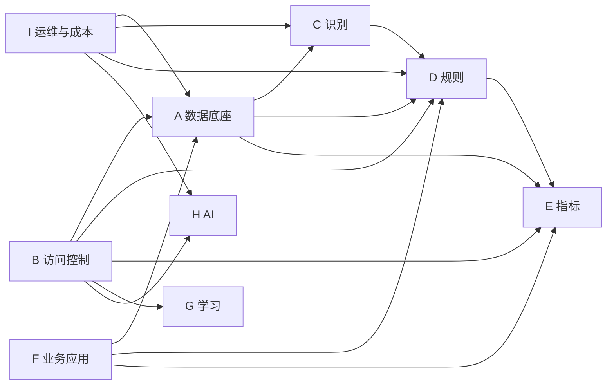

# hbecho · 新媒体运营平台 产品需求文档（总 PRD）

**版本 v1.0.7 · 2026-11-04 · 重构版**

> **状态**：`draft` —— 逐章复核中；全部章节确认后整体转 `current`。
> **本文档的职责边界**
>
> 总 PRD 只写四件事：**产品定位与范围**、**现状基线与约束**、**域的划分与边界**、**跨域关键决策**。
>
> 总 PRD 不写：任何单个域的功能细则（在各 `prd-domain-*.md`）、表结构与事务（在 v2 基线）、技术选型与不选原因（在 ADR）、运维步骤（在 runbook）。
>
> **冲突时以域文档与本 PRD 指向的基线为准。** 若本 PRD 与域文档不一致，按域文档执行并回来修订这里。
>
> 文档地图见第零章；需求编号与追踪规则见 §0.5。

---

## 文档修订记录

| 版本 | 日期 | 主要变化 | 决策人 |
|---|---|---|---|
| v0 | 2026-09-02 | 初版《项目总纲》：五项目标、九条非目标、模块地图、六阶段 | — |
| **v1.0** | **2026-10-27** | 按 hbdam 形式重构：新增文档地图、域划分 A–I、需求编号与追踪矩阵；吸收旧设计大纲的旧系统教训、分层模型与模块地图；确认 1.0 范围（含 C2 档1、G 精简版、H1/H2/H5/H8）；域代号重定为 A 数据底座 / B 访问控制 | 刘学奎（范围决策）· Claude（整理） |
| v1.0.1 | 2026-10-29 | **订正事实，非新决策**：§0.1 域 PRD 由"尚未编写"改为 7 份已写；§4.2 C1 去掉 1.0 分词与关键短语（C 13.1）；§4.2 F5 去掉 1.0 批次回滚（F-D06）；§5.3 第 6 项按 D-22 更新 `RoleCode`；§12 按实际进度重排并标注 H/I 域 PRD 缺口 | —（订正，依据 D-22、C 域 PRD §13.1、F-D06 与各域 PRD 现状） |
| v1.0.2 | 2026-10-30 | 新增 §6.11「活动计划是消费侧的统一入口」：采集只一份、计划是消费侧入口、三代生命周期、版本挂判定计划、可见与可选分开。决策人：刘学奎 |
| v1.0.3 | 2026-10-30 | 补 D-68 与 §6.11 第 1、3、6 条：采集分常态（账号与列表）与按需（详情、视频源、音频、评论，由判定计划触发）；计划删除不触发数据清理；按需采集幂等。决策人：刘学奎 |
| v1.0.4 | 2026-10-30 | §6.11 改为三层对象：A 活动计划 → 监控判定计划（C 监控段 + D 判定段，1:1 两表）→ E 计划看板；D-68 同步修订，推翻同日初稿把 C 挂在 D 判定计划下的写法。决策人：刘学奎 |
| v1.0.5 | 2026-10-30 | 清理 §11：Python 运行形态（C 13.4）、Store 不可变（D-18）、手机号存储（D-42）已关闭；§11.3 时限按现状重写。决策人：刘学奎 |
| v1.0.7 | 2026-11-04 | 新决策 D-69～D-72（一专员一平台一账号、名单导入自动建专员、内容逐层过滤、费用预估 1.0 不展示）；D-27 由 D-D12 替代；D-30 改为当前配置；D-36 经销商级仅超管；§7.2 增 `a-activity-plan`（共 10 个 spec）、§7.4 调整顺序；门禁 5 改为按监控判定计划。批次 1 订正事实：§0.1 / §2.5 文档与 spec 现状、`store_staff` 能力、D-18 由 ADR-0008 修订、A 模块编号与追踪矩阵、2.0 范围、门禁 1 媒资、D4 生命周期、AI Master 单价；新决定：费用预估 1.0 不向业务展示（R3-05）。决策人：刘学奎 |
| v1.0.8 | 2026-11-04 | D-73：不单独编写 `conventions-platform.md`，跨域约定按主题回原文；§0.1 与 §12 同步，导航移到 INDEX §3.1。决策人：刘学奎 |
| v1.0.6 | 2026-11-03 | 按 H 域 v0.2 收窄 1.0：H8 规则辅助移至 2.0；H5 仅超管/总部；H5 只接受可见内容快照；门禁 12 改为 H1 计量审计；D-07 修订。决策人：刘学奎 |

---

## 零、文档地图与职责边界

### 0.1 五层文档

| 层 | 文档 | 管什么 | 状态 |
|---|---|---|---|
| 领域语义 | [`CONTEXT.md`](../CONTEXT.md) | 领域词汇、语义边界、不变量 | current |
| **产品需求** | **本文档** | 定位、范围、域边界、跨域决策 | draft（复核中） |
| 产品需求（域） | `prd-domain-<代号>-<slug>.md` | 单域的用户、场景、功能、规则、验收 | 9 份已写：B `current`；A、C–G 定稿候选；H、I 初稿（见 [`INDEX.md`](INDEX.md) §5） |
| 跨域约定 | 不单独编写（D-73） | 编号、权限谓词、日志、成本、配置、容量按主题回原文，导航见 [`INDEX.md`](INDEX.md) §3.1 | — |
| 技术基线 | [`domains/data-foundation/database-design-v2.md`](domains/data-foundation/database-design-v2.md) | 30 表、状态机、事务边界 | draft（待按 A 域逐表复核） |
| 技术设计 | `.kiro/specs/<代号>-<切片>/{requirements,design,tasks,acceptance}.md` | 单切片的可实施设计 | draft |
| 技术决策 | [`architecture/adr/`](architecture/adr/README.md) | 难逆取舍与未决选型 | current |
| 不可协商条款 | [`governance/constitution.md`](governance/constitution.md) | 18 条跨模块红线 | draft |
| 运维 | [`runbooks/`](runbooks/) | 服务器、部署、CI | current |
| 历史 | [`archive/`](archive/) | superseded / archived / legacy | 不参与裁决 |

导航与状态以 [`INDEX.md`](INDEX.md) 为准。

### 0.2 本 PRD 不写什么

| 不写 | 去哪 |
|---|---|
| 单域功能细则、页面流程、字段级规则 | 域 PRD |
| 表、字段、CHECK、current 指针、事务边界 | v2 基线 |
| 框架、ORM、队列、部署拓扑 | ADR + runbook |
| 供应商逐字段合同 | `aimaster接口文档/` |
| 算法实现、DSL schema | 对应 spec 的 design.md |

### 0.3 冲突裁决

沿用 [`INDEX.md` §3](INDEX.md)：`CONTEXT.md` → v2 → 供应商合同与实测 → `.kiro/specs/*` → 本 PRD → 历史归档。

### 0.4 本 PRD 的性质

- 本 PRD 是**产品语义的框架**，不是需求全集；每条产品级需求在 §10.3 有唯一编号和承接方。
- 本 PRD 中的**未决项保持显式**，不得在示例、配置或代码中被默认值冻结。
- 本 PRD 只记录**决策**（产品拍板）与**事实订正**，两者分开写：决策写决策人、日期与它推翻了什么；订正只改事实并标注来源。

### 0.5 需求编号与追踪规则

| 层 | 编号格式 | 示例 |
|---|---|---|
| 总 PRD（产品级） | `P-R<nn>` | `P-R26` |
| 域 PRD | `<代号>-R<nn>` | `A-R07`、`D-R03` |
| Spec（切片级） | 沿用 spec 自身 `R<nn>` | tracer `R9` |

规则：

1. 每条需求必须**可验证**：要么有自动化检查，要么有明确的手工验收步骤。
2. 域 PRD 与 spec 的 `requirements.md` 顶部必须引用它承接的 `P-R` 编号。
3. 需求编号一经分配不复用；作废时保留编号并标注 `void`。
4. 追踪矩阵见 [§10.3](#103-需求追踪矩阵)。

---

## 一、产品定位与范围

### 1.1 一句话定位

面向海信、日立、约克、科龙等品牌的新媒体运营团队，把「账号与内容数据获取 → 业务规则判定 → 指标度量 → 报表与点检 → 学习与内容辅助」串成一条**可追溯、可解释、可授权**的平台链路。

### 1.2 五项必须形成的能力

| # | 能力 | 可验收的结果 | 1.0 |
|---|---|---|---|
| 1 | 可信数据家底 | 组织、门店、专员、平台账号、内容、观察快照、列表出现与正式媒资具有稳定身份与历史语义；供应商原始事实可在保留期内重放 | ✅ |
| 2 | 可解释的业务判定 | 考核项由业务别名、版本化规则和达标方式组成；判定能解释输入、版本、实际求值路径与技术待定原因 | ✅ |
| 3 | 唯一指标口径 | 点检表、看板与导出读取同一冻结投影；比率、观察时点、分母与数据质量不在各页面重复实现 | ✅ |
| 4 | 受控访问 | 每个真实用户有独立会话；Capability 与 DataScope 正交；当前查看权限与历史业务归属分开；撤权后异步任务不能继续扩大处理或交付范围 | ✅ |
| 5 | 成本与运行可控 | 供应商调用、媒资下载和高成本识别可计量、限流、审计和人工止损；默认测试不产生付费调用 | ✅ |

### 1.3 非目标

当前阶段明确不做：

- 自研社媒爬虫；数据通过商用供应商适配层获取；
- 覆盖全项目的一次性巨型 Spec 或一次性上线所有模块；
- 跨企业 SaaS 多租户；
- 重型湖仓、流处理或大数据栈；
- 动态角色设计器、任意 ABAC、个人权限覆盖、通用临时提权和通用审批平台；
- 公开注册、复杂资质入驻、全员 SSO/MFA/设备中心；
- 完整 DAM、多云抽象、全量视频无差别归档、复杂转码平台；
- 财务级 FinOps、内部结算和自动成本分摊；
- 自研基础大模型，或让 Agent 绕过内部服务直接查询数据库；
- 在本 PRD 复制 30 表 DDL、规则 DSL、指标 schema 或供应商字段字典。

### 1.4 与旧平台的关系

旧系统 `lxk-BigSpard` 只提供两类输入：**经验**（哪些坑不再踩，见 §2.2）与**存量数据**（是否迁移见 §5.1 D-03）。平台不做渐进式改造，也不继承旧表名、旧组织模型或旧技术选型（不继承清单见 §5.3）。

---

## 二、现状基线与约束

### 2.1 旧系统实测（经验来源）

| 存量资产 | 数量 | 对当前的价值 |
|---|---|---|
| `dealers` | 1,294 | 门店主数据的历史参照 |
| `dealer_staff` | 1,334 | 账号台账的历史参照（全部抖音） |
| `videos` | 39,346 | 历史内容样本；**不进入 1.0** |
| `account_snapshots` | 5,752 | 粉丝/获赞历史趋势样本 |
| `video_type_matches` | 6,775 | 旧判定结果，仅作新规则的对账参照 |
| `campaign_events` | 15（12 个有效） | 历史活动与考核口径的实物样本 |
| 已归档图片素材 | 约 1.6 万张 | 媒资判同与归档策略的参照 |

这些数据**不迁移**（§5.1 D-03），只用于理解业务口径与做验收对照。

### 2.2 旧系统十二类教训

不是技术债清单，是设计约束的来源。

| # | 旧系统的做法 | 造成的问题 | 本平台的约束 |
|---|---|---|---|
| 1 | 判定逻辑写在代码里 | 业务想加维度就要发版 | 规则必须是数据，判定能力原子化可组合 |
| 2 | 同一个"完成"有三套口径 | 同一问题三个答案 | 指标口径唯一，一处定义全局引用 |
| 3 | 组织与业务常量硬编码 | 组织或活动一变就发版 | 组织与常量全部数据化 |
| 4 | 品牌隔离靠每个路由手写 | 已发生跨品牌数据泄漏 | 数据范围在数据访问层强制注入 |
| 5 | 判定结论存在账号表单字段 | 下个活动覆盖，历史不可回溯 | 判定按「对象 × 规则版本 × 时点」存，不覆盖 |
| 6 | 重算先 DELETE 再 INSERT，无事务 | 中途失败即数据丢失 | 新版本写入 → 校验 → 原子切换 |
| 7 | 长任务跑在 HTTP 请求里 | 客户端断开即中断，不可恢复 | 长任务一律入队，HTTP 只下单与查状态 |
| 8 | `spawn python3` + 正则解析 stderr | 契约靠日志格式，极其脆弱 | 能力服务化，暴露明确接口契约 |
| 9 | 只读角色可执行写操作 | 写操作无门禁 | 功能权限与数据范围两个维度都要有 |
| 10 | 前端零框架、巨型内联 JS | 无法承载多角色 × 多模块 | 正规前端工程，配置化 UI |
| 11 | 零事务、session 存内存、同步阻塞 | 只能单实例跑 | 无状态服务，Session 可撤销 |
| 12 | 建库脚本与库内表不一致 | schema 漂移，两代模型互相 JOIN | 迁移脚本单一来源，空库可重放 |

### 2.3 规模与成本约束

| 参数 | 数值 | 来源/状态 |
|---|---|---|
| 经销商 | 约 2,000 | 设计目标 |
| 门店 | 约 3,000 | 设计目标 |
| 新媒体专员 | 约 3,500 | 设计目标 |
| **跨平台账号总量** | **6,000** | 2026-10-27 确认 |
| 其中被监控账号数 | **待确认** | 直接影响配额与媒资预算 |
| 内容平台 | 抖音 / 小红书 / 视频号 / 快手 | 1.0 做抖音、小红书、快手；视频号 2.0 |
| 同步频率 | 每周一或两次，北京时间；当前配置每周一次 | D-30（2026-11-04 修订） |

**数据规模不是首要瓶颈。** 主要成本约束有三处：① 供应商 API 配额与合同；② 媒资下载流量与 OSS 容量；③ 视觉/ASR/多模态识别调用。

### 2.4 数据供给的行为约束

商用 API 单次返回一个窗口内的内容列表。由此产生五个必须在设计中正面处理的后果：

| # | 后果 | 设计要求 |
|---|---|---|
| 1 | 窗口容量 vs 发布速度 | 监测窗口是否被填满；判定为连续性缺口并告警 |
| 2 | 漏采可能不可补 | 同步失败必须在下一次同步前重试；同步成功率是 P0 指标 |
| 3 | 互动数据是"最后观测值"不是"最终值" | 指标必须显式声明观察基准；区分最后观测值与发布后 N 天值 |
| 4 | 排名类判定需要可比基准 | 排名作为预计算信号，不在规则引擎里做聚合 |
| 5 | 首次接入拿不到完整历史 | 历史深度受供应商窗口限制；不承诺全量历史 |

> **订正（2026-10-27）**：旧设计大纲把"单页 20 条"当作硬上限并据此做溢出判断。当前基线已改为：**20 不是硬上限，已返回的整页必须全部处理**，检查点只在整页终态后推进（v2 §1.3、CONTEXT 不变量 11）。

### 2.5 当前实现状态

| 项 | 状态 |
|---|---|
| 应用代码 | **无** |
| 数据库 DDL / 迁移 | **无** |
| 已部署 | 测试 ECS（MySQL 8.0.46 容器，无业务表，首次部署时换 8.4；OSS 五桶）；生产 ECS 未购买 |
| 可运行的验证 | `./scripts/verify.sh`：密钥、链接、文档登记与 spec 结构 |
| 技术选型 | 应用栈已定（ADR-0005）；编排 Docker Compose + 宿主 Nginx（ADR-0006） |
| Spec | 5 个：2 个四件套（tracer、g-learning-min）、3 个 design-only |

本文档不得假设任何能力"已经实现"。

---

## 三、用户与角色框架

### 3.1 三类身份必须分离

| 概念 | 所属域 | 含义 |
|---|---|---|
| `User` | B 访问控制 | 可登录平台、拥有 Session、Capability 和 DataScope 的主体 |
| `MediaStaff` | A 数据底座 | 某人在特定门店与品牌下的业务身份，不是跨门店自然人档案 |
| `ExternalAccount` | A 数据底座 | 抖音、小红书、视频号或快手上的稳定平台账号 |

访问控制域只读引用数据底座的业务主档，不得重建 `Staff`、平台账号或账号归属平行表。数据底座的 `monitoring_enabled` 只决定采集，不决定用户能否登录或查看数据。

### 3.2 四类角色

| RoleCode | 角色 | 品牌范围 | 数据范围 | 典型能力 |
|---|---|---|---|---|
| `platform_admin` | 超级管理员（平台运营） | 全部 | 全部 | 系统配置、用户与组织管理、全部业务配置 |
| `hq_manager` | 总部人员 | 授权品牌 | 授权品牌下全部组织 | 业务全功能；组织与人员管理；规则/指标/模板配置 |
| `branch_manager` | 分公司人员 | 随所属分公司 | 仅本分公司及下属门店 | 看数、下发任务、维护本区外部人员 |
| `store_staff` | 经销商人员（门店专员本人） | 随所属门店 | 仅本人 | 看自己的数据、学课程 |

> **2026-11-04 订正**：1.0 的 `store_staff` 只开放「看自己的数据、学课程」；任务（F6）1.0 不开放，AI 辅助（H5）1.0 仅超管/总部（H-D02）。

> **2026-10-27 决策（D-22）**：不保留旧系统的 `dealer_staff` 命名。`dealer` 是经销商（门店所有者），而该角色实际是门店下的 `MediaStaff`；用 `store_staff` 与领域模型一致。`dealer_staff` 如需保留，只能作为界面别名，不得作为代码标识。

### 3.3 两个正交维度

| 维度 | 回答 | 实现约束 |
|---|---|---|
| **Capability** | 能不能执行这个动作 | 业务代码只检查 `resource.action`，不写角色条件 |
| **DataScope** | 能访问哪些对象 | 每个资源类型必须注册 `ScopeStrategy`；未注册或无法解释时**默认拒绝** |

两者都由 B 域提供，所有入口与出口（查询、同步、导出、下载、Worker、AI 工具）执行同一套判定。

### 3.4 当前权限与归属

- 账号归属是**当前单一事实**；采集不得抢占，改绑只由受审计的管理员操作。
- `ContentDiscovery` 保存采集当时的归属快照（专员 / 门店 / 品牌），因此改绑不会改写已发生的事实。
- 当前 Grant 决定"现在能不能看"；授权收缩立即缩小查询结果，但不删除历史事实。
- 门店的品牌不可变；经销商、板块以当前值保存，变更只走受审计的结构变更（仅超管），不保留历史（ADR-0008）。组织修正不建时间区间模型。

---

## 四、域的划分与边界

### 4.1 域代号

| 代号 | 域 | 一句话 | 1.0 |
|---|---|---|---|
| **A** | 数据底座 | 把四平台的账号、内容与媒资变成可追溯的事实 | ✅ 核心 |
| **B** | 访问控制 | 谁在用、能干什么、能看什么 | ✅ 最小闭环 |
| **C** | 识别能力 | 从文本与图像抽取可判定的信号 | ✅ C1 + C2 档1 + C3 音频 ASR/大模型 |
| **D** | 规则与考核 | 业务自己配判定规则，可试运行、可解释、可重算 | ✅ 0 档 + 1 档模板匹配 + 2 档 ASR/3 档大模型（仅音频） |
| **E** | 指标与看板 | 唯一口径、三张表、看板与导出 | ✅ |
| **F** | 业务应用 | 活动、点检、账号档案、内容库、任务闭环 | ✅ 仅 F5 导入 |
| **G** | 学习平台 | 课程、资料、学习进度 | ✅ 极简 |
| **H** | AI 能力 | 网关、Prompt、脚本分析 | ✅ 最小集；规则辅助 2.0 |
| **I** | 运维与成本 | 部署、可观测、备份、安全、配置、配额 | ✅ 最小集 |

> **2026-10-27 决策（刘学奎）**：域代号按当前事实所有权重定。旧稿 A 平台底座被拆分：组织主数据与媒资归 A，身份与权限归 B，配置与配额归 I。C–I 的字母含义不变。旧编号对照见 §4.5。

### 4.2 各域内容

#### A 数据底座

| 模块 | 职责 | 1.0 |
|---|---|---|
| A1 组织与主数据 | 七张组织主表的导入与维护；编码唯一、手机号唯一、停用不删除、门店单品牌 | ✅ |
| A2 账号、标识与归属 | 账号身份与当前归属（同一记录）、命名空间标识与绑定证据、主页入口、冲突拒绝 | ✅ |
| A3 AI Master 客户端与能力门控 | 单供应商薄客户端；capability registry 控制平台 × 动作 × 模式 × 环境 | ✅ |
| A4 同步编排 | 计划、批次、任务、租约、fencing、重试、检查点、连续性缺口、质量问题写入 | ✅ |
| A5 原始证据 ODS | 请求/响应原文、调用状态、一年保留与清理 | ✅ |
| A6 明细层 | 主页快照、按账号的内容快照、评论最新态、ValueState | ✅ |
| A7 媒资归档 | 媒资引用、下载、SHA-256 判同、正式资产、carry-forward | ✅ |
| A8 元数据与血缘 | 表 / 信号 / 算子 / 规则 / 指标的注册与血缘 | ❌ 2.0 |

**边界**：A 拥有事实，不拥有判定、指标口径与访问许可。下游不得用 current 主档重新解释历史归属。

**详见**：`.kiro/specs/a-data-foundation-tracer/`、[`database-design-v2.md`](domains/data-foundation/database-design-v2.md)。

#### B 访问控制

| 模块 | 职责 |
|---|---|
| B1 身份认证 | 邀请、一次性激活、登录、密码策略、限速 |
| B2 会话 | 短期凭证、刷新轮换与重用检测、撤销 |
| B3 功能权限 | Capability 注册、固定角色映射、Grant |
| B4 数据范围 | DataScope、按资源类型的 ScopeStrategy、GrantBoundary |
| B5 审计 | 认证、授权、管理变更、敏感读取、授权拒绝 |
| B6 用户与授权管理 | 邀请、授权变更、状态变更、当前/提案双校验 |

**边界**：不重建组织主档；不定义业务规则；不返回 SQL。未注册策略默认拒绝。

**详见**：`.kiro/specs/access-control/design.md`。

#### C 识别能力

| 模块 | 职责 | 1.0 |
|---|---|---|
| C1 文本信号 | 话题标签、归一化标题/正文；@提及、POI、链接与分词、关键短语 **1.0 不做**（C 域 PRD §13.1 与 C-D06，2026-11-02 刘学奎） | ✅ |
| C2 视觉识别 | 档0 感知哈希 / 档1 模板匹配 / 档2 OCR / 档3 视觉大模型 / 档4 向量化 / 档5 组合 | ✅ 仅档1；档4 明确不做 |
| C3 语音与视频 | **音频 ASR + 大模型判定（1.0）**；抽帧、分镜、字幕 OCR、机型识别、图片/视频理解（2.0） | ✅ 仅音频；其余 2.0 |
| C4 特征存储 | 一个对象一行 + 信号 JSON + 信号版本 | ✅ |
| C5 向量与相似检索 | 以图搜图、相似聚类、RAG 检索 | ❌ **明确不做** |

**边界**：C 只产出信号，不做业务判定；规则判定只读特征表，绝不直接调外部服务。

**1.0 的 C2 档1** 用于「主页背景/头像是否与活动标准图一致」。标准图属于监控判定计划的**监控段**（C 管理），随计划版本冻结；阈值属于**判定段**（D）。见 §5.1 D-05、§6.11。

**C5 与 C2 档4 明确不做**（2026-10-28 刘学奎）：业务侧不需要以图搜图、相似聚类与 RAG，1.0 与 2.0 均不建向量库。C 域能力上限止于 C1–C4。此决定推翻了本文档此前把「C 的向量」列入 2.0 范围的写法（§7.3）。

#### D 规则与考核

| 模块 | 职责 |
|---|---|
| D1 算子注册中心 | 算子标识、作用对象、依赖信号、参数 schema、成本档位 |
| D2 规则编排器 | 表达式树、试运行、命中率预估；费用预估 2.0（仅超管） |
| D3 达标定义 | 带存在量词的判定（存在 ≥N 条命中规则 R） |
| D4 版本与生效 | 三页阻塞式流程（圈定 → 比对 → 理解与执行）；配置变更并发布才产生新版本；无审批环节（详见 D 域 §2.0.1） |
| D5 判定执行 | 代价感知分阶段执行、证据可下钻、增量与批量双模 |
| D6 重算与对账 | 新版本写入 → 校验 → 原子切换；两版本差异清单 |

**边界**：不实现供应商 IO、不实现识别算法、不重新定义指标口径。

**1.0 开放 0 档算子、1 档模板匹配、2 档 ASR 与 3 档大模型判定（仅音频）**（时间、文本、话题、属性、互动门槛、组织/门店；模板匹配对应 C2 档1，D-05；ASR + 大模型仅用于音频理解）。2 档 OCR 与 3 档视觉大模型（图片/视频）仍在 2.0。此前本文与 §7.1 把模板匹配也算作「0 档」，与规则引擎的成本档定义不一致，2026-10-28 订正；ASR + 大模型前移为 2026-11-03 决定（D-D10 / C-D14）。

**详见**：`.kiro/specs/rule-engine/design.md`。

#### E 指标与看板

| 模块 | 职责 |
|---|---|
| E1 指标字典 | 唯一编码、口径、分子/分母、粒度、单位、责任人、版本 |
| E2 预聚合 | 按活动 × 组织粒度 × 周期生成宽表，幂等 |
| E3 看板配置器 | 卡片 = 指标 + 维度 + 图表 + 阈值 + 下钻 |
| E4 报表模板 | 点检表/明细表/稽核表统一为模板 |
| E5 自助分析 | 业务自选维度指标的即席查询 |
| E6 导出中心 | 异步导出、带图 Excel、下载中心 |

**边界**：不重新实现规则求值或参与资格；不定义角色矩阵。

**1.0 的 E3 只做固定模板**，不做自由配置器；E5 不做。

**详见**：[`prd-domain-e-metrics.md`](prd-domain-e-metrics.md)、`.kiro/specs/metrics-and-dashboard/design.md`。

#### F 业务应用

| 模块 | 职责 | 1.0 |
|---|---|---|
| F1 四角色工作台 | 各自首页、待办、趋势 | ❌ |
| F2 活动管理与点检 | 活动 CRUD、绑定规则版本、参与范围、标准图下发 | ❌ |
| F3 账号台账与档案 | 账号详情、画像趋势、装修历史、同步状态、变更流程 | ❌ |
| F4 内容库 | 内容广场、优秀内容池、案例库 | ❌ |
| F5 数据导入中心 | 模板、校验、失败回流、幂等 | ✅ |
| F6 任务与执行闭环 | 下发 → 执行 → 自动核销 → 完成率 | ❌ |
| F7 账号质量评分 | 多维评分与改进建议 | ❌ |
| F8 热点与选题 | 热榜聚合、选题建议 | ❌ |
| F9 投放记录 | 投放登记、效果汇总 | ❌ |

**边界**：只编排 A/B/C/D/E，不复制规则、指标或授权逻辑。

**1.0 的 F5 与 A 域的分工**：A 域 §4.2 与 §11.2.2 定义 upsert 规则与冲突判定，F5 提供模板、上传、预检与失败回流；**1.0 不做批次回滚**（F-D06），纠错走 A 域已有的名单撤出与监控开关。

**详见**：[`prd-domain-f-business-apps.md`](prd-domain-f-business-apps.md)。

#### G 学习平台

| 模块 | 职责 | 1.0 |
|---|---|---|
| G1 学习内容管理 | 课程、图文资料、上下架（替换即覆盖，不保留版本） | ✅ 极简 |
| G2 学习中心 | 目录、播放、资料预览、我的学习与进度 | ✅ 极简 |
| G3 AI 出题 | 从课程内容生成题目，人工审核后入库 | ❌ |
| G4 题库与考核 | 题库、组卷、判分、错题本、补考 | ❌ |
| G5 成长体系 | 积分、等级、勋章、排行榜、证书 | ❌ |
| G6 学习任务 | 下发课程任务、完成率 | ❌ |
| G7 学习效果分析 | 学习行为与运营表现的关联分析 | ❌ |

**1.0 的 G = 能看课、能记住学到哪**，不含任何考核与激励。

**详见**：[`prd-domain-g-learning.md`](prd-domain-g-learning.md)。

#### H AI 能力

| 模块 | 职责 | 1.0 |
|---|---|---|
| H1 AI 网关 | 模型路由、Key 托管、降级、缓存、成本计量、审计 | ✅ |
| H2 Prompt 管理 | 模板、变量、版本 | ✅ 极简 |
| H3 知识库服务 | 解析、切片、向量化、检索、管理 UI | ❌ |
| H4 知识审核 | 待审队列、切片查看、通过/驳回 | ❌ |
| H5 脚本分析与仿写 | 亮点提炼、结构还原、诊断、生成 | ✅ 单条（仅超管/总部） |
| H6 合规审核（RAG） | 参数正确性、口径一致性、违禁词 | ❌ |
| H7 营销 Agent | 多轮对话 + 工具调用 | ❌ |
| H8 规则辅助生成 | 自然语言 → 算子组合草稿，人工确认 | ❌ 2.0 |
| H9 评测闭环 | 版本管理、离线评测、效果回流 | ❌ |

**边界**：AI 不绕过平台服务直接查库；工具必须继承调用者 DataScope。

#### I 运维与成本

| 模块 | 职责 |
|---|---|
| I1 环境与部署 | 编排、配置分环境、迁移单一来源 |
| I2 可观测性 | 日志、队列指标、同步成功率与数据鲜度、成本看板、告警 |
| I3 备份与恢复 | MySQL 全备 + binlog、OSS、恢复演练 |
| I4 安全与合规 | 最小权限、脱敏、密钥托管、HTTPS、审计留存 |
| I5 数据生命周期 | OSS 分级、导出件清理、ODS 清理、判定历史保留 |
| I6 配置中心 | 分作用域、类型化、版本化的可热调配置 |
| I7 配额与成本 | 预算、限流、用量归因、超限告警与降级 |

**1.0 的 I6 走环境变量与配置文件**，不建配置中心；I7 只做硬上限与人工开关。

### 4.3 域依赖



### 4.4 三个易混边界

| 易混 | 正确划分 |
|---|---|
| 组织主数据 vs 数据底座 | 组织主档属于 A；旧稿把它放在"平台底座"，已按当前事实所有权修正 |
| 媒资服务 vs 媒资归档 | 存储抽象属 I/A 的公共能力；"何时下、如何判同、如何保留"属 A7 |
| 点检表 vs 活动管理 | E4 是报表模板，能独立产出点检表；F2 是活动管理与下发 |

### 4.5 旧编号对照

> 旧编号对照仅供追溯，以 §4.2 为准。

| 旧编号（设计大纲） | 新归属 |
|---|---|
| A1 身份认证 | B1 + B2 |
| A2 组织与主数据 | A1 |
| A3 权限中心 | B3 + B4 |
| A4 审计 | B5 |
| A5 配置中心 | I6 |
| A7 媒资与文件服务 | A7 |
| A8 配额与成本 | I7 |
| B8 存量导入 | 不进入当前范围 |
| C1–C5 | C1–C5（不变） |
| D1–D6 | D1–D6（不变） |
| E1–E6 | E1–E6（不变） |
| F1–F9 | F1–F9（不变） |
| G1–G7 | G1–G7（不变） |
| H1–H9 | H1–H9（不变） |
| I1–I5 | I1–I5（不变） |

---

## 五、跨域关键决策

### 5.1 已确认

| # | 决策 | 日期 | 决策人 | 推翻了什么 |
|---|---|---|---|---|
| D-01 | 域代号 A 数据底座 / B 访问控制 / C–I 不变 | 2026-10-27 | 刘学奎 | 旧稿 A 平台底座的分组 |
| D-02 | 跨平台账号总量按 6,000 设计 | 2026-10-27 | 刘学奎 | 旧稿"3,000 监控账号"作为唯一容量口径 |
| D-03 | 存量库迁移不进入 1.0 | 2026-10-27 | 刘学奎 | 旧稿"39,346 条必须一次性导入" |
| D-04 | 1.0 采用能力闭环切法，并加入 G/H 精简版 | 2026-10-27 | 刘学奎 | 总纲"阶段 5/6 才做业务应用、学习与 AI" |
| D-05 | C2 档1（模板匹配）进入 1.0；标准图作为规则参数随版本冻结 | 2026-10-27 | 刘学奎 | "识别能力全部 2.0"的初步切分（2026-10-30 修订：标准图改归监控判定计划的监控段，由 C 管理；阈值仍在 D 的判定段） |
| D-06 | G 的 1.0 不做考试 | 2026-10-27 | 刘学奎 | 旧稿 G4 在首版的默认包含 |
| D-07 | ~~H8 规则辅助生成进入 1.0~~ —— **2026-11-03 改为 2.0**（H-D01）；1.0 业务 AI 只保留 D 第三层 ASR + 大模型 | 2026-10-27（2026-11-03 修订） | 刘学奎 | "H 全部 2.0" |
| D-08 | 主数据导入用 **CSV**，不引入 xlsx 解析库 | 2026-10-27 | 刘学奎 | 先前“xlsx 为主”的建议；依据 hbdam 实测：四个 xlsx 库均不满足维护与安全判据 |
| D-09 | F 域 1.0 只做 F5 导入 | 2026-10-27 | 刘学奎 | 新决定 |
| D-10 | ODS 保留一年；长期快照、归属与正式媒资长期保留 | 2026-09-02 | 文档基线（v2） | 旧稿"ODS 应存尽存" |
| D-11 | 媒资按完整下载字节 SHA-256 判同 | 2026-09-02 | 文档基线（v2） | 旧稿"sha256 + pHash" |
| D-12 | 20 条不是硬上限；已返回整页必须处理 | 2026-09-02 | 文档基线（v2） | 旧稿"满 20 条判断窗口溢出" |
| D-13 | 个人权限覆盖不进入首版 | 2026-09-02 | 文档基线（总纲） | 旧稿 `user_permissions` 覆盖层 |
| D-14 | 首版不启用 MySQL 原生分区 | 2026-09-02 | 文档基线（v2） | 旧稿"大表按时间分区" |
| D-15 | 应用栈与 hbdam 一致：Node/TypeScript + Next.js + Drizzle + better-auth；Python 仅作能力辅助；队列用 MySQL 任务表 | 2026-10-27 | 刘学奎 | ADR-0004 的延迟决定 |
| D-16 | 账号归属改为**当前单一归属**，不建时间区间；改绑只由管理员受审计操作产生 | 2026-10-27 | 刘学奎 | CONTEXT 原“一段有效时间内”的归属模型 |
| D-17 | 离职账号停采、归属不变；门店停用则账号停采 | 2026-10-27 | 刘学奎 | 未决的离职/停用策略 |
| D-18 | ~~门店的 dealer / brand / sector 视为不可变~~；不做组织历史归属快照。**2026-11-02 由 ADR-0008 修订：经销商、板块改为可变更；品牌仍不可变** | 2026-10-27 | 刘学奎 | v2 未决项“Store 的 dealer/brand/sector 是否可变” |
| D-19 | 评论进入 1.0 | 2026-10-27 | 刘学奎 | 先前把评论列为 2.0 的初步切分 |
| D-20 | 主数据来源为**手工 CSV 导入**，不接 CRM | 2026-10-27 | 刘学奎 | 新决定 |
| D-21 | 第一阶段只对接一家供应商；**取消可插拔适配层**，保留 platform / provider 两个维度 | 2026-10-27 | 刘学奎 | 旧稿“架构按多家供应商设计” |
| D-22 | `RoleCode` 定为 `platform_admin` / `hq_manager` / `branch_manager` / `store_staff`，不保留 `dealer_staff` | 2026-10-27 | 刘学奎 | 旧系统的 `dealer_staff` 命名 |
| D-23 | 同一作品出现在多个账号时**按账号各存一条**，取消跨账号合并与列表阶段 fan-in；重复计数可接受 | 2026-10-27 | 刘学奎 | CONTEXT 原“同一内容共享快照、多 discovery”模型 |
| D-24 | 评论采集范围由规则引擎决定，A 只执行采集任务 | 2026-10-27 | 刘学奎 | 先前“每个账号都取评论”的假设 |
| D-25 | 命名空间改为代码枚举，不建独立表（M2 采纳） | 2026-10-27 | 刘学奎 | v2 的 `identifier_namespaces` 表 |
| D-26 | 同步配置**保留在后台表**，供运营在线配置；后续继续扩展配置项（M3 不采纳） | 2026-10-27 | 刘学奎 | 先前“改为配置文件”的建议 |
| D-27 | ~~评论采集由活动规则圈定：先用免费条件（话题、封面等）过滤，再对剩余账号按排名或转评赞阈值筛选，只对这些账号的内容抓评论~~ —— **2026-11-03 由 D-D12 替代**：评论只对通过监控判定计划第 1、2 层的内容采集，不做排名筛选 | 2026-10-27 | 刘学奎 | “每个账号都取评论”的假设 |
| D-28 | 账号与当前归属在**语义上**是一条业务记录（M1 采纳）；归属是账号上的当前值，改绑走审计。物理上可以是对账号唯一的归属行（ADR-0009），2026-11-04 措辞订正 | 2026-10-27 | 刘学奎 | v2 的独立归属表与时间区间模型 |
| D-29 | 1.0 归档视频源与音频轨；范围由规则圈定，不做内容识别 | 2026-10-27 | 刘学奎 | “视频/音频归档 2.0”的初步切分 |
| D-30 | 被监控账号 6,000；同步频率**当前每周一次，系统支持每周最多两个执行时点**（2026-11-04 修订：原「每周一次」是硬值，改为当前配置） | 2026-10-27 | 刘学奎 | 未监控数与“一次或两次”的未决状态 |
| D-31 | 详情采集只对规则圈定的内容 | 2026-10-27 | 刘学奎 | “全量拉详情”的假设 |
| D-32 | 监控开关的修改权限归分公司及以上；门店与专员只能看 | 2026-10-27 | 刘学奎 | 未定 |
| D-33 | 全量批次串行执行：上一批次未结束时，新批次排队；队列最多 1 个，超出则跳过 | 2026-10-27 | 刘学奎 | “上一批未结束则跳过”的基线 |
| D-34 | 主数据 CSV **只新增、不更新**已有记录；已有记录的修改走单条编辑、组织调整或监控开关批量操作 | 2026-10-28 | 刘学奎 | 2026-10-27 的“新增 + 变更预览”方案 |
| D-35 | Python 能力采用常驻小服务（单 worker，空闲近 0 CPU），不按调用起进程 | 2026-10-27 | 刘学奎 | “spawn python3”的旧做法 |
| D-36 | 监控开关挂在分公司、经销商、门店、专员、账号五级；**经销商级仅超管可改**（2026-11-04 补：经销商跨分公司、跨品牌） | 2026-10-27 | 刘学奎 | 未定的开关层级 |
| D-37 | 视频与音频归档在白天执行、不设业务上限；并发由实施按服务器容量设定 | 2026-10-27 | 刘学奎 | 先前“夜间窗口 + 并发 2”的建议 |
| D-38 | 账号保留“暂不可用”状态；网络/供应商失败不改变状态，删除只人工确认 | 2026-10-27 | 刘学奎 | 未定的账号状态集合 |
| D-39 | 登录与激活：手机号 + 密码 / 短信验证码；激活用短信验证码并自设密码 | 2026-10-28 | 刘学奎 | 未定的登录与激活方式 |
| D-40 | 会话有效期 15 天，滑动续期（每次登录刷新） | 2026-10-28 | 刘学奎 | 未定的会话时长 |
| D-41 | 审计日志 1.0 仅 `platform_admin` 可见 | 2026-10-28 | 刘学奎 | 设计草案中的分级可见 |
| D-42 | 登录手机号明文保存 | 2026-10-28 | 刘学奎 | 未定的手机号存储方案 |
| D-43 | 手机号变更只做“删旧建新”，不支持直接改绑 | 2026-10-28 | 刘学奎 | 未定的改绑/删旧建新 |
| D-44 | 审计日志保留一年 | 2026-10-28 | 刘学奎 | 未定的审计保留期 |
| D-45 | 密码不强制字符组合与定期改密；只保留最短 8 位 | 2026-10-28 | 刘学奎 | 未定的密码复杂度 |
| D-46 | 数据采集与登录账号激活完全解耦：只要业务身份与监控成立，未激活也照常采集 | 2026-10-28 | 刘学奎 | 隐含“开通后才采集”的假设 |
| D-47 | 1.0 平台范围 = 抖音 + 小红书 + 快手；视频号放 2.0 | 2026-10-28 | 刘学奎 | “1.0 只做抖音与小红书”的初步切分 |
| D-48 | 快手媒资：封面全存；视频仅规则圈定、用详情 720p h264；音频抽轨；不存列表 video.url | 2026-10-28 | 刘学奎 | 未定的快手媒资策略 |
| D-49 | 小红书视频按规则圈定归档 720p h264，并抽音频轨 | 2026-10-28 | 刘学奎 | 未定的小红书视频策略 |
| D-50 | 小红书评论接受部分覆盖，记数据质量问题；D/E 不得当完整 | 2026-10-28 | 刘学奎 | 未定的评论完整性口径 |
| D-51 | 快手不采评论；依赖评论的考核项必须识别平台不支持 | 2026-10-28 | 刘学奎 | 未定的快手评论策略 |
| D-52 | 账号追踪只接受主页入口；视频/笔记链接判为非主页入口，不建账号、不重试 | 2026-10-28 | 刘学奎 | 未定的入口类型规则 |
| D-53 | 快手 `max_cursor=no_more` 且 `has_more=true` 时停止翻页并记质量问题 | 2026-10-28 | 刘学奎 | 未定的游标异常处理 |
| D-54 | 数据质量问题 1.0 只记录；不可访问对象由运营人工删除或替换，不自动改状态 | 2026-10-28 | 刘学奎 | 未定的处置方式 |
| D-55 | 三个平台共用一套每周同步计划 | 2026-10-28 | 刘学奎 | 未定的平台级调度 |
| D-56 | A 保留原始字节并生成标准化衍生图（JPEG/WebP），衍生图是独立资产 | 2026-10-28 | 刘学奎 | 未定的媒资标准化责任 |
| D-57 | ~~抖音 HEIC 用 sharp 解码~~ —— **2026-11-04 修订**：抖音 HEIC 由 Python 能力服务的 ffmpeg 解码（ADR-0012）；快手 KVIF 用 CDN `x-oss-process` 转 JPEG | 2026-10-28（2026-11-04 修订） | 刘学奎 | 未定的格式转换方案；修订原因：实测抖音封面是 HEVC 编码的 HEIC，sharp 预编译包能读出尺寸但无法解码像素 |
| D-58 | 音频抽成 m4a/AAC 原样；视频存原始 mp4，不转码 | 2026-10-28 | 刘学奎 | 未定的音视频归档格式 |
| D-59 | 媒资设技术安全上限（单文件/批次总量可配置），不是业务上限 | 2026-10-28 | 刘学奎 | “完全不设上限” |
| D-60 | 标准化衍生图统一 JPEG q80、540 宽 | 2026-10-28 | 刘学奎 | 未定的衍生图格式 |
| D-61 | 抖音封面以数组第 2 条（540 宽）为标准化源 | 2026-10-28 | 刘学奎 | 未定的封面源选择 |
| D-62 | 快手 CDN `x-oss-process` 可用但非合同；失败标记封面不可用，不阻塞内容 | 2026-10-28 | 刘学奎 | 未定的 KVIF 转换依赖 |
| D-63 | 原始字节与标准化衍生图都长期保留 | 2026-10-28 | 刘学奎 | 未定的衍生图保留策略 |
| D-65 | 参与专员分母**不排除**同步异常账号：异常记「未获取成功」，计入分母、不计入分子并单列数量 | 2026-10-29 | 刘学奎 | §11.2 的“是否排除同步异常”；旧草案“倾向排除并单列异常账号数” |
| D-66 | 1.0 互动类指标只做 `last_observed`；`n_day_matured` 及其 N、方向、容差放 2.0 | 2026-10-29 | 刘学奎 | §11.2 的“n_day 的 N、方向与容差”；旧草案建议 N=7 |
| D-67 | 考核与指标上卷按**判定执行时冻结的账号归属**；内容自身的列表出现事实仍保留采集当时归属（CONTEXT 不变量 19），两者不互相改写 | 2026-10-29 | 刘学奎 | §11.2 的“按 discovery 时归属还是发布时间归属”这一二选一 |
| D-68 | **活动计划是消费侧的统一入口**：三层为 A 活动计划 → **监控判定计划**（1..n；监控段归 C、判定段归 D，共用一个版本号）→ E 计划看板；采集分常态（账号、主页快照、列表与封面）与按需（详情、视频源、音频、评论，由监控判定计划触发） | 2026-10-30 | 刘学奎 | 同日晚些时候修订：初稿把「D 判定计划」当作子层、把 C 挂在其下，依赖方向错误；现改为跨域对象「监控判定计划」，C 只拥有监控段 |
| D-69 | **一个专员在同一平台最多一个账号**；账号被人工确认已删除或改绑给他人时释放名额 | 2026-11-04 | 刘学奎 | CONTEXT 原「一位专员可拥有同平台多个账号」 |
| D-70 | **名单导入时自动新建专员**：手机号在有效专员中不存在时，预检列出、确认后新建并记审计；单批 ≤ 1,000；专员手机号只在有效专员中唯一 | 2026-11-04 | 刘学奎 | 「专员须先由管理员新增、名单只报已有专员」 |
| D-71 | **监控判定按内容逐层过滤**：同一条内容必须满足全部层的条件；内容 / 评论 / 账号各用一个专员级达标方式；不设分项完成率 | 2026-11-04 | 刘学奎 | D 域 v1.0「三层按专员推进、同层多考核项全过、分项率分母 = 到达人数」 |
| D-72 | 第 3 层等付费调用 **1.0 不向业务展示费用预估**，只显示执行条数；费用由 I 域硬上限兜底；费用预估 2.0 仅超管 | 2026-11-04 | 刘学奎 | §4.2 D2「费用预估」 |
| D-73 | **不单独编写 `conventions-platform.md`**：编号、权限谓词、日志、成本、配置、容量按主题回 B/I/structure/ADR 原文；INDEX §3.1 只做导航 | 2026-11-04 | 刘学奎 | §0.1 与 §12「尚未编写 / 下一步编写」的写法 |

> **编号说明**：D-64 原为「导入格式改 xlsx」，已于 2026-10-29 随格式回退 CSV 一并撤回（F 域 v0.3、D-08 不变）；编号不复用，后续新增跨域决策从 D-69 继续（2026-11-04 已用到 D-73）。

### 5.2 尚未冻结

见 [§11](#十一待决策与前置项)。未决项必须在实现、示例与配置中保持显式；没有结论时使用 capability gate 或默认拒绝。

### 5.3 不继承清单

以下旧稿结论**不得**进入实现：

| # | 不继承 | 原因 |
|---|---|---|
| 1 | 固定最近 20 条、固定每周调用量或"列表即含全部详情" | 供应商行为未被合同保证 |
| 2 | `staffs` / `staff_accounts` / `staff_store_relations` / Dealer 组织树 | 已被 CONTEXT 与 v2 的分离模型取代 |
| 3 | ODS 永久保留、供应商统一 `async=false` | 与保留策略、capability 门控冲突 |
| 4 | NestJS / Prisma / BullMQ / Redis / RAGFlow 等具体选型 | 已由 ADR-0005 决定为 Next.js + Drizzle + better-auth；旧选型不继承 |
| 5 | 旧库存量迁移属于当前数据底座范围 | 2026-10-27 决策 D-03 |
| 6 | 固定四角色键与旧品牌 SQL 作为最终权限合同 | `RoleCode` 已由 D-22 定为 `platform_admin` / `hq_manager` / `branch_manager` / `store_staff`；不继承的是旧品牌 SQL |
| 7 | pHash 作为媒资判同依据 | 与 SHA-256 精确判同冲突 |
| 8 | 大表按时间分区 | v2 决策为首版不启用 |

---

## 六、数据事实的权威边界

本节只给边界，细节以 [`CONTEXT.md`](../CONTEXT.md) 与 [`database-design-v2.md`](domains/data-foundation/database-design-v2.md) 为准。

### 6.1 稳定身份与观察快照分离

账号、内容等稳定根不承载会变化的昵称、文本与指标；业务判断绑定具体观察快照。

**内容的事实粒度按账号**：同一平台作品出现在多个被监控账号的列表中时，各账号各自保留一条内容事实，不做跨账号合并。重复计数是已知且可接受的代价。

### 6.2 归属是当前单一事实

- 一个账号只有一条当前归属；一位专员可拥有多个账号。
- 采集不得抢占他人归属；冲突时保留原归属并暴露问题。
- 改绑只能由受审计的管理员操作；离职账号停采、归属不变；门店停用则账号停采。
- 列表出现事实保存采集当时的归属快照，不随改绑改写。
- 门店的品牌不可变；经销商、板块以当前值保存，变更只走受审计的结构变更（仅超管），不保留历史（ADR-0008）。
- 归属与账号是同一业务记录上的当前值，不单独保留历史版本；改绑本身记入审计流水。

### 6.3 外部 ID 是文本

外部标识始终按原始文本 + 命名空间处理；真实 `0`、缺失、显式 null、非法值四态互不转换；哈希命中后必须复核原文。

### 6.4 原始事实先于解释

供应商请求/响应 body 或传输错误先可靠落入私有 ODS 并验证，再由版本化适配器解析；ODS 失败时不得生成业务事实。

### 6.5 网络 IO 期间不持有数据库事务

供应商 HTTP、媒资下载、OSS 上传全部在事务外；用 `prepared → in_flight → terminal` 的短事务分段。

### 6.6 已返回的页整页处理

本地 limit 只决定是否请求下一页，不能截断已返回页；检查点只在整页全部 entry 到达结构化终态后推进。

### 6.7 current 只接受 finalized

旧批次迟到只保留历史，不得回退 current 或检查点；仍在合并的快照不能成为 current。

### 6.8 临时 URL 不是媒资身份

正式媒资按完整下载字节的 SHA-256 判同；本轮下载失败可以续用旧资产，但必须记录本轮失败。

### 6.9 技术失败不得转成业务空值

传输、存储、解析、超时失败不得映射为空主页、空列表、真实 `0` 或"账号不存在"。

### 6.10 保留期边界

ODS 调用元数据与原始载荷一年；结构化快照、历史归属、评论最新态与正式媒资不随之删除。

### 6.11 活动计划是消费侧的统一入口

2026-10-30 决策（刘学奎）。三层对象、七条规则：

```text
A 活动计划（业务范围：哪些账号与分公司参与、什么时候采）
   └─ 监控判定计划（1..n；监控段归 C，判定段归 D，共用一个版本号）
        └─ E 计划看板（按监控判定计划出数）
```

1. **采集只有一份，分常态与按需**：账号信息、主页快照、内容列表与封面由全局监控状态驱动，按周期常态采集；详情、视频源、音频与评论由**监控判定计划的按需需求**触发（D 的圈定或第三层），由 A 执行、只存一份，多个计划共享。计划只提出需求、不拥有数据，也不能绕过 A 直接取数。
2. **计划是消费侧入口**：C 的监控段、D 的判定段与 E 的计划看板都必须带**监控判定计划**标识；没有计划上下文，不产生判定与指标。
3. **对象与归属**：一个活动计划下可建 **1..n 个监控判定计划**。**生命周期、判定段、执行与结果归 D；监控段（信号集合、标准图 / 元素图、能力版本）归 C**。两域各有一张表、1:1 对应，删除级联保持一致；C 不写判定段，D 不写监控段。
4. **版本挂在监控判定计划上**：活动计划不版本化；监控段与判定段**共用该计划的一个版本号**。换标准图、改阈值、升级能力都产生新版本，旧版本结果保留可查。
5. **生命周期与删除**：活动计划（A）→ 监控判定计划（D）→ 计划看板与投影（E）。删除活动计划级联删除后两层，先进回收站 30 天；**计划删除不触发采集数据与全局信号的清理**，它们仍按 A §8、C §6.4 的保留期执行。
6. **可见与可选分开**：活动计划的列表可见性沿用 A 域规则；**能选它建立监控判定计划的人只有创建者本人与超级管理员**。
7. **按需采集幂等**：同一视频详情或同一内容评论被多个监控判定计划需要时只抓一次，后续计划复用已有结果；是否已有由 A 判断，计划不重复发起。

> 分工细节见 A §11、C §3.6 与 §5.5、D §2.0、E §3.3。

---

## 七、分期规划与 1.0 范围

### 7.1 1.0 范围

| 域 | 1.0 做 | 1.0 不做 |
|---|---|---|
| **A** | 主数据导入、账号与归属、周期同步（抖音 + 小红书 + 快手）、ODS、主页/内容快照、详情、按规则采集的评论、头像/背景/封面归档、**按规则归档视频源与音频轨** | 存量迁移、视频号、内容识别、图文图片归档、血缘 |
| **B** | 登录、邀请激活、Capability、DataScope、最小审计 | 个人权限覆盖、动态角色、SSO/MFA |
| **C** | C1 文本信号（话题标签与归一化标题/正文；不含 @、POI、链接、分词与关键短语）、C2 档1 模板匹配、C3 音频 ASR + 大模型判定、C4 特征存储 | OCR、图片/视频理解、多轮对话、pHash、分词、向量与相似检索（C5 明确不做） |
| **D** | D1–D6，开放 0 档算子 + 1 档模板匹配 + 2 档 ASR/3 档大模型（仅音频） | 2 档 OCR、3 档视觉（图片/视频）、付费算子、跨对象聚合 |
| **E** | E1/E2/E4/E6 + E3 固定模板 | 自助分析、自由看板设计器 |
| **F** | 只有 F5 导入 | F1–F4、F6–F9 |
| **G** | G1 + G2（资料、播放、进度） | AI 出题、考试、积分、学习任务、效果分析 |
| **H** | H1、H2、H5（单条，仅超管/总部） | 知识库、知识审核、RAG 合规、Agent、评测、规则辅助生成 H8 |
| **I** | I1、I3、I4 + I2 最小告警 | OSS 分级存储（只做 ODS 一年清理） |

### 7.2 1.0 的 Spec

| # | Spec | 承接需求 | 纵向验收结果 |
|---|---|---|---|
| 1 | `a-data-foundation-tracer` | P-R01、P-R25–P-R33 | 抖音/小红书各一个账号从入口到首屏、检查点与媒资进度可查 |
| 2 | `a-master-data-import` | P-R01 | 导入权威主档导出（F5 路径 1）：预检差异、确认写入，失败行落库可重试 |
| 3 | `a-full-sync` | P-R01、P-R30、P-R33 | 抖音、小红书、快手各若干账号完成一轮周期同步，含详情与按规则圈定的评论；外部监控账号复用同一链路 |
| 4 | `b-access-control` | P-R11–P-R15 | 真实用户可登录，Capability 与 DataScope 生效，无授权旁路 |
| 5 | `a-activity-plan` | P-R01、P-R26 | 活动计划、分公司参与与负责人名额、名单导入（F5 路径 2，含自动新建专员）、监控联动与 15 天停采可用 |
| 6 | `c-signals` | P-R01、P-R22 | 文本信号、模板匹配与音频 ASR/大模型判定结果落入特征表，可被规则引用 |
| 7 | `d-rule-engine` | P-R02 | 业务能配一条 0/1 档规则与音频 ASR 判定、试运行、看证据、发布 |
| 8 | `e-metrics` | P-R03 | 点检表、导出与查询同口径；比率可上卷 |
| 9 | `g-learning-min` | P-R49 | 课程可上传、播放、记录进度 |
| 10 | `h-ai-min` | P-R05 | AI 调用经网关计量审计；单条脚本分析可用（仅超管/总部） |

### 7.3 2.0 范围

C 的 OCR 与图片/视频理解（ASR 已在 1.0，不做向量与相似检索）；D 的付费算子与跨对象聚合；E 的自助分析与自由看板；F 的活动管理、账号档案、内容库、任务闭环；G 的考试与积分；H 的知识库、合规审核、Agent、规则辅助生成 H8；A 的视频号、图文图片归档、血缘。

### 7.4 关键路径

```text
A tracer → A 主数据导入 → A full sync → B 访问控制 → A 活动计划 → C 信号 → D 规则 → E 指标
                                                              ↘ G 学习（可并行）
                                                              ↘ H AI（可并行）
```

- A 的 tracer 可先用用途受限的 service principal 跑通，不必等 B；
- 主数据导入排在 full sync 前面：周期同步的账号要挂在门店与专员下；
- 活动计划排在 B 后面：它的权限谓词（创建者、本分公司）依赖 B；
- B 是真实用户开放的前置，未完成前不得向业务开放；
- G 与 H 不占主链，建议排在 E 之后，避免"课能看了但一张点检表都没有"的倒挂。

### 7.5 阶段门槛

| 阶段 | 进入下一阶段的条件 |
|---|---|
| A tracer | 原始字节先落 ODS；身份与归属幂等；状态可查；默认零付费测试 |
| A full sync | 一轮同步无漏采缺口；失败可在下一周期前重试完成；媒资归档独立可观察 |
| B | 手工同步、查询、下载和导出不存在授权旁路 |
| D | 业务能独立配规则；技术失败不变成业务未命中；新 run 原子激活 |
| E | 同一 token 下数值一致；比率可上卷；DataScope 收缩立即生效 |
| 1.0 收尾 | §10.1 的验收门禁全部通过 |

---

## 八、横切门槛

### 8.1 最小安全门槛（向真实用户开放前）

- 独立用户身份、可撤销 Session 和一次性激活；
- 固定角色映射到 `resource.action` Capability；
- 账号/内容/规则/指标/导出各自注册 ScopeStrategy；
- 手工同步、原始载荷、手机号、媒资、导出和下载有显式权限；
- Worker 不伪造超级管理员，所有最终出口复查权限；
- 用户、授权、规则、导出、敏感读取和高成本操作可追溯。

### 8.2 最小成本门槛（高成本调用前）

- platform × action × mode × environment capability 有证据等级；
- 调用预算、并发、重试上限和人工开关可配置；
- 试运行只读已有缓存；
- 未批准的 smoke、回溯或全量识别默认拒绝；
- 供应商调用、模型调用、缓存命中和失败重试可计量。

### 8.3 审计与可观测

至少记录：命令与任务、ProviderCall、规则发布与重算、指标与模板变更、导出、敏感读取、高成本调用、授权拒绝。日志不写 secret、raw body 或临时 URL；手机号按明文记录（D-42、B 域 PRD v1.9）。

### 8.4 默认离线测试

默认测试使用 fixture、fake transport、fake clock、fake OSS；网络禁用，不需要供应商 secret；CI 禁止真实付费调用。真实 smoke 需人工批准、显式开关、预算与审计摘要。

---

## 九、技术基线与部署约束

### 9.1 已冻结

| 项 | 决定 | 出处 |
|---|---|---|
| 数据库 | MySQL 8.4 LTS，首版自建，不用 RDS | ADR-0002 |
| 对象存储 | 阿里云 OSS，按保留期分四桶 | ADR-0001 |
| 仓 | Docker 运行时；服务器只走 Workbench | runbook、steering |
| 外部数据 | 商用供应商，不自研爬虫 | 本文 §1.3 |
| 应用栈 | Node 24 LTS / TypeScript + Next.js + Drizzle + better-auth | ADR-0005 |
| 队列 | MySQL 任务表 + `SKIP LOCKED` + 租约/fencing，不引入 Redis | ADR-0005 |
| 进程形态 | Web（Next.js）与 Worker（独立 Node 进程）同镜像两入口；Python 能力服务只在 compose 内网 | ADR-0005、ADR-0012 |
| 报表导出 | exceljs 4.4.0，仅写入；导入只用 CSV | ADR-0011 |

### 9.2 未冻结

部署拓扑：**Docker Compose 编排 + 宿主 Nginx**（[ADR-0006](architecture/adr/0006-host-nginx-reverse-proxy.md)，2026-10-28）；域名与 HTTPS 随后处理。应用栈已由 [ADR-0005](architecture/adr/0005-application-stack-and-auth.md) 决定。其余此前列在这里的项（`RoleCode`、`User ↔ MediaStaff`、登录手机号、供应商 QPS/计费/SLA）均已关闭，见 §5.1 与 §11.1。

### 9.3 环境

- 现有唯一实例是**测试 ECS**，允许跑测试，但必须使用一次性库容器；
- **生产 ECS 未购买**；生产机永不运行测试或迁移演练；
- 服务器访问一律走 Workbench，禁止 SSH / SCP / 端口转发。

### 9.4 1.0 会新增的技术决定

| # | 决定 | 为何阻塞 |
|---|---|---|
| T-01 | Python 能力的运行形态（独立服务 vs 进程内库） | C2 档1 需要本地图像计算；旧稿明确反对 `spawn python3` |
| T-02 | 标准图的存储与版本化方式 | 决定 D 的模板匹配算子参数形态 |
| T-03 | CSV 编码探测（UTF-8 / GB18030，兼容 GBK）与公式注入防护 | F5 导入的前置；xlsx 解析库已排除 |

T-01、T-02 已关闭（见 §11.1 第 4、5 项；T-01 的部署形态见 ADR-0012）；T-03 的判定顺序已由 F-D11 定，实现前在 `a-master-data-import` spec 的 design 里落地。

---

## 十、验收门禁与追踪矩阵

### 10.1 1.0 验收门禁

全部满足才算 1.0 完成：

1. 抖音、小红书、快手各至少一个真实账号完成：入口解析 → 主页快照 → 完整首屏 → 检查点 → 媒资归档（抖音：头像、背景、封面；小红书、快手：封面）；
2. 一个分公司 20+ 账号完成一轮周期同步，无漏采缺口，失败可在下一周期前重试完成；
3. 组织/门店/专员/账号名单可用 CSV 导入，UTF-8 与 GB18030（兼容 GBK）均可识别，冲突行可回流并重试；
4. 业务能独立配置一条 0 档规则，试运行看到命中证据，发布后产出判定；
5. 点检表能回答"某分公司某监控判定计划的完成率"，并能下钻到未达标专员及其卡在哪一层；
6. 同一指标在页面、看板与导出中数值一致，比率按组件上卷；
7. 账号转移后历史结果不变；未授权用户看不到也改不了；
8. 默认测试无网络、无 secret、无付费调用；
9. 成本看板能显示本轮供应商调用数、媒资下载量与估算费用；
10. 一门课程能上传、播放并记录进度；
11. 单条内容能生成脚本分析（仅超管/总部），且不返回调用者范围外的数据；
12. AI 调用经 H1 计量审计，且不返回调用者范围外的数据。

### 10.2 每域的业务验收（框架）

域 PRD 必须为每个模块编号提供**用户可验证**的勾选框，并标注 `[自动]` 或 `[手工]`。禁止只写技术断言。

### 10.3 需求追踪矩阵

| 编号 | 需求 | 章节 | 承接 | 验证 |
|---|---|---|---|---|
| P-R01 | 1.0 必须形成可信数据家底（账号/内容/媒资可追溯） | §1.2 | A 域 | 1.0 门禁 1–3 |
| P-R02 | 1.0 必须支持版本化规则判定与可解释证据 | §1.2 | D 域 | 1.0 门禁 4 |
| P-R03 | 1.0 必须提供唯一指标口径与点检表 | §1.2 | E 域 | 1.0 门禁 5–6 |
| P-R04 | 平台访问必须受控（Capability × DataScope） | §1.2 | B 域 | 1.0 门禁 7 |
| P-R05 | 成本与运行必须可计量、可限流、可止损 | §1.2 | I7 + H1 | 1.0 门禁 9 |
| P-R06 | 容量按 6,000 跨平台账号设计；监控账号数待确认 | §2.3 | A 域 | 容量评审 |
| P-R07 | 配额、流量与识别成本是主要瓶颈 | §2.3 | I7 | 成本看板 |
| P-R08 | 本文档不得假设任何能力已实现 | §2.5 | 全部 | 评审 |
| P-R09 | 默认测试离线，CI 禁止真实付费调用 | §8.4 | 全部 | CI |
| P-R10 | 未验证 capability 不得启用 | §8.2 | A3 + H1 | capability gate 测试 |
| P-R11 | User / MediaStaff / ExternalAccount 三类身份分离 | §3.1 | A + B | 域验收 |
| P-R12 | 角色只聚合 Capability，业务只检查 `resource.action` | §3.3 | B | 域验收 |
| P-R13 | Capability 与 DataScope 正交 | §3.3 | B | 域验收 |
| P-R14 | 未注册 ScopeStrategy 默认拒绝 | §3.3 | B | 域验收 |
| P-R15 | 当前查看权限与历史归属分开 | §3.4 | B + A2 + A6 | 域验收 |
| P-R16 | 九个域的事实所有权互不重叠 | §4.2 | 全部 | 评审 |
| P-R17 | 跨域只通过语义接口协作，不跨域写表 | §4.2 | 全部 | 评审 |
| P-R18 | 不创建平行主档 | §4.2 | 全部 | 评审 |
| P-R19 | 域边界变更必须同步更新本文档与 INDEX | §4.2 | 全部 | 评审 |
| P-R20 | 每个域必须有独立可验收边界 | §4.2 | 全部 | 评审 |
| P-R21 | 已确认决策必须记录决策人、日期与推翻内容 | §5.1 | 全部 | 评审 |
| P-R22 | 未决项不得被默认值冻结 | §5.2 | 全部 | 评审 |
| P-R23 | 不继承清单内的结论不得进入实现 | §5.3 | 全部 | 评审 |
| P-R24 | 技术选型未关闭前不得宣称已选型 | §9.2 | 全部 | 评审 |
| P-R25 | 稳定身份与观察快照分离 | §6.1 | A2 + A6 | A 域验收 |
| P-R26 | 归属是当前单一事实；不抢占、改绑受审计、列表出现保留当时归属快照 | §6.2 | A 域 | A 域验收 |
| P-R27 | 外部 ID 按原文 + 命名空间，四态不互转 | §6.3 | A2 | A 域验收 |
| P-R28 | 原始事实先于解释（ODS before parse） | §6.4 | A5 | A 域验收 |
| P-R29 | 网络 IO 期间不持有数据库事务 | §6.5 | A4 | A 域验收 |
| P-R30 | 已返回页整页处理，检查点只在整页终态后推进 | §6.6 | A4 | A 域验收 |
| P-R31 | current 只接受 finalized，旧批次不倒退 | §6.7 | A6 | A 域验收 |
| P-R32 | 临时 URL 不是媒资身份，按 SHA-256 判同 | §6.8 | A7 | A 域验收 |
| P-R33 | ODS 一年；长期快照/归属/媒资长期 | §6.10 | A5 | 清理测试 |
| P-R34 | 技术失败不得转成业务空值 | §6.9 | A + D | 故障注入 |
| P-R35 | 1.0 必须交付 10 个 spec 的纵向结果 | §7.2 | 全部 | 1.0 门禁 |
| P-R36 | 1.0 不含存量迁移、视频号、图文图片归档 | §7.1 | A | 范围评审 |
| P-R37 | 2.0 才做知识库、Agent、考试、活动管理 | §7.3 | F/G/H | 范围评审 |
| P-R38 | 每个 spec 必须有独立验收，不建巨型 spec | §7.2 | 全部 | 评审 |
| P-R39 | 真实用户开放前必须满足最小安全门槛 | §8.1 | B | 安全评审 |
| P-R40 | 高成本调用前必须满足最小成本门槛 | §8.2 | I7 | 成本评审 |
| P-R41 | 用户/授权/规则/导出/敏感读取/高成本操作可追溯 | §8.3 | B5 + I2 | 审计抽查 |
| P-R42 | 付费 smoke 需人工批准、预算与审计摘要 | §8.4 | A3 | smoke 记录 |
| P-R43 | 技术基线以 §9.1 与 ADR 为准；未在 ADR 登记的依赖不得宣称已选型 | §9.1–9.2 | 全部 | ADR 检查 |
| P-R44 | 生产 ECS 未购买；测试 ECS 只跑一次性库 | §9.3 | I1 | 运维检查 |
| P-R45 | 服务器访问只走 Workbench | §9.3 | I1 | 运维检查 |
| P-R46 | 1.0 验收必须业务可验证 | §10.1 | 全部 | 验收会 |
| P-R47 | 需求编号必须可追踪到 spec 与验收 | §0.5 | 全部 | 本矩阵 |
| P-R48 | 验收项必须标注自动或手工 | §10.2 | 域 PRD | 领域评审 |
| P-R49 | 1.0 必须提供最小学习能力（资料、播放、进度） | §7.1 | G 域 | 1.0 门禁 10 |

---

## 十一、待决策与前置项

### 11.1 P0：阻塞 1.0 实施

| # | 未决项 | 卡住 | 谁来定 |
|---|---|---|---|
| 1 | ~~四类角色的最终 `RoleCode`~~ —— 已由 D-22 关闭 | — | — |
| 2 | ~~`User ↔ MediaStaff` 首版是否严格一对一~~ —— 已由 B 域 PRD §8.3 关闭：`store_staff` 的 User 与一个 `MediaStaff` 一对一绑定，绑不上拒绝本人范围 | — | 已关闭 |
| 3 | ~~被监控账号数（6,000 中的多少）~~ —— 已由 D-30 关闭：6,000 全部为被监控账号 | — | 已关闭 |
| 4 | ~~Python 能力的运行形态（T-01）~~ —— 已由 C 域 §13.4 关闭：常驻小服务（D-35），部署、资源与计量归 I 域 | — | 已关闭 |
| 5 | ~~标准图的存储与版本化方式（T-02）~~ —— 已关闭：存 OSS，按「监控判定计划 ID + 版本 + 图片 SHA-256」定位，旧版本不覆盖（D 域 PRD §2.3） | — | 已关闭 |
| 6 | ~~AI Master 的 QPS、并发、计费与 SLA~~ —— 认证、同步/异步、计费口径与单价已确认（0.02 元/点，1 元 = 50 点）；SLA 由业务接受为风险 | — | 已关闭 |
| 7 | ~~部署拓扑与反代形态~~ —— 已定：Docker Compose 编排 + 宿主 Nginx（ADR-0006）；域名与 HTTPS 随后处理 | — | 已关闭 |

### 11.2 可在对应域 PRD 或 spec 评审中关闭

- 互动总数中 share/forward/collect 的跨平台口径（1.0 搁置：该项未定前 `interactions_total` 不上线，见 E 域 PRD §11.1）；
- 报名/审核类扩展字段是否进入 1.0。

> Store 的 dealer/brand/sector 可变性（D-18）与登录手机号存储方式（D-42）已关闭，不再列在这里。

### 11.3 决策权与时限

- §11.1 的 P0 项已全部关闭；§11.2 的项在对应域 spec 评审中关闭；
- 任何未决项在关闭前，对应能力必须保持 `disabled` 或默认拒绝。

---

## 十二、下一步

| 顺序 | 动作 | 产出 |
|---|---|---|
| 1 | 逐章复核本 PRD | 本文件转 `current` |
| 2 | 复核 A 域 PRD 并定稿 | A 域转 `current` |
| 3 | 逐份关闭 C/D/E/F/G 的剩余待定项 | 五份域 PRD 定稿 |
| 4 | 按 §7.2 顺序逐个写 spec | 10 个 spec（现有 5 个） |

> **H、I 域已有初稿**：[`prd-domain-h-ai.md`](prd-domain-h-ai.md) v0.2（1.0 只 H1 / H2 / H5，H5 仅超管/总部；H8 移 2.0）与 [`prd-domain-i-ops.md`](prd-domain-i-ops.md) v0.1（待盘问确认）。`h-ai-min` 是 §7.2 的第 10 个 spec；I 域为横切能力，不单列 spec。

---

## 附录：术语与引用

| 需要判断的内容 | 权威入口 |
|---|---|
| 领域词汇与不变量 | [`CONTEXT.md`](../CONTEXT.md) |
| 文档状态与冲突顺序 | [`INDEX.md`](INDEX.md) |
| 数据底座表、约束、状态与事务 | [`database-design-v2.md`](domains/data-foundation/database-design-v2.md) |
| AI Master 书面合同与实测 | [`aimaster接口文档/`](../aimaster接口文档/) |
| 不可协商条款 | [`constitution.md`](governance/constitution.md) |
| 难逆取舍与未决选型 | [`adr/README.md`](architecture/adr/README.md) |
| 历史方案与复盘 | [`archive/`](archive/) |