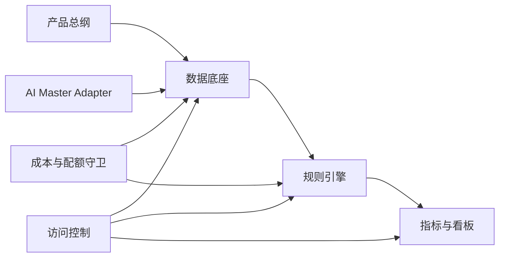

# Media Platform 3.0 文档索引

> 状态：Current  
> 作用：项目文档的唯一导航页；定义权威顺序、状态和新旧边界。  
> 更新日期：2026-09-03

## 1. 从这里开始

按任务选择入口：

1. 理解领域词汇与不可违反的事实：[`CONTEXT.md`](../CONTEXT.md)
2. 理解产品目标、模块地图和阶段：[`media-platform-3.0-overview.md`](product/media-platform-3.0-overview.md)
3. 实现数据获取与资产域：[`database-design-v2.md`](domains/data-foundation/database-design-v2.md)
4. 实现当前纵向切片：[`data-foundation-tracer`](../.kiro/specs/data-foundation-tracer/)
5. 评审后续模块设计：[`access-control`](../.kiro/specs/access-control/design.md)、[`rule-engine`](../.kiro/specs/rule-engine/design.md)、[`metrics-and-dashboard`](../.kiro/specs/metrics-and-dashboard/design.md)
6. 配置 hbecho 的服务器、OSS、密钥、Git 与部署：[`server-operations-runbook.md`](runbooks/server-operations-runbook.md)
7. 从 0 配置一台新服务器（hbdam 或其他项目）：[`new-server-bootstrap-checklist.md`](runbooks/new-server-bootstrap-checklist.md)
7. 查看自动注入但不独立裁决事实的精简规则：[`product.md`](../.kiro/steering/product.md)、[`tech.md`](../.kiro/steering/tech.md)、[`structure.md`](../.kiro/steering/structure.md)

## 2. 文档状态

| 状态 | 含义 | 是否可作为当前实现依据 |
|---|---|---|
| `current` | 已确认的当前基线 | 是，按其适用范围使用 |
| `draft` | 正在评审的提案；允许保留明确未决项 | 否；评审通过前不可当成已冻结合同 |
| `superseded` | 已被新文档替代，仅保留背景、反例和迁移线索 | 否 |
| `archived` | 历史记录、复盘或证据，不再维护 | 否；实测证据除外，见权威顺序 |

“文件较新”不自动代表“更权威”；必须以本索引标注的状态和适用范围为准。

## 3. 冲突时的权威顺序

1. [`CONTEXT.md`](../CONTEXT.md)：已确认领域词汇、语义边界和不变量。
2. [`database-design-v2.md`](domains/data-foundation/database-design-v2.md)：数据获取与资产域的当前实施基线。
3. [AI Master API V1.2](../aimaster接口文档/FieldShortcut%20A%20Master%20API%20开发文档%20V1.2.md) 与 [`raw3`](../aimaster接口文档/测试结果/raw3/)：外部合同与实测证据。文档与实测冲突时，raw3 只证明“样本中观察到的行为”，不能外推为供应商长期合同。
4. `.kiro/specs/*`：各模块的当前需求、设计和任务；不得静默改写前 3 项事实。
5. [`media-platform-3.0-overview.md`](product/media-platform-3.0-overview.md)：产品方向、模块边界和路线图，不承载表级实现。
6. `superseded` 与 `archived` 文档：只用于追溯，不参与当前实现裁决。

`.kiro/steering/` 是上述权威内容的精简、always-included 派生规则，不新增独立事实层级，也不能覆盖本节。修改 steering 时必须同步核对其来源文档；发生漂移时，以本索引及前述权威来源为准并修正 steering。

若当前 Spec 与领域不变量或 v2 基线冲突，先停止实现并显式修订文档；不得通过代码或局部 SQL 暗中选择一方。

## 4. 五类项目文档

| 类别 | 目录 | 承载内容 | 不应承载 |
|---|---|---|---|
| 产品文档 | `docs/product/` | 目标、非目标、模块地图、阶段、依赖 | DDL、接口逐字段说明 |
| 架构与领域 | `CONTEXT.md`、`docs/domains/`、`docs/architecture/` | 领域语义、模块边界、实施基线、必要 ADR | 单次任务清单 |
| Kiro Specs | `.kiro/specs/<feature>/` | 可验收需求、实现设计、执行任务 | 全项目巨型总设计 |
| Runbook 与证据 | `docs/runbooks/`、`aimaster接口文档/` | 运维步骤、供应商合同、fixture 与实测记录 | 未标状态的产品决策 |
| 历史归档 | `docs/archive/`、`项目历史文档/` | superseded 方案、旧稿、复盘 | 当前实现依据 |

`docs/architecture/` 与 `docs/runbooks/` 在出现首份有效内容时创建；不以空目录或占位文档制造虚假完备度。

## 5. 当前权威矩阵

| 范围 | 文档 | 状态 | 说明 |
|---|---|---|---|
| 数据底座领域语言 | [`CONTEXT.md`](../CONTEXT.md) | current | 只含词汇、语义和不变量，不加入表名、框架或接口决策 |
| 产品总纲 | [`media-platform-3.0-overview.md`](product/media-platform-3.0-overview.md) | current | 产品目标、模块地图、依赖、阶段和待决策清单 |
| Kiro steering | [`product`](../.kiro/steering/product.md) · [`tech`](../.kiro/steering/tech.md) · [`structure`](../.kiro/steering/structure.md) | current（derived） | 从本索引、总纲、CONTEXT 与 v2 提炼的自动注入规则；无独立裁决权 |
| 数据底座数据库 | [`database-design-v2.md`](domains/data-foundation/database-design-v2.md) | current | 28 表实施基线；v1 不参与新实现 |
| 数据底座 tracer | [requirements](../.kiro/specs/data-foundation-tracer/requirements.md) · [design](../.kiro/specs/data-foundation-tracer/design.md) · [tasks](../.kiro/specs/data-foundation-tracer/tasks.md) | draft | 首个 Design-First 纵向切片；AI Master 是内部适配器 |
| 访问控制 | [`design.md`](../.kiro/specs/access-control/design.md) | draft | 认证、Capability、DataScope、异步任务撤权语义 |
| 规则引擎 | [`design.md`](../.kiro/specs/rule-engine/design.md) | draft | 消费 v2 终态快照；规则、证据和重算归规则域所有 |
| 指标与看板 | [`design.md`](../.kiro/specs/metrics-and-dashboard/design.md) | draft | 依赖规则 outcome；统一口径、投影、报表、看板与导出 |
| 服务器与部署运维 | [`server-operations-runbook.md`](runbooks/server-operations-runbook.md) | current | hbecho 专属：ECS/OSS 资产、系统与 MySQL 配置、密钥、Git、部署、备份、监控与验收。文档顶部 §待办清单 是搭建期待办的唯一入口 |
| 新服务器从 0 配置 | [`new-server-bootstrap-checklist.md`](runbooks/new-server-bootstrap-checklist.md) | current | 项目无关的可复用清单，供 hbdam 或任何新项目使用。内容来自 hbecho 一次实际执行，每条经过验证 |
| AI Master 外部合同 | [V1.2 文档](../aimaster接口文档/FieldShortcut%20A%20Master%20API%20开发文档%20V1.2.md) | evidence | 认证、异步、游标等仍有合同缺口 |
| AI Master 实测 | [`raw3`](../aimaster接口文档/测试结果/raw3/) | evidence | 25 个成功样本；不覆盖完整异步、失败、快手全链路 |

## 6. 模块依赖

主交付顺序是 `数据底座 tracer → 最小访问控制闭环 → 规则引擎 → 指标与看板`。访问控制和成本守卫是横切关口，不得被某个业务模块复制实现。

## 7. 当前 Spec 路线图

| 顺序 | Spec | 验收结果 |
|---:|---|---|
| 1 | `data-foundation-tracer` | 抖音、小红书各一个账号从入口解析到主页、首屏、检查点和媒资进度可查询 |
| 2 | `access-control` | 真实用户可在最小 Capability + DataScope 闭环下查询、手工同步和下载/导出 |
| 3 | `rule-engine` | 对冻结快照与归属上下文完成版本化判定、证据和原子重算 |
| 4 | `metrics-and-dashboard` | 同一投影下点检表、看板和导出共享唯一指标口径 |

不创建覆盖全项目的巨型 Spec。每个 Spec 必须有独立可验收边界；跨域只通过明确契约连接。

## 8. 历史资料

### 8.1 已明确替代

| 文档 | 状态 | 当前替代 |
|---|---|---|
| [`database-design-v1.md`](archive/data-foundation/database-design-v1.md) | archived | [`database-design-v2.md`](domains/data-foundation/database-design-v2.md) |
| [`data-supply-mvp.md`](archive/data-foundation/data-supply-mvp.md) | superseded | v2 + `data-foundation-tracer` |
| [`data-supply-and-assets.md`](archive/data-foundation/data-supply-and-assets.md) | superseded | v2 + `data-foundation-tracer` |

两份 superseded 数据供给稿仍可用于追溯 parser fixture、错误分类、反腐层、限流/熔断和 raw-before-parse 的早期思路，但其中的旧表名、旧状态、旧组织模型和 API 假设均不得直接实现。

### 8.2 Spec 重写输入

以下文件仍位于 `项目历史文档/` 或根目录，只作为新 Spec 的历史输入：

- `项目历史文档/media-platform-3.0-模块设计-规则引擎.md`
- `项目历史文档/media-platform-3.0-模块设计-指标与看板.md`
- `项目历史文档/media-platform-3.0-模块设计-权限中心.md`
- `域E-用户与权限详细设计.md`
- `域E-用户与权限详细设计-评审意见.md`
- `项目历史文档/media-platform-3.0-平台底座首版产品设计.md`
- `项目历史文档/media-platform-3.0-设计大纲.md`

`项目历史文档/` 以及根目录两份域 E 文件是为保留既有外部引用而暂留的**受控历史位置例外**；每份都必须有 `superseded/archived` 头并由本索引登记。新归档不得继续放入这些位置，应进入 `docs/archive/`。若未来移动这些 legacy 文件，必须同步修复全部引用。

这些文件中的结论只有被当前总纲或 `.kiro/specs/*` 明确吸收后才生效。

## 9. 变更规则

1. 修改领域词义或不变量：先更新 `CONTEXT.md`，并检查所有受影响 Spec。
2. 修改数据底座物理模型：更新 v2，记录迁移影响；不可在下游 Spec 复制出平行主档。
3. 新功能：创建小而可验收的 `.kiro/specs/<feature>/`，优先纵向切片。
4. 难以逆转且存在真实取舍的跨模块决定：在 `docs/architecture/adr/` 创建 ADR；普通实现细节不建 ADR。
5. 被替代文档不得删除；新归档或可安全迁移的文件移动到 `docs/archive/`，在文首标明状态、替代文档和禁止用途。`项目历史文档/` 与根目录域 E 的 legacy 例外按 §8.2 管理，不得扩张。
6. 所有链接使用工作区相对路径；移动文件后必须检查断链和旧路径引用。

## 10. 尚未冻结的跨模块决定

- 最终 `RoleCode`，包括是否保留 `dealer_staff` 名称；
- `User ↔ MediaStaff` 首版是否严格一对一；
- Branch 范围是否还需与显式品牌 grant 求交；
- Store 的 dealer/brand/sector 是否不可变，以及历史组织归属快照归谁所有；
- User 登录手机号采用明文还是 `ciphertext + lookup HMAC`；
- AI Master 生产执行采用统一模式还是按 action 配置同步/异步 capability；
- 供应商正式 QPS、并发、价格、失败/轮询计费和 SLA；
- 应用框架、ORM/迁移工具、队列实现。

未决项必须保持可见，不得在代码或文档示例中被悄悄“默认确认”。
