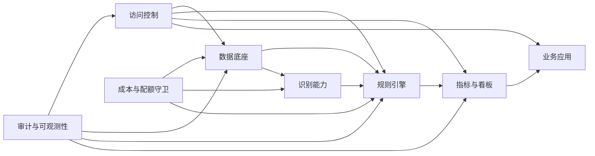

# Media Platform 3.0 项目总纲

> **状态**：`current`  
> **文档类型**：产品总纲  
> **适用范围**：产品目标、模块地图、依赖、建设阶段与跨模块决策边界  
> **不承载**：表结构、供应商逐字段合同、模块内部算法和实施任务  
> **更新日期**：2026-09-02

## 1. 文档定位

Media Platform 3.0 面向海信、日立、约克、科龙等品牌的新媒体运营团队，把“账号与内容数据获取 → 业务规则判定 → 指标度量 → 报表与看板 → 业务执行”串成一条可追溯链路。

本总纲回答四个问题：

1. 平台解决什么问题、不解决什么问题；
2. 各模块拥有什么事实、通过什么契约协作；
3. 为什么按当前顺序建设多个小而可验收的 Spec；
4. 哪些决定已经确认，哪些必须保持未决。

文档导航、状态和冲突裁决以 [`docs/INDEX.md`](../INDEX.md) 为准。数据底座的领域词汇以 [`CONTEXT.md`](../../CONTEXT.md) 为准，物理实施基线以 [`database-design-v2.md`](../domains/data-foundation/database-design-v2.md) 为准。

## 2. 产品目标

### 2.1 一句话目标

建立一个内部、渐进开放的新媒体运营平台：先形成可信的数据家底，再让业务以版本化规则定义考核，以唯一指标口径查看结果，并保证任何查询、导出、下载、Worker 或 AI 工具都不能绕过访问范围和成本边界。

### 2.2 首版必须形成的五项能力

| 目标 | 可验收结果 |
|---|---|
| 可信数据家底 | 组织、门店、专员、平台账号、内容、观察快照、列表出现和正式媒资具有稳定身份与历史语义；供应商原始事实可在保留期内重放 |
| 可解释的业务判定 | 考核项由业务别名、版本化规则和达标方式组成；判定能解释输入、版本、实际求值路径和技术待定原因 |
| 唯一指标口径 | 点检表、看板和导出读取同一冻结投影；比率、观察时点、分母与数据质量不在各页面重复实现 |
| 受控访问 | 每个真实用户有独立会话；Capability 与 DataScope 正交；当前查看权限与历史业务归属分开；撤权后异步任务不能继续扩大处理或交付范围 |
| 成本与运行可控 | 供应商调用、媒资下载和高成本识别可计量、限流、审计和人工止损；默认测试不产生付费调用 |

### 2.3 中长期价值

当上述基础稳定后，平台可逐步承载活动点检、账号档案、内容库、任务闭环、优秀内容复用、学习成长和受限 AI 工具。后续能力必须复用同一数据底座、规则结果、指标语义和授权出口，不得另建影子业务事实。

## 3. 非目标

当前阶段明确不做：

- 自研社媒爬虫；数据通过商用供应商适配层获取；
- 覆盖全项目的一次性巨型 Spec 或一次性上线所有模块；
- 跨企业 SaaS 多租户；
- 为当前规模提前引入重型湖仓、流处理或大数据栈；
- 动态角色设计器、任意 ABAC、个人权限覆盖、通用临时提权和通用审批平台；
- 公开注册、复杂资质入驻、全员 SSO/MFA/设备中心；
- 完整 DAM、多云抽象、全量视频无差别归档或复杂转码平台；
- 财务级 FinOps、内部结算和自动成本分摊；
- 自研基础大模型，或让 Agent 绕过内部服务直接查询数据库；
- 在本总纲复制数据底座 28 表、规则 DSL、指标 schema 或供应商字段字典。

当真实流程、风险或人工成本达到阈值时，上述能力应以新的独立 Spec 立项，而不是提前藏入当前模块。

## 4. 已确认规模与边界

### 4.1 参考规模

当前数据底座以以下规模作为设计参考：

- 约 2,000 个经销商；
- 约 3,000 个门店；
- 约 3,500 名新媒体专员；
- 约 6,000 个跨平台账号；
- 账号规模在 10,000 以内不改变总体架构；
- 目标内容平台为抖音、小红书、视频号、快手。

数据规模本身不是首要瓶颈。更重要的约束是供应商配额与合同、媒资下载流量与 OSS 容量，以及视觉/ASR/多模态调用成本。

### 4.2 产品开放方式

平台按内部小范围逐步开放设计。首期不提供公开注册；平台运营通过受控流程创建或导入用户，用户使用一次性凭证激活并自行设置密码。只有内部 service principal 的数据准备阶段可以早于完整用户开放，但真实用户查询、手工同步、导出和下载前必须具备最小访问控制闭环。

### 4.3 三类身份必须分离

| 概念 | 所属域 | 含义 |
|---|---|---|
| `User` | 访问控制域 | 可登录平台、拥有 Session、Capability 和 DataScope 的主体 |
| `MediaStaff` | 数据底座 | 某人在特定门店与品牌下的业务身份，不是跨门店自然人档案 |
| `ExternalAccount` | 数据底座 | 抖音、小红书、视频号或快手上的稳定平台账号 |

访问控制域只读引用数据底座的业务主档，不得重建 `Staff`、平台账号或账号归属平行表。数据底座的 `monitoring_enabled` 只决定采集，不决定用户能否登录或查看数据。

## 5. 产品与架构原则

1. **稳定身份与观察快照分离**：账号、内容等稳定根不承载会变化的昵称、文本和指标；业务判断绑定具体观察快照。
2. **原始事实先于解释**：供应商请求/响应 body 或传输错误先可靠落入私有 ODS OSS，再由版本化适配器解释；原始事实保留一年，长期业务快照与正式媒资不随之删除。
3. **历史事实不被当前状态改写**：账号转移、组织调整、current 指针变化或旧批次迟到，都不能回写既有归属和历史结果。
4. **能力原子化，规则版本化**：识别能力提供版本化信号；规则求值保持纯净、可解释、可重算。
5. **代价感知执行**：先用低成本结构化条件缩小候选，再请求媒资或高成本识别；试运行不产生未批准付费调用。
6. **口径唯一**：比率上卷分子和分母后再计算；互动指标必须显式携带观测基准；数据质量不能伪装成业务零。
7. **Capability 与 DataScope 正交**：先回答“能否执行动作”，再回答“能访问哪些对象”；每类资源必须注册独立 ScopeStrategy，未注册默认拒绝。
8. **长任务可恢复且不扩大权限**：HTTP 只下单和查状态；任务幂等、带租约与 fencing；异步有效范围为提交时范围与执行时当前范围的交集，交付前再次复查。
9. **外部合同按证据等级管理**：API 文档、fixture 观察和生产 capability 分开；未实测平台或 action 不因枚举存在就自动开放。
10. **模块拥有自己的事实**：跨模块通过语义接口和版本 token 协作，不跨域直接写表，不复制主档。

## 6. 模块地图与事实所有权

| 模块 | 拥有的事实与职责 | 依赖/输出 | 当前文档 |
|---|---|---|---|
| 访问控制 | User、Session、固定角色到 Capability 的映射、Grant、DataScope、授权审计 | 只读引用业务主档；为所有入口与出口提供授权决定 | [design](../../.kiro/specs/access-control/design.md) |
| 数据获取与资产 | 组织与业务身份、平台账号与标识、归属、同步、ODS、主页/内容快照、发现、评论、正式媒资与质量问题 | 向规则和指标提供版本化事实；AI Master 只是内部 Provider Adapter | [v2](../domains/data-foundation/database-design-v2.md) · [tracer](../../.kiro/specs/data-foundation-tracer/) |
| 识别与派生信号 | OCR、ASR、视觉和其他版本化派生特征；以正式媒资和模型/参数版本为输入 | 向规则返回 ready/waiting/unavailable，不拥有业务判定 | 后续独立 Spec |
| 规则与考核 | 活动公共范围、考核项、规则版本、算子注册、运行、判定、证据、参与资格与 outcome set | 读取终态快照和历史归属；输出冻结结果给指标域 | [design](../../.kiro/specs/rule-engine/design.md) |
| 指标、报表与看板 | 指标定义版本、观察策略、投影与血缘、三张表、看板配置、异步导出 | 消费规则 outcome 和数据底座观察；所有查询应用当前 DataScope | [design](../../.kiro/specs/metrics-and-dashboard/design.md) |
| 业务应用 | 活动点检、账号档案、内容库、任务下发与执行闭环 | 编排上述模块，不复制规则、指标或授权逻辑 | 后续独立 Spec |
| 学习与 AI | 学习内容、课程、测验、受限内容辅助和取数工具 | 继承指标语义、Capability、DataScope、审计和成本守卫 | 后置；按真实需求拆 Spec |
| 运维治理 | 配置白名单、可观测性、质量问题、配额、备份与恢复 | 横切但不替代各域状态机 | 随具体能力立项 |

## 7. 关键业务链路

### 7.1 数据底座 tracer

```text
平台 + MediaStaff + 主页入口
→ 最多 3 次受控解析
→ ExternalAccount 与官方标识
→ AccountAssignment
→ 主页快照
→ 首个完整列表页
→ ContentSnapshot + ContentDiscovery
→ 初始 SyncCheckpoint
→ 头像/背景/封面异步归档
→ 查询本地任务与质量状态
```

AI Master API 位于这条链路内部。同步/异步、认证和游标按 capability 配置与证据门控，不单独先建设大而全的 API 模块。

### 7.2 从数据到考核和看板

```text
终态内容/主页快照 + discovery/assignment 上下文
→ 版本化规则与代价感知求值
→ 可解释 Judgement 与参与资格
→ Campaign Outcome Set 原子激活
→ 指标投影冻结观察基准与历史归属
→ 全量数据表 / 命中业务明细表 / 点检表
→ 看板与受控异步导出
```

数据底座提供事实，规则域提供业务结论，指标域提供口径和展示投影。任何下游都不能用 current 主档重新解释历史归属。

### 7.3 受控用户访问

```text
一次性激活 → 独立 Session → Capability 检查 → 资源专属 DataScope
→ 查询/手工同步/规则配置/导出
→ Worker 以提交范围 ∩ 当前范围执行
→ 下载、文件、AI 或导出交付前再次授权
→ 追加写审计
```

## 8. 依赖与横切关口



### 8.1 进入真实用户试点前的最小安全门槛

- 独立用户身份、可撤销 Session 和一次性激活；
- 固定角色映射到 `resource.action` Capability；
- 账号/内容/规则/指标/导出各自注册 ScopeStrategy；
- 手工同步、原始载荷、手机号、媒资、导出和下载有显式权限；
- Worker 不伪造超级管理员，所有最终出口复查权限；
- 用户、授权、规则、导出、敏感读取和高成本操作可追溯。

### 8.2 进入高成本调用前的最小成本门槛

- action/platform/mode capability 有证据等级；
- 调用预算、并发、重试上限和人工开关可配置；
- 试运行只读已有缓存；
- 未批准的 smoke、回溯或全量识别默认拒绝；
- 供应商调用、模型调用、缓存命中和失败重试可计量。

## 9. Design-First Spec 路线图

| 阶段 | Spec/工作包 | 目标 | 进入下一阶段的门槛 |
|---:|---|---|---|
| 0 | 文档与事实基线 | `CONTEXT.md`、v2、AI Master V1.2/raw3 和权威索引边界一致 | 不再以旧表或旧组织模型作为当前事实 |
| 1 | `data-foundation-tracer` | 抖音、小红书各一个账号完成入口到首屏、检查点和媒资进度的离线可验收链路 | 原始字节先落 ODS；身份与归属幂等；状态可查；默认零付费测试 |
| 2 | 最小 `access-control` | 开放真实用户所需的认证、Capability、DataScope、审计与异步撤权闭环 | 手工同步、查询、下载和导出不存在授权旁路 |
| 3 | `rule-engine` | 业务配置考核项并对冻结快照完成可解释、版本化判定 | 技术缺失不变成业务未命中；新 run 原子激活；结果可重放 |
| 4 | `metrics-and-dashboard` | 三张表、看板与导出共享唯一投影和观察口径 | 同一 token 下数值一致；比率可上卷；DataScope 收缩立即生效 |
| 5 | 业务应用 | 用真实活动串起配置、执行、点检、下钻与任务闭环 | 一个真实活动端到端完成且申诉可解释 |
| 6 | 识别、学习与 AI 增强 | 按已验证需求增加视觉/ASR、学习和受限 AI 工具 | 成本、权限、质量与评测各有独立验收 |

阶段 1 与最小访问控制的详细设计可以并行，但内部 service principal 可先完成 tracer；任何真实用户开放必须经过阶段 2。规则必须建立在数据底座稳定事实上，指标与看板必须建立在规则 outcome 上。

## 10. 当前成功标准

### 10.1 数据底座

- 抖音与小红书各有一个完全离线可复现 tracer fixture；
- 主页入口不被当作账号身份，昵称不参与身份绑定；
- 已返回首屏全部处理，前三项只标可能置顶；
- 每次供应商提交、轮询、分页和重试分别形成 ProviderCall；
- ODS 失败时不生成可靠业务事实；
- 结构化快照可先终态化，媒资进度独立推进；
- 普通失败不改变 ExternalAccount 生命周期状态。

### 10.2 访问控制

- 授权模块不返回 SQL，而返回可由资源适配器解释的语义 DataScope；
- 当前查看权限和历史归属分开；
- 导出、下载、Worker 与 AI 都不能成为越权旁路；
- 未注册资源策略和无法映射的范围默认拒绝。

### 10.3 规则与指标

- 规则输入固定到终态快照、discovery/assignment 和版本化媒资/特征；
- 技术失败、等待依赖、不适用和业务未命中互不混淆；
- 分子始终属于统一参与资格分母；
- 比率先上卷组件再计算；
- 点检表、看板和导出在同一投影 token 下返回一致值与质量状态。

## 11. 文档权威关系

本总纲不重复维护详细事实。当前实现必须沿以下入口读取：

| 需要判断的内容 | 权威入口 |
|---|---|
| 领域词汇和不变量 | [`CONTEXT.md`](../../CONTEXT.md) |
| 文档状态与冲突顺序 | [`docs/INDEX.md`](../INDEX.md) |
| 数据底座表、约束、状态和事务 | [`database-design-v2.md`](../domains/data-foundation/database-design-v2.md) |
| AI Master 书面合同与实测 | [V1.2](../../aimaster接口文档/FieldShortcut%20A%20Master%20API%20开发文档%20V1.2.md) · [`raw3`](../../aimaster接口文档/测试结果/raw3/) |
| 当前功能需求、设计和任务 | 对应 `.kiro/specs/<feature>/` |
| 历史方案与复盘 | `docs/archive/` 与 `项目历史文档/`；不得直接实施 |

## 12. 风险与待决策

### 12.1 P0：相关模块实施前必须确认

1. AI Master 的 canonical 认证方式、各 action 的同步/异步能力、正式 QPS、并发、SLA、计费与轮询失败合同；
2. 哪些 Home locator 解析策略会产生 captured terminal `media_user_info` payload；凡已产生者必须直接复用，未产生者才允许一次独立 profile fetch，并为每种策略锁定 ProviderCall 数；
3. User 与 MediaStaff 首版是否严格一对一，以及“本人”范围如何建立稳定映射；
4. Branch 范围是否还与显式品牌 grant 求交；
5. Store 的 dealer/brand/sector 是否不可变；若可变，长期 `AttributionSnapshot` 的 owner 与冻结时点；
6. 内容考核按 discovery/采集时归属还是发布时间归属；多 discovery/共创的计数粒度；
7. 参与专员分母是否排除同步异常，以及异常如何单独披露；
8. `n_day_matured` 的 N、快照选择方向与容差；互动总数中 share/forward/collect 的跨平台口径。

### 12.2 可在对应 Spec 评审中确认

- 最终 `RoleCode`，尤其是否继续使用 `dealer_staff`；
- User 登录手机号采用明文还是 `ciphertext + lookup HMAC`；数据底座 `media_staff.phone` 明文基线不因此改变；
- 同一专员同平台多账号在账号型考核中的聚合方式；
- 结构化话题抽取和四平台 hashtag 归一化；
- `carried_forward` 媒资是否可用于“当前图匹配”规则及最大陈旧期；
- 规则 run 是否允许带 waiting/indeterminate 激活；
- 多平台点检表是否按 sheet/标签页拆分；
- 报表模板发布是否需要审批，导出行数、图片数、文件大小和保留期上限；
- 应用框架、ORM/迁移工具、队列、具体 OSS 厂商和部署拓扑。

未决项必须在对应设计、测试和运行配置中保持显式；没有结论时使用能力门控或默认拒绝，不以示例值代替业务决策。

## 13. 历史总纲的使用方式

旧 `media-platform-3.0-设计大纲.md` 与 `media-platform-3.0-平台底座首版产品设计.md` 继续作为历史输入，保留了旧系统教训、长期产品构想和早期模块枚举。以下内容不再从旧稿继承为当前事实：

- 固定最近 20 条、固定每周调用量或列表即含全部详情；
- 旧 `Staff`、`staff_accounts`、Dealer 组织树或当前归属回写历史；
- ODS 永久保留、供应商统一 `async=false`；
- 已冻结 NestJS、Prisma、BullMQ、Redis、RAGFlow 等具体选型；
- 旧库存量迁移属于当前数据底座范围；
- 固定四角色键或旧品牌 SQL 自动成为最终权限合同。

历史内容只有被本总纲、当前实施基线或对应 Spec 明确吸收后才生效。
